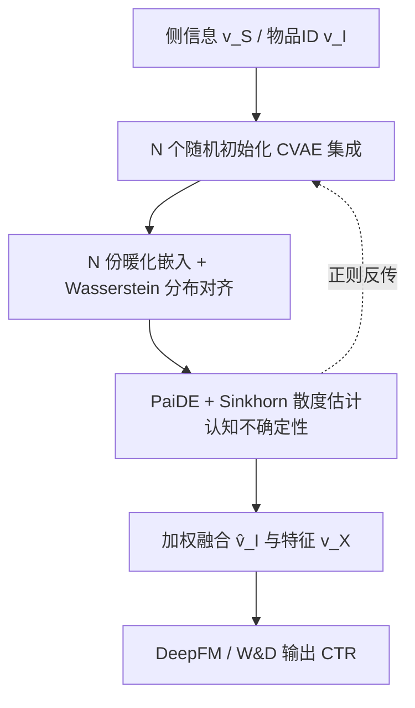
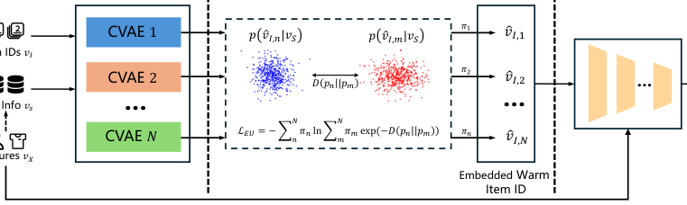
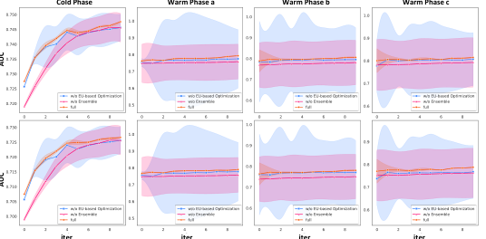

# Harnessing Light for Cold-Start Recommendations: Leveraging Epistemic Uncertainty to Enhance Performance in User-Item Interactions (借"光"破冷启动：以认知不确定性增强用户-物品交互建模)

- **会议/期刊**: CIKM 2025 (Seoul, Republic of Korea)
- **作者与机构**: Yang Xiang, Li Fan, Chenke Yin, Chengtao Ji (西安利物浦大学)；Menglin Kong (McGill University)
- **推荐链路定位**: 精排 (CTR 预估，冷启动物品嵌入暖化)
- **研究方向**: 冷启动与长尾推荐 / CTR 预估与特征交叉
- **论文原文**: [https://arxiv.org/abs/2502.16256v3](https://arxiv.org/abs/2502.16256v3)
- **开源代码**: [https://github.com/EsiksonX/CREU](https://github.com/EsiksonX/CREU)

## TL;DR (1分钟核心速览)

现有冷启动工作一味"堆知识"（多模态、内容对齐、历史交互）来丰富嵌入，却从不检验这些知识是否被模型真正用上。本文引入**认知不确定性 (epistemic uncertainty)** 作为"知识利用率"的间接度量：用 $N$ 个随机初始化的 CVAE 集成生成暖化物品嵌入，再用 PaiDE 框架以 **Sinkhorn 散度**（替代 KL/Bhattacharyya，适配非重叠分布）闭式估计集成成员间互信息，并将其作为正则项最小化。在 MovieLens-1M 与 Taobao Display Ad Click 的冷启动划分下，冷阶段 ACC/AUC 较 CVAR 提升 1.17%/1.54%（ML-1M），且暖阶段 a 已逼近暖阶段 c，说明知识被更充分吸收。

## Background & Motivation (背景与核心矛盾)

- **主流范式**: 冷启动物品推荐以"知识增强"为主线——GoRec 用多媒体内容生成隐表征、PAD-CLRec 做内容-协同双对比对齐、CVAR 用历史+新交互生成暖化 ID 嵌入，本质都是往输入/嵌入里塞更多信息。
- **前人局限**: 其一，这些方法**无法判断新增知识是否被有效利用**，大量提取出的知识闲置，冷启动收益被天花板锁死；其二，MC 采样类不确定性估计在输出维度升高时需海量采样，计算上不可行，而 PaiDE 原版用 KL/Bhattacharyya 度量，在集成成员随机初始化、分布几乎不重叠时度量失效。
- **核心洞察 (Key Insight)**: 认知不确定性是总不确定性中**可约简**的部分，恰好对应"模型对训练知识的无知程度"；因此压低它等价于逼迫模型把已有知识吃干榨净，而非继续外求新数据。
- **本文切入点**: 用集成 CVAE 制造"多视角输出"，用 Sinkhorn 散度版 PaiDE 闭式量化成员间互信息，把该量作为可微正则项直接反传优化。

## Method (核心方法设计)

### 1. 整体框架 (Overall Architecture)

CREU 分三段闭环：**(a) 集成 CVAE** 以物品侧信息 $v_S$为输入，经$N$个独立随机初始化的编码器-解码器生成$N$份暖化嵌入$\hat{v}_{I,k}$，同时用同一解码器从物品 ID 重建嵌入并以 Wasserstein 距离对齐两侧分布，弥合"内容嵌入 vs ID 嵌入"的分布鸿沟；**(b) 认知不确定性优化** 将$N$份输出视作集成成员的条件分布，用 PaiDE 结构 + Sinkhorn 散度闭式算出互信息$I(\hat{v}_I,\theta|v_S)$，作为正则项压低；**(c) 主干模型** 以权重$\pi_k$加权融合暖化嵌入$\hat{v}_I=\sum_k \pi_k\hat{v}_{I,k}$与特征$v_X$ 输入 DeepFM / W&D 输出 CTR。训练时联合优化 CTR 的 BCE 损失、Wasserstein 对齐损失与不确定性正则。

<figure class="paper-figure" markdown="span">
  <figcaption>图1：所提出的CREU模型架构。</figcaption>
</figure>

### 2. 关键设计拆解 (Key Designs)

1. **集成 CVAE 暖化 + Wasserstein 分布对齐**：单 CVAE 只能给一个确定性视角，无法支撑不确定性估计；本文用 $N$个随机初始化 CVAE 各学生成$\hat{v}_{I,k}=g_{dec,k}(z_k,x_{freq})$，并以物品频次$x_{freq}$作解码条件抑制频次偏置。由于内容侧嵌入与 ID 侧嵌入存在分布 gap，另设同构编码器从 ID 生成$\hat{v}'_{I,k}$，用$\mathcal{L}_w=\sum_k \pi_k W(\mathcal{N}(\mu_k,\Sigma_k),\mathcal{N}(\mu'_k,\Sigma'_k))$ 拉近两侧高斯分布——直觉是让"内容暖化"落在 ID 嵌入的真实流形上，避免暖化嵌入成为离群点。

2. **Sinkhorn 版 PaiDE 认知不确定性估计**：总不确定性用条件微分熵 $H(y|x)$表示，认知不确定性为互信息$I(y,\theta|x)=H(y|x)-\mathbb{E}_{p(\theta)}[H(y|x,\theta)]$。PaiDE 将其改写为成员两两距离的闭式表达：
$$I(\hat{v}_I,\theta|v_S)=-\sum_{m=1}^{N}\pi_m\ln\sum_{n=1}^{N}\pi_n\exp\left(-D(\hat{v}_{I,m}\|\hat{v}_{I,n})\right)$$
关键改动在 $D$：推荐场景数据稀疏、成员又各自随机初始化，分布近乎不重叠，KL 与 Bhattacharyya 距离在此退化；改用熵正则化的 Sinkhorn 散度$D=\mathcal{W}_\epsilon(\hat{v}_{I,m},\hat{v}_{I,n})-\tfrac{1}{2}[\mathcal{W}_\epsilon(\hat{v}_{I,n},\hat{v}_{I,n})+\mathcal{W}_\epsilon(\hat{v}_{I,m},\hat{v}_{I,m})]$，即使支撑集不相交也能稳定求值并给出有意义的梯度。

3. **训练目标、负采样与推理效率**：总损失为 $\mathcal{L}=\mathcal{L}_{CTR}+\lambda_1\mathcal{L}_w+\lambda_2 I(\hat{v}_I,\theta|v_S)$，其中$\mathcal{L}_{CTR}$为 BCE；CTR 任务天然以曝光未点击为负样本，无需额外负采样。推理时仅需前向$N$个 CVAE 与主干，$N=3$、$\epsilon=0.15$、迭代 10 次，开销约为单 CVAE 的 3 倍，属可接受量级。

## Experimental Setup & Evaluation Protocol (实验设置与评估协议)

- **数据集与预处理**: 按总交互量（ML-1M 用评分、Taobao 用点击）降序排列，前 80% 为老物品、后 20% 为新物品；新物品再按 CVAR/MWUF 同款设置切为 warm-a/b/c 与 test 四组，模拟"新物品逐步积累交互"的渐进冷启动。

| 数据集 | #Users | #Items | #Interactions | 稀疏度/密度 | 特征/场景说明 |
| :--- | :---: | :---: | :---: | :---: | :--- |
| MovieLens-1M | ~6.0K | ~3.7K | ~1.0M | 密度约 4.5% | 电影评分，含类型/年代等侧信息 |
| Taobao Display Ad Click | 规模更大（阿里展示广告日志） | 商品级 | 点击日志 | 极稀疏 | 电商展示广告，点击率为标签 |

- **数据划分与防穿越 (Splitting Strategy)**: **冷启动划分**——按物品交互量分老/新，新物品再分 warm-a→b→c→test 递进阶段，严格保证 test 阶段物品在训练中零交互。
- **排名评测协议 (Ranking Protocol)**: 采用 CTR 分类指标 **ACC 与 AUC**（非 Full-Ranking 排序指标），在冷阶段与三个暖阶段分别汇报。
- **对比基线与超参设置**: 基线含 DropoutNet、Meta-E、MWUF、CVAR，统一挂载 DeepFM 与 Wide&Deep 两种主干；嵌入维度与超参沿用原论文/官方仓库；CVAE 数 $N=3$、$\epsilon=0.15$、Adam 学习率 0.001、迭代 10 次，单卡 RTX 4090。

## Key Experimental Results (实验关键数据)

### 1. 主实验对比 (Main Results)

MovieLens-1M（DeepFM 主干，节选冷阶段与暖阶段 c）：

| Method | Cold ACC | Cold AUC | Warm-c ACC | Warm-c AUC |
| :--- | :---: | :---: | :---: | :---: |
| DeepFM | 72.67 | 62.31 | 76.94 | 66.08 |
| DropoutNet | 73.87 | 63.39 | 76.73 | 65.99 |
| Meta-E | 73.27 | 63.44 | 76.33 | 65.92 |
| MWUF | 73.16 | 62.89 | 77.01 | 66.16 |
| CVAR | 74.19 | 63.56 | 80.41 | 69.78 |
| **CREU** | **74.36** | **63.85** | **81.12** | **70.16** |
| Improv.% | +1.17% | +1.54% | +0.63% | +0.15% |

Taobao（DeepFM 主干）：CREU 冷阶段 ACC 60.03 / AUC 13.53，暖阶段 a 达 62.41 / 14.83，均优于 CVAR（59.78 / 13.47；61.98 / 14.80）；W&D 主干下暖阶段 b 的 AUC 达 15.00，为全表最优。

### 2. 消融实验 (Ablation Study)

| 变体 | 冷阶段表现 | 暖阶段表现 | 认知不确定性走势 |
| :--- | :---: | :---: | :---: |
| 单 CVAE | 基线 | 基线 | 全程几乎不变（知识未被利用） |
| 集成 CVAE | 优于单 CVAE | 优于单 CVAE | 波动大、整体偏高 |
| **CREU（集成 + 不确定性优化）** | **最优且曲线最平滑** | **最优** | **末轮收敛至极低值** |

<figure class="paper-figure" markdown="span">
  <figcaption>图2：CREU在MovieLens-1M数据集上的消融研究。（第1行：DeepFM主干，第2行：W&amp;D主干，颜色条：认知不确定性。）</figcaption>
</figure>

### 3. 关键实验发现 (Key Findings)

1. **知识利用率是可优化的一阶因素**：单 CVAE 的不确定性曲线全程平坦，说明它提取了侧信息却未消化，性能垫底；CREU 末轮不确定性收敛到极低值，对应冷阶段 ACC 提升 1.17%，直接验证"压低认知不确定性 = 提升知识利用率 = 提升冷启动性能"的因果链。
2. **暖阶段 a 逼近暖阶段 c 是核心信号**：ML-1M 上 CREU 暖阶段 a 的 ACC 79.53 已接近暖阶段 c 的 81.12，而 CVAR 为 79.27 vs 80.41，说明 CREU 在极少新交互时就能把暖化嵌入调到接近充分训练的水平，冷启动"预热期"被显著压缩。
3. **Sinkhorn 替换是必要而非装饰**：集成成员随机初始化导致分布近乎不重叠，原版 KL/Bhattacharyya 度量在此退化；改用 Sinkhorn 后不确定性估计才能稳定收敛并产生有效梯度，这是集成 CVAE 单独使用（不确定性高且波动）无法转化为性能的根本原因。

## Highlights & Limitations (亮点、对比与审稿批判)

- **与代表作对比 (vs. Prior Work)**: CVAR 只做"生成暖化嵌入"，是 CREU 的组件级前身，本文在其上加了集成与不确定性正则；Meta-E/MWUF 走元学习/多任务权重更新路线，关注"如何快速适配"而非"知识是否用尽"；DropoutNet 用 dropout 模拟冷启动物品，属输入扰动范式，三者均无显式的知识利用率度量。
- **可迁移亮点**: ① "集成 + PaiDE + Sinkhorn"是一套与任务无关的、免采样的不确定性量化插件，可直接挂到任何生成式暖化模块（如 RQ-VAE 语义 ID 生成）上做正则；② 用不确定性曲线宽度作为"知识利用率"的可视化诊断工具，可迁移到多模态融合、跨域迁移等"知识注入型"任务的调试中。
- **审稿级局限批判**: ① 评测仅用 ACC/AUC 两个分类指标，未做 Full-Ranking 排序评估，也未报告 NDCG/HR，与推荐系统主流评测口径存在偏差；② 推理需前向 $N=3$ 个 CVAE，且 Sinkhorn 迭代带来额外开销，论文未给出延迟对比；③ 冷启动划分仅按交互量 80/20 切分，未覆盖严格 zero-shot 新物品，且仅在两个数据集上验证，泛化性证据偏薄。

## Rating (四维评分)

- **方法创新性 (Novelty)**: ⭐⭐⭐⭐ （首次把认知不确定性作为"知识利用率"的代理指标引入冷启动，并用 Sinkhorn 修正 PaiDE 的非重叠分布失效问题，视角新颖但组件多为已有模块的组合）
- **评估协议与实验扎实度 (Protocol & Experiments)**: ⭐⭐⭐ （冷/暖四阶段划分合理、双主干双数据集交叉验证，但仅用 ACC/AUC、缺排序指标与显著性检验，消融以曲线呈现而非数值表）
- **写作与数学规范度 (Clarity & Rigor)**: ⭐⭐⭐⭐ （PaiDE 到 Sinkhorn 的推导链条清晰、公式与符号定义完整，但部分符号如 $\pi_k$ 的可微权重来源交代略简）
- **工业落地与复现价值 (Industrial & Practical Value)**: ⭐⭐⭐⭐ （代码已开源、仅需在现有 CVAE 暖化管线外加集成与正则，改造成本低；但 3 倍 CVAE 前向与 Sinkhorn 开销在超大规模商品库下需实测）

