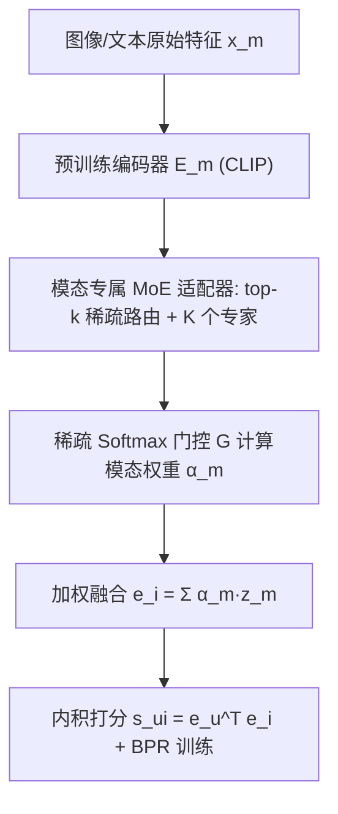
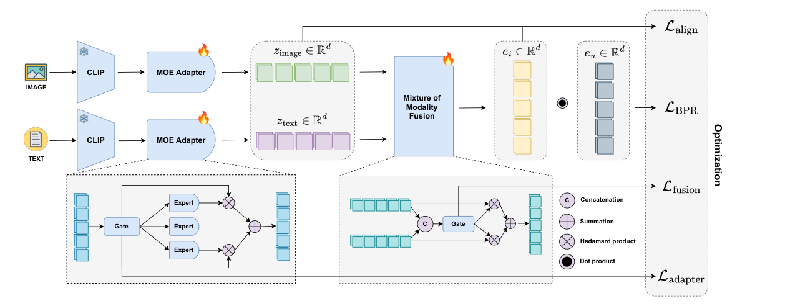

# Multi-modal Adaptive Mixture of Experts for Cold-start Recommendation (面向冷启动推荐的多模态自适应专家混合框架)

- **会议/期刊**: CIKM 2025
- **作者与机构**: Van-Khang Nguyen, Duc-Hoang Pham, Huy-Son Nguyen, Cam-Van Thi Nguyen, Hoang-Quynh Le, Duc-Trong Le（VNU University of Engineering and Technology；Delft University of Technology）
- **推荐链路定位**: 召回（冷启动物品表征与打分）
- **研究方向**: 冷启动与长尾推荐 / 多模态推荐
- **论文原文**: [https://arxiv.org/abs/2508.08042v1](https://arxiv.org/abs/2508.08042v1)
- **开源代码**: [https://github.com/L2R-UET/MAMEX](https://github.com/L2R-UET/MAMEX)

## TL;DR (1分钟核心速览)

针对物品冷启动下多模态融合"一视同仁"的痛点——拼接、平均池化、固定权重无法刻画模态间复杂关系、也无法按物品内容自适应分配重要性——本文提出 MAMEX：先用模态专属 MoE 适配器（每模态独立 Router + 独立专家池，top-$k$ 稀疏路由）精炼各模态表征，再用稀疏 softmax 门控做模态级加权融合，并辅以适配器负载均衡、融合均衡与跨模态对齐三项正则。在 Amazon Baby/Clothing/Sport 三域、完全移除测试物品交互的冷启动划分下，Recall@10 相对最强基线 MILK 分别提升 10.11%/5.75%/16.17%，NDCG@10 提升 7.75%/6.13%/20.51%。

## Background & Motivation (背景与核心矛盾)

- **主流范式**: 冷启动物品缺乏交互，主流做法是引入图像/文本等多模态内容特征，用预训练编码器（CLIP、wav2vec）抽取后融合成物品表征，再与用户向量做内积召回。
- **前人局限**: 其一，CLCRec、AlignRec、MILK 等虽引入多模态，但融合仍以拼接、平均池化或固定权重为主，隐含假设"各模态同等重要且相互独立"，无法建模跨模态交互；其二，注意力式融合在模态质量参差或缺失时缺乏鲁棒性，且无法针对不同物品动态调整模态权重——而这恰是异构内容场景的关键。
- **核心洞察 (Key Insight)**: 不同物品的信息量分布在不同模态上（服饰的视觉风格 vs. 文本的材质品牌），因此融合权重应当是**内容条件化**的；MoE 的稀疏门控天然提供了"按输入选择专家"的机制，可同时承担模态内精炼与模态间加权两个层级的自适应。
- **本文切入点**: 把 MoE 从"多任务/序列"场景迁移到多模态冷启动，构建**双层 MoE**（模态内适配器 + 模态间融合门控），并用 KL 均衡正则显式抑制专家塌缩与模态塌缩。

## Method (核心方法设计)

### 1. 整体框架 (Overall Architecture)

输入为物品 $i$的各模态原始特征$\{x_i^1,\dots,x_i^{|\mathcal{M}|}\}$，先经模态专属预训练编码器$E_m$得到$h_m=E_m(x_m)\in\mathbb{R}^d$；随后每个模态进入各自的 MoE 适配器，由 top-$k$稀疏门控在$K$个线性专家中挑选并加权求和，得到对齐后的$z_m$；融合层将各$z_m$拼接后送入稀疏 softmax 门控$G(\cdot)$产生模态权重$\alpha_m$，加权求和得最终物品向量$e_i$；用户向量$e_u$与$e_i$ 做内积打分，以 BPR 为目标联合三项正则训练。推理阶段仅需一次前向即可为新物品生成向量，无需任何交互。

<figure class="paper-figure" markdown="span">
  <figcaption>图 1：我们提出的框架 MAMEX 的总体架构。</figcaption>
</figure>

### 2. 关键设计拆解 (Key Designs)

1. **模态专属 MoE 适配器（Modality-Specific Adapter）**：痛点在于单一线性投影无法适配推荐任务、且不同模态需要不同容量的子空间。本文为每个模态 $m$配置独立 Router 与独立专家池，仅激活 top-$k$ 专家：
$$z_m=\sum_{k\in\mathcal{T}}\hat{g}_m^k(h_m)\,E_m^k(h_m),\quad \mathcal{T}=\mathrm{TopK}(g_m(h_m))$$
直觉是让每个模态在自己的专家子空间内被"再加工"，Router 与专家同时专属化带来最大特化度（后文 Table 3 验证其优于 Joint Router 与共享专家方案）。

2. **自适应模态融合 + 双重均衡正则**：融合权重由拼接后的稀疏 softmax 门控给出，$\alpha=G(z_{\text{image}}\|z_{\text{text}})$，$e_i=\sum_m \alpha_m z_m$。为防止 Router 只偏爱少数专家（专家塌缩）或只偏爱某一模态（模态塌缩），分别对 batch 内平均路由分布与平均融合权重施加 KL 散度约束至均匀分布：
$$\mathcal{L}_{\text{adapter}}=\sum_{m}D_{\mathrm{KL}}\Big(\tfrac{1}{N}\textstyle\sum_{i=1}^{N}g_m(h_m^i)\,\Big\|\,\tfrac{1}{K}\mathbf{1}\Big),\quad \mathcal{L}_{\text{fusion}}=D_{\mathrm{KL}}\Big(\tfrac{1}{N}\textstyle\sum_{i=1}^{N}\alpha^{(i)}\,\Big\|\,\tfrac{1}{m}\mathbf{1}\Big)$$
物理直觉：冷启动物品的模态质量波动大，强制均衡可避免模型退化为"单模态推荐器"，从而在模态缺失/低质时保持鲁棒。

3. **跨模态对齐损失与训练目标**：为使融合向量不丢失任一模态的语义，加入 MSE 对齐项 $\mathcal{L}_{\text{align}}=\sum_m\|e_i-z_m\|_2^2$，总损失为
$$\mathcal{L}=\mathcal{L}_{\text{BPR}}+\lambda_1\mathcal{L}_{\text{align}}+\lambda_2\mathcal{L}_{\text{adapter}}+\lambda_3\mathcal{L}_{\text{fusion}}+\lambda_4\|\Theta\|_2^2$$
负采样采用标准 BPR 三元组（每正样本配 1 个均匀负样本），无额外难负采样设计；推理零额外开销，仅多出 $|\mathcal{M}|\times K$ 个线性专家的前向。

## Experimental Setup & Evaluation Protocol (实验设置与评估协议)

- **数据集与预处理**: 三个 Amazon Reviews 子域，均含商品图像、文本描述与用户评论；论文未报告 5-core 过滤细节与精确规模统计，下表仅列可用信息：

| 数据集 | #Users | #Items | #Interactions | 稀疏度/密度 | 特征/场景说明 |
| :--- | :---: | :---: | :---: | :---: | :--- |
| Amazon Baby | 未报告 | 未报告 | 未报告 | 未报告 | 母婴，图像+文本 |
| Amazon Clothing | 未报告 | 未报告 | 未报告 | 未报告 | 服饰，视觉风格主导 |
| Amazon Sport | 未报告 | 未报告 | 未报告 | 未报告 | 运动户外，文本语义丰富 |

- **数据划分与防穿越 (Splitting Strategy)**: 按 $8:1:1$ 比例划分训练/验证/测试，并**完全移除验证集与测试集中物品的全部交互**，构造严格物品冷启动设定（Strict Item Cold-Start）。
- **排名评测协议 (Ranking Protocol)**: 采用 Recall@$\{10,20\}$与 NDCG@$\{10,20\}$；论文未显式声明是否为全库 Full-Ranking 或采样排序，从指标量级（Recall@10 约 0.05–0.10）推断为全库未交互物品排序，但缺少明确说明，属评估描述上的薄弱点。
- **对比基线与超参设置**: 基线含 MTPR、AlignRec、MetaEmbed、DropoutNet、CLCRec、GAR、MILK 共 7 个 SOTA；专家数 $K\in\{4,6,8\}$、top-$k\in\{2,3,4\}$网格搜索，学习率 0.001，$\lambda\in\{1,0.1,0.01\}$，Adam 优化；未报告显著性检验。

## Key Experimental Results (实验关键数据)

### 1. 主实验对比 (Main Results)

| 方法 | Baby R@10 | Baby N@10 | Clothing R@10 | Clothing N@10 | Sport R@10 | Sport N@10 |
| :--- | :---: | :---: | :---: | :---: | :---: | :---: |
| MTPR | 0.0130 | 0.0066 | 0.0215 | 0.0110 | 0.0146 | 0.0076 |
| AlignRec | 0.0224 | 0.0107 | 0.0425 | 0.0234 | 0.0274 | 0.0153 |
| MetaEmbed | 0.0264 | 0.0132 | 0.0352 | 0.0188 | 0.0349 | 0.0173 |
| DropoutNet | 0.0174 | 0.0083 | 0.0152 | 0.0091 | 0.0171 | 0.0089 |
| CLCRec | 0.0263 | 0.0136 | 0.0348 | 0.0181 | 0.0271 | 0.0139 |
| GAR | 0.0119 | 0.0057 | 0.0368 | 0.0206 | 0.0360 | 0.0201 |
| MILK | 0.0465 | 0.0271 | 0.0991 | 0.0571 | 0.0668 | 0.0390 |
| **MAMEX** | **0.0512** | **0.0292** | **0.1048** | **0.0606** | **0.0776** | **0.0470** |
| Improv.% | +10.11 | +7.75 | +5.75 | +6.13 | +16.17 | +20.51 |

### 2. 消融实验 (Ablation Study)

| 变体 | Baby R@20 | Baby N@20 | Clothing R@20 | Clothing N@20 | Sport R@20 | Sport N@20 |
| :--- | :---: | :---: | :---: | :---: | :---: | :---: |
| w/o MoE（换标准网络） | 0.0746 | 0.0339 | 0.1388 | 0.0647 | 0.0983 | 0.0462 |
| w/o Align（去对齐损失） | 0.0571 | 0.0260 | 0.1152 | 0.0545 | 0.0832 | 0.0399 |
| w/o MMF（改平均融合） | 0.0752 | 0.0353 | 0.1429 | 0.0679 | 0.1084 | 0.0528 |
| **MAMEX** | **0.0771** | **0.0363** | **0.1501** | **0.0729** | **0.1152** | **0.0574** |

MoE 适配器设计对比（Table 3）：Clothing 上 Joint Router / Mod-Specific / MAMEX 的 NDCG@20 为 0.2206 / 0.2207 / 0.2245；Sport 上为 0.1714 / 0.1714 / 0.1810，MAMEX 相对最强变体在 Sport 上 R@20 提升 3.61%、N@20 提升 5.60%。

### 3. 关键实验发现 (Key Findings)

1. **对齐损失是真正的命门**：去掉 $\mathcal{L}_{\text{align}}$ 后 Baby 的 R@20 从 0.0771 暴跌至 0.0571（−25.9%），跌幅远超去掉 MoE（−3.2%）与去掉自适应融合（−2.5%），说明冷启动下融合向量若偏离单模态语义流形，BPR 无法自行纠正，必须显式锚定。
2. **模态互补性成立但文本强于图像**：单模态对比中 w/o image（仅文本）在 Baby/Sport 的 R@20 为 0.0591/0.1041，均高于 w/o text（仅图像）的 0.0417/0.0861；而全模态 0.0771/0.1152 又高于任一单模态，验证融合确有增益，且图像承载的"风格/舒适度"等抽象属性弱于文本的显式语义。
3. **Router 与专家必须同时专属化**：Joint Router 与"专属 Router + 共享专家"在 Clothing 上几乎完全同分（0.0847/0.0847），只有 MAMEX 的"专属 Router + 专属专家"才拉开差距（Sport N@20 0.1810 vs. 0.1714），说明增益来源不是路由本身，而是专家子空间与模态特性的绑定。

## Highlights & Limitations (亮点、对比与审稿批判)

- **与代表作对比 (vs. Prior Work)**: 相比 MILK（同样利用多模态做冷启动，但融合方式较固定），MAMEX 的核心差异是把"融合"从静态算子升级为内容条件化的稀疏路由，且额外引入两级 KL 均衡；相比 CLCRec 的对比学习式模态对齐，本文用更轻的 MSE 对齐 + MoE 特化取得更优结果；相比 GAR/AlignRec 的注意力融合，本文在模态质量不均时通过均衡正则获得鲁棒性。
- **可迁移亮点**: ①"模态内 MoE 适配器 + 模态间门控"的双层结构可直接移植到短视频多模态召回；②对 batch 平均路由分布施加 KL 至均匀分布的写法，是抑制 MoE 塌缩的轻量通用技巧，可复用到任何多专家推荐骨干。
- **审稿级局限批判**: ①实验仅两个模态（图像+文本），摘要提及的 audio 未落地，且数据集统计、过滤规则、Full-Ranking 与否均未交代，可复现性打折；②增益主要来自对齐损失与专家特化，但缺少与"简单 MLP + 对齐损失"这一强对照的公平比较，MoE 本身的净贡献被高估的风险存在；③专家数/top-$k$网格与$\lambda$ 敏感性未给出曲线，线上延迟与参数量开销亦未讨论。

## Rating (四维评分)

- **方法创新性 (Novelty)**: ⭐⭐⭐ （双层 MoE + 双 KL 均衡的组合在冷启动多模态场景属首次系统落地，但各组件均为已有技术的迁移拼装，缺少理论分析）
- **评估协议与实验扎实度 (Protocol & Experiments)**: ⭐⭐⭐ （三域冷启动划分严格、基线覆盖 7 个 SOTA，但数据集统计缺失、排序协议未声明、无显著性检验与超参敏感性分析）
- **写作与数学规范度 (Clarity & Rigor)**: ⭐⭐⭐ （公式与符号基本清晰、总损失组织完整，但 Table 3 指标量级与主表不一致、部分记号如 $\alpha_m\in\mathbb{R}^m$ 存在笔误）
- **工业落地与复现价值 (Industrial & Practical Value)**: ⭐⭐⭐⭐ （代码已开源，推理仅增少量线性专家前向、无交互依赖，天然适配新品上架即召回的场景）

