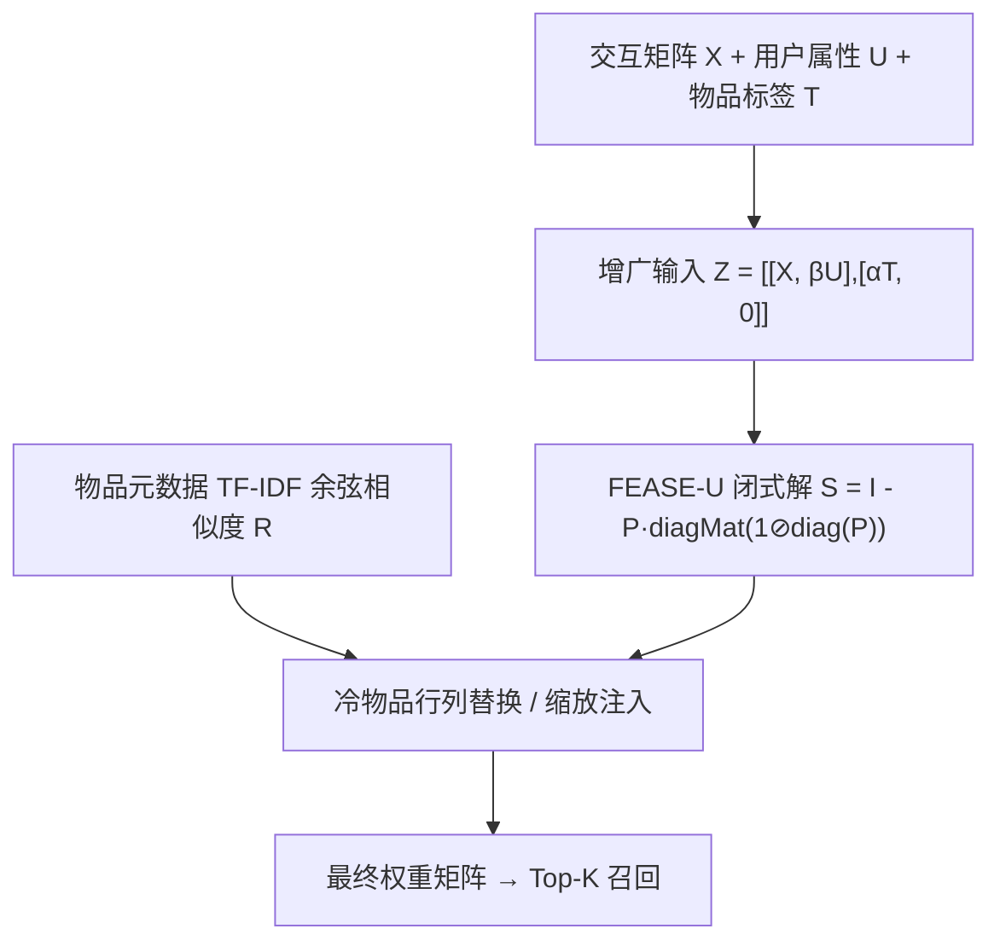

# Shallow AutoEncoding Recommender with Cold Start Handling via Side Features (基于侧特征的浅层自编码冷启动推荐)

- **会议/期刊**: CIKM 2025
- **作者与机构**: Edward DongBo Cui (DotDash Meredith), Lu Zhang, William Ping-hsun Lee (NBC Universal Peacock)
- **推荐链路定位**: 召回（Top-K 候选生成）
- **研究方向**: 冷启动与长尾推荐 / 协同过滤
- **论文原文**: [https://arxiv.org/abs/2504.02288v4](https://arxiv.org/abs/2504.02288v4)
- **开源代码**: 暂未开源（正文附 NumPy 实现片段）

## TL;DR (1分钟核心速览)

EASE 仅依赖交互矩阵，冷用户/冷物品在权重矩阵中得分恒为 0 或近 0，天然无法冷启动。本文提出 FEASE 家族：把用户属性 $U$、物品标签$T$以权重$\alpha,\beta$拼入输入矩阵$Z$，使闭式解自动为冷用户生成分段级表征（FEASE-U）；再以 TF-IDF 内容相似度矩阵$R$ 作为冷物品权重的贝叶斯先验，通过联合优化或行/列替换注入（FEASE-I）。在 Netflix/MovieLens/Amazon Books 的冷用户+冷物品划分上，FEASE-U 在 Netflix 全量 HR@20 达 0.4342（EASE 0.4230），冷用户 HR@20 从 0.0322 跃升至 0.3107，且热物品性能无损。

## Background & Motivation (背景与核心矛盾)

- **主流范式**: EASE 以 $\hat{X}=XB$、$\mathrm{diag}(B)=0$的线性自编码器建模物品-物品相似度，闭式解$P=(X^\top X-\lambda I)^{-1}$ 高效且强于多数神经 CF；CEASE/MARec 已尝试引入物品侧信息。
- **前人局限**: 其一，CEASE 仅把物品标签拼入输入，冷物品在 $X^\top X$ 中对应行列全零，闭式解仍给出无信息权重；其二，现有工作从未在同一框架内同时评估用户与物品双冷启动，且引入侧信息常以牺牲热物品精度为代价。
- **核心洞察 (Key Insight)**: 从贝叶斯视角看，冷物品的似然 $p(X|B,\sigma^2)$为常数，后验退化为先验$p(B)$——冷物品得分完全由先验决定，因此"给冷物品一个内容先验"才是正解，而非继续堆叠输入特征。
- **本文切入点**: 用输入矩阵增广解决冷用户，用相似度先验/替换解决冷物品，二者共享同一闭式解框架。

## Method (核心方法设计)

### 1. 整体框架 (Overall Architecture)

模型分三支：FEASE-U 将交互、用户属性、物品标签拼成稀疏矩阵 $Z$后直接套用 EASE 闭式解，冷用户因属性行非零而获得分段级权重；FEASE-I 先用 EASE 求热物品权重$B$，再将内容相似度矩阵$R$按冷物品行列替换/缩放注入；FEASE 将两者串联——先解 FEASE-U 得$\hat{S}$，再对$\hat{S}$的$M\times M$块执行冷物品替换。另提供 FEASE-Prior 变体，把$R'$ 作为正则先验与主损失联合优化，同样有闭式解。全流程仅需一次矩阵求逆，无梯度迭代。

### 2. 关键设计拆解 (Key Designs)

1. **FEASE-U：增广输入解决冷用户**：冷用户在 $X$中整行为零，EASE 无法给出任何偏好。将$Z=\begin{bmatrix}X & \beta U\\ \alpha T & 0\end{bmatrix}$代入原目标$\|Z-ZS\|_F^2+\lambda\|S\|_F^2$，闭式解形式不变，仅$P=(Z^\top Z+\lambda I)^{-1}$。直觉是：用户属性行与物品标签行的内积为冷用户提供了"属性-标签"共现通道，等价于把用户按属性分段后做段级协同，故冷用户获得非零、可解释的得分。

2. **FEASE-I：内容相似度作为冷物品先验**：针对冷物品后验退化为先验的问题，引入 $\delta\|B-R\|_F^2$ 得联合优化解
$$\hat{B}=P(X^\top X+\delta R)-P\cdot\mathrm{diagMat}\big(\mathrm{diag}(P(X^\top X+\delta R))\oslash \mathrm{diag}(P)\big),\quad P=(X^\top X+(\lambda+\delta)I)^{-1}$$
但联合优化会拖累热物品，故作者更推荐解耦启发式：热物品用 EASE 的 $B$，冷物品行列直接用 min-max 重标定后的$R$替换（乘缩放因子$\delta$），实现零热物品损伤的冷启动扶持。

3. **训练目标、负采样与推理效率**：总损失即上述带先验的 Frobenius 回归，**无负采样**（全隐式 0/1 矩阵重构）；推理为一次 $O(M^3)$ 矩阵求逆加一次稀疏-稠密乘，与 EASE 同阶，工业可离线日更。

## Experimental Setup & Evaluation Protocol (实验设置与评估协议)

- **数据集与预处理**: 构造冷用户（仅出现在验证/测试集）与冷物品（训练集完全不可见），并为缺侧特征的数据集人工构造用户特征（评分分桶、星期几、小时）：

| 数据集 | #Cold Users | #Cold Items | 用户特征 | 物品特征 |
| :--- | :---: | :---: | :--- | :--- |
| Netflix | 19,388 | 1,004 | 星期几、评分数 | 标签、年份、描述 |
| MovieLens | 11,474 | 1,103 | 星期几、小时、评分数 | 标签 |
| Amazon Books | 1,480 | 1,000 | 星期几、评分数、评论数 | 标签 |

- **数据划分与防穿越 (Splitting Strategy)**: 冷启动划分——冷用户/冷物品仅保留在验证与测试集，训练集严格不可见；Netflix 上同一用户按交互上下文（星期几）拆分为多个虚拟用户。
- **排名评测协议 (Ranking Protocol)**: Top-K 全库排序，报告 HR@20/50、Recall、NDCG、ECS（有效目录规模，衡量多样性）及 ColdHR@K（冷物品命中率）。
- **对比基线与超参设置**: Popularity / Popularity(seg)、MFBPR、DropoutNet、FM、EASE、CEASE、MARec；相似度用 TF-IDF + 余弦；$\alpha,\beta,\lambda,\delta$ 网格调参，FEASE-I 刻意偏向冷物品以展示多样性-精度权衡。

## Key Experimental Results (实验关键数据)

### 1. 主实验对比 (Main Results)

Netflix 全量测试集（含冷用户与冷物品），@20：

| Model | HR@20 | Recall@20 | NDCG@20 | HR@50 |
| :--- | :---: | :---: | :---: | :---: |
| Popularity(seg) | 0.2106 | 0.0545 | 0.0867 | 0.3527 |
| DropoutNet | 0.2915 | 0.0832 | 0.1222 | 0.4584 |
| FM | 0.3111 | 0.0960 | 0.1320 | 0.4818 |
| EASE | 0.4230 | 0.1426 | 0.2033 | 0.5598 |
| CEASE | 0.4230 | 0.1426 | 0.2033 | 0.5598 |
| MARec | 0.4248 | 0.1434 | 0.2044 | 0.5614 |
| **FEASE-U** | **0.4342** | **0.1450** | **0.2080** | **0.5764** |
| FEASE | 0.4209 | 0.1378 | 0.1848 | **0.5792** |

MovieLens 上 FEASE-U 的 HR@20 达 **0.4965**（EASE 0.4569，相对提升 8.7%），HR@50 达 **0.6222**（EASE 0.5684，+9.5%）；Amazon Books 上 FEASE-U HR@20 为 **0.2052**（EASE 0.2012）。

冷用户子集（Netflix，@20）：EASE/CEASE/MARec 的 HR 仅 0.0322，**FEASE-U 达 0.3107**，FEASE 同为 0.3107，逼近 DropoutNet 的 0.3625 但热用户性能远优。

冷物品（Netflix，@20）：EASE ColdHR 仅 0.00004，**FEASE-I 达 0.07621**，FEASE 为 0.06240；MovieLens 上 FEASE-I ColdHR@20 为 0.02910（EASE 0.0005 量级）。

### 2. 消融实验 (Ablation Study)

| 配置 | 全量 HR@20 | 冷用户 HR@20 | 冷物品 ColdHR@20 | ECS@20 |
| :--- | :---: | :---: | :---: | :---: |
| EASE（基线） | 0.4230 | 0.0322 | 0.00004 | 587.3 |
| + 物品标签输入 (CEASE) | 0.4230 | 0.0322 | 0.00004 | 588.0 |
| + 用户属性输入 (FEASE-U) | 0.4342 | 0.3107 | ≈0 | 541.8 |
| + 冷物品替换 (FEASE-I) | 0.4004 | 0.0322 | 0.07621 | 611.5 |
| 二者合并 (FEASE) | 0.4209 | 0.3107 | 0.06240 | 577.9 |
| FEASE-Prior（$\delta$ 增大） | 单调下降 | — | 单调上升 | — |

### 3. 关键实验发现 (Key Findings)

1. **物品侧信息拼入输入 ≠ 解决冷物品**：CEASE 与 FEASE-U 均含物品标签，但 ColdHR 与 EASE 几乎相同（0.00004），图 1 显示冷物品权重分布紧贴 0——证明冷物品必须靠先验注入而非输入增广。
2. **用户侧信息是冷用户的关键杠杆**：仅加用户属性即把冷用户 HR@20 从 0.0322 拉至 0.3107（约 10 倍），且全量 HR 反升 2.6%，说明属性-标签通道对热用户也无害。
3. **精度-多样性存在可调旋钮**：FEASE-I 以全量 HR 下降约 5%（0.4230→0.4004）换取 ColdHR 提升三个数量级与 ECS 提升（587→611），图 2 表明替换式注入比联合优化（-Prior）在同等冷物品曝光下热物品损失更小。

## Highlights & Limitations (亮点、对比与审稿批判)

- **与代表作对比 (vs. Prior Work)**: 相比 CEASE 仅做输入拼接，本文指出冷物品后验退化问题并显式构造先验；相比 MARec 的对齐式闭式解，本文用行/列替换实现零热物品损伤；相比 DropoutNet/FM，本文在冷用户上略逊但热用户精度高出 30% 以上，且无需训练。
- **可迁移亮点**: ①"冷物品得分 = 先验"的贝叶斯诊断可直接用于解释任何线性/浅层召回模型的冷启动失效；②按上下文拆分虚拟用户以构造用户特征，是低成本增强冷用户表征的实用技巧。
- **审稿级局限批判**: ①相似度仅用 TF-IDF 余弦，未验证 LLM/多模态嵌入，先验质量上限未探明；②冷用户评估依赖人工构造的上下文特征（星期几等），在无此类元数据的场景下 FEASE-U 增益可能大幅缩水；③$O(M^3)$ 求逆在千万级物品库需分块近似，论文未讨论规模化开销。

## Rating (四维评分)

- **方法创新性 (Novelty)**: ⭐⭐⭐ （贝叶斯视角诊断冷物品失效颇具洞察，但整体仍是 EASE 的增广与正则化组合，算子层面增量有限）
- **评估协议与实验扎实度 (Protocol & Experiments)**: ⭐⭐⭐⭐ （三数据集、冷用户/冷物品/全量三视角 + ECS 多样性 + 超参扫描曲线，覆盖完整；缺显著性检验与采样排序对照）
- **写作与数学规范度 (Clarity & Rigor)**: ⭐⭐⭐⭐ （闭式解推导完整、附 NumPy 代码，符号清晰；部分表格数值排版有缺失，公式编号与正文偶有错位）
- **工业落地与复现价值 (Industrial & Practical Value)**: ⭐⭐⭐⭐ （无梯度训练、单次求逆、$\delta$ 可作冷启动扶持旋钮，工程落地门槛极低；未开源完整仓库略减分）

