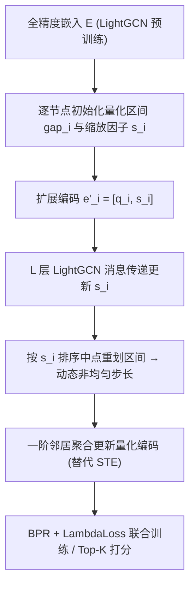

# A Node-Aware Dynamic Quantization Approach for Graph Collaborative Filtering (面向图协同过滤的节点感知动态量化方法)

- **会议/期刊**: CIKM 2025
- **作者与机构**: Lin Li, Chunyang Li, Yu Yin, Xiaohui Tao, Jianwei Zhang（武汉理工大学、华为、南昆士兰大学、岩手大学）
- **推荐链路定位**: 召回（图协同过滤的嵌入压缩与部署）
- **研究方向**: 协同过滤与双塔召回 / 图神经网络推荐
- **论文原文**: [论文原文链接](https://arxiv.org/abs/2508.16516v1)
- **开源代码**: [开源代码仓库链接](https://github.com/WUT-IDEA)

## TL;DR (1分钟核心速览)

图协同过滤（GCF）的参数量几乎全部集中在节点嵌入表上，直接套用 CV/NLP 的均匀量化会忽略图结构，在消息传递中累积误差。本文提出 GNAQ：把每个节点的 $2^n$ 个量化区间缩放因子拼进节点嵌入，借 GNN 消息传递端到端学习**节点级非均匀量化步长**，并用一阶邻居聚合替代直通估计器（STE）更新量化编码。在 4 个数据集、2-bit 量化下，Recall@10 平均较 BiGeaR/N2UQ 提升 27.8%、NDCG@10 提升 17.6%，模型体积压缩 8–12 倍，训练时间约为蒸馏类基线的一半。

## Background & Motivation (背景与核心矛盾)

- **主流范式**: LightGCN 类 GCF 把全部参数放在用户/物品嵌入表 $E\in\mathbb{R}^{N\times d}$，靠多层邻接归一化传播聚合高阶协同信号；量化即压缩这张表。
- **前人局限**: ① BiGeaR、N2UQ、GPTQ 等沿用全局或逐层均匀量化，所有节点共享同一量化尺度，无法适配节点嵌入分布的强异质性（热门物品与长尾物品的嵌入范数差异巨大）；② 量化函数是分段常值、几乎处处导数为 0，传统 STE 的梯度与量化目标不一致，收敛慢且误差在多层消息传递中被放大。
- **核心洞察 (Key Insight)**: 节点嵌入的分布本身由交互图决定，因此量化尺度不应是超参而应是**可学习的图节点属性**——把它当作嵌入的一部分参与传播，就能让量化区间随邻居结构自适应。
- **本文切入点**: 用参数共享思想把量化步长"藏"进节点编码，用消息传递而非 STE 来完成量化参数的梯度更新。

## Method (核心方法设计)

### 1. 整体框架 (Overall Architecture)

GNAQ 以预训练 LightGCN 的全精度嵌入表初始化，为每个节点 $i$计算初始均匀量化区间$gap_i=(\max(e_i)-\min(e_i))/2^b$，得到离散码$q_i$与$2^b$个区间中点缩放因子$s_i$；将$[q_i, s_i]$拼接为扩展编码$e'_i\in\mathbb{R}^{d+2^b}$输入 GNN，经$L$ 层对称归一化邻接传播后，缩放因子被更新，再按排序后的中点重划区间得到**非均匀**步长；前向用缩放因子查表还原量化值，反向用一阶邻居聚合更新量化编码，最后以 BPR + LambdaLoss 联合优化。

### 2. 关键设计拆解 (Key Designs)

1. **节点感知参数共享量化（Node-Aware Parameter Sharing）**：痛点是不论节点度数高低都共用一套量化尺度。GNAQ 为每个节点分配 $2^b$个缩放因子并拼入编码，使量化函数本身成为可学习参数：$e'_i=[q_i,s_i]\in\mathbb{R}^{d+2^b}$，$H^{(0)}=[E'_{quant},S]$。直觉上这等价于给每个节点一套"私有码本"，长尾节点不再被热门节点的尺度挤压。

2. **动态步长更新（Dynamic Quantization Step, DQS）**：初始区间均匀，训练后缩放因子 $s'_1,\dots,s'_{2^b}$被更新，取其相邻中点与分布边界作为新分界，重划出$2^b$个长度不等的区间：$s_i=\big[\min_i+\tfrac{gap_i}{2},\ \min_i+\tfrac{3gap_i}{2},\dots\big]$。这样量化误差在嵌入密集区更细、稀疏区更粗，贴合重尾分布。

3. **图关系感知梯度估计（RAU）与训练目标**：量化函数不可微，GNAQ 不估梯度，而是把量化编码视作分配矩阵，反向传播后用一阶聚合 $\hat{e}_i=\frac{1}{|\mathcal{N}_i|}\sum_{j\in\mathcal{N}_i}e_j$重新量化，既规避 STE 偏差又抑制"Z 字形"振荡，起正则作用。总损失$\mathcal{L}=\mathcal{L}_{BPR}+\mathcal{L}_{Lambda}$，负采样为标准 BPR 三元组（1 正 1 负均匀采样），推理时仅需 2-bit 码表 + FP8 缩放因子查表，无额外开销。

## Experimental Setup & Evaluation Protocol (实验设置与评估协议)

- **数据集与预处理**: MovieLens、Gowalla、Yelp2020、Amazon-Book，均沿用 LightGCN/LEGCF 官方 10-core 版本划分。

| 数据集 | #Users | #Items | #Interactions | 稀疏度/密度 | 特征/场景说明 |
| :--- | :---: | :---: | :---: | :---: | :--- |
| MovieLens | ~6.0k | ~3.7k | ~1.0M | 较稠密 | 电影评分，二值化隐式反馈 |
| Gowalla | ~29.9k | ~40.98k | ~1.03M | 稀疏 | LBS 签到 |
| Yelp2020 | ~42.7k | ~26.8k | ~1.8M | 中等 | 本地商户评论 |
| Amazon-Book | ~52.6k | ~91.5k | ~2.98M | 最稀疏 | 图书购买 |

- **数据划分与防穿越 (Splitting Strategy)**: 沿用 LightGCN 官方 `Leave-One-Out` 划分（每用户最后一条交互为测试、倒数第二条为验证），属固定切分而非时间戳切分。
- **排名评测协议 (Ranking Protocol)**: 采用 `Full-Ranking` 全库未交互物品排序，报告 Recall@{10,20} 与 NDCG@{10,20}；训练负采样为每正样本 1 个均匀负样本。
- **对比基线与超参设置**: 基线含全精度 LightGCN、量化方法 BiGeaR / N2UQ / GPTQ、轻量参数共享 LEGCF；嵌入维度 $d\in\{64,128,256\}$，GNN 层数 3，Adam 优化器，学习率$5\times10^{-4}\sim10^{-3}$，$\lambda=5\times10^{-4}$，量化位宽固定 2-bit。

## Key Experimental Results (实验关键数据)

### 1. 主实验对比 (Main Results)

以 128 维（论文主推设置）为例，Full-Ranking 下各数据集 Recall@10 / NDCG@10：

| Model | MovieLens R@10 | MovieLens N@10 | Gowalla R@10 | Gowalla N@10 | Yelp2020 R@10 | Yelp2020 N@10 | Amazon R@10 | Amazon N@10 |
| :--- | :---: | :---: | :---: | :---: | :---: | :---: | :---: | :---: |
| LightGCN (FP) | 0.1658 | 0.2855 | 0.1101 | 0.0901 | 0.0426 | 0.0284 | 0.0215 | 0.0172 |
| BiGeaR | 0.1551 | 0.3894 | 0.1229 | 0.1331 | 0.0503 | 0.0433 | 0.0219 | 0.0177 |
| N2UQ | 0.1272 | 0.2889 | 0.1188 | 0.1291 | 0.0350 | 0.0399 | 0.0188 | 0.0198 |
| GPTQ | 0.0867 | 0.0949 | 0.0414 | 0.0440 | 0.0131 | 0.0111 | 0.0067 | 0.0076 |
| LEGCF | 0.0737 | 0.1523 | 0.0979 | 0.0846 | 0.0310 | 0.0214 | 0.0156 | 0.0134 |
| **GNAQ (Ours)** | **0.2287** | **0.5261** | **0.1576** | **0.1635** | **0.0686** | **0.0624** | **0.0242** | **0.0204** |
| Improv.% (vs 最优基线) | +47.4% | +13.7% | +28.2% | +22.8% | +36.4% | +44.1% | +10.5% | +3.03% |

256 维下 GNAQ 在 Yelp2020 的 NDCG@10 较 GPTQ 高 48%，且全面超过全精度 LightGCN（如 MovieLens R@10 0.2353 vs 0.1708）。

### 2. 消融实验 (Ablation Study)

128 维、Gowalla 与 Yelp2020 上的组件移除结果：

| 变体 | Gowalla R@20 | Gowalla N@20 | Yelp2020 R@20 | Yelp2020 N@20 |
| :--- | :---: | :---: | :---: | :---: |
| GNAQ 完整 | **0.1750** | **0.1643** | **0.0779** | **0.0643** |
| w/o DQS | 0.1613 | 0.1263 | 0.0708 | 0.0431 |
| w/o RAU | 0.1424 | 0.0973 | 0.0518 | 0.0274 |
| w/o rank_loss | 0.1689 | 0.1245 | 0.0740 | 0.0432 |

### 3. 关键实验发现 (Key Findings)

1. **RAU 是最大贡献项**：移除后 Yelp2020 Recall@20 从 0.0779 跌至 0.0518（−33.5%），远超 DQS 的 −9.1%，说明"用邻居聚合替代 STE"不只是梯度技巧，而是量化精度的主要来源。
2. **rank_loss 只提排序不提召回**：去掉后 Gowalla Recall@20 仅降 3.5% 而 NDCG@20 降 24.2%，验证 LambdaLoss 对列表内次序的定向增益，与 BPR 形成互补而非冗余。
3. **稠密图收益更大、维度越高越占优**：MovieLens（最稠密）在 128 维取得 +47.4% Recall@10 的最大提升；Gowalla 64 维时 NDCG@20 反落后 BiGeaR 9.8%，作者归因为低维下邻居信息不足使 RAU 失效——这暴露了方法对图密度的敏感性。

## Highlights & Limitations (亮点、对比与审稿批判)

- **与代表作对比 (vs. Prior Work)**: BiGeaR 走"二值化 + 知识蒸馏"，需重训全精度教师，Amazon-Book 训练耗时 298k 秒；N2UQ 把非均匀量化转成均匀量化，仍全局共享尺度；LEGCF 用参数共享压缩但无量化。GNAQ 首次把量化尺度做成**图上的可学习节点属性**，直接优化量化模型，训练时间约为 BiGeaR 的 45%。
- **可迁移亮点**: ① "把超参拼进嵌入、让消息传递去学"这一参数共享范式可迁移到任何图上的逐节点阈值/温度/门控学习；② 用邻居聚合替代 STE 的思路可用于其他不可微离散算子的反向传播。
- **审稿级局限批判**: ① 参数量并非最优——GNAQ 为 $O(N(d+128))$，在 Amazon-Book 上训练时间 133k 秒仍高于 N2UQ 的 32k 秒，且参数量高于 LEGCF，"8–12 倍压缩"仅相对全精度而言；② 仅在 2-bit 与 3 层 LightGCN 上验证，缺少 1/4/8-bit 扫描与 STE 消融的直接对照，且 Gowalla 64 维的负提升说明方法对稀疏低维场景鲁棒性不足，缺少理论误差界分析。

## Rating (四维评分)

- **方法创新性 (Novelty)**: ⭐⭐⭐⭐ （把量化步长重构为图节点可学习属性并用消息传递更新，视角新颖，但缺少理论误差界）
- **评估协议与实验扎实度 (Protocol & Experiments)**: ⭐⭐⭐⭐ （4 数据集 × 3 维度 × Full-Ranking + 消融 + 资源分析较完整，但缺位宽扫描与 STE 直接对照）
- **写作与数学规范度 (Clarity & Rigor)**: ⭐⭐⭐ （公式与符号基本清晰，但 Eq.16 中 $\eta_{ij}$ 两种情形均写作 1 属明显笔误，部分符号前后不一致）
- **工业落地与复现价值 (Industrial & Practical Value)**: ⭐⭐⭐⭐ （2-bit 查表推理、8–12 倍压缩、训练提速 2 倍，代码已开源，边缘部署价值明确）

