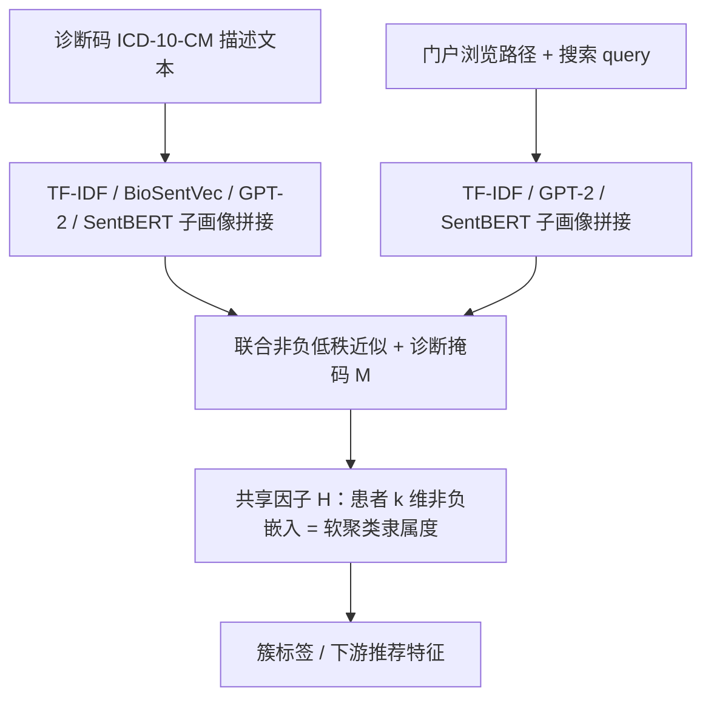

# Patient Clustering via Integrated Profiling of Clinical and Digital Data (临床与数字数据联合画像的患者聚类)

- **会议/期刊**: CIKM 2023 (Short Paper)
- **作者与机构**: Dongjin Choi, Haesun Park (Georgia Tech) / Andy Xiang, Ozgur Ozturk, Deep Shrestha, Hamid Haidarian, Faizan Javed (Kaiser Permanente) / Barry Drake (GTRI)
- **推荐链路定位**: 召回（用户表征 + 软聚类分群）
- **研究方向**: 协同过滤与双塔召回 / 冷启动与长尾推荐
- **论文原文**: [https://arxiv.org/abs/2308.11748v1](https://arxiv.org/abs/2308.11748v1)
- **开源代码**: 暂未开源

## TL;DR (1分钟核心速览)

医疗场景下患者诊断码极度稀疏（1.8 万码库、人均仅 10 条、5% 患者零诊断），且传统画像只吃临床数据、丢弃门户浏览/搜索信号。本文把 ICD-10-CM 描述文本（TF-IDF + BioSentVec + GPT-2 + SentenceBERT 四路子画像）与浏览/搜索文本画像拼接，构造**掩码约束的非负低秩近似**目标，共享因子 $\mathbf{H}$同时充当患者$k$ 维非负嵌入与软聚类隶属度。在 Kaiser Permanente 真实门户数据（30,690 患者、652 万浏览、8.5 万搜索）上，18 簇下 Silhouette 达 0.416（NMF-only 0.216），推荐任务 ROC-AUC 80.92%（次优 GPT-2 75.14%）。

## Background & Motivation (背景与核心矛盾)

- **主流范式**: 患者分群长期依赖诊断码独热/文本嵌入 + K-means；画像推荐则用交互历史学用户向量。两条线各自为战。
- **前人局限**: ① 诊断码稀疏且存在"未确诊≠无病"的开放世界语义，纯文本嵌入（SentBERT/GPT-2）在 18,000 码库上聚类轮廓系数仅 0.012–0.076；② 门户浏览/搜索行为蕴含健康关注意图，但现有临床聚类完全弃用，冷启动患者（5% 零诊断）无表征可用。
- **核心洞察 (Key Insight)**: 诊断、浏览、搜索是同一患者的三种"视图"，应共享同一低维隐空间；且非负分解天然对应软聚类隶属度，一箭双雕。
- **本文切入点**: 用**共享因子矩阵 $\mathbf{H}$+ 视图专属基$\mathbf{W}_j$** 的联合非负低秩近似替代"先嵌入再 K-means"的两段式流程，并对诊断视图施加观测掩码以区分开放/封闭世界假设。

## Method (核心方法设计)

### 1. 整体框架 (Overall Architecture)

对每位患者分别构造三张画像矩阵：诊断画像 $\mathbf{P}_d$（TF-IDF、BioSentVec、GPT-2、SentenceBERT 四子画像 Min-Max 归一后纵向拼接）、浏览画像$\mathbf{P}_b$、搜索画像$\mathbf{P}_s$（后两者仅用 TF-IDF/GPT-2/SentenceBERT）。三矩阵列对齐到同一患者，送入带掩码的联合非负低秩分解，交替更新$\mathbf{W}_d,\mathbf{W}_b,\mathbf{W}_s,\mathbf{H}$至收敛；$\mathbf{H}$ 的列即患者嵌入，其列内最大元素下标即簇标签，无需二次聚类。

### 2. 关键设计拆解 (Key Designs)

1. **多视图共享隐空间的联合非负分解**：痛点是把三类异构画像硬拼接会淹没稀疏诊断信号。本文让每个视图拥有独立基矩阵、只共享患者因子：
$$\min_{\mathbf{W}_d,\mathbf{W}_b,\mathbf{W}_s,\mathbf{H}\geq 0}\ \|\mathbf{P}_d-\mathbf{W}_d\mathbf{H}\|_F^2+\alpha_b\|\mathbf{P}_b-\mathbf{W}_b\mathbf{H}\|_F^2+\alpha_s\|\mathbf{P}_s-\mathbf{W}_s\mathbf{H}\|_F^2$$
直觉：$\mathbf{H}\in\mathbb{R}^{k\times N}_+$被三视图共同"拉扯"，迫使诊断语义与行为意图在同一$k$ 维空间对齐；非负性使每维可读作"疾病主题权重"，直接支撑软聚类解释。

2. **开放世界掩码（Bypassing Unobserved Diagnosis）**：浏览/搜索遵循封闭世界（没点=不感兴趣），诊断却是开放世界（没记录≠没病）。故引入掩码 $\mathbf{M}\in\{0,1\}^{M_d\times N}$，仅对观测项计损失：
$$\min\ \|\mathbf{M}\circ(\mathbf{P}_d-\mathbf{W}_d\mathbf{H})\|_F^2+\alpha_b\|\mathbf{P}_b-\mathbf{W}_b\mathbf{H}\|_F^2+\alpha_s\|\mathbf{P}_s-\mathbf{W}_s\mathbf{H}\|_F^2$$
$\mathbf{H}$的更新化为对堆叠矩阵$[\mathbf{M}\circ\mathbf{P}_d;\sqrt{\alpha_b}\mathbf{P}_b;\sqrt{\alpha_s}\mathbf{P}_s]$ 的 NLS 问题，按列拆解为逐患者小规模非负最小二乘。直觉：避免把"未确诊"误当负反馈压向零，保住零诊断患者的可学习性。

3. **优化与推理开销**：块坐标下降（BCD），每个子问题用 Block Principal Pivoting (BPP) 求解非负最小二乘，极限点保证为驻点。无负采样、无梯度反传；一次分解离线完成，在线仅需查表取 $\mathbf{H}$ 列，推理成本可忽略。

## Experimental Setup & Evaluation Protocol (实验设置与评估协议)

- **数据集与预处理**: Kaiser Permanente Digital 门户 2022 年匿名数据（HIPAA 合规）：

| 数据集 | #Users | #Items | #Interactions | 稀疏度/密度 | 特征/场景说明 |
| :--- | :---: | :---: | :---: | :---: | :--- |
| KPD 门户 | 30,690 | 18,000 诊断码 | 652 万浏览 + 8.5 万搜索 | 诊断人均仅 10 条，5% 零诊断 | ICD-10-CM + 页面路径 + 搜索 query |

- **数据划分与防穿越 (Splitting Strategy)**: 未采用 LOO/时间切分；聚类为全量无监督拟合，推荐任务以"采集期内是否访问心理健康 App 下载页"构造二分类标签，属**同期标签划分**（非严格时序防穿越，是本文评估短板）。
- **排名评测协议 (Ranking Protocol)**: 非排序式评估。聚类用 Davies-Bouldin（越低越好）与 Silhouette（越高越好），簇数 $k=18$ 由 Gap Statistic 确定；推荐用 XGBoost 下游分类，报告 ROC-AUC / Accuracy / Recall / Precision / F1，嵌入维度统一 128（GPT-2/SentBERT/BioSentVec 经 PCA 降至 128）。
- **对比基线与超参设置**: 聚类基线为 SentBERT / GPT-2 / BioSentVec 单独嵌入 + K-means；推荐基线含 HashGNN（图哈希，不用文本）与三种文本嵌入 + PCA。$\alpha_b,\alpha_s$ 为视图平衡因子（原文未给敏感性分析）。

## Key Experimental Results (实验关键数据)

### 1. 主实验对比 (Main Results)

聚类（表 1，$k=18$）：

| 使用数据 | 方法 | Davies-Bouldin ↓ | Silhouette ↑ |
| :--- | :--- | :---: | :---: |
| 仅诊断 | SentBERT | 8.663 | 0.019 |
| 仅诊断 | GPT-2 | 2.758 | 0.076 |
| 仅诊断 | BioSentVec | 2.458 | 0.121 |
| 仅诊断 | **NMF (本文)** | **1.434** | **0.216** |
| 诊断+浏览 | GPT-2 | 2.600 | 0.125 |
| 诊断+浏览 | **NMF (本文)** | **1.277** | **0.254** |
| 诊断+浏览+搜索 | GPT-2 | 2.913 | 0.209 |
| 诊断+浏览+搜索 | **NMF (本文)** | **1.144** | **0.416** |

推荐（表 2，单位 %，嵌入维度 128）：

| 方法 | ROC-AUC | Accuracy | Recall | Precision | F1 |
| :--- | :---: | :---: | :---: | :---: | :---: |
| HashGNN | 59.38 | 57.14 | 55.90 | 57.30 | 56.59 |
| GPT-2 (PCA) | 75.14 | 68.42 | **71.63** | 67.37 | 69.43 |
| SentBERT (PCA) | 74.29 | 67.56 | 69.65 | 66.82 | 68.21 |
| BioSentVec (PCA) | 63.59 | 59.84 | 67.05 | 58.61 | 62.54 |
| **NMF (本文)** | **80.92** | **73.05** | 70.31 | **74.41** | **72.30** |

相对次优 GPT-2：ROC-AUC **+5.78 pt**（+7.7%），F1 **+2.87 pt**（+4.1%），Precision **+7.04 pt**。

### 2. 消融实验 (Ablation Study)

原文未设独立消融表，但表 1 的"数据源逐级累加"等价于视图消融：

| 配置 | Davies-Bouldin ↓ | Silhouette ↑ | 相对仅诊断增益 |
| :--- | :---: | :---: | :---: |
| w/o 浏览、w/o 搜索（仅诊断） | 1.434 | 0.216 | — |
| w/o 搜索（诊断+浏览） | 1.277 | 0.254 | DB −10.9%，Sil +17.6% |
| Full（诊断+浏览+搜索） | **1.144** | **0.416** | DB −20.2%，Sil **+92.6%** |

### 3. 关键实验发现 (Key Findings)

1. **搜索视图是聚类质量的主引擎**：加入浏览仅把 Silhouette 从 0.216 提到 0.254（+17.6%），再叠加搜索直接跳到 0.416（+92.6%），说明主动 query 比被动点击更能刻画健康关注主题，稀疏但高信息量。
2. **联合分解显著优于"嵌入 + K-means"两段式**：同为仅诊断输入，NMF 的 Silhouette 0.216 是 BioSentVec+K-means（0.121）的 1.8 倍、SentBERT（0.019）的 11 倍，证明共享因子约束比事后聚类更能保留簇结构。
3. **嵌入质量可跨任务迁移**：同一 $\mathbf{H}$ 直接喂给 XGBoost 做心理健康 App 推荐，ROC-AUC 80.92% 反超专用图哈希 HashGNN 21.5 pt，且 Precision 74.41% 为全表最高——Recall 略逊 GPT-2（70.31 vs 71.63）说明本文嵌入偏保守精确，适合高误推代价的医疗场景。

## Highlights & Limitations (亮点、对比与审稿批判)

- **与代表作对比 (vs. Prior Work)**: 相比 HashGNN（图结构哈希、无文本语义）与纯文本嵌入 + K-means（表征与聚类割裂），本文是首个把**临床码文本 + 门户行为文本**纳入同一非负低秩框架的工作；与经典 NMF 聚类（Kim & Park 系列）的区别在于多视图共享因子 + 开放世界掩码，而非单矩阵分解。
- **可迁移亮点**: ① "开放世界掩码 vs 封闭世界全量"的双假设建模，可直接搬到电商（曝光缺失≠不感兴趣）与内容冷启动场景；② 非负共享因子天然给出可解释软聚类，适合需要人群洞察 + 推荐双交付的工业管线。
- **审稿级局限批判**: ① 推荐评估用同期二分类标签而非时序留出/全库排序，存在标签泄漏与乐观偏差风险，且仅一个下游任务、无重复实验与显著性检验；② 三视图权重 $\alpha_b,\alpha_s$与簇数$k$ 缺乏敏感性分析，BCD+BPP 在百万级患者上的收敛时间与内存未报告，工业可扩展性存疑。

## Rating (四维评分)

- **方法创新性 (Novelty)**: ⭐⭐⭐ （多视图共享因子 + 开放世界掩码的组合在医疗画像中较新，但 NMF/BCD/BPP 均为成熟组件的工程化整合，理论增量有限）
- **评估协议与实验扎实度 (Protocol & Experiments)**: ⭐⭐⭐ （真实 3 万患者工业数据可贵，但缺时序切分、缺显著性检验、缺超参敏感性与独立消融表）
- **写作与数学规范度 (Clarity & Rigor)**: ⭐⭐⭐⭐ （目标函数、掩码子问题与逐行列更新规则推导完整，符号统一，5 页短文信息密度高）
- **工业落地与复现价值 (Industrial & Practical Value)**: ⭐⭐⭐ （离线一次分解、在线查表，部署成本极低；但无开源代码、无大规模收敛性报告，复现需自备同等门户数据）

