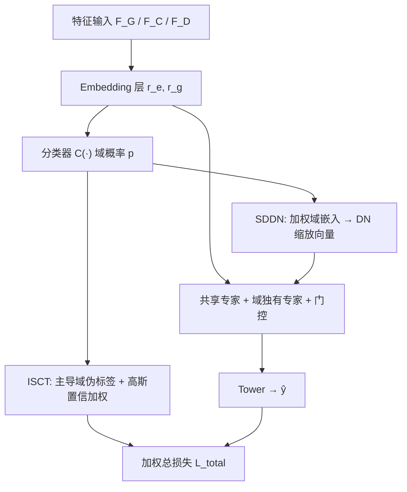
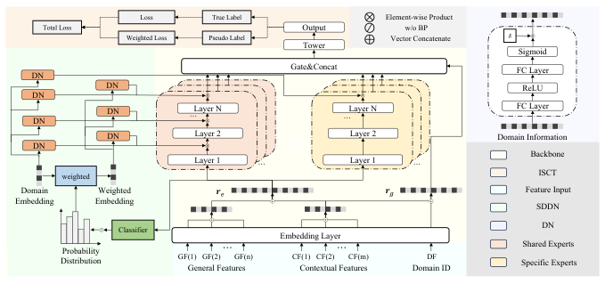

# A Soft-partitioned Semi-supervised Collaborative Transfer Learning Approach for Multi-Domain Recommendation (面向多域推荐的软分区半监督协同迁移学习)

- **会议/期刊**: CIKM 2025
- **作者与机构**: Xiaoyu Liu, Yiqing Wu, Ruidong Han, Fuzhen Zhuang, Xiang Li, Wei Lin（北航、中科院计算所、美团）
- **推荐链路定位**: 精排（多域 CTR 预估）
- **研究方向**: 跨域与多场景推荐 / CTR 预估与特征交叉
- **论文原文**: [https://arxiv.org/abs/2511.01404v1](https://arxiv.org/abs/2511.01404v1)
- **开源代码**: 暂未开源

## TL;DR (1分钟核心速览)

工业多域推荐中主导域（首页）占 81% 流量、长尾域不足 1%，共享-独有（shared-specific）架构的**硬分区**导致两个病灶：共享参数被主导域"淹没"（Overwhelming），稀疏域独有参数过拟合（Overfitting）。本文提出 SSCTL：ISCT 把主导域样本当无标签数据、用非主导域分类器打伪标签并按置信度加权回灌；SDDN 用软分区概率分布动态生成缩放向量调制共享层。在 Ali-CCP 与美团外卖数据上全库 AUC 全面最优（稀疏域 #3 相对 MLP 提升 10.23%），线上 10 天 A/B 中 GMV 提升 0.54%–2.90%、CTR 提升 0.22%–1.69%。

## Background & Motivation (背景与核心矛盾)

- **主流范式**: HMoE / STAR / CGC 等 shared-specific 架构，用域指示符把数据**硬切分**给共享专家与域独有专家，分别捕捉共性与个性。
- **前人局限**: ① 非主导域样本极少，域独有参数 $g^k$ 严重过拟合（如 Ali-CCP #3、美团 D5/D6 上 STAR 甚至劣于 MLP）；② 共享参数被主导域梯度主导，且数据极度不平衡时模型会"忽略"域指示符，进一步放大淹没效应。
- **核心洞察 (Key Insight)**: 业务上域边界本就模糊——主导域与其他域 item 重叠 74%–86%、user 重叠 91%–99%，用户跨域购买常带随机性（心情驱动），因此硬分区的前提不成立；主导域数据本身可作为非主导域的"免费"监督信号。
- **本文切入点**: 用**软分区**替代硬分区：以样本级域概率分布驱动动态参数，同时把主导域样本半监督地转成非主导域的加权伪标签数据。

## Method (核心方法设计)

### 1. 整体框架 (Overall Architecture)

骨干沿用 CGC 式结构：特征 embedding 层输出 $r_e=E(F_G)\oplus E(F_C)$送入$m$个共享专家与每域一个独有专家，门控网络以$r_g=E(F_C)\oplus E(F_D)$（上下文+域指示符拼接，而非仅域 ID）生成 softmax 权重聚合成$z$后过塔输出$\hat{y}$。在此之上挂两个模块：ISCT 在训练期用非主导域分类器$C(\cdot)$为主导域样本生成加权伪标签，扩充稀疏域监督；SDDN 复用同一$C(\cdot)$输出的域概率分布加权域 embedding，经 Differentiation Network 生成缩放向量调制每个共享层。二者共享分类器、端到端联合训练，推理时仅多一次$C(\cdot)$ 前向，开销可忽略。

<figure class="paper-figure" markdown="span">
  <figcaption>图1：SSCTL的整体框架。</figcaption>
</figure>

### 2. 关键设计拆解 (Key Designs)

1. **ISCT：主导域伪标签加权回灌（治过拟合）**：稀疏域独有参数缺监督 $\to$先在$N-1$个非主导域真实标签上训练分类器$C(\cdot)$，对主导域样本$x^d_i$取$y^d_i=\arg\max_j p^d_{i,j}$、置信度$c_i=\max p^d_i$；再用截断高斯$w_i=G(c_i)=\exp(-(c_i-\mu_t)^2/2\sigma_t^2)$（$c_i\le\mu_t$，否则取 1）软加权，$\mu_t,\sigma_t$ 由 EMA 在线估计。直觉：高斯最大熵性质使高置信样本权重趋 1、低置信样本平滑降权，避免 FixMatch 式硬阈值丢弃大量主导域数据。

2. **SDDN：软分区动态参数（治淹没）**：硬分区只用域 ID，无法表达"品类/时段/业务规则"造成的域间渐变 $\to$用$p=C(r_e)$对非主导域 embedding 加权得$e_w=\sum_j p_j E(F_d)_j$，与真实域 embedding$e_d$ 一并送入两层 DN 得缩放向量，逐层调制共享层：
$$\gamma^l_d=DN_l(e_d),\ \gamma^l_w=DN_l(e_w),\ h_l=\sqrt{\gamma^l_d*\gamma^l_w}\otimes FC_l(h_{l-1})$$
平方根保证特征尺度一致，$\delta=2$约束缩放幅度。直觉：即使样本真属主导域，$e_w$ 仍把非主导域知识注入共享参数梯度，等效于给稀疏域"加权投票权"。

3. **训练目标、负采样与推理效率**：总损失 $\mathcal{L}_{total}=\sum_{x_i\in X_d,X_o}\mathcal{L}(x_i)+\lambda\sum_{x_j\in X_p}w_j\mathcal{L}(x_j)$，$\lambda=0.7$；分类器侧用 Focal Loss 对抗域不平衡。CTR 任务为 pointwise 二分类（无负采样环节），推理仅增加一次分类器前向与逐层缩放，SDDN 为 plug-and-play 模块。

## Experimental Setup & Evaluation Protocol (实验设置与评估协议)

- **数据集与预处理**:

| 数据集 | #Users | #Items | #Interactions | 稀疏度/密度 | 特征/场景说明 |
| :--- | :---: | :---: | :---: | :---: | :--- |
| Ali-CCP | 未披露 | 未披露 | 未披露 | 未披露 | 公开点击/转化数据集，3 个域（#1 为主导域） |
| MT-takeaway | 未披露 | 未披露 | 未披露 | 未披露 | 美团外卖工业采样，6 个域（D1 主导，占 81.16%） |

- **数据划分与防穿越 (Splitting Strategy)**: 原文未明确说明划分方式（工业采样数据，按平台常规时间切分），属复现信息缺口。
- **排名评测协议 (Ranking Protocol)**: 采用 AUC 与 RImp 指标，属 pointwise 分类评估而非 Full-Ranking 排序评估；未报告采样负例比例。
- **对比基线与超参设置**: 五类基线——Single（MLP）、General（DeepFM/xDeepFM）、MTL（SharedBottom/MMoE/PLE）、MDR（HMoE/STAR/AdaSparse）、MTMDR（HiNet/PEPNet）；embedding 维度 10，隐层 [256,128,64]，Adam lr=1e-3，batch 4096，dropout 0.2，$\lambda=0.7$，显著性$p<0.05$（★）。

## Key Experimental Results (实验关键数据)

### 1. 主实验对比 (Main Results)

| 数据集/域 | MLP | DeepFM | MMoE | PLE | HMoE | STAR | PEPNet | **SSCTL** | Improv. |
| :--- | :---: | :---: | :---: | :---: | :---: | :---: | :---: | :---: | :---: |
| Ali #1 | 0.6276 | 0.6309 | 0.6305 | 0.6302 | 0.6299 | 0.6309 | 0.6298 | **0.6331★** | +0.86% |
| Ali #2 | 0.6235 | 0.6271 | 0.6243 | 0.6252 | 0.6250 | 0.6278 | 0.6250 | **0.6301★** | +1.17% |
| Ali #3 | 0.5530 | 0.6022 | 0.5853 | 0.5997 | 0.6066 | 0.5773 | 0.5990 | **0.6095★** | +10.23% |
| MT D1 | 0.6925 | 0.6925 | 0.6929 | 0.6935 | 0.6942 | 0.6938 | 0.6946 | **0.6951** | +0.38% |
| MT D2 | 0.6501 | 0.6725 | 0.6690 | 0.6747 | 0.6754 | 0.6718 | 0.6759 | **0.6783★** | +4.35% |
| MT D5 | 0.6207 | 0.6510 | 0.6445 | 0.6552 | 0.6553 | 0.6509 | 0.6552 | **0.6591★** | +6.19% |
| MT D6 | 0.6061 | 0.6700 | 0.6613 | 0.6740 | 0.6691 | 0.6669 | 0.6777 | **0.6817★** | +12.47% |

线上 A/B（美团外卖 5 域，10 天）：PVCTR +0.57%/+0.80%/+0.22%/+1.40%/+1.69%，GMV +0.54%/+1.17%/+1.63%/+2.06%/+2.90%。

### 2. 消融实验 (Ablation Study)

原文未提供显式消融表（仅以模块级定性归因替代），此处按论文证据整理：

| 配置 | 关键表现 | 说明 |
| :--- | :--- | :--- |
| w/o ISCT（仅 SDDN 类动态参数） | 稀疏域增益弱于 SSCTL | 对应 AdaSparse/PEPNet 在 D5/D6 上仍低于 SSCTL |
| w/o SDDN（仅硬分区 + ISCT） | 主导域共享参数仍被淹没 | 对应 STAR/HMoE 在 #3、D5/D6 上退化 |
| 硬阈值伪标签（FixMatch 式） | 论文论证会丢弃大量主导域样本 | 以高斯软加权替代 |

### 3. 关键实验发现 (Key Findings)

1. **稀疏域是主战场**：域越稀疏增益越大——Ali #3（+10.23%）、MT D6（+12.47%）远超主导域 #1（+0.86%）与 D1（+0.38%），说明 ISCT 的伪标签回灌精准补在了数据最缺的地方；主导域 0.002 AUC 的提升因样本量巨大而具统计显著性。
2. **硬分区在稀疏域会反噬**：STAR 在 Ali #3（0.5773）与 MT D6（0.6669）上低于 DeepFM，验证了域独有参数在少样本下的过拟合；而采用动态参数的 AdaSparse/PEPNet 明显更稳，佐证 SDDN 路线正确。
3. **软分区优于纯动态参数**：同为动态参数家族，SSCTL 在全部 9 个域上均超过 AdaSparse 与 PEPNet，说明"样本级域概率分布 + 主导域知识注入"比仅靠域 ID 生成参数信息量更足；线上 GMV 最高 +2.90% 表明离线 AUC 增益可转化为真实成交。

## Highlights & Limitations (亮点、对比与审稿批判)

- **与代表作对比 (vs. Prior Work)**: 相比 STAR/HMoE 的硬分区（域 ID 决定参数），SSCTL 用分类器概率实现样本级软分区；相比 AdaSparse/PEPNet 的纯动态参数，额外引入主导域→非主导域的半监督知识迁移；相比 FixMatch 式伪标签，用截断高斯软加权保留全部主导域数据。
- **可迁移亮点**: ① "主导域当无标签池、稀疏域当标注池"的半监督回灌范式可迁移到任何流量极不均衡的多场景/多业务建模；② 用同一分类器同时服务伪标签与动态参数生成，一份开销两处收益，工程上极友好。
- **审稿级局限批判**: ① 评估仅用 AUC/RImp 的 pointwise 协议，缺少 Full-Ranking 与校准指标，且数据集统计、划分方式均未披露，复现性存疑；② 无显式消融表与超参敏感性分析（$\lambda$、$\mu_t/\sigma_t$、$\delta$ 均未扫），且方法假设"主导域行为可迁移至非主导域"，在域间重叠低的场景（如跨 App）有效性未验证。

## Rating (四维评分)

- **方法创新性 (Novelty)**: ⭐⭐⭐⭐ （软分区 + 半监督迁移的组合在 MDR 中较新，但高斯加权与 DN 缩放分别借鉴 SoftMatch 与 STAR/AdaSparse，单点原创度中等）
- **评估协议与实验扎实度 (Protocol & Experiments)**: ⭐⭐⭐ （离线双数据集 + 10 天线上 A/B 难得，但缺消融表、缺数据统计与划分说明，评测仅 AUC）
- **写作与数学规范度 (Clarity & Rigor)**: ⭐⭐⭐⭐ （公式与模块职责清晰、图示完整，但部分符号如 $X_p$与$X_d$ 关系、EMA 更新细节略欠严谨）
- **工业落地与复现价值 (Industrial & Practical Value)**: ⭐⭐⭐⭐ （美团真实场景验证、plug-and-play、推理仅增一次分类器前向，但未开源、依赖主导域假设）

