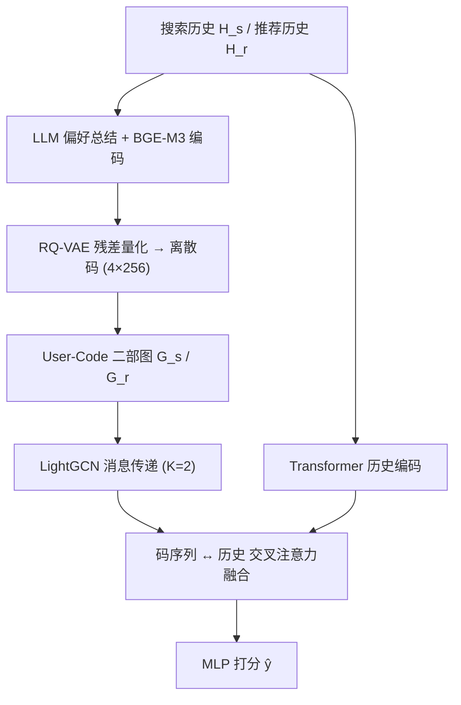

# Benefit from Rich: Tackling Search Interaction Sparsity in Search Enhanced Recommendation (从富者获益：应对搜索增强推荐中的搜索交互稀疏问题)

- **会议/期刊**: CIKM 2025
- **作者与机构**: Teng Shi, Weijie Yu, Xiao Zhang, Ming He, Jianping Fan, Jun Xu（中国人民大学高瓴人工智能学院、对外经济贸易大学、联想研究院 AI Lab）
- **推荐链路定位**: 召回（序列下一物品预测）
- **研究方向**: 跨域与多场景推荐（搜索域→推荐域迁移）/ 图神经网络推荐
- **论文原文**: [https://arxiv.org/abs/2508.04145v1](https://arxiv.org/abs/2508.04145v1)
- **开源代码**: 暂未开源

## TL;DR (1分钟核心速览)

现有搜索增强推荐（如 UniSAR）的收益高度依赖用户搜索交互的丰富度，而平台上绝大多数用户搜索行为稀疏（Qilin 上 5134/8810 用户搜索交互 <10 次），导致这些方法只惠及少数人。本文提出 GSERec：用 LLM 总结用户搜索/推荐偏好，经 RQ-VAE 离散化为码本，以共享码连接相似用户构建 User-Code 二部图，通过 LightGCN 消息传递把搜索富用户的表征传播给稀疏用户，并配三重对比损失对齐。在 3 个真实数据集、Leave-One-Out + 99 负采样协议下全面 SOTA，Qilin 上 HR@1 相对 UniSAR 提升 12.1%，且稀疏用户组增益最大（+39.25%）。

## Background & Motivation (背景与核心矛盾)

- **主流范式**: 搜索增强推荐分两路——特征级（把搜索历史拼进模型输入，如 Query-SeqRec、USER）与损失级（S&R 联合训练共享损失，如 JSR、UniSAR、SESRec）。
- **前人局限**: ① 稀疏用户的搜索历史特征本身信息量极少，拼进模型近乎噪声；② 联合训练中稀疏用户贡献的损失梯度微弱，无法有效优化其表征。二者叠加使 UniSAR 的增益随搜索交互数单调上升（图 2：搜索 >100 次用户 +39.25%，<10 次仅 +11.64%）。
- **核心洞察 (Key Insight)**: 并非所有用户都稀疏——少数搜索富用户携带高质量偏好信号，若能通过"相似用户"这一桥梁把富用户表征传播给稀疏用户，即可在不增加稀疏用户自身数据的前提下补全其表征。
- **本文切入点**: 用离散语义码（而非稠密向量）作为用户相似性的"锚点"，共享码即天然连边，从而构建轻量 User-Code 图做跨用户信息传播。

## Method (核心方法设计)

### 1. 整体框架 (Overall Architecture)

GSERec 分两阶段。**构图阶段**：LLM（DeepSeek-R1-Distill-Qwen-7B）分别总结用户的搜索偏好与推荐偏好文本，经冻结的 BGE-M3 编码为稠密向量 $\mathbf{v}_s,\mathbf{v}_r$，再由 RQ-VAE 各离散为$L=4$级码（每级码本 256）；用户与其码相连、共享码的用户间接相连，形成搜索图$G_s$与推荐图$G_r$。**建模阶段**：在两张图上做 LightGCN 消息传递得到增强的用户/码表征，再与用户原始 S&R 序列经 Transformer 编码后的历史表征做交叉注意力融合，最终拼接送入 MLP 预测下一物品。

### 2. 关键设计拆解 (Key Designs)

1. **RQ-VAE 偏好量化 + 量化前对齐（$L_{\text{RQ-CL}}$）**：痛点在于稠密偏好向量无法直接定义"用户相似"，且搜索/推荐两路偏好语义空间错位。做法是量化前先用 InfoNCE 对齐同一用户的$\mathbf{z}_s,\mathbf{z}_r$：$L_{\text{RQ-CL}}=-\big[\log\frac{\exp(\text{sim}(\mathbf{z}_s,\mathbf{z}_r)/\tau_1)}{\sum_{\mathbf{z}^-_r}\exp(\text{sim}(\mathbf{z}_s,\mathbf{z}^-_r)/\tau_1)}+\text{对称项}\big]$，再做残差量化$s_l=\arg\min_k\|\mathbf{r}_{l-1}-\mathbf{e}_k\|_2^2,\ \mathbf{r}_l=\mathbf{r}_{l-1}-\mathbf{e}_{s_l}$。直觉：对齐后同一用户的搜索码与推荐码语义一致，共享码才真正代表"兴趣相同"而非"碰巧撞码"。

2. **User-Code 图消息传递（替代 User-Item 图）**：痛点在于传统 LightGCN 的 User-Item 图节点数为 $|\mathcal{U}|+|\mathcal{I}|$，物品量级巨大且稀疏用户连边极少。本文改为$|\mathcal{U}|+L\cdot N_c$个节点（$L,N_c\ll|\mathcal{U}|$），传播算子沿用对称归一化：$\mathbf{e}^{(k)}_u=\sum_{s\in\mathcal{N}_u}\frac{1}{\sqrt{|\mathcal{N}_u||\mathcal{N}_s|}}\mathbf{e}^{(k-1)}_s$，最终取各层均值。直觉：码是"兴趣簇"的高层抽象，一个稀疏用户只要命中某个富用户也命中的码，就能一跳获得该簇的聚合信号，等效于稠密化其邻域。

3. **用户级与历史级双重对齐 + 融合**：消息传递后搜索/推荐两图可能传播冗余信息，故加 $L_{\text{U-CL}}$对齐$\mathbf{e}^s_u,\mathbf{e}^r_u$（式 9）；码序列与历史序列再做$L_{\text{His-CL}}$对齐（式 13），最后以历史为 Query、码序列为 Key/Value 做 MCA 融合。总损失$\mathcal{L}_{\text{Total}}=\mathcal{L}_{\text{rec}}+\lambda_{\text{U-CL}}L_{\text{U-CL}}+\lambda_{\text{His-CL}}L_{\text{His-CL}}+\lambda_{\text{Reg}}\|\Theta\|^2$，其中$\mathcal{L}_{\text{rec}}$ 为 BCE；负样本全部为 in-batch 负采样，无额外硬负采样。LLM 推理离线完成，在线仅跑推荐模型。

## Experimental Setup & Evaluation Protocol (实验设置与评估协议)

- **数据集与预处理**:

| 数据集 | #Users | #Items | #Queries | #Inter-S | #Inter-R | 说明 |
| :--- | :---: | :---: | :---: | :---: | :---: | :--- |
| CDs | 75,258 | 64,443 | 671 | 852,889 | 1,097,592 | Amazon 5-core，半合成搜索行为 |
| Electronics | 192,403 | 63,001 | 982 | 1,280,465 | 1,689,188 | Amazon 5-core，半合成搜索行为 |
| Qilin | 15,482 | 1,983,938 | 44,820 | 969,866 | 1,438,435 | 小红书真实 S&R 行为，仅用文本模态 |

- **数据划分与防穿越**: 全部数据集采用 `Leave-One-Out`（最后一项测试、倒数第二项验证），与前作 UniSAR/SESRec 一致。
- **排名评测协议**: `Sampled Ranking`——每个 ground-truth 配 99 个用户未交互过的随机负样本构成 100 候选列表，报告 HR@{1,5,10} 与 NDCG@{5,10}。
- **对比基线与超参**: 基线含 9 个纯推荐模型（LightGCN/SGL/SimGCL/GRU4Rec/SASRec/BERT4Rec/CL4SRec/KAR/LLM-ESR）与 7 个搜索增强模型（NRHUB/Query-SeqRec/JSR/USER/SESRec/UnifiedSSR/UniSAR）。嵌入维度 $d=64$（CDs/Electronics）、$d=32$（Qilin），LightGCN 层数$K=2$，温度$\tau=0.1$，显著性用$t$-test（$p<0.05$，表中 `*` 标注）。

## Key Experimental Results (实验关键数据)

### 1. 主实验对比 (Main Results)

| 类别 | 模型 | CDs H@1 | CDs N@5 | Elec. H@1 | Elec. N@5 | Qilin H@1 | Qilin N@5 |
| :--- | :--- | :---: | :---: | :---: | :---: | :---: | :---: |
| 推荐 | SASRec | 0.1621 | 0.2907 | 0.1019 | 0.1608 | 0.1334 | 0.2411 |
| 推荐 | CL4SRec | 0.1834 | 0.3240 | 0.1052 | 0.1684 | 0.1363 | 0.2455 |
| 推荐 | LLM-ESR | 0.2079 | 0.3648 | 0.1055 | 0.1817 | 0.1422 | 0.2532 |
| 搜索增强 | JSR | 0.1808 | 0.3113 | 0.1090 | 0.1694 | 0.1445 | 0.2608 |
| 搜索增强 | USER | 0.1904 | 0.3465 | 0.0672 | 0.1415 | 0.1549 | 0.2715 |
| 搜索增强 | SESRec | 0.2019 | 0.3595 | 0.0790 | 0.1606 | 0.1535 | 0.2647 |
| 搜索增强 | UniSAR | 0.2219 | 0.3797 | 0.0996 | 0.1829 | 0.1616 | 0.2767 |
| — | **GSERec** | **0.2505\*** | **0.4045\*** | **0.1205\*** | **0.1989\*** | **0.1812\*** | **0.2988\*** |
| — | Improv. vs UniSAR | +12.9% | +6.5% | +21.0% | +8.7% | +12.1% | +8.0% |

### 2. 消融实验 (Ablation Study, Qilin)

| 变体 | H@1 | H@5 | N@5 | N@10 | ΔH@1 |
| :--- | :---: | :---: | :---: | :---: | :---: |
| GSERec 完整 | **0.1812** | **0.4062** | **0.2988** | **0.3400** | — |
| w/o $L_{\text{RQ-CL}}$ | 0.1665 | 0.3975 | 0.2862 | 0.3281 | −8.1% |
| w/o U-C Graph | 0.1428 | 0.3647 | 0.2576 | 0.2967 | −21.2% |
| w/o $L_{\text{U-CL}}$ | 0.1632 | 0.3922 | 0.2819 | 0.3242 | −9.9% |
| w/o $L_{\text{His-CL}}$ | 0.1654 | 0.3935 | 0.2835 | 0.3248 | −8.7% |
| w/o MCA | 0.1763 | 0.4032 | 0.2933 | 0.3358 | −2.7% |

### 3. 关键实验发现 (Key Findings)

1. **User-Code 图是绝对主力**：移除后 H@1 从 0.1812 跌至 0.1428（−21.2%），甚至低于 UniSAR 的 0.1616，说明本文全部增益几乎都来自跨用户传播而非 LLM 语义本身；且图 5 显示该模块在搜索交互 <10 次的用户组上跌幅最大，直接印证"富补贫"机制。
2. **量化前对齐比量化本身更关键**：$L_{\text{RQ-CL}}$移除损失（−8.1%）大于两个下游对比损失，说明若搜索码与推荐码语义错位，共享码连边会把不相似用户错误连接，污染传播；图 6 的 t-SNE 也显示无$L_{\text{U-CL}}$ 时 S&R 嵌入高度纠缠。
3. **稀疏用户增益显著更陡**：图 2 中 GSERec 相对 UniSAR 在搜索交互 <10 次组提升 +39.25%，而 >100 次组仅 +0.52%——富用户已接近饱和，本文方法本质是把稀疏用户"拉平"到富用户水平，验证了问题定位的准确性。

## Highlights & Limitations (亮点、对比与审稿批判)

- **与代表作对比**: 相比 UniSAR（Transformer 掩码 + 对比学习建模 S&R 转移）与 SESRec（对比学习解耦搜索表征），本文不改进序列编码器，而是从"用户邻域"这一正交维度补信息；相比 LightGCN/SGL 的 User-Item 图，本文图规模从 $|\mathcal{U}|+|\mathcal{I}|$降到$|\mathcal{U}|+L N_c$，在 Qilin 这种 198 万物品的数据集上开销优势极大。
- **可迁移亮点**: ① "LLM 总结 + RQ-VAE 离散码 + 共享码连边"是一套通用的轻量用户聚类构图范式，可迁移到冷启动用户补全、跨域用户对齐；② 量化前/传播后/融合前三段式对比对齐的设计，可作为多表征融合任务的模板。
- **审稿级局限批判**: ① 评估仅用 99 负采样的 Sampled Ranking，未报告 Full-Ranking，在 198 万物品的 Qilin 上结论的工业可信度存疑；② 增益高度依赖 LLM 总结质量与 BGE-M3 编码，论文未报告 LLM 总结失败率、码本利用率（是否大量码成为死码）及对 LLM 换型的敏感性；③ Amazon 两数据集为半合成搜索行为，真实场景泛化性证据仅靠 Qilin 单点支撑。

## Rating (四维评分)

- **方法创新性 (Novelty)**: ⭐⭐⭐⭐ （用离散码作为用户相似性锚点构建轻量 User-Code 图，视角新颖，但 RQ-VAE + LightGCN + 三重对比损失均为成熟组件组合）
- **评估协议与实验扎实度 (Protocol & Experiments)**: ⭐⭐⭐ （三数据集 + 16 基线 + 分组消融较完整，但仅 Sampled Ranking、缺 Full-Ranking 与码本健康度分析）
- **写作与数学规范度 (Clarity & Rigor)**: ⭐⭐⭐⭐ （框架图与公式链条清晰，损失逐项交代，复杂度讨论到位；部分符号如 $\mathbf{E}^{\|r}$ 排版略乱）
- **工业落地与复现价值 (Industrial & Practical Value)**: ⭐⭐⭐⭐ （LLM 离线推理、在线仅跑轻量图 + Transformer，图规模远小于 User-Item 图，工程友好；但代码未开源、依赖闭源 LLM 总结流程）

