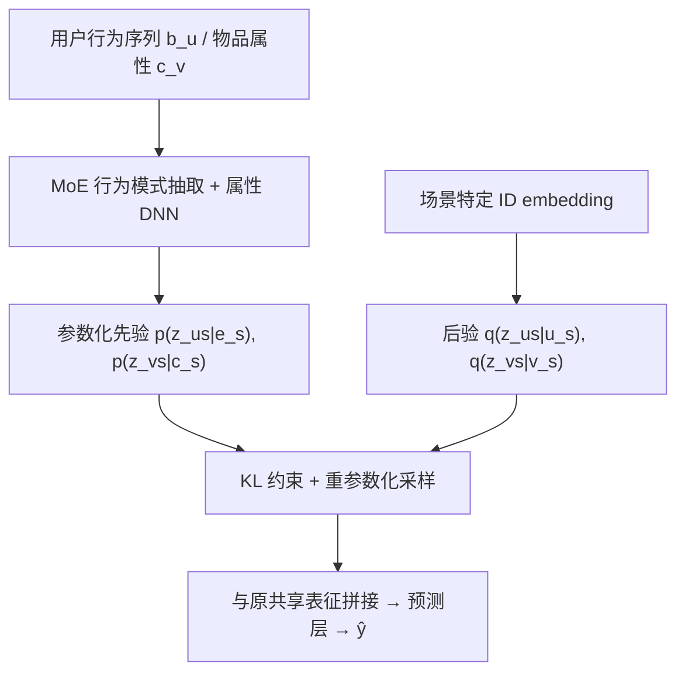

# Global-Distribution Aware Scenario-Specific Variational Representation Learning Framework (全局分布感知的场景特定变分表征学习框架)

- **会议/期刊**: CIKM 2025 (short paper, 6 pages)
- **作者与机构**: Moyu Zhang, Yujun Jin, Jinxin Hu, Yu Zhang（阿里巴巴集团 / Lazada）
- **推荐链路定位**: 精排（多场景 CTR 预估的底层表征层）
- **研究方向**: 跨域与多场景推荐 / CTR 预估与特征交叉
- **论文原文**: [https://arxiv.org/abs/2508.14493v1](https://arxiv.org/abs/2508.14493v1)
- **开源代码**: 暂未开源

## TL;DR (1分钟核心速览)

现有多场景推荐（PEPNet、MARIA 等）共用一套底层共享表征、仅靠 scenario ID 区分场景，导致场景独特性被抹平；而直接为每场景学独立表征又因数据稀疏而欠学习。本文提出 GSVR：用变分推断为每个场景下的每个用户/物品学习高斯后验分布（而非点估计），并以「全局行为模式 MoE 先验 + 物品属性先验」约束后验，使相似用户/物品分布相近。作为即插即用模块叠加在 PEPNet/MARIA 上，在工业 4 场景 S-GAUC 与 Ali-CCP 3 场景 AUC 上全面显著提升（$p<0.05$），线上 A/B 收入 +4.6%、CTR +4.9%。

## Background & Motivation (背景与核心矛盾)

- **主流范式**: 多场景推荐分两支——MTL 式场景特定网络（PLE、AESM2）与场景自适应参数网络（AdaSparse、PEPNet、MARIA），二者均在**共享底层表征**之上用 scenario ID 做缩放/门控来区分场景。
- **前人局限**: ① 共享底层表征 + 仅靠 ID 区分，模型难以真正刻画场景差异，场景独特性被部分抹平；② 若改为逐场景独立表征，各场景交互量差异巨大（工业集 #A3 仅 1.9M click vs #A1 15.8M），稀疏场景下表征欠学习，引发负迁移。
- **核心洞察 (Key Insight)**: 稀疏场景的本质困难是**不确定性**——样本少则点估计方差大。用分布估计替代点估计可显式建模该不确定性；而分布的先验不应是固定标准高斯（β-VAE 做法），应由**跨场景全局知识**参数化，从而把富场景的统计强度迁移给稀疏场景。
- **本文切入点**: 把用户/物品的场景特定表征建模为后验高斯分布，用全局行为模式（MoE 抽取）与物品 side-info 参数化先验，做 KL 约束下的变分学习。

## Method (核心方法设计)

### 1. 整体框架 (Overall Architecture)

输入为 $\{u,v,b_u,c_v,s\}$。底层保留原 backbone 的场景共享 embedding$\boldsymbol{u},\boldsymbol{v}$；GSVR 在其旁挂一条概率支路：对每个$(u,s)$、$(v,s)$用 DNN 输出后验高斯$q_\phi(\boldsymbol{z}_{us}|u_s)=\mathcal{N}(\boldsymbol{\mu}_{us},\boldsymbol{\sigma}^2_{us})$与$q_\phi(\boldsymbol{z}_{vs}|v_s)$；同时用 MoE 从用户行为序列抽取行为模式、用物品 side feature 经 DNN 生成两个**参数化先验**。训练时重参数化采样得到$\boldsymbol{u}_s,\boldsymbol{v}_s$送入原预测层，损失为点击重构误差 + 双向 KL（后验→先验、先验→标准高斯）。推理时令$\boldsymbol{\epsilon}=0$，直接取均值$\boldsymbol{\mu}$ 作为场景特定表征，零采样开销。

### 2. 关键设计拆解 (Key Designs)

1. **分布估计替代点估计（Variational Scenario-Specific Representation）**：痛点是从零学场景独立向量在稀疏场景下方差爆炸。做法是把推荐目标改写为 $p_{\phi,\theta}(y=1|\boldsymbol{x},\boldsymbol{z})$，由 Jensen 不等式得 ELBO，逐特征 Mean-field 分解后目标为
$\mathcal{L}=\mathcal{L}_{pre}-\alpha\big[KL(q_\phi^u(\boldsymbol{z}_{us}|u_s)\|p(\boldsymbol{z}_{us}))+KL(q_\phi^v(\boldsymbol{z}_{vs}|v_s)\|p(\boldsymbol{z}_{vs}))\big]$其中$\mathcal{L}_{pre}$为对$L$ 次蒙特卡洛采样的负 log-loss。直觉：分布建模把「样本少」转化为「后验宽」，KL 项则把宽后验拉向有信息量的先验，等价于对稀疏实体做自适应收缩（shrinkage）。

2. **全局知识感知的多项式先验（Global-Knowledge Aware Prior）**：固定标准高斯先验无法区分用户/物品差异，故将先验参数化：物品侧 $p_{\phi_c}(\boldsymbol{z}_{vs}|c_s)=\mathcal{N}(\boldsymbol{\mu}_{cs},\boldsymbol{\sigma}^2_{cs})$ 由 side feature 经 DNN 生成，使同品牌/同类目物品先验相近；用户侧用 MoE 抽取行为模式
$\boldsymbol{b}_{us}=\Big(\sum_{i<d_c}\alpha^c_i E^c_i(\boldsymbol{h})\Big)\oplus\Big(\sum_{i<d_s}\alpha^s_i E^s_i(\boldsymbol{h}\oplus\boldsymbol{s})\Big)$其中共享专家刻画全局行为模式、场景专家刻画场景特有模式，再以$\boldsymbol{b}_{us}$生成先验$p_{\phi_b}(\boldsymbol{z}_{us}|\boldsymbol{e}_s)$。直觉：富场景的全局统计强度通过先验「注入」稀疏场景，实现跨场景知识迁移而非硬共享。

3. **训练目标、负采样与推理效率**：最终损失在式 (7) 基础上再加一层「先验→标准高斯」KL 以防过拟合：
$\mathcal{L}=\mathcal{L}_{pre}-\alpha\big[KL(q^u\|p_{\phi_b})+KL(q^v\|p_{\phi_c})\big]-\alpha\big[KL(p_{\phi_b}\|\mathcal{N}(0,I))+KL(p_{\phi_c}\|\mathcal{N}(0,I))\big]$训练为 pointwise 点击 log-loss（无负采样环节），$\alpha$ 平衡重构与正则。推理取均值免采样；作者对新增场景特定参数做量化压缩，四场景新增参数由 1.2M 压至 0.28M。

## Experimental Setup & Evaluation Protocol (实验设置与评估协议)

- **数据集与预处理**:

| 数据集 | #Users | #Items | #Interactions(Click) | 稀疏度/密度 | 特征/场景说明 |
| :--- | :---: | :---: | :---: | :---: | :--- |
| 工业集 #A1 | 10,430,696 | 1,972,477 | 15,870,365 | 曝光 860M，极稀疏 | 国际广告平台，4 场景 |
| 工业集 #A2 | 4,877,528 | 1,535,663 | 9,220,309 | 曝光 265M | 同上 |
| 工业集 #A3 | 3,703,052 | 1,289,892 | 1,966,885 | 曝光 76M，最稀疏 | 同上 |
| 工业集 #A4 | 1,067,512 | 1,330,079 | 7,521,706 | 曝光 56M | 同上 |
| Ali-CCP #B1/#B2/#B3 | 91,488 / 2,612 / 154,024 | 535,711 / 198,651 / 537,937 | 1.29M / 28K / 2.00M | 曝光 32M / 0.64M / 52M | 淘宝推荐三场景，#B2 极稀疏 |

- **数据划分与防穿越 (Splitting Strategy)**: 工业集取 2025-04-26 至 05-16 的日志，按时间切分训练/测试（原文未给出比例细节）；Ali-CCP 沿用公开数据集的既定划分。
- **排名评测协议 (Ranking Protocol)**: 均为**全量曝光样本上的排序指标**，非采样排序。Ali-CCP 用 AUC；工业集用 session 加权 **S-GAUC**（更贴合多会话曝光分布）。显著性用 Mann-Whitney U 检验，$p<0.05$。
- **对比基线与超参设置**: 基线含 SharedBottom、PLE、AESM2、AdaSparse、PEPNet、MARIA；GSVR 以 PEPNet、MARIA 为 backbone 叠加。Embedding 维度 $d=40$，三层 MLP 隐层 [256,128,64]，Adam，lr=0.001（decay 0.9），batch=512，Xavier 初始化；$\alpha$ 在 0.1–0.9 间扫描。

## Key Experimental Results (实验关键数据)

### 1. 主实验对比 (Main Results)

工业集 S-GAUC（节选）：

| Method | #A1 | #A2 | #A3 | #A4 |
| :--- | :---: | :---: | :---: | :---: |
| SharedBottom | 0.6282 | 0.6756 | 0.6313 | 0.5824 |
| PLE | 0.6356 | 0.6829 | 0.6398 | 0.5916 |
| AdaSparse | 0.6389 | 0.6871 | 0.6441 | 0.5952 |
| PEPNet | 0.6403 | 0.6883 | 0.6452 | 0.5991 |
| MARIA | 0.6412 | 0.6901 | 0.6471 | 0.6002 |
| PEPNet+GSVR | 0.6424* | 0.6912* | 0.6489* | 0.6027* |
| **MARIA+GSVR** | **0.6459*** | **0.6937*** | **0.6526*** | **0.6068*** |
| Improv. (vs MARIA) | +0.73% | +0.52% | +0.85% | +1.10% |

Ali-CCP AUC：

| Method | #B1 | #B2 | #B3 |
| :--- | :---: | :---: | :---: |
| SharedBottom | 0.5685 | 0.5881 | 0.5817 |
| PLE | 0.5786 | 0.5828 | 0.5893 |
| AdaSparse | 0.5808 | 0.5986 | 0.6024 |
| PEPNet | 0.5839 | 0.6101 | 0.6052 |
| MARIA | 0.5864 | 0.6108 | 0.6068 |
| PEPNet+GSVR | 0.5921* | 0.6149* | 0.6115* |
| **MARIA+GSVR** | **0.5937*** | **0.6163*** | **0.6127*** |
| Improv. (vs MARIA) | +1.24% | +0.90% | +0.97% |

### 2. 消融实验 (Ablation Study)

工业集，backbone 为 MARIA：

| 变体 | #A1 | #A2 | #A3 | #A4 |
| :--- | :---: | :---: | :---: | :---: |
| GSVR (完整) | **0.6459** | **0.6937** | **0.6526** | **0.6068** |
| GSVR(R-MoE)（去专家，直接用序列表征做先验） | 0.6442 | 0.6929 | 0.6513 | 0.6041 |
| GSVR(Uniform)（标准高斯先验，退化为 VAE） | 0.6430 | 0.6914 | 0.6499 | 0.6009 |
| GSVR(Distinct)（逐场景独立点表征） | 0.6416 | 0.6899 | 0.6473 | 0.5997 |

### 3. 关键实验发现 (Key Findings)

1. **稀疏场景收益最大**：工业集最稀疏的 #A3（仅 1.97M click）相对 MARIA 提升 +0.85%，而样本最丰富的 #A1 仅 +0.73%；Ali-CCP 极稀疏的 #B2（28K click）提升 +0.90% 且绝对 AUC 提升幅度与 #B1 相当，说明分布先验确实在低样本场景起到「统计强度借力」作用。
2. **全局先验是主要增益来源**：GSVR(Uniform) 已优于全部点估计基线（#A4 0.6009 > MARIA 0.6002），但完整 GSVR 再涨 +0.59%（0.6068），证明增益并非仅来自「加了 VAE 正则」，而主要来自全局知识参数化先验；GSVR(Distinct) 全面垫底（#A4 0.5997 甚至低于 MARIA），直接印证「逐场景独立表征在稀疏下不可学」这一核心动机。
3. **MoE 行为模式抽取有实质贡献**：GSVR(R-MoE) 在 #A4 掉 0.27%（0.6041 vs 0.6068），说明仅用原始序列表征做先验不足以刻画「相似兴趣用户」，需共享/场景专家分离才能对齐全局行为模式。

## Highlights & Limitations (亮点、对比与审稿批判)

- **与代表作对比 (vs. Prior Work)**: 与 PEPNet/AdaSparse 的本质区别在于——后者在**结构层**做场景缩放/剪枝，底层表征仍是共享点估计；GSVR 则在**表征层**引入分布与先验，二者正交可叠加（实验已验证）。与 β-VAE 类生成式推荐的区别在于先验不是固定 $\mathcal{N}(0,I)$，而是由 MoE 行为模式与物品属性参数化，从而携带跨场景全局知识。
- **可迁移亮点**: ①「参数化先验 + 双向 KL」这一套可低成本套用到任何需要稀疏实体表征的模块（冷启动物品、长尾用户）；②推理取均值 + 参数量化压缩（1.2M→0.28M）是工业落地的实用范式。
- **审稿级局限批判**: ① 仅 6 页短文，缺少与「场景特定表征」直接对手（如 STAR、ADL、PLATE 等）的对比，也未报告训练耗时与显存增量，工业开销论证偏薄；② 工业集划分细节、$\alpha$之外的关键超参（如采样数$L$、专家数$d_c/d_s$）未披露，且仅在两个数据集上验证，泛化性证据有限。

## Rating (四维评分)

- **方法创新性 (Novelty)**: ⭐⭐⭐⭐ （把多场景表征从点估计推向「全局先验约束的变分分布」，视角清晰且与结构派方法正交，但 VAE + 参数化先验的组合本身不算全新）
- **评估协议与实验扎实度 (Protocol & Experiments)**: ⭐⭐⭐⭐ （工业 4 场景 + Ali-CCP 3 场景、全量排序指标、显著性检验与线上 A/B 齐备，但缺关键对手对比与超参细节）
- **写作与数学规范度 (Clarity & Rigor)**: ⭐⭐⭐⭐ （ELBO 推导与双向 KL 目标写得紧凑自洽，公式编号完整；部分符号如 $\boldsymbol{e}_s$与$\boldsymbol{b}_{us}$ 的对应关系略含糊）
- **工业落地与复现价值 (Industrial & Practical Value)**: ⭐⭐⭐⭐ （即插即用、推理零采样开销、参数已量化压缩、线上收入 +4.6%，落地价值高；但未开源，复现需自行补细节）

