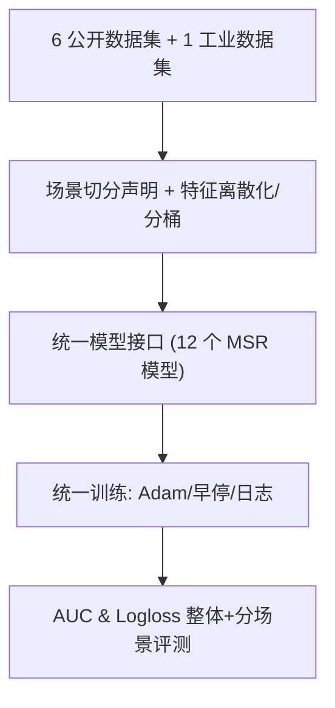
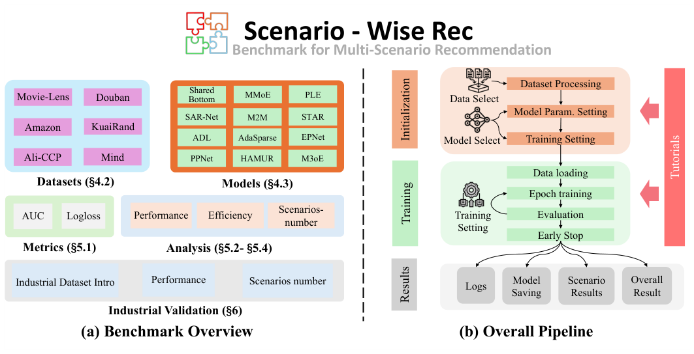

# Scenario-Wise Rec: A Multi-Scenario Recommendation Benchmark (多场景推荐基准)

- **会议/期刊**: CIKM 2025
- **作者与机构**: Xiaopeng Li, Jingtong Gao, Pengyue Jia, Xiangyu Zhao 等（香港城市大学）；Yichao Wang, Huifeng Guo, Ruiming Tang（华为诺亚方舟实验室）
- **推荐链路定位**: 精排（多场景 CTR 预估）
- **研究方向**: 跨域与多场景推荐 / CTR 预估与特征交叉
- **论文原文**: [https://arxiv.org/abs/2412.17374v4](https://arxiv.org/abs/2412.17374v4)
- **开源代码**: [https://github.com/Applied-Machine-Learning-Lab/Scenario-Wise-Rec](https://github.com/Applied-Machine-Learning-Lab/Scenario-Wise-Rec)

## TL;DR (1分钟核心速览)

多场景推荐（MSR）长期缺乏统一的数据处理、训练与评测规范，且多数 SOTA 模型闭源，导致横向对比不可复现。本文提出首个 MSR 专用基准 **Scenario-Wise Rec**：统一 6 个公开数据集（MovieLens/KuaiRand/Ali-CCP/Amazon/Douban/Mind）的场景切分与特征处理管线，标准化模型接口并复现 12 个代表性 MSR 模型，以 AUC/Logloss 在 8:1:1 划分下做 10 次随机种子评测，另用含 10 场景的工业广告数据验证。结论是：动态场景自适应模型（M2M/AdaSparse/HAMUR/M3oE）普遍优于静态专家结构，且场景数增加时稀疏场景存在"跷跷板效应"。

## Background & Motivation (背景与核心矛盾)

- **主流范式**: 以 SharedBottom/MMoE/PLE 的多任务结构为骨架，将每个场景视作一个"任务"，通过专家网络（MoE）、场景特化塔（STAR）、元学习（M2M）、剪枝（AdaSparse）、Adapter（HAMUR）等平衡场景共享与特化信息。
- **前人局限一（数据不可比）**: 各论文对同一公开数据集的场景切分（按上下文特征 / 物品类别 / 用户属性）与特征过滤规则各自为政，甚至不公开处理后的数据，导致同一模型在不同论文中数值差异巨大。
- **前人局限二（代码不可复现）**: STAR、AdaSparse、CausalInt 等工业模型多因企业隐私闭源，学术界难以在同等超参空间下与 SOTA 公平对比。
- **核心洞察 (Key Insight)**: MSR 的"场景"本质是**预定义域划分**，其切分策略（上下文/物品/用户）直接决定场景间用户-物品重叠度（COV 从 MovieLens 的 0.32 到 KuaiRand 的 1.36），而重叠度又决定知识迁移的可行上限——这正是需要被标准化固定的变量。
- **本文切入点**: 不做新模型，而是把"场景切分 + 特征处理 + 模型接口 + 训练评测"四件事固化为可扩展管线，用统一实验回答"哪类结构在什么场景分布下更优"。

## Method (核心方法设计)

### 1. 整体框架 (Overall Architecture)

基准将 MSR 形式化为带场景指示符的统一 CTR 预估：输入由场景无关特征 $\boldsymbol{x}_g$、场景特化特征$\boldsymbol{x}_s$与场景 ID$s\in\{1,\dots,S\}$组成，统一模型输出$\hat{y}=\mathcal{F}_{\theta_M}(\boldsymbol{x}_g,\boldsymbol{x}_s,s)$，所有场景共享同一参数集$\theta_M$。管线依次完成：数据集选择与场景声明 → 离散化/分桶与稀疏-稠密-场景特征三分类 → 统一模型接口实例化 → 统一训练（Adam、早停、学习率调度、日志落盘）→ 统一 AUC/Logloss 评测与场景级结果拆分。整体流程见原文图 2。

<figure class="paper-figure" markdown="span">
  <figcaption>图2：Scenario-Wise Rec的整体流程。</figcaption>
</figure>

### 2. 关键设计拆解 (Key Designs)

1. **场景切分策略的三分类标准化**：痛点是同一数据集在不同论文中被切成不同场景数，数值不可比。基准显式规定三类切分算子——上下文特征切分（Ali-CCP 用位置特征 "301"、KuaiRand 用 "tab" 取交互最多的前 5 个）、物品特征切分（Amazon 按 Clothing/Beauty/Health 品类、Douban 按书/影/音平台）、用户特征切分（MovieLens 按年龄切 1-24/25-34/35+）。其价值在于把"场景定义"从隐含假设变为可复现的显式声明，并用变异系数 COV 量化场景不均衡度，使跨数据集结论具备可比语义。

2. **统一模型接口下的 12 模型同空间复现**：痛点是闭源模型无法在同等超参下比较。基准为 SharedBottom、MMoE、PLE、STAR、SAR-Net、M2M、AdaSparse、ADL、EPNet、PPNet、HAMUR、M3oE 定义一致的输入/输出契约，统一 embedding 维度 $d=16$、统一搜索空间与参数量级，并对多任务模型做 MSR 适配（如 M2M 的 meta-tower 数设为 1、PPNet 的 meta-tower 数设为场景数）。这样得到的排序反映的是**结构差异**而非调参差异。

3. **训练目标、负采样与推理开销**：全部模型沿用标准 CTR 二元交叉熵 $\mathcal{L}=-\frac{1}{N}\sum_{i}\left[y_i\log\hat{y}_i+(1-y_i)\log(1-\hat{y}_i)\right]$，标签由点击/未点击或评分阈值（Douban 以评分 >3 为正）给定，不做额外负采样（曝光日志本身即隐式负样本）。推理为单次前向，效率分析显示各模型参数量同数量级（主要来自 embedding 层），差异主要来自训练/推理时间而非模型容量。

## Experimental Setup & Evaluation Protocol (实验设置与评估协议)

- **数据集与预处理**: 特征独立做离散化与分桶，分为稀疏/稠密/场景特化三类；场景统计如下（节选主要场景）：

| 数据集 | #Users | #Items | #Interactions | 场景切分依据 | 场景均衡度 COV |
| :--- | :---: | :---: | :---: | :--- | :---: |
| MovieLens | 1,325–2,619 | 3,429–3,595 | 21.0万–39.6万/场景 | 用户年龄 | 0.3186 |
| KuaiRand | 171–991 | 4.3万–274万 | 18.3万–776万/场景 | tab 广告位（前5） | 1.3552 |
| Ali-CCP | 2,561–150,471 | 18.9万–46.7万 | 6.4万–5,244万/场景 | 位置特征 301 | 0.9180 |
| Amazon | 22,363–39,387 | 1.2万–2.3万 | 19.9万–34.6万/场景 | 商品品类 | 0.2696 |
| Douban | 1,820–2,712 | 3.5万–9.6万 | 18.0万–127.8万/场景 | 平台（书/影/音） | 1.1053 |
| Mind | 65.7万–73.8万 | 1,797–8,284 | 922万–2,606万/场景 | 新闻大类（前4） | 0.5611 |
| 工业广告 | — | — | 约 300 万（10 场景，108 特征） | 广告位 | — |

- **数据划分与防穿越 (Splitting Strategy)**: 公开数据集默认按 **8:1:1 比例划分**（除非原数据集自带划分规则）；工业数据集按天切分，前 7 天训练、后 2 天分别验证与测试，严格避免时间穿越。
- **排名评测协议 (Ranking Protocol)**: 采用 CTR 场景标准的 **AUC（越高越好）与 Logloss（越低越好）**，非全库排序 Recall@K 协议；所有模型在相同测试集上做整体与分场景评测，10 次不同随机种子取均值并报告标准误，双尾 t 检验 $p<0.05$ 标显著性。
- **对比基线与超参设置**: 12 个基线覆盖共享底层、MoE 专家、场景特化塔、元学习、剪枝、Adapter、多级融合七类结构；embedding 维度 $d=16$，Adam 优化器，初始学习率 1e-3，早停 + 学习率调度；batch size 按数据集设为 4,096（MovieLens/Amazon/Douban/Mind）、9,048（KuaiRand/工业）、102,400（Ali-CCP），单卡 Tesla V100 32GB。

## Key Experimental Results (实验关键数据)

### 1. 主实验对比 (Main Results)

节选 6 个代表性基线（完整 12 模型见原文表 3），加粗为最优：

| 模型 | MovieLens AUC↑ | MovieLens Logloss↓ | KuaiRand AUC↑ | Ali-CCP AUC↑ | Amazon AUC↑ | Douban AUC↑ | Mind AUC↑ |
| :--- | :---: | :---: | :---: | :---: | :---: | :---: | :---: |
| SharedBottom | 0.8095 | 0.5228 | 0.7793 | 0.6232 | 0.6792 | 0.7993 | 0.7509 |
| MMoE | 0.8086 | 0.5218 | 0.7794 | 0.6242 | 0.6744 | 0.7978 | 0.7508 |
| STAR | 0.8096 | 0.5258 | 0.7806 | 0.6253 | 0.6738 | 0.7957 | 0.7512* |
| SAR-Net | 0.8092 | 0.5245 | 0.7816 | 0.6245 | 0.7071 | 0.8033 | 0.7490 |
| M2M | 0.8115 | 0.5213 | 0.7821* | 0.6257* | 0.6865 | 0.7962 | 0.7508 |
| AdaSparse | 0.8108 | 0.5205 | 0.7816 | 0.6239 | 0.6888 | 0.7963 | 0.7497 |
| HAMUR | **0.8133*** | **0.5193*** | 0.7820 | 0.6235 | 0.6730 | 0.7979 | 0.7494 |
| M3oE | 0.8116 | 0.5211 | 0.7812 | 0.6249 | 0.7010 | **0.8036*** | 0.7451 |
| EPNet | 0.8097 | 0.5215 | 0.7801 | 0.6236 | **0.7101*** | 0.7997 | 0.7418 |

工业数据集（10 场景）上 M2M 取得最高 AUC **0.8392**、M3oE 次之 0.8384，显著高于 SharedBottom 的 0.8276（相对提升约 1.4%）。

### 2. 消融/效率分析 (Efficiency & Scenario-Number Study)

基准本身无模块消融，但提供了等价的"结构族对比 + 效率 + 场景数"三组受控分析：

| 分析维度 | 关键观测 | 代表数值 |
| :--- | :--- | :--- |
| 专家结构 vs 直接建模 | MoE 类普遍优于 SharedBottom/ADL | KuaiRand 上 SAR-Net 0.7816 vs ADL 0.7773 |
| 动态自适应 vs 静态结构 | M2M/AdaSparse/HAMUR 优于静态专家 | MovieLens 上 HAMUR 0.8133 vs MMoE 0.8086 |
| 训练/推理开销 | 参数量同数量级，M2M 最慢 | Amazon 上 M2M 训练 13.59s vs AdaSparse 3.70s |
| 场景数 3→7（KuaiRand） | 稠密场景单调升，稀疏场景先降后升 | Scenario-2# 出现"跷跷板效应"，SAR-Net 最稳 |

### 3. 关键实验发现 (Key Findings)

1. **结构族差异大于数据集规模差异**：在 MovieLens 上 HAMUR 相对 MMoE 的 AUC 提升约 0.47%（0.8133 vs 0.8086），而在交互量高两个数量级的 Ali-CCP 上最优与最差模型差距仅约 1.8%（0.6257 vs 0.6144），说明 MSR 的收益瓶颈在场景相关性建模而非数据量。
2. **场景数增加并非单调利好稀疏场景**：KuaiRand 从 3 扩到 7 个场景时，稠密 Scenario-0# 的 AUC 稳步上升，但稀疏 Scenario-2# 在 SharedBottom/ADL/STAR 上先跌后升，印证"负迁移"风险；SAR-Net 因注意力式跨场景兴趣建模在两端都保持稳定，是稀疏场景部署的稳健选择。
3. **工业多场景更偏好元学习与多级融合**：在 10 场景、108 特征的工业数据上，M2M（0.8392）与 M3oE（0.8384）领先，而 AdaSparse 反而跌至 0.8224，说明场景数极多时"逐场景剪枝"的稀疏结构假设失效，跨场景元知识共享更关键。

## Highlights & Limitations (亮点、对比与审稿批判)

- **与代表作对比 (vs. Prior Work)**: 相比 RecBole/FuxiCTR 等通用 CTR 库，本文是首个**专为 MSR 设计**的基准，内置场景切分声明与分场景评测；相比 MMLRec（多任务多场景 CTR 基准），本文额外提供工业数据验证、可自定义数据集/模型接口与完整教程；相比单篇 STAR/AdaSparse 论文，本文把闭源模型拉回同一超参空间，使排序结论可信。
- **可迁移亮点**: (1) 用 COV + 场景交集统计先刻画数据再选模型，可低成本预判负迁移风险；(2) "场景数扫描"实验设计可直接迁移到多业务线联合建模的离线评估，用于发现跷跷板效应。
- **审稿级局限批判**: (1) 仅覆盖 CTR 类任务与 AUC/Logloss，未纳入排序指标（NDCG/Recall）与生成式/LLM4Rec 新范式，基准覆盖面随领域演进而老化；(2) 场景切分仍依赖人工预定义，自动场景发现（如 D3）仅作讨论未纳入统一评测，且工业数据因隐私无法公开交集统计，削弱了结论的外部可复现性。

## Rating (四维评分)

- **方法创新性 (Novelty)**: ⭐⭐⭐ （非新模型，创新在于首个 MSR 专用基准与场景切分标准化的系统性工程）
- **评估协议与实验扎实度 (Protocol & Experiments)**: ⭐⭐⭐⭐ （6 公开 + 1 工业数据集、12 模型同空间复现、10 种子 + t 检验，协议完整度高）
- **写作与数学规范度 (Clarity & Rigor)**: ⭐⭐⭐⭐ （形式化简洁、场景切分与 COV 定义清晰，但理论分析较浅）
- **工业落地与复现价值 (Industrial & Practical Value)**: ⭐⭐⭐⭐⭐ （全开源、含工业验证与教程，可直接作为 MSR 研究的标准实验底座）

