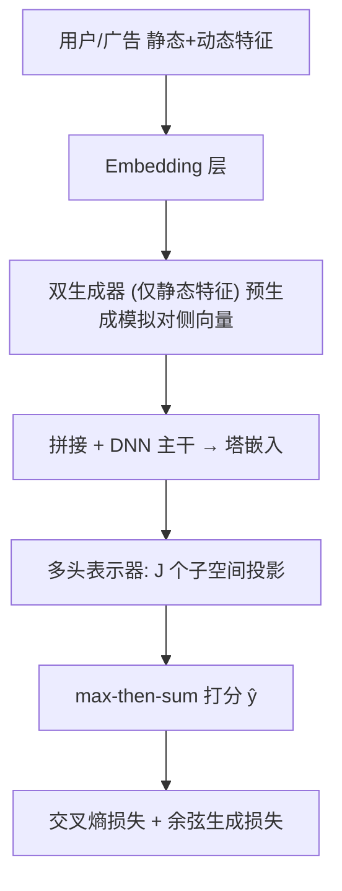
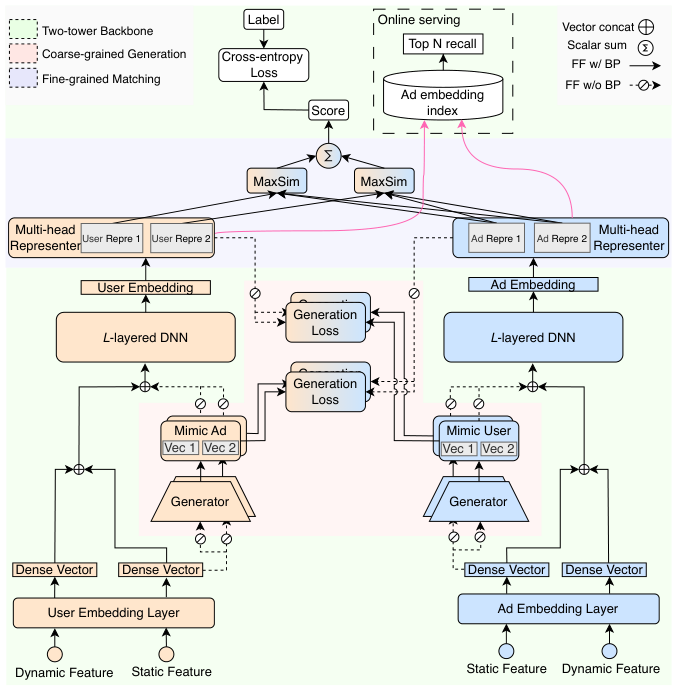

# HIT Model: A Hierarchical Interaction-Enhanced Two-Tower Model for Pre-Ranking Systems (面向粗排系统的层次交互增强双塔模型)

- **会议/期刊**: CIKM 2025
- **作者与机构**: Haoqiang Yang, Congde Yuan, Kun Bai, Mengzhuo Guo, Wei Yang, Chao Zhou（腾讯 / 四川大学）
- **推荐链路定位**: 粗排（Pre-Ranking）
- **研究方向**: CTR预估与特征交叉 / 多任务学习与列表级重排
- **论文原文**: [https://arxiv.org/abs/2505.19849v2](https://arxiv.org/abs/2505.19849v2)
- **开源代码**: [https://github.com/HarveyYang123/HIT_model](https://github.com/HarveyYang123/HIT_model)

## TL;DR (1分钟核心速览)

粗排双塔因用户/广告两塔完全解耦，既无法建模跨域特征交互，又只能用内积做粗粒度相似度，精度受限；而全交互模型（DCN/AutoInt）虽准却无法预缓存广告向量、扛不住万级 QPS。HIT 提出「粗粒度生成 + 细粒度匹配」两级增强：双生成器仅用静态特征预生成模拟对侧塔的高层向量（余弦生成损失），多头表示器把嵌入投影到多个子空间并用 max-then-sum 打分。在 Alibaba/MovieLens/Amazon 三数据集上 AUC 相对 DSSM 提升 40.98%/9.49%/9.08%，腾讯线上 A/B 五天内 GMV +1.66%、ROI +1.55%，推理延迟与原生双塔几乎持平。

## Background & Motivation (背景与核心矛盾)

- **主流范式**: 工业粗排需在毫秒级从百万候选广告中筛出数百条，双塔（DSSM 系）因两塔解耦、广告向量可离线预缓存而成为事实标准。
- **前人局限**: ① 两塔之间**无粗粒度信息交换**，无法建模跨域依赖；② 打分仅靠**单向量内积**，无法刻画用户多面兴趣与广告多维属性的细粒度语义匹配。
- **交互谱系矛盾**: 早交互（DAT/MVKE）与晚交互（Poly-Encoder/IntTower）能提升精度但交互仍浅；全交互（Wide&Deep/DeepFM/DCN/AutoInt/COLD）精度最高，却因用户-广告特征在 embedding 层即交叉，**广告向量无法预计算**，推理开销不可接受。
- **核心洞察 (Key Insight)**: 用户/广告的**静态特征**（年龄、品类）已足以刻画其长期本质属性，可在编码前就"预生成"对侧塔的高层语义；而多面兴趣的匹配不必靠全交互，用**多子空间 + max 对齐**即可近似。
- **本文切入点**: 在双塔骨架上插入"生成器"做粗粒度跨塔信息注入、"多头表示器"做细粒度子空间匹配，二者均不破坏广告向量预缓存能力。

## Method (核心方法设计)

### 1. 整体框架 (Overall Architecture)

输入用户静态/动态特征与广告静态/动态特征，各自经 Embedding 层后，**生成器**（仅吃静态特征的两层 MLP）预生成 $K$个模拟对侧塔的向量$\mathbf{r}^{m}_{k}$，L2 归一化后与稠密向量拼接送入 DNN 主干得到塔嵌入$\mathbf{h}^{i}_{u}/\mathbf{h}^{i}_{a}$；随后**多头表示器**将塔嵌入线性投影到$J$ 个潜在子空间，用 max-then-sum 聚合出最终打分。训练时联合交叉熵损失与余弦生成损失端到端优化（生成器输入输出均 stop-gradient）；在线服务时广告侧全部子空间表示离线预计算缓存，仅实时计算用户侧。

<figure class="paper-figure" markdown="span">
  <figcaption>图3：HIT模型架构概览。</figcaption>
</figure>

### 2. 关键设计拆解 (Key Designs)

1. **双生成器粗粒度跨塔生成（Dual-Generator Coarse Generation）**：痛点是双塔零交互。生成器 $g_k(\cdot)$只接收静态特征$\mathbf{x}_{\delta b}$，输出模拟对侧塔的向量$\mathbf{r}^{m}_{k}=g_k(\mathbf{x}_{\delta b})$，用户塔的生成器去模拟广告表示、广告塔的生成器去模拟用户表示，从而在编码前就把对侧信息"注入"本塔。按标签正负设$K=2$（target / non-target 生成器分别拟合正负样本），直觉是正负样本携带的目标/非目标实体信息增益不同，分开建模更充分。生成损失用**余弦距离**而非 MSE/MAE，因为余弦只看方向不看模长，避免高维表示被幅值差异主导：
$$\mathcal{L}_{g_u}=-\frac{1}{N}\sum_{i=1}^{N}\left(y_i\,\mathrm{Dist}(\mathbf{r}_u,\mathbf{r}^{m}_{1})+(1-y_i)\,\mathrm{Dist}(\mathbf{r}_u,\mathbf{r}^{m}_{2})\right)$$
其中 $\mathrm{Dist}(\cdot)$为余弦距离，$\mathbf{r}_u=[\mathbf{r}_{u,(1)},\dots,\mathbf{r}_{u,(J)}]$为多头表示拼接（维度$p=z\times J$ 与生成器输出对齐）。

2. **多头表示器细粒度子空间匹配（Multi-Head Representer）**：痛点是单向量内积无法表达"用户多面兴趣 × 广告多维属性"。将塔嵌入投影到 $J$个子空间$\mathbf{r}_{u,(j)}=\mathbf{W}_{u,(j)}\mathbf{h}^{i}_{u}+\mathbf{b}_{u,(j)}$，打分时对每个用户兴趣头取与所有广告属性头的**最大**内积（找最匹配的那一维属性），再对所有兴趣头**求和**：
$$\hat{y}=\sum_{j_u=1}^{J}\max_{j_a\in\{1,\dots,J\}}\left\{(\mathbf{r}_{u,(j_u)})^{\top}\mathbf{r}_{a,(j_a)}\right\}$$
max 算子实现"每个兴趣只认最契合的属性"，sum 实现"多兴趣综合"，且广告侧 $\mathbf{r}_{a,(j)}$ 可全部预缓存，效率不损。

3. **训练目标、负采样与推理效率**：总损失 $\mathcal{L}=\mathcal{L}_{c}+\alpha(\mathcal{L}_{g_u}+\mathcal{L}_{g_a})$，$\mathcal{L}_c$为标准交叉熵，$\alpha=10^{-3}$。生成器输入/输出与表示器输出在生成损失分支上均做 **stop-gradient**，使生成器专注拟合高层表示而不干扰主干反向传播。训练负采样沿用曝光未点击的隐式负样本（工业日志天然正负），无额外难负采样设计。在线仅需实时算用户塔 + 多头投影，广告侧全预缓存，QPS=35,000 下延迟与原生双塔几乎一致。

## Experimental Setup & Evaluation Protocol (实验设置与评估协议)

- **数据集与预处理**:

| 数据集 | #Users | #Items | #Interactions | 稀疏度/密度 | 特征/场景说明 |
| :--- | :---: | :---: | :---: | :---: | :--- |
| MovieLens-1M | 6,040 | 3,952 | 1,000,000 | 密度约 4.2% | 电影评分转隐式反馈 |
| Amazon (Electro) | 192,403 | 630,001 | 1,689,188 | 极稀疏 | 电商电子产品评论 |
| Alibaba | 1,061,768 | 785,597 | 26,557,961 | 中等 | 阿里广告展示日志 |

- **数据划分与防穿越 (Splitting Strategy)**: 遵循 Huang et al. 的**随机 80%/20% 训练-测试比例划分**（非时间切分，存在一定未来信息泄漏风险，属该子领域常见做法）。
- **排名评测协议 (Ranking Protocol)**: 采用**点击率预估式逐样本打分评估**，指标为 AUC、交叉熵 CEloss 与相对提升 RelaImpr $=\left(\frac{\mathrm{AUC}_{model}-0.5}{\mathrm{AUC}_{base}-0.5}-1\right)\times100\%$，基线为原生双塔 DSSM；结果取 10 次重复平均，显著性水平$\alpha=0.01$。
- **对比基线与超参设置**: 覆盖四类双塔——Vanilla（DSSM）、Early（DAT、MVKE）、Late（Poly-Encoder、IntTower）、All-to-all（Wide&Deep、DeepFM、DCN、AutoInt、COLD）。Embedding 维 $d=32$，batch=256，DNN 三层 MLP 隐层$[300,300,32]$，生成器两层$[64,32]$，$J=2$，$z=16$，$\alpha=10^{-3}$，2×Tesla T4。

## Key Experimental Results (实验关键数据)

### 1. 主实验对比 (Main Results)

| 类型 | 模型 | 参数量 | Alibaba AUC | Alibaba RelaImpr | MovieLens AUC | MovieLens RelaImpr | Amazon AUC | Amazon RelaImpr |
| :--- | :--- | :---: | :---: | :---: | :---: | :---: | :---: | :---: |
| Vanilla | DSSM | 0.74M | 0.6579 | 0% | 0.8697 | 0% | 0.8469 | 0% |
| Early | MVKE | 0.84M | 0.6625 | 2.91% | 0.8720 | 0.62% | 0.8503 | 0.98% |
| Late | IntTower | 1.18M | 0.6827 | 15.71% | 0.8974 | 7.49% | 0.8696 | 7.91% |
| All-to-all | DCN | 0.68M | 0.6831 | 15.96% | 0.8964 | 7.22% | 0.8665 | 5.65% |
| All-to-all | AutoInt | 0.70M | 0.6867 | 18.24% | 0.8948 | 6.79% | 0.8686 | 6.25% |
| All-to-all | COLD | 0.68M | 0.6816 | 15.01% | 0.8836 | 3.75% | 0.8633 | 4.72% |
| **Hierarchical** | **HIT (ours)** | **0.79M** | **0.7226** | **40.98%** | **0.9048** | **9.49%** | **0.8784** | **9.08%** |

HIT 以仅 0.79M 参数（低于 IntTower 的 1.18M）在三个数据集上全面超越所有全交互模型，Alibaba 上 AUC 相对 DSSM 提升 40.98%，比最强基线 AutoInt 高约 22.7 个相对点。

### 2. 消融实验 (Ablation Study)

| 配置 | Alibaba AUC | MovieLens AUC | Amazon AUC | 说明 |
| :--- | :---: | :---: | :---: | :--- |
| HIT 完整 | **0.7226** | **0.9048** | **0.8784** | — |
| w/o generators | 0.7170 | 0.8955 | 0.8690 | 去掉生成器 |
| w/o representers | 0.7166 | 0.8954 | 0.8689 | 去掉多头表示器 |
| w/o both | 0.6579 | 0.8697 | 0.8469 | 退化为原生双塔 |
| w/o target generator | 0.7196 | 0.9022 | 0.8751 | 仅去正样本生成器 |
| w/o non-target generator | 0.7216 | 0.8987 | 0.8723 | 仅去负样本生成器 |
| w/ dynamic features | 0.7205 | 0.9012 | 0.8711 | 生成器吃动态特征 |
| w/ MAE 生成损失 | 0.7204 | 0.8945 | 0.8691 | 替换余弦 |
| w/ MSE 生成损失 | 0.7188 | 0.8933 | 0.8689 | 替换余弦 |

### 3. 关键实验发现 (Key Findings)

1. **两组件缺一不可且互补**：单独去掉生成器或表示器，Alibaba AUC 均掉约 0.005–0.006；两者同时去掉则暴跌至 0.6579（等同 DSSM），说明粗粒度跨塔注入与细粒度子空间匹配是两条独立增益路径，叠加后才有 40.98% 的相对跃升。
2. **正负生成器贡献随数据分布而异**：MovieLens/Amazon 上去掉 target 生成器（保留 non-target）反而优于去掉 non-target，而 Alibaba 上恰好相反——说明正负样本的信息增益并非对称，工业日志与公开数据集的标签分布差异会改变最优生成器配置。
3. **静态特征 + 余弦距离是刻意设计而非随意选择**：生成器加入动态特征后三数据集 AUC 全部下降（Alibaba 0.7226→0.7205），因动态特征引入短期噪声；把余弦换成 MSE/MAE 也一致变差（Alibaba 降至 0.7188/0.7204），验证"方向对齐优于几何距离"的高维表示假设。此外 $J$从 1 增至 6 时$J=2$ 最优，头数过多过拟合。

## Highlights & Limitations (亮点、对比与审稿批判)

- **与代表作对比 (vs. Prior Work)**: 相比 IntTower（晚交互、1.18M 参数）HIT 参数更少但 Alibaba AUC 高 0.04；相比 AutoInt/DCN 等全交互模型，HIT 保留了广告向量预缓存能力，线上 QPS=35,000 下延迟与原生双塔几乎持平（图 6），而全交互模型根本无法支撑该 QPS——这是本文最核心的工程卖点。
- **可迁移亮点**: ① "静态特征预生成对侧塔表示 + stop-gradient" 可迁移到任何需保持双塔解耦的召回/粗排场景做轻量跨塔注入；② max-then-sum 多头打分是一种免全交互的细粒度匹配近似，可替代内积用于多兴趣召回。
- **审稿级局限批判**: ① 离线评估采用随机 80/20 划分而非时间切分，存在未来信息泄漏，AUC 绝对值可能偏乐观；② 生成器与表示器的 stop-gradient 设计使生成损失不直接优化主干，$\alpha$与$J$均需人工调参，且$J=2$ 最优暗示多头收益有限，方法对超参较敏感；③ 线上 A/B 仅报告 GMV/ROI 相对提升，缺少 CTR 等中间相关性指标的置信区间与显著性说明。

## Rating (四维评分)

- **方法创新性 (Novelty)**: ⭐⭐⭐⭐ （用静态特征预生成对侧塔表示 + 多头子空间 max-sum 匹配，在双塔效率约束下巧妙近似全交互，思路新颖但组件本身较朴素）
- **评估协议与实验扎实度 (Protocol & Experiments)**: ⭐⭐⭐⭐ （三数据集 + 10 次重复 + 显著性检验 + 五组消融 + 五天线上 A/B 完整，但随机划分与缺少 CTR 置信区间略扣分）
- **写作与数学规范度 (Clarity & Rigor)**: ⭐⭐⭐⭐ （四类双塔谱系梳理清晰、公式简洁、stop-gradient 与余弦选择均有动机解释，复杂度分析略简）
- **工业落地与复现价值 (Industrial & Practical Value)**: ⭐⭐⭐⭐⭐ （已开源、腾讯线上日级十亿曝光部署、延迟与原生双塔持平、GMV+1.66%/ROI+1.55%，落地价值极高）

