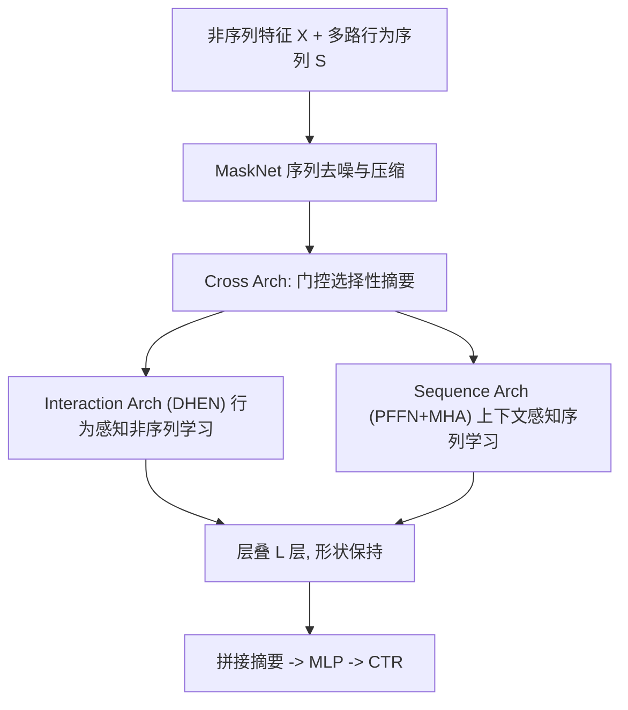
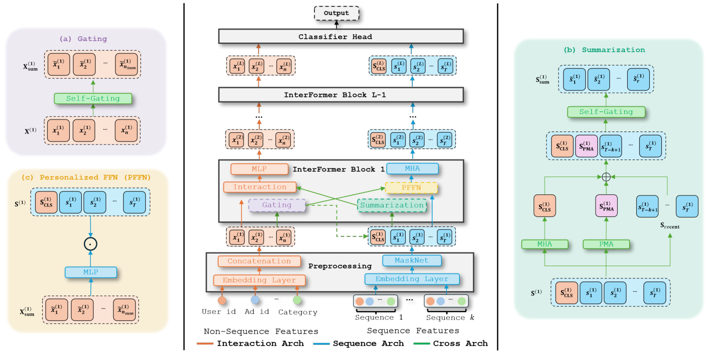

# InterFormer: Effective Heterogeneous Interaction Learning for Click-Through Rate Prediction (面向 CTR 预估的高效异构交互学习)

- **会议/期刊**: CIKM 2025
- **作者与机构**: Zhichen Zeng, Xiaolong Liu, Mengyue Hang 等；UIUC / Meta AI / UIC
- **推荐链路定位**: 精排 (CTR 预估)
- **研究方向**: CTR 预估与特征交叉 / 序列推荐
- **论文原文**: [论文原文链接](https://arxiv.org/abs/2411.09852v4)
- **开源代码**: 暂未开源

## TL;DR (1分钟核心速览)

CTR 精排中非序列特征（用户画像/上下文）与行为序列长期被"单向融合 + 早期激进聚合"处理：序列只被非序列信息单向引导，且序列在进入交互层前就被 sum/pool/concat 压扁，造成交互不足与信息过度损失。InterFormer 提出交错式（interleaving）双向学习：Interaction Arch 与 Sequence Arch 各自保留完整 token 形态，由独立 Cross Arch 做门控选择性摘要后互换信息。在 Amazon、TaobaoAd、KuaiVideo 三个公开集上 gAUC 最高提升 0.9%、AUC 提升 0.14%，Meta 工业集 NE 提升 0.15% 且 QPS 提升 24%。

## Background & Motivation (背景与核心矛盾)

- **主流范式**: 非序列模型（FM/DCNv2/DHEN/Wukong）做特征交叉但忽略行为序列；序列模型（DIN/DIEN/BST/DMR/TransAct）用 Attention/RNN 建模序列，但把非序列信息当作"引导信号"单向注入序列侧。
- **前人局限**: 其一，**单向信息流**——序列到非序列的反向通路被忽略，瞬时兴趣（如突然关注某品类）无法反哺静态画像；其二，**早期激进聚合**——序列在进入交互层前就被 sum/pooling/concat 压缩，高维非序列特征与长序列无法在原始粒度上交互，信息损失不可逆。
- **核心洞察 (Key Insight)**: 作者用消融式实验验证了性能随信息交换量单调递增：`sole < sep < n2s ≈ s2n < int`，说明"交互不足"与"聚合过早"是两个可分离的独立瓶颈，且双向优于任一单向。
- **本文切入点**: 让两种模态以**交错（interleaving）方式逐层同步演化**，各自保持完整 token 形态，把"摘要"从主干网络中剥离出来交给独立的 Cross Arch 按需选择。

## Method (核心方法设计)

### 1. 整体框架 (Overall Architecture)

输入侧，稠密/稀疏非序列特征经线性映射拼成 $X^{(1)}\in\mathbb{R}^{d\times n}$，多路行为序列（点击/转化/多平台）先按嵌入维拼接，再用 MaskNet 自掩码去噪并线性压缩为单序列$S^{(1)}\in\mathbb{R}^{d\times T}$。随后堆叠$L$层 InterFormer block：每层先由 Cross Arch 产出低维摘要$X^{(l)}_{sum}$与$S^{(l)}_{sum}$，再并行送入 Interaction Arch（以 DHEN 为骨干，融合$[X^{(l)}\|S^{(l)}_{sum}]$ 学行为感知的非序列表示）与 Sequence Arch（以 PFFN+MHA 学上下文感知的序列表示），两路输出形状与输入一致，可无缝层叠。最终层将两路摘要拼接后经 MLP 输出点击概率。

<figure class="paper-figure" markdown="span">
  <figcaption>图1：InterFormer 模型架构概览。每个模块由三部分组成，包括：(1) 交互架构（橙色），根据序列查询学习行为感知的非序列嵌入；(2) 序列架构（蓝色），根据非序列查询学习上下文感知的序列嵌入；(3) 交叉架构（绿色），在交互架构与序列架构之间交换信息。注意，用于追加 CLS token 的绿色虚线仅在第一层出现。</figcaption>
</figure>

### 2. 关键设计拆解 (Key Designs)

1. **交错式双向信息流（Interleaving Bidirectional Flow）**：痛点是非序列→序列的单向引导使序列侧无法反哺静态画像。本文让两路 Arch 在每层互相消费对方摘要：序列侧用 PFFN 以非序列摘要生成投影权重，非序列侧把序列摘要拼进交互输入。核心算子为
$X^{(l+1)}=\mathrm{MLP}^{(l)}\big(\mathrm{Interaction}^{(l)}([X^{(l)}\|S^{(l)}_{sum}])\big),\quad S^{(l+1)}=\mathrm{MHA}^{(l)}\big(\mathrm{PFFN}(X^{(l)}_{sum},S^{(l)})\big)$其中$\mathrm{PFFN}(X_{sum},S)=f(X_{sum})\,S$ 本质是"以非序列摘要为条件的增强点积交互"。直觉：两模态在每一层都处于同一"信息新鲜度"，避免了一侧早已被压缩、另一侧仍在原始粒度的错配。

2. **独立 Cross Arch 的选择性聚合**：痛点是早期 sum/pool 不可逆丢信息。本文不在主干内聚合，而是用自门控做软选择：非序列侧 $X^{(l)}_{sum}=\sigma\big(X^{(l)}\odot \mathrm{MLP}(X^{(l)})\big)$将$n$维压到$n_{sum}\ll n$；序列侧则融合三类互补摘要——CLS token（依赖非序列上下文）、PMA token（可学习 query，摆脱对 CLS 的过度依赖）与最近$K$ 个交互 token（短期兴趣），再统一门控：
$S^{(l)}_{sum}=\mathrm{Gating}\big([S^{(l)}_{CLS}\|S^{(l)}_{PMA}\|S^{(l)}_{recent}]\big)$
直觉：门控提供稀疏掩码，把"选择什么"与"如何交互"解耦，主干得以保留全量信息，交换的只是高质量低维摘要。

3. **训练目标、负采样与推理效率**：采用标准交叉熵（LogLoss）端到端训练，无额外对比/辅助损失，负采样沿用曝光日志天然负例（无人工负采样）。工程侧利用 Interaction Arch（DHEN，参数重、计算轻，易通信瓶颈）与 Sequence Arch（Transformer，计算密集）的异构特性做**并行排布**，使 DHEN 的 FSDP 通信与序列计算重叠，QPS +20%；并通过 FLOPs 重分配与小 kernel 合并把交互模块 MFU 从 11% 提到 16%、DHEN 从 38% 提到 45%。

## Experimental Setup & Evaluation Protocol (实验设置与评估协议)

- **数据集与预处理**: 采用 BARS 框架的公开划分，未额外做 k-core 过滤。

| 数据集 | #Samples | #Feat.(Seq/Non-Seq) | Seq Length | 说明 |
| :--- | :---: | :---: | :---: | :--- |
| Amazon-Electronics | 3.0M | 6 (2/4) | 100 | 用户/物品/品类 + 交互序列 |
| TaobaoAd | 25.0M | 22 (3/19) | 50 | 8 天广告点击，品牌/品类序列 |
| KuaiVideo | 13.7M | 9 (4/5) | 100 | 短视频，含视觉嵌入与多行为序列 |
| Internal (Meta) | 70B | 数百非序列 / 10 序列 | 200–1000 | 工业级，10 路长序列 |

- **数据划分与防穿越 (Splitting Strategy)**: 沿用各数据集官方公开划分（Amazon 2.60M 训练 / 0.38M 测试；TaobaoAd 22.0M / 3.1M；KuaiVideo 10.9M / 2.7M），工业集按时间切分。
- **排名评测协议 (Ranking Protocol)**: 点击日志全量评估，报告 gAUC / AUC / LogLoss / NE 与参数量，非采样排序。
- **对比基线与超参设置**: 14 个基线，含非序列（FM、xDeepFM、AutoInt+、DCNv2、FmFM、DOT、DHEN、Wukong）与序列（DIN、DIEN、BST、DMIN、DMR、TransAct）；Adam + 学习率调度（1e-1/1e-2/1e-3 搜索），batch 2048，最多 100 epoch 早停，Swish 激活；InterFormer 用 4 个 CLS、2 个 PMA、2 个 recent token，注意力 MLP 尺寸 {512,256,128,64}，头数 {1,2,4,8}。

## Key Experimental Results (实验关键数据)

### 1. 主实验对比 (Main Results)

| 模型 | Amazon gAUC | Amazon AUC | Amazon LogLoss | Taobao gAUC | Taobao AUC | Kuai gAUC | Kuai AUC | Kuai LogLoss |
| :--- | :---: | :---: | :---: | :---: | :---: | :---: | :---: | :---: |
| DCNv2 | 0.8783 | 0.8807 | 0.4447 | 0.5704 | 0.6472 | 0.6627 | 0.7426 | 0.4378 |
| DHEN | 0.8759 | 0.8790 | 0.4398 | 0.5708 | 0.6509 | 0.6589 | 0.7424 | 0.4365 |
| DIN | 0.8817 | 0.8848 | 0.4324 | 0.5719 | 0.6507 | 0.6621 | 0.7437 | 0.4353 |
| DIEN | 0.8825 | 0.8856 | 0.4276 | 0.5721 | 0.6519 | 0.6651 | 0.7451 | 0.4343 |
| DMIN | 0.8831 | 0.8852 | 0.4298 | 0.5723 | 0.6498 | 0.6623 | 0.7449 | 0.4356 |
| DMR | 0.8827 | 0.8848 | 0.4309 | 0.5711 | 0.6504 | 0.6642 | 0.7449 | 0.4355 |
| TransAct | 0.8835 | 0.8851 | 0.4285 | 0.5715 | 0.6498 | 0.6632 | 0.7448 | 0.4352 |
| **InterFormer** | **0.8843** | **0.8865** | **0.4253** | **0.5728** | **0.6528** | **0.6637** | **0.7453** | **0.4340** |
| Improv. | +0.08% | +0.09% | -0.23% | +0.05% | +0.09% | +0.05% | +0.02% | -0.03% |

（相对最强基线：gAUC 最高 +0.9%、AUC 最高 +0.14%、LogLoss 最高 -0.54%，见原文表述；参数量 7.18M/44.73M/43.61M，与基线同量级。）

### 2. 消融实验 (Ablation Study)

| 变体 | 关键指标变化 | 说明 |
| :--- | :---: | :--- |
| w/o PMA tokens | AUC ↓ 最多 0.004 | 序列摘要质量最关键 |
| w/o Gating | AUC ↓ 最多 0.003 | 门控选择性去噪有效 |
| w/o PFFN | AUC 小幅下降 | 非序列→序列条件投影有效 |
| w/o MHA | AUC 小幅下降 | 序列内长程依赖建模有效 |
| 聚合方式: AvgPool / MLP / MHA | 均低于 InterFormer | 选择性越强，效果越好 |
| 信息流: sole / sep / n2s / s2n / int | 单调递增，int 最优 | 双向优于任一单向，最高 +1.46% AUC |

### 3. 关键实验发现 (Key Findings)

1. **双向信息流是主因而非骨干网络**：在 DOT、DCNv2、DHEN 三种骨干下 `int` 均稳定最优，且 `sole<sep<n2s≈s2n<int` 的严格排序说明"交互不足"是可独立量化的瓶颈，双向带来的增益（最高 1.46% AUC）远超更换交互模块。
2. **聚合越"选择性"越好**：AvgPool < MLP < MHA < InterFormer 的单调关系，配合消融中 PMA token 缺失导致 AUC 掉 0.004，证明"摘要质量"而非"摘要维度"是信息损失的关键控制点。
3. **工业侧规模律成立**：3 层 InterFormer 相对内部 SOTA 取得 0.15% NE 增益与 24% QPS 增益；序列特征扩展（增加 2 条长度 1000 长序列）带来 0.14% NE 提升，模型从 1 层堆到 2/3/4 层分别再获 0.13%/0.05%/0.04% NE 增益，且 NE 曲线随样本量持续下降、优于 cross-attention 基线 0.06%。

## Highlights & Limitations (亮点、对比与审稿批判)

- **与代表作对比 (vs. Prior Work)**: 相比 DIN/DIEN 的"非序列 query 单向注意力"，InterFormer 增加了序列→非序列的反向通路；相比 TransAct 的早期 concat 融合，本文用独立 Cross Arch 做延迟摘要，主干全程保持 token 粒度；相比 DHEN/Wukong 的纯特征交叉堆叠，本文把序列作为一等公民参与逐层交互。
- **可迁移亮点**: 其一，"主干保形 + 旁路摘要"的解耦范式可迁移到多模态/多场景融合，避免早期 concat 的信息塌缩；其二，利用异构模块（通信密集 vs 计算密集）的互补特性做并行排布以重叠通信，是工业训练加速的通用技巧。
- **审稿级局限批判**: 其一，公开集上的绝对增益较小（AUC +0.02%~0.14%），且未报告多次运行的方差与显著性检验，统计稳健性存疑；其二，Cross Arch 引入 CLS/PMA/recent 三类 token 与门控，超参（token 数、层数、$n_{sum}$）敏感度未系统分析，且双向逐层交互在超长序列（1000）下的推理延迟仅以 QPS 汇总呈现，缺少细粒度时延剖析。

## Rating (四维评分)

- **方法创新性 (Novelty)**: ⭐⭐⭐⭐ （"交错式双向 + 旁路选择性摘要"的组合清晰且切中两个可分离瓶颈，但单点算子多为已有组件的巧妙重组）
- **评估协议与实验扎实度 (Protocol & Experiments)**: ⭐⭐⭐⭐ （三公开集 + 70B 工业集 + 线上 pilot，消融与规模律完整，但缺显著性检验与方差报告）
- **写作与数学规范度 (Clarity & Rigor)**: ⭐⭐⭐⭐ （模块划分与公式定义清晰、动机实验设计有说服力，复杂度与延迟分析偏薄）
- **工业落地与复现价值 (Industrial & Practical Value)**: ⭐⭐⭐⭐⭐ （已在 Meta Ads 多平台部署，0.15% NE + 24% QPS + 0.6% topline 的实测收益，模型-系统协同设计极具工程参考价值）

