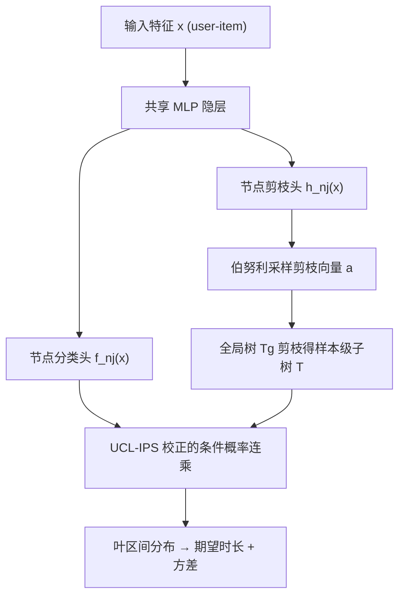

# Personalized Tree-Based Progressive Regression Model for Watch-Time Prediction in Short Video Recommendation (面向短视频推荐观看时长预测的个性化树结构渐进回归模型)

- **会议/期刊**: CIKM 2025
- **作者与机构**: Xiaokai Chen, Xiao Lin, Changcheng Li, Peng Jiang（快手科技）
- **推荐链路定位**: 精排（观看时长预估作为排序正项分）
- **研究方向**: CTR/CVR 预估与特征交叉 / 多任务学习与列表级重排
- **论文原文**: [https://arxiv.org/abs/2505.22153v2](https://arxiv.org/abs/2505.22153v2)
- **开源代码**: [WeChat Big Data Challenge 2021 仓库](https://github.com/WeChat-Big-Data-Challenge-2021/WeChat_Big_Data_Challenge)（仅数据集，模型代码暂未开源）

## TL;DR (1分钟核心速览)

短视频观看时长预估的主流 SOTA——TPM——把时长离散成有序区间并组织成**预定义满二叉树**，逐节点二分类。本文指出两大痛点：满二叉树强制**等宽划分**，无法适配用户/物品侧高度异质的时长分布；且树式条件建模在训练/推理间引入**样本选择偏差 (SSB)**。PTPM 将树结构学习重构为**全局树剪枝**问题，用 REINFORCE 自批判目标端到端学出样本级个性化子树，并以 IPS 校正条件概率。在 KuaiRec/CIKM16/WeChat21 三个数据集上 MAE 与 XAUC 全面最优（KuaiRec MAE 4.741→4.536，XAUC 0.599→0.622），线上 A/B 观看时长 +0.428%、延迟仅 +0.006%。

## Background & Motivation (背景与核心矛盾)

- **主流范式**: 观看时长预估已从 MSE 值回归、WLR 加权逻辑回归，演进到 D2Q/DML 的分组分位数回归，再到 CREAD/TPM 的**有序回归 + 离散化**路线；TPM 用满二叉树把回归拆成一串条件二分类，同时给出期望与方差（不确定性）。
- **前人局限**: ① TPM 的满二叉树等价于对时长空间做**等宽/等频划分**，而图 2 显示快手平台上用户平均观看时长呈重尾分布、不同视频类目的时长累积分布差异巨大，单一全局离散化必然次优；② 树式条件建模使每个分类器**只在落入父区间的样本上训练**，推理时却面对任意真值样本，产生选择偏差；③ 唯一研究离散化的 CREAD 依赖启发式公式 + 网格搜索，划分静态且需反复重训。
- **核心洞察 (Key Insight)**: 一棵足够大的全局树天然**蕴含大量候选子树**，因此"学树"不必从零搜索结构，而可等价转化为"在全局树上做选择性剪枝"——剪枝不改变分类器语义，只改变参与期望计算的节点集合，从而把**双层优化降维成单层联合训练**。
- **本文切入点**: 用输入相关的剪枝模型为每个 (user, item) 样本实时生成个性化子树，并用 IPS 把条件概率的连乘当作倾向分做无偏校正。

## Method (核心方法设计)

### 1. 整体框架 (Overall Architecture)

输入 user/video 特征向量 $x$，共享底层 MLP 后接两族任务头：每个非叶节点$n_j$上的分类头$f_{n_j}(x)$与剪枝头$h_{n_j}(x)$。训练分两路：一路在全局树$T_g$（深度 6 的满二叉树）上按 TPM 原目标训练分类器并施加 UCL 无偏损失；另一路用剪枝头输出各节点保留概率$p_i$，伯努利采样得到剪枝向量$a$，得到样本级子树$T=T_g\circledast a$，以自批判奖励$R_T-R_{T_g}$ 更新剪枝模型。推理时对每个请求实时生成子树，沿保留路径连乘条件概率得到叶区间分布，再按式 (2) 求期望时长与方差，作为排序正项分。

### 2. 关键设计拆解 (Key Designs)

1. **树结构学习 TSL（把双层优化变成剪枝）**：原始问题是外层选树、内层训分类器的嵌套优化，内层不收敛外层无法启动。PTPM 改写为 $T^{*}=\arg\min_{T=T_g\circledast a} \mathcal{L}_{tree}(\theta^{*}(T),T)$，并约束$\theta^{*}(T)=\theta^{*}(T_g)\odot(1-a_T)$——即子树直接**继承全局树参数、不重训**。合法性来自"子树是严格子树、路径语义不变"这一性质。剪枝动作不可导，故用 REINFORCE 且以全局树为基线构造自批判目标$\mathcal{L}_{tree}(T)=-\mathbb{E}_{T\sim p}(R_T-R_{T_g})$，其中$R_T=\mathrm{XAUC}(y,\hat{y})-\mathrm{MSE}(y,\hat{y})$，既降梯度方差又显式鼓励"剪后优于不剪"。

2. **无偏条件学习 UCL（IPS 校正 SSB）**：TPM 的 native 估计 $\hat{R}_{native}$只在$y_i\in n_{\phi_{l_k}(j-1)}$的样本上算损失，期望不等于真实风险。关键观察是：这个"进入条件"的生成过程恰好就是式 (1) 中前序条件概率的连乘，可直接当作倾向分$p(\hat{y}_i\in n_{\phi_{l_k}(j-1)}\mid x_i)$。于是把每层对数项除以该倾向分：

$$\mathcal{L}_{ce\text{-}UCL}=-\sum_{1\le j\le d(l_k)}\frac{\log p(\hat{y}_i\in n_{\phi_{l_k}(j)}\mid \hat{y}_i\in n_{\phi_{l_k}(j-1)},x_i,T)}{p(\hat{y}_i\in n_{\phi_{l_k}(j-1)}\mid x_i)}$$

   可证 $\mathbb{E}_I[\hat{R}_{IPS}]=\mathcal{R}$，即无偏。物理直觉：左侧浅区间样本被过度采样（欠估）、右侧深区间样本被欠采样（高估），除以倾向分正好把权重拉回均匀。

3. **训练目标、负采样与推理效率**：总损失 $\mathcal{L}_{PTPM}=\mathcal{L}_{tree}+\mathcal{L}_{ce\text{-}UCL}+\mathcal{L}_{reg}+\mathcal{L}_{var}$，回归项与方差项沿用 TPM；本任务为回归/有序分类，**不涉及负采样**。工程上不为每个节点单独建模型，而是**共享隐层 + 节点专属输出层**，参数量 32.55M vs TPM 32.27M、FLOPs 65.1M vs 64.55M，几乎零增量；剪枝搜索收敛也显著快于随机搜索（图 6 右）。

## Experimental Setup & Evaluation Protocol (实验设置与评估协议)

- **数据集与预处理**:

| 数据集 | #Users | #Items | #Interactions | 稀疏度/密度 | 特征/场景说明 |
| :--- | :---: | :---: | :---: | :---: | :--- |
| KuaiRec | 7,176 | 10,728 | 12,530,806 | 密度约 16.3% | 快手短视频，含全观测用户子集 |
| CIKM16 | 87,934 | 122,994 | 1,235,381 | 密度约 0.011% | 电商搜索后停留时长 |
| WeChat21 | 20,000 | 96,564 | 7.3M | 密度约 0.38% | 微信短视频偏好 |

- **数据划分与防穿越 (Splitting Strategy)**: 原文未显式声明划分方式与时间戳切分细节（属写作短板），按任务性质应为交互级比例划分；此处不做臆测。
- **排名评测协议 (Ranking Protocol)**: 采用 **MAE（回归精度）+ XAUC（成对排序一致性）** 双指标，XAUC 在全部样本对上计算，属**全量成对排序**而非采样排序；无负采样环节。
- **对比基线与超参设置**: 基线含 WLR、D2Q、OR、DML、CREAD、TPM 六种；为公平比较**统一骨干架构，仅替换输出层与损失**；全局树深度 $d(T_g)=6$；显著性以$p<0.05$ 标注。

## Key Experimental Results (实验关键数据)

### 1. 主实验对比 (Main Results)

| 方法 | KuaiRec MAE↓ | KuaiRec XAUC↑ | CIKM16 MAE↓ | CIKM16 XAUC↑ | WeChat21 MAE↓ | WeChat21 XAUC↑ |
| :--- | :---: | :---: | :---: | :---: | :---: | :---: |
| WLR | 6.047 | 0.525 | 0.998 | 0.672 | 20.738 | 0.668 |
| D2Q | 5.426 | 0.565 | 0.899 | 0.661 | 19.521 | 0.681 |
| OR | 5.321 | 0.558 | 0.918 | 0.664 | 19.876 | 0.679 |
| DML | 5.150 | 0.563 | 0.892 | 0.663 | 19.489 | 0.682 |
| CREAD | 5.230 | 0.586 | 0.910 | 0.669 | 19.534 | 0.682 |
| TPM | 4.741 | 0.599 | 0.884 | 0.676 | 19.355 | 0.688 |
| **PTPM** | **4.536\*** | **0.622\*** | **0.810\*** | **0.693\*** | **19.210\*** | **0.710\*** |
| Improv. vs TPM | -4.32% | +3.84% | -8.37% | +2.51% | -0.75% | +3.20% |

### 2. 消融实验 (Ablation Study)

| 变体 | KuaiRec MAE↓ | KuaiRec XAUC↑ | CIKM16 MAE↓ | CIKM16 XAUC↑ | WeChat21 MAE↓ | WeChat21 XAUC↑ |
| :--- | :---: | :---: | :---: | :---: | :---: | :---: |
| PTPM 完整 | **4.536** | **0.622** | **0.810** | **0.693** | **19.210** | **0.710** |
| w/o TSL | 4.650 | 0.605 | 0.870 | 0.680 | 19.330 | 0.691 |
| w/o UCL | 4.600 | 0.615 | 0.860 | 0.686 | 19.300 | 0.697 |
| TPM（基线） | 4.741 | 0.599 | 0.884 | 0.676 | 19.355 | 0.688 |

### 3. 关键实验发现 (Key Findings)

1. **TSL 是主增益来源，且增益随数据稀疏度放大**：去掉 TSL 后 KuaiRec MAE 退化 0.114、XAUC 掉 0.017；在 CIKM16 上 MAE 从 0.810 恶化到 0.870（相对退化 7.4%），说明越稀疏、分布越偏的数据越依赖个性化离散化，而非全局等宽划分。
2. **UCL 是"低成本高回报"的即插即用件**：仅加 IPS 校正即让 KuaiRec MAE 降 0.064、XAUC 升 0.007；图 7 进一步显示 TPM 在左侧浅区间系统性低估、右侧深区间系统性高估，UCL 把 prior/posterior 比值拉回 1.0 附近，分类器平均 AUC 从 0.59 升至 0.62。
3. **深度 6 是性价比拐点**：$d(T_g)$从 3 增至 6 时 PTPM 的 XAUC 持续上升，但学到的子树平均深度在$d(T_g)\ge 6$ 后收敛于约 4.6，说明剪枝自动压缩了冗余分支；线上 A/B 一周结果显示观看时长 +0.428%、延迟仅 +0.006%、CPU 时间 +0.052%，覆盖 4 亿 DAU，验证了"个性化树不带来线上开销"的工程主张。

## Highlights & Limitations (亮点、对比与审稿批判)

- **与代表作对比 (vs. Prior Work)**: 与 **TPM** 的本质区别是树从"预定义常量"变为"输入相关的可学习变量"，且额外修掉了 TPM 未意识到的 SSB；与 **CREAD** 相比，CREAD 是静态、样本无关的启发式划分 + 网格搜索重训，PTPM 是端到端、样本级、免重训的剪枝式搜索；与 **JTM/TDM** 相比，后两者用树做物品召回且逐层贪心建树，PTPM 用树做**任务空间分解**并一次性联合优化。
- **可迁移亮点**: ① "大结构 + 可学习剪枝 + 参数继承"这一范式可迁移到任何需要动态离散化/动态专家路由的回归任务（如时长、GMV、LTV 分桶）；② 把条件建模的进入概率直接复用为 IPS 倾向分，是树式/级联式模型去偏的通用技巧，几乎零额外开销。
- **审稿级局限批判**: ① 剪枝依赖 REINFORCE 采样，奖励含不可导的 XAUC，梯度方差与训练稳定性对基线 $R_{T_g}$ 的设计较敏感，论文未给出多随机种子方差；② 离线仅报 MAE/XAUC，缺少按用户活跃度、视频时长分桶的细粒度分析，也未讨论冷启动视频上剪枝模型（需 item 特征）是否退化；③ 数据集划分与时间切分未明确交代，存在潜在穿越风险。

## Rating (四维评分)

- **方法创新性 (Novelty)**: ⭐⭐⭐⭐ （把树结构学习重构为剪枝 + 参数继承，绕开双层优化，思路干净且有 IPS 无偏性证明支撑）
- **评估协议与实验扎实度 (Protocol & Experiments)**: ⭐⭐⭐⭐ （三数据集 + 六基线 + 消融 + 效率分析 + 4 亿 DAU 线上 A/B，但缺划分细节与分桶分析）
- **写作与数学规范度 (Clarity & Rigor)**: ⭐⭐⭐⭐ （式 (6)(11)(17) 推导清晰、IPS 无偏性证明完整，符号表规范；划分协议与部分实现细节略欠）
- **工业落地与复现价值 (Industrial & Practical Value)**: ⭐⭐⭐⭐⭐ （参数量/FLOPs 与 TPM 几乎持平、延迟 +0.006%，已全量上线核心流量，工程价值极高；可惜模型代码未开源）

