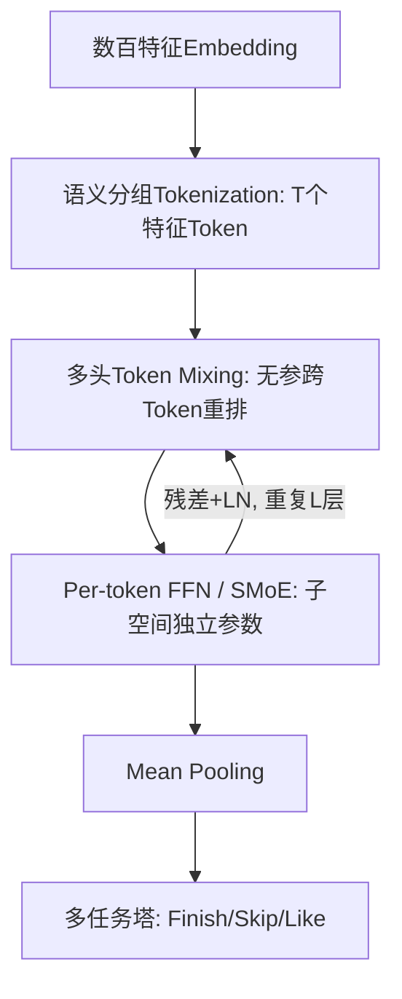
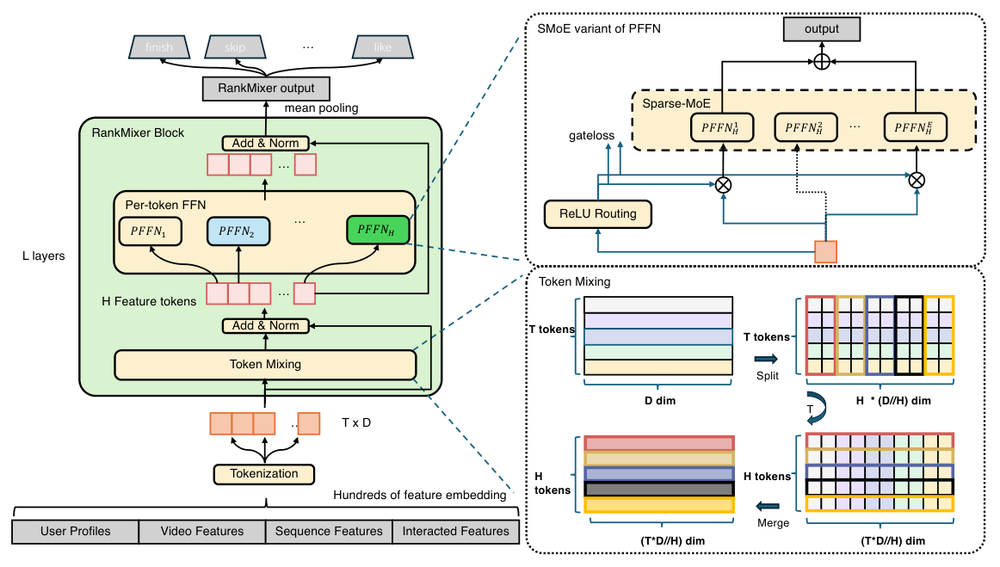

# RankMixer: Scaling Up Ranking Models in Industrial Recommenders (面向工业推荐系统的排序模型规模化)

- **会议/期刊**: CIKM 2025
- **作者与机构**: Jie Zhu, Zhifang Fan, Xiaoxie Zhu, Yuchen Jiang 等（字节跳动抖音团队）
- **推荐链路定位**: 精排（Ranking）
- **研究方向**: CTR/CVR 预估与特征交叉 / 多任务学习与列表级重排
- **论文原文**: [https://arxiv.org/abs/2507.15551v3](https://arxiv.org/abs/2507.15551v3)
- **开源代码**: 暂未开源

## TL;DR (1分钟核心速览)

工业精排模型长期沿用 CPU 时代手工特征交叉算子，在现代 GPU 上呈 Memory-bound，MFU 仅个位数，导致"加参数不加收益"的缩放困境。RankMixer 提出硬件对齐的统一骨干：用**无参多头 Token Mixing** 替代二次复杂度自注意力完成跨特征交互，用 **Per-token FFN** 为异构特征子空间分配独立参数，并以 **ReLU 路由 + 稠密训练稀疏推理 (DTSI)** 的稀疏 MoE 扩展至 10 亿参数。在抖音万亿级生产数据上，100M 参数版本 Finish AUC 相对 DLRM-MLP 提升 0.64%、Skip AUC 提升 0.86%，1B 版本分别提升 0.95%/1.25%；线上全流量部署使 MFU 从 4.47% 升至 44.57%，参数扩 70 倍而推理延迟持平（14.5ms→14.3ms），用户活跃天数 +0.29%、App 时长 +1.08%。

## Background & Motivation (背景与核心矛盾)

- **主流范式**: DLRM 类模型以"Embedding + 稠密特征交叉层"为核心，DCNv2、AutoInt、DHEN、Wukong 等不断堆叠更复杂的显式交叉算子来提升精度。
- **前人局限**: 其一，这些算子的核心操作（逐特征小矩阵乘、注意力权重矩阵）在现代 GPU 上是 **Memory-bound 而非 Compute-bound**，MFU 常年在个位数百分比，算力被大量浪费；其二，简单加宽/加深 DLRM 的收益微弱甚至为负，而 DHEN/Wukong 虽改进结构，却让 FLOPs 随参数近乎同步膨胀，**参数增长与计算成本未解耦**，缩放 ROI 极低。
- **核心洞察 (Key Insight)**: 推荐特征空间本质异构——用户 ID 空间可达上亿量级，与物品侧语义空间做内积相似度在数学上缺乏意义，因此自注意力在推荐场景并不优于**无参数**的跨 Token 重排；同时高频字段会在共享交互模块中淹没长尾信号，需要**参数隔离**的子空间建模。
- **本文切入点**: 放弃"设计更强交叉算子"，转而设计**硬件对齐的 Transformer 式统一骨干**，让参数增长主要落在访存友好的大 GEMM 上，从而同时拿到精度与效率。

## Method (核心方法设计)

### 1. 整体框架 (Overall Architecture)

输入侧将数百个异构特征 embedding 按领域知识聚成语义连贯的特征组，拼接后切分为 $T$个定长特征 Token（式 2），避免"一特征一 Token"导致的参数碎片化与"单 Token"退化为纯 DNN。随后堆叠$L$个 RankMixer Block，每块依次执行多头 Token Mixing 与 Per-token FFN，均带残差与 LayerNorm（式 1）；末端对$L$ 层输出做 mean pooling 得到样本表示，接多任务塔输出 Finish/Skip/Like 等目标。稀疏版本将 Per-token FFN 替换为 ReLU 路由的 SMoE，训练稠密、推理稀疏。

<figure class="paper-figure" markdown="span">
  <figcaption>图1：RankMixer 模块的架构。RankMixer 模块由两个模块组成：多头 Token 混合和基于 SMoE 的逐 Token FFN。Token 混合模块将每个 Token 的嵌入划分为 𝐻 个较小的部分（头），然后跨 Token 重新组合这些部分以生成新的混合 Token。这使得不同特征的信息能够相互交互。</figcaption>
</figure>

### 2. 关键设计拆解 (Key Designs)

1. **多头 Token Mixing（无参跨特征交互）**：自注意力需计算异构空间内积且产生 $O(T^2)$权重矩阵，访存开销大。本文将每个 Token 均分为$H$个头，把第$h$个头在所有 Token 上的切片直接拼接成新 Token：$\mathbf{s}_h = \mathrm{Concat}(\mathbf{x}_h^1,\mathbf{x}_h^2,\dots,\mathbf{x}_h^T)$，取$H=T$ 以保持 Token 数不变、支持残差。该算子零参数、纯数据搬移，却让每个新 Token 天然混合了全部特征的同一子空间视角，物理直觉是"用重排代替相似度计算"。

2. **Per-token FFN（子空间参数隔离）**：共享 FFN 会让高频字段主导梯度、淹没长尾。本文为第 $t$个 Token 配置专属两层 MLP：$\mathbf{v}_t = f^{\text{pffn}}_{t,2}(\mathrm{Gelu}(f^{\text{pffn}}_{t,1}(\mathbf{s}_t)))$，其中$f^{\text{pffn}}_{t,i}(\mathbf{x})=\mathbf{x}\mathbf{W}^{\text{pffn}}_{t,i}+\mathbf{b}^{\text{pffn}}_{t,i}$。与 MMoE（多专家共享同一输入）和 Transformer（多输入共享同一 FFN）不同，它**同时切分输入与参数**，在 FLOPs 不变的前提下把参数量乘以$T$，直接改善缩放斜率。

3. **ReLU 路由 + DTSI 稀疏 MoE 与训练目标**：Top-$k$均匀路由对低信息 Token 浪费预算、对高信息 Token 供给不足，且专家数随 Token 数爆炸导致欠训练。改用$\mathbf{G}_{i,j}=\mathrm{ReLU}(h(\mathbf{s}_i))$、$\mathbf{v}_i=\sum_{j=1}^{N_e}\mathbf{G}_{i,j}e_{i,j}(\mathbf{s}_i)$，以自适应$\ell_1$惩罚$\mathcal{L}=\mathcal{L}_{\text{task}}+\lambda\sum_{i}\sum_{j}\mathbf{G}_{i,j}$将平均激活率压至预算附近；训练用双路由$h_{\text{train}}$（稠密，保证专家充分梯度）与$h_{\text{infer}}$（稀疏，仅其受$\mathcal{L}_{\text{reg}}$ 约束），推理只用后者。负采样沿用工业日志真实曝光样本，无额外构造；推理侧靠大 GEMM 形状与 fp16 量化摊薄成本。

## Experimental Setup & Evaluation Protocol (实验设置与评估协议)

- **数据集与预处理**: 抖音线上日志两周数据，300+ 特征（数值、ID、交叉、序列），十亿级用户 ID、亿级视频 ID，日均万亿记录；稠密部分参数量与 FLOPs 单独统计，稀疏 embedding 不计入。

| 数据集 | #Users | #Items | #Interactions | 稀疏度/密度 | 特征/场景说明 |
| :--- | :---: | :---: | :---: | :---: | :--- |
| Douyin Production Logs | 十亿级 | 亿级 | 万亿/天（两周） | 极高稀疏 | 300+ 特征，Feed 推荐 + 广告双场景 |

- **数据划分与防穿越 (Splitting Strategy)**: 采用**全局时间戳切分**（按两周日志的时间顺序划分训练/评估），线上指标另由 8 个月长期反转 A/B 实验验证。
- **排名评测协议 (Ranking Protocol)**: 离线采用**真实曝光样本上的 AUC / UAUC**（非全库排序），以 Finish（完播）与 Skip（划走）双标签评估；作者声明 AUC 提升 0.0001 即视为统计显著。
- **对比基线与超参设置**: 基线含 DLRM-MLP（含 100M 加宽版）、DCNv2、RDCN、MoE、AutoInt、DHEN、HiFormer、Wukong；稠密部分统一 RMSProp（lr=0.01）、稀疏部分 Adagrad，百卡混合并行（稀疏异步/稠密同步）。100M 配置 $(D{=}768,T{=}16,L{=}2)$，1B 配置$(D{=}1536,T{=}32,L{=}2)$。

## Key Experimental Results (实验关键数据)

### 1. 主实验对比 (Main Results)

约 100M 参数同量级对比（相对 DLRM-MLP 基线 0.8554/0.8270/0.8124/0.7294 的提升）：

| Model | Finish AUC↑ | Finish UAUC↑ | Skip AUC↑ | Skip UAUC↑ | Params | FLOPs/Batch |
| :--- | :---: | :---: | :---: | :---: | :---: | :---: |
| DLRM-MLP-100M | +0.15% | — | +0.15% | — | 95 M | 185 G |
| DCNv2 | +0.13% | +0.13% | +0.15% | +0.26% | 22 M | 170 G |
| AutoInt | +0.10% | +0.14% | +0.12% | +0.23% | 19.2 M | 307 G |
| DHEN | +0.18% | +0.26% | +0.36% | +0.52% | 22 M | 158 G |
| HiFormer | +0.48% | — | — | — | 116 M | 326 G |
| Wukong | +0.29% | +0.29% | +0.49% | +0.65% | 122 M | 442 G |
| **RankMixer-100M** | **+0.64%** | **+0.72%** | **+0.86%** | **+1.33%** | 107 M | 233 G |
| **RankMixer-1B** | **+0.95%** | **+1.22%** | **+1.25%** | **+1.82%** | 1.1 B | 2.1 T |

线上 A/B（抖音主端 / 极速版，均统计显著）：活跃天数 +0.2908% / +0.1968%，App 时长 +1.0836% / +0.9869%，点赞 +2.3852% / +1.1318%，完播 +1.9874% / +2.0744%；广告场景 ΔAUC +0.73%、ADVV +3.90%。

### 2. 消融实验 (Ablation Study)

| 设置 | ΔAUC |
| :--- | :---: |
| w/o skip connections | −0.07% |
| w/o multi-head token mixing | −0.50% |
| w/o layer normalization | −0.05% |
| Per-token FFN → shared FFN | −0.31% |
| 路由替换为 All-Concat-MLP | −0.18% |
| 路由替换为 All-Share | −0.25% |
| 路由替换为 Self-Attention | −0.03%（+16% 参数、+71.8% FLOPs） |

### 3. 关键实验发现 (Key Findings)

1. **Token Mixing 是收益主引擎，自注意力是负性价比**：移除多头 Token Mixing 掉 0.50% AUC，为全部消融之最；而换成自注意力仅多 0.03% 却要多付 71.8% FLOPs，直接证伪了"推荐精排必须用注意力"的惯性认知。
2. **参数隔离优于参数共享**：Per-token FFN 退回共享 FFN 掉 0.31%，All-Share 路由掉 0.25%，说明异构特征子空间的独立建模是缩放收益的结构性来源，而非单纯堆参数。
3. **稀疏化几乎无损、且低活用户受益最大**：DTSI + ReLU 路由在 1/8 激活率下仍保留 1B 稠密模型几乎全部精度，吞吐提升约 50%；线上低活用户活跃天数提升 1.7412%，远高于高活用户的 0.1445%，体现强泛化性。

## Highlights & Limitations (亮点、对比与审稿批判)

- **与代表作对比 (vs. Prior Work)**: 相较 DHEN/Wukong 继续"设计更强交叉算子"，本文反向做减法——用无参重排替代注意力，把创新点放在**参数-计算解耦**上；相较 HSTU 等生成式推荐聚焦序列侧缩放，本文聚焦**特征交叉侧**的稠密骨干缩放，二者正交可组合。
- **可迁移亮点**: ①"无参 Token 重排 + 参数隔离 FFN"可作为通用稠密骨干替换任意精排模型的交叉层；②DTSI（稠密训练/稀疏推理）双路由方案可低成本迁移到任何 MoE 化推荐模型，缓解专家欠训练与死亡专家问题。
- **审稿级局限批判**: ①离线评估基于真实曝光样本的 AUC 而非全库排序，存在曝光偏差，且数据为内部万亿级日志、无公开数据集与代码，复现性受限；②1B 模型 FLOPs 仍增长 20.7 倍，延迟持平高度依赖 fp16 量化与算子融合等工程优化，缺乏对 Token 数 $T$、头数$H$ 与稀疏率的敏感性分析，跨业务迁移成本未知。

## Rating (四维评分)

- **方法创新性 (Novelty)**: ⭐⭐⭐⭐ （以"无参重排替代注意力 + 输入参数双切分"重构特征交叉范式，工程洞察深刻，但单点算子理论新颖度中等）
- **评估协议与实验扎实度 (Protocol & Experiments)**: ⭐⭐⭐⭐ （万亿级数据、8 个月长期 A/B、双场景验证与完整消融俱佳，扣分在无公开数据集与全库排序评估）
- **写作与数学规范度 (Clarity & Rigor)**: ⭐⭐⭐⭐ （公式简洁、缩放轴与延迟分解公式清晰，但部分符号（如 $k$、$N_e$与$T$ 关系）交代略松散）
- **工业落地与复现价值 (Industrial & Practical Value)**: ⭐⭐⭐⭐⭐ （全流量部署、MFU 提升 10 倍、参数扩 70 倍延迟不增，是工业缩放范式的标杆级落地证据）

