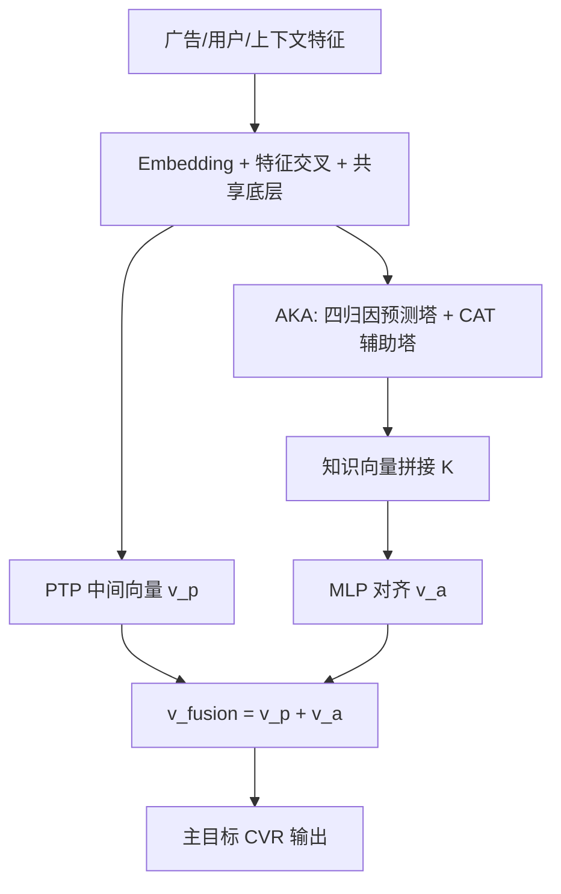
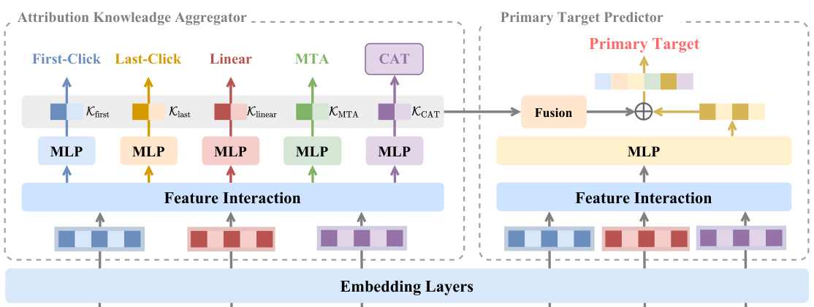

# See Beyond a Single View: Multi-Attribution Learning Leads to Better Conversion Rate Prediction (超越单一视角：多归因学习带来更好的转化率预估)

- **会议/期刊**: CIKM 2025
- **作者与机构**: Sishuo Chen, Zhangming Chan, Xiang-Rong Sheng, Lei Zhang, Sheng Chen, Chenghuan Hou, Han Zhu, Jian Xu, Bo Zheng（阿里巴巴淘天集团）
- **推荐链路定位**: 精排（CVR 预估，服务自动出价与流量分配）
- **研究方向**: CTR/CVR 预估与特征交叉 / 多任务学习
- **论文原文**: [https://arxiv.org/abs/2508.15217v1](https://arxiv.org/abs/2508.15217v1)
- **开源代码**: 暂未开源

## TL;DR (1分钟核心速览)

工业 CVR 模型只用单一生产归因机制（如 Last-Click）生成的标签训练，把其他归因视角下的互补信号全部丢弃。本文提出多归因学习框架 MAL：用归因知识聚合器（AKA）以多任务方式同时拟合 Last-Click / First-Click / Linear / MTA 四种归因标签，抽取各塔倒数第二层知识向量拼接后注入主目标预测器（PTP），再用笛卡尔积辅助任务 CAT 把 4 个二值标签组合成 16 类分类任务以丰富监督。在淘宝展示广告真实数据上，Last-Click 为主目标时 GAUC 相对提升 +0.51%、AUC +0.14%；线上 A/B 测试 ROI +2.6%、GMV +2.7%。

## Background & Motivation (背景与核心矛盾)

- **主流范式**: 工业平台虽向广告主提供多种归因报表，但为运维简单，CVR 模型只用单一"生产关键"归因机制（多为 Last-Click 或 MTA）生成的标签训练，预测值再驱动自动出价与流量分配。
- **前人局限**: 其一，Last-Click 把转化前所有非末次触点一律打成负样本，早期真正起作用的触点被误标，用户意图建模被截断；其二，Linear/MTA 会把转化信用分摊到多个触点，天然产生更多正样本（淘宝实测 Linear 正样本比 Last-Click 多 42%、MTA 多 15%），单归因范式完全浪费了这部分信息增益。
- **核心洞察 (Key Insight)**: 不同归因机制是对同一转化行为的不同"投影"，其标签差异本身携带了用户转化路径的结构信息；把多归因标签当作辅助任务联合学习，等价于给主任务注入更细粒度的行为监督。
- **本文切入点**: 不改动生产主目标与部署形态，仅在训练期引入多归因辅助信号，通过"知识聚合 + 知识融合 + 笛卡尔积辅助目标"三步把辅助视角的知识迁移进主目标预测器。

## Method (核心方法设计)

### 1. 整体框架 (Overall Architecture)

MAL 采用 shared-bottom 范式：底层 Embedding 与特征交叉模块（含 SimTier 多模态特征、行为序列 Attention、MLP 主干）在所有任务间共享，输出共享表征 $v$。左半部分 AKA 为每个归因机制挂独立预测塔，另加一个 CAT 辅助塔，各塔倒数第二层输出即"转化知识向量"$\mathcal{K}_{a}$，拼接为统一知识表征$\mathcal{K}$；右半部分 PTP 复用生产模型结构，将$\mathcal{K}$经 MLP 对齐后与自身中间向量$v_p$ 逐元素相加，再经二分类头输出主目标转化概率。训练端到端联合优化，推理时仅需 PTP 通路，AKA 塔可离线或旁路，部署成本可控。

<figure class="paper-figure" markdown="span">
  <figcaption>图3：MAL的整体框架。</figcaption>
</figure>

### 2. 关键设计拆解 (Key Designs)

1. **归因知识聚合器 AKA（把多归因标签变成可迁移知识）**：痛点是单归因标签信息被截断。AKA 对每个归因机制 $a$建独立塔，以归因权重$l\in[0,1]$为软标签、样本权重$w$做加权二元交叉熵：$\mathcal{L}_{a}=\sum_{\mathcal{D}}w\cdot\left[-l\log\sigma(\hat{y})-(1-l)\log(1-\sigma(\hat{y}))\right]$。各塔倒数第二层输出$\mathcal{K}_{\text{first}},\mathcal{K}_{\text{last}},\mathcal{K}_{\text{linear}},\mathcal{K}_{\text{mta}}$拼接为$\mathcal{K}$。直觉：不同归因塔被迫学习"同一曝光在不同信用分配下的转化倾向"，其隐层表征自然编码了转化路径的互补结构，比原始特征更贴近主任务所需。

2. **主目标预测器 PTP 与知识融合（保证与生产口径对齐）**：痛点是辅助知识若直接混入会污染主目标校准。PTP 保持生产模型同构，仅将 $\mathcal{K}$经 MLP 投影到$v_p$的语义空间得$v_a=\mathrm{MLP}(\mathcal{K})$，再逐元素相加$v_{\text{fusion}}=v_p+v_a$ 送入二分类头，且 PTP 自身仍以主目标交叉熵训练。直觉：加法融合近似残差注入，主通路梯度可"选择性吸收"辅助知识，避免辅助任务主导优化方向。

3. **笛卡尔积辅助训练 CAT（把 4 个二值标签升级为 16 类监督）**：痛点是四个独立二值任务丢失了归因标签间的联合模式。CAT 对 $N$个归因二值标签做笛卡尔积，按$O\leftarrow O+A[i]\times 2^{i}$编码为$2^{N}$类（本文$N=4$即 16 类），新增一个辅助塔拟合该多分类目标，其知识向量$\mathcal{K}_{\text{CAT}}$一并拼入$\mathcal{K}$。直觉：某一曝光在 Last-Click 下为负、在 Linear 下为正的组合模式，恰好刻画了"早期影响型触点"，多分类目标迫使模型显式区分这类细粒度行为模式。总损失为主目标损失与各归因/CAT 辅助损失之和，负样本沿用曝光未转化样本（无额外负采样），推理仅走 PTP 单塔。

## Experimental Setup & Evaluation Protocol (实验设置与评估协议)

- **数据集与预处理**: 无公开多归因 CVR 数据集，采用淘宝展示广告系统真实日志，含四种归因机制标签：

| 数据集 | #Users | #Items | #Interactions | 稀疏度/密度 | 特征/场景说明 |
| :--- | :---: | :---: | :---: | :---: | :--- |
| Taobao Display Ads | 未披露 | 未披露 | 两个月点击日志 | 未披露 | 广告/用户/上下文特征 + 多模态与行为序列；Last-Click 正样本比例为 $r$，Linear 为$1.42r$，MTA 为$1.15r$ |

- **数据划分与防穿越 (Splitting Strategy)**: 全局时间戳切分——前两个月日志训练，紧随其后一天日志测试，严格防穿越。
- **排名评测协议 (Ranking Protocol)**: 工业全量曝光日志上的 AUC 与 GAUC（按用户分组加权，权重为 #click），AUC 计算计入样本权重；GAUC 为生产核心指标，与线上表现一致性更强。
- **对比基线与超参设置**: 基线含生产模型 Base（单归因）与四种 SOTA 多任务结构 Shared-Bottom、MMoE、PLE、HoME（各辅助目标为独立任务）；所有方法训练 1 个 epoch；做两组实验分别以 Last-Click 与 MTA 为主目标以验证泛化性。

## Key Experimental Results (实验关键数据)

### 1. 主实验对比 (Main Results)

| 主目标 | \multicolumn{2}{c|}{Last-Click} | \multicolumn{2}{c|}{MTA} |
| :--- | :---: | :---: | :---: | :---: |
| 方法 / 指标 | GAUC | AUC | GAUC | AUC |
| Base（生产） | 0.7819 | 0.9110 | 0.7824 | 0.9042 |
| Shared-Bottom | 0.7843 (+0.31%) | 0.9119 (+0.10%) | 0.7858 (+0.43%) | 0.9053 (+0.12%) |
| MMoE | 0.7825 (+0.08%) | 0.9115 (+0.05%) | 0.7844 (+0.26%) | 0.9049 (+0.08%) |
| PLE | 0.7836 (+0.22%) | 0.9117 (+0.08%) | 0.7861 (+0.47%) | 0.9055 (+0.14%) |
| HoME | 0.7825 (+0.08%) | 0.9116 (+0.07%) | 0.7846 (+0.28%) | 0.9052 (+0.11%) |
| **MAL (Ours)** | **0.7859 (+0.51%)** | **0.9123 (+0.14%)** | **0.7873 (+0.75%)** | **0.9061 (+0.21%)** |

### 2. 消融实验 (Ablation Study)

| 模型（主目标 Last-Click） | GAUC | AUC |
| :--- | :---: | :---: |
| Base | 0.7819 (+0.00%) | 0.9110 (+0.00%) |
| MAL w/o CAT | 0.7849 (+0.38%) | 0.9123 (+0.14%) |
| MAL w/o 多归因（各塔均用主目标训练） | 0.7820 (+0.01%) | 0.9110 (+0.00%) |
| **MAL 完整** | **0.7859 (+0.51%)** | **0.9123 (+0.13%)** |

### 3. 关键实验发现 (Key Findings)

1. **增益来自信息而非参数**：把 AKA 所有塔都改用主目标标签训练（参数量不变）后，GAUC 仅 +0.01%、AUC 持平，几乎退回 Base，直接排除"参数变多带来提升"的猜想，证明 +0.51% GAUC 主要源于多归因视角的信息增益。
2. **增益与正样本增量强正相关**：按 Linear 相对 Last-Click 的正样本增量对用户分桶，零增量组 GAUC 仅 +0.19%，增量 ≥10 的组飙升至 +1.23%；行业维度同样成立——长转化路径的大件家电（正样本 +70.63%，AUC +0.15%）、珠宝（+50.15%，+0.14%）显著优于短路径的宠物用品（+30.13%，+0.06%），说明 MAL 精准吃到了多触点分摊带来的额外监督。
3. **CAT 与 AKA 互补且线上兑现**：AKA 单独贡献 +0.38% GAUC，叠加 CAT 再 +0.13% GAUC（AUC 不变），表明笛卡尔积联合模式主要改善用户内排序；线上 A/B（2025-05-21 至 05-25）ROI +2.6%、GMV +2.7%、BuyCnt +1.2%，高单价行业 BuyCnt 提升最猛（大件家电 +11.6%、珠宝 +9.7%），与离线行业分析完全吻合。

## Highlights & Limitations (亮点、对比与审稿批判)

- **与代表作对比 (vs. Prior Work)**: 与 ESMM/ESCM-2 等联合学习工作相比，本文的辅助任务不是 CTR 等相邻行为，而是"同一转化在不同信用分配规则下的标签重投影"，辅助信号与主任务同源但视角互补；与 MMoE/PLE/HoME 等通用 MTL 结构相比，MAL 的关键不在专家网络设计，而在"知识向量抽取 + 加法融合 + 笛卡尔积目标"的任务构造，实验显示通用 MTL 直接套用最多只拿到 +0.47% GAUC，远逊 MAL 的 +0.75%（MTA 主目标）。
- **可迁移亮点**: 其一，"辅助标签 = 同一事件的不同标注规则"这一思路可迁移到延迟反馈（不同归因窗口）、多场景（不同业务口径）等标签口径不一致的联合建模；其二，CAT 的笛卡尔积编码是一种零额外标注成本的细粒度监督增强手段，适用于任意多个二值辅助标签的组合建模。
- **审稿级局限批判**: 其一，实验仅限淘宝单一平台私有数据，缺乏公开多归因基准，且数据集统计（用户数、物品数、稀疏度）未披露，复现与横向比较受限；其二，AKA 多塔 + CAT 塔使训练侧参数量与显存开销上升，论文未给出训练/推理延迟与吞吐的量化分析，也未讨论归因机制数量 $N$增大时$2^{N}$ 类目标的扩展性与长尾类别问题。

## Rating (四维评分)

- **方法创新性 (Novelty)**: ⭐⭐⭐⭐ （首次把"多归因标签"作为辅助监督引入工业 CVR，CAT 的笛卡尔积目标构造简洁且有信息论直觉支撑，但整体仍是 shared-bottom + 知识融合的工程组合）
- **评估协议与实验扎实度 (Protocol & Experiments)**: ⭐⭐⭐⭐ （时间切分防穿越、双主目标交叉验证、参数对照消融与用户/行业分桶归因分析完整，并有线上 A/B 佐证；扣分在单平台私有数据、无公开基准与显著性检验细节）
- **写作与数学规范度 (Clarity & Rigor)**: ⭐⭐⭐⭐ （框架图与 CAT 示例清晰、公式简洁，但 Eq.(1) 排版有符号瑕疵，缺少复杂度与训练开销分析）
- **工业落地与复现价值 (Industrial & Practical Value)**: ⭐⭐⭐⭐⭐ （与生产模型同构、推理仅走 PTP 单通路，线上 ROI +2.6% 已兑现，落地路径极清晰；可惜未开源）

