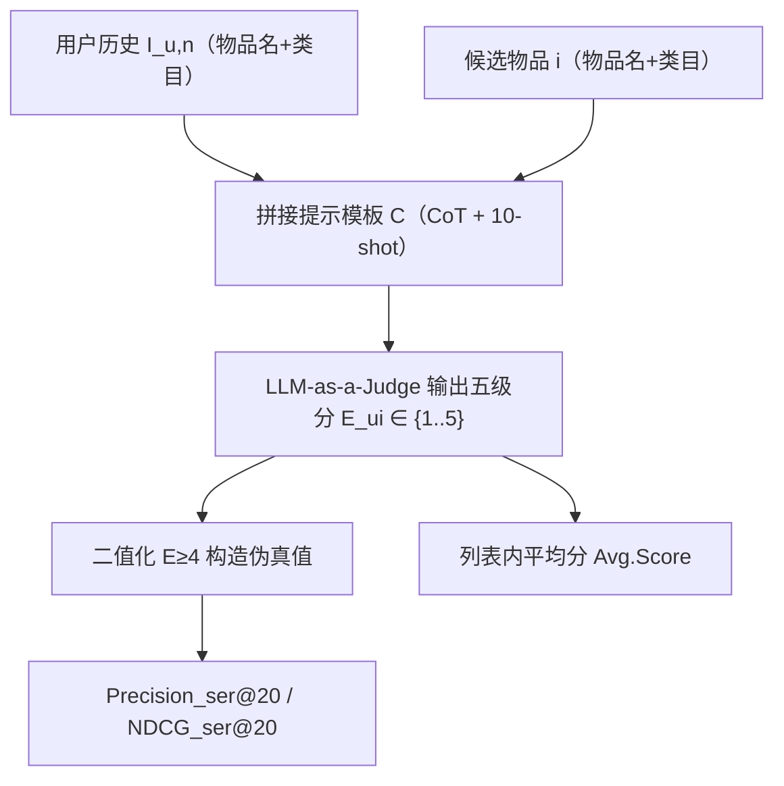
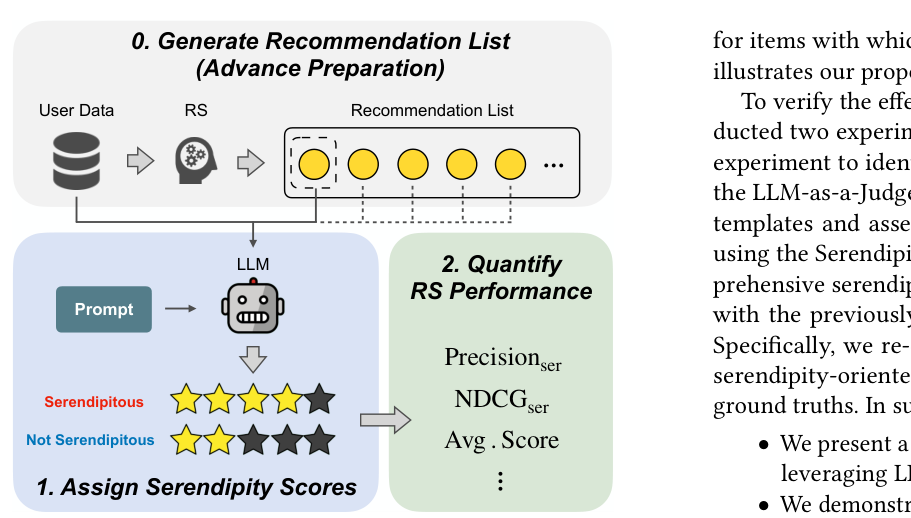

# A Universal Framework for Offline Serendipity Evaluation in Recommender Systems via Large Language Models (基于大语言模型的推荐系统离线惊喜度通用评测框架)

- **会议/期刊**: CIKM 2025
- **作者与机构**: Yu Tokutake, Kazushi Okamoto, Kei Harada, Koki Karube (The University of Electro-Communications); Atsushi Shibata (Advanced Institute of Industrial Technology)
- **推荐链路定位**: 离线评测（不涉及召回/排序模型本身，作用于任意 RS 的输出列表）
- **研究方向**: 去偏公平、可信隐私与工业架构 / 大语言模型推荐
- **论文原文**: [https://arxiv.org/abs/2508.17571v1](https://arxiv.org/abs/2508.17571v1)
- **开源代码**: 暂未开源

## TL;DR (1分钟核心速览)

惊喜度 (serendipity) 的离线评测长期受困于"真值不可观测"：自定义指标依赖人为阈值、带标注数据集只覆盖电影/图书两个域。本文提出以 LLM-as-a-Judge 作为评测器的通用框架——把用户最近 10 条历史与候选物品的名称+类目喂给 LLM，输出 1–5 级惊喜度分，再据此计算 Precision/NDCG 类指标或平均分。在 Serendipity-2018 上 CoT 提示取得 MAE 0.847、三分类准确率 46.98%（GPT-4o-mini），显著优于 Base 的 1.473/20.79%；随后在 ML-1M、Goodreads、Beauty 三个无真值数据集上重评 6 个 RS，发现没有任何惊喜度导向模型能全面胜出。

## Background & Motivation (背景与核心矛盾)

- **主流范式**: 惊喜度被普遍拆解为 relevance + unexpectedness 两个成分；离线评测分两派——(1) 自定义指标（如把"不在测试集 top-50 高分或 top-50 热门"的物品判为 unexpected）计算列表重叠率；(2) 使用 Serendipity-2018、SerenLens 等带人工惊喜度标注的数据集，套用 Precision/NDCG。
- **前人局限**: 派别 (1) 对所有用户使用同一硬阈值，忽略个体差异，且部分指标与特定 RS 内部结构耦合，跨模型不可比；派别 (2) 的真值数据集仅覆盖电影与图书两个域，且 SerenLens 只有二值标注，泛化性被锁死。
- **核心洞察 (Key Insight)**: LLM 在大规模多元语料上预训练，具备"类人"的常识与推理能力，理论上可以像人类评审一样，仅凭用户历史与物品语义判断"这个推荐对这个人是否既意外又有用"，从而把评测从"依赖真值/阈值"转为"依赖语义推理"。
- **本文切入点**: 不做推荐模型，只做评测器——用 LLM-as-a-Judge 对推荐列表逐项打五级分，分数既可当连续信号（Avg. Score）也可二值化（$E \geq 4$ 视为惊喜）后套用标准准确率指标，且对用户未交互过的物品同样可打分（支持反事实评测）。

## Method (核心方法设计)

### 1. 整体框架 (Overall Architecture)

框架分三步闭环：先由待评测 RS 为每个用户生成 top-$K$推荐列表（预备阶段）；再将"用户最近$n=10$条历史（物品名+类目）+ 候选物品（物品名+类目）+ 提示模板$\mathcal{C}$"拼接送入 LLM，得到五级惊喜度分$E_{ui}$；最后按两种方式量化 RS 表现——直接对列表内分数取均值（Avg. Score@20），或以$E_{ui}\geq 4$ 构造伪真值后计算 Precisionser@20 / NDCGser@20。整个流程只依赖文本信息，与具体 RS 的内部结构解耦。

<figure class="paper-figure" markdown="span">
  <figcaption>图1：所提出的评估框架概览。惊喜度得分高于四的项目被视为对用户具有惊喜性。</figcaption>
</figure>

### 2. 关键设计拆解 (Key Designs)

1. **五级细粒度评分替代二值判定**：前作 Tokutake et al. 只让 LLM 做二分类判断，信息损失大且无法刻画"中等惊喜"。本文将输出扩展为 1–5 级（3 为中性），形式化为 $E_{ui}\leftarrow P_{\text{LLM}}(x(I_{u,n},i)\oplus \mathcal{C})$，$E_{ui}\in\{1,2,3,4,5\}$。细粒度分数带来双重灵活性：既能直接当序数信号算均值，也能在任意阈值处二值化，从而兼容既有准确率指标体系。

2. **CoT 三步分解提示（核心增量）**：Base 提示只要求直接给分，模型缺乏推理锚点。CoT 提示把评测显式拆成 relevance → unexpectedness → serendipity 三步，逐步输出子分数再汇总；LtM 进一步把三步拆成三个独立子提示串行调用。直觉是：惊喜度本质是两个维度的组合判断，强制模型先分别评估再综合，等价于给 LLM 注入了一个结构化的"评分量表"，显著降低打分漂移。所有模板统一采用 10-shot（每个分数档给 2 个示例）。

3. **训练目标、负采样与推理开销**：本文无训练环节，无损失函数；"负采样"仅出现在下游 RS 评测的数据构造中（隐式反馈正样本为评分 $\geq 4$，负样本随机采样）。推理开销是主要代价：每个 (用户, 物品) 对需一次 LLM 调用，CoT 单次调用内完成三步，LtM 则需 3 次调用，成本约为 CoT 的 3 倍——这也是作者最终选 CoT 而非 LtM 的工程理由。

## Experimental Setup & Evaluation Protocol (实验设置与评估协议)

- **数据集与预处理**:

| 数据集 | #Users | #Items | #Interactions | 特征/场景说明 |
| :--- | :---: | :---: | :---: | :--- |
| Serendipity-2018 | — | — | 2,150 条标注 | 电影域，含五级惊喜度人工真值（分布 1:321 / 2:1022 / 3:586 / 4:208 / 5:13），仅用于提示选择实验 |
| ML-1M | 6,038 | 3,533 | 575,281 | 电影域，20 个类目 |
| Goodreads | 18,522 | 25,439 | 883,573 | 图书域，11 个类目 |
| Beauty | 22,269 | 12,086 | 154,272 | 亚马逊电商，233 个类目 |

  三个 RS 评测数据集均做隐式反馈转换：评分 $\geq 4$ 视为正交互，其余丢弃，负样本随机采样。

- **数据划分与防穿越 (Splitting Strategy)**: 采用**全局时间戳切分 + 三折交叉验证**——交互按时间排序后等分为 10 份，前 6 份训练、第 7 份验证、第 8 份测试，起始位置每次后移一份，重复三次，严格防止未来信息泄漏。
- **排名评测协议 (Ranking Protocol)**: 准确率侧用 Precisionacc@20 与 NDCGacc@20（基于测试集正交互）；惊喜度侧用 Precisionser@20 与 NDCGser@20（$E\geq 4$ 为惊喜），外加 Avg. Score@20。所有结果取三折平均。
- **对比基线与超参设置**: 6 个 RS——准确率导向的 BPRMF、SASRec；惊喜度导向的 KFN（$k$-NN 推荐"相似用户不喜欢"的物品）、UAUM（MF + unexpectedness 项）、DESR（DL 长短期偏好）、PURS（自注意力建模会话意外性）。超参用 TPE 贝叶斯优化，每个 RS 每折 100 次试验，目标函数为 Recallacc@10 以保证准确率底线。LLM 侧：GPT-4o-mini 与 4-bit 量化 Llama-3.1-70B Instruct，temperature=0.0。

## Key Experimental Results (实验关键数据)

### 1. 主实验对比 (Main Results)

提示模板选择实验（Serendipity-2018，准确率为三分类百分比）：

| Prompt | MAE (GPT) | Acc (GPT) | MAE (Llama) | Acc (Llama) |
| :--- | :---: | :---: | :---: | :---: |
| Base | 1.473 | 20.79 | 2.265 | 27.49 |
| LS | 1.159 | 30.74 | 1.731 | 13.67 |
| **CoT** | **0.847** | **46.98** | **1.117** | 34.05 |
| LtM | 1.014 | 40.88 | 1.356 | **35.26** |

RS 重评实验（节选核心列，三折平均，% ；Avg 为分数值）：

| RS | ML-1M Pser | ML-1M Nser | ML-1M Avg | Goodreads Pser | Goodreads Nser | Beauty Pser | Beauty Nser | Beauty Avg |
| :--- | :---: | :---: | :---: | :---: | :---: | :---: | :---: | :---: |
| BPRMF | **8.51** | 8.17 | 2.378 | 0.995 | 0.991 | 0.412 | 0.389 | 2.189 |
| SASRec | 5.95 | 5.87 | 2.339 | 1.28 | 1.30 | 0.243 | 0.210 | 2.187 |
| KFN | 3.38 | 3.36 | 2.134 | 1.13 | 1.19 | 0.125 | 0.105 | 2.168 |
| UAUM | 8.25 | 8.16 | 2.334 | 1.41 | 1.38 | 0.393 | 0.398 | 2.155 |
| DESR | 7.90 | **8.38** | 2.346 | 1.01 | 1.05 | 0.152 | 0.145 | 2.172 |
| PURS | 6.50 | 6.59 | **2.387** | **1.33** | **1.41** | **1.06** | **0.946** | **2.224** |

### 2. 消融实验 (Ablation Study)

原文未设传统模块消融，但提示策略对比本身即构成"推理链消融"：

| 配置 | 相对 Base 的 MAE 变化 (GPT) | 相对 Base 的 Acc 变化 (GPT) |
| :--- | :---: | :---: |
| Base（无量表） | — | — |
| + Likert 量表 (LS) | −0.314 | +9.95 |
| + 三步 CoT | **−0.626** | **+26.19** |
| + LtM 子提示拆分 | −0.459 | +20.09 |

### 3. 关键实验发现 (Key Findings)

1. **推理链是精度主引擎，而非量表描述**：仅加 Likert 量表只把 GPT 准确率从 20.79% 提到 30.74%，而加入三步 CoT 后跃升至 46.98%、MAE 降至 0.847（低于 1.0，意味着平均能正确区分惊喜/非惊喜两侧）；LtM 反而因过度拆分导致误差累积，GPT 上不如 CoT。
2. **惊喜度导向模型并非稳赢**：PURS 在 Beauty 上 Pser 1.06 远超 BPRMF 的 0.412，但在 ML-1M 上 Pser 仅 6.50，反被 BPRMF 的 8.51 压制；UAUM 在 Goodreads 上 Pser 1.41 居首。结论是"最优惊喜度模型随域而变"，简单 MF 类方法在部分场景可与复杂 DL 模型打平甚至反超。
3. **LLM 打分分布与真人分布对齐**：所有数据集、所有 RS 的 Avg. Score 稳定落在 2.1–2.4 区间，与 Serendipity-2018 真值分布的重心（大量样本集中在 2 分档）高度吻合，间接佐证 LLM 评审未出现系统性乐观/悲观偏移。

## Highlights & Limitations (亮点、对比与审稿批判)

- **与代表作对比 (vs. Prior Work)**: 相比 Zheng et al. 的 UAUM 类阈值指标（固定 top-50 规则、用户无关），本文用 LLM 做用户个性化语义判断，彻底摆脱硬阈值；相比 Serendipity-2018 / SerenLens 依赖人工标注的路线，本文只需物品名与类目文本，可零成本迁移到任意域；相比 Tokutake et al. 的二值 LLM 判定，本文升级为五级评分并系统比较了四种提示策略，准确率提升逾 26 个百分点。
- **可迁移亮点**: (1) "先分维度打分再综合"的 CoT 模板可直接复用到其他主观指标（新颖性、多样性、可解释性）的 LLM 评测；(2) 用 Avg. Score 分布与已知真值分布做"分布对齐校验"，是一种低成本验证 LLM 评审无偏的实用技巧。
- **审稿级局限批判**: (1) 成本与可扩展性存疑——每个 (用户, 物品) 对一次 LLM 调用，top-20 列表 × 数万用户意味着百万级 API 调用，论文未报告延迟与费用，也未做 LLM 评审与真人评分的相关性显著性检验（仅在三分类准确率上对比）；(2) 提示选择实验仅在单一电影域数据集上完成，CoT 在图书/电商域的迁移有效性未被验证，且 10-shot 示例本身可能引入域偏置；此外 $E\geq4$ 的阈值选择缺乏敏感性分析。

## Rating (四维评分)

- **方法创新性 (Novelty)**: ⭐⭐⭐⭐ （首次把 LLM-as-a-Judge 系统化为惊喜度离线评测框架，五级评分+双路量化设计巧妙，但本质是提示工程组合，理论深度有限）
- **评估协议与实验扎实度 (Protocol & Experiments)**: ⭐⭐⭐ （时间切分+三折交叉验证规范，但提示选择仅单数据集、无显著性检验、无 LLM-人类相关性量化分析）
- **写作与数学规范度 (Clarity & Rigor)**: ⭐⭐⭐⭐ （5 页短文结构紧凑，问题形式化与提示模板图示清晰，公式简洁无冗余）
- **工业落地与复现价值 (Industrial & Practical Value)**: ⭐⭐⭐ （框架与模型无关、即插即用，但百万级 LLM 调用成本与未开源代码削弱了直接落地性）

