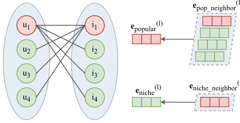
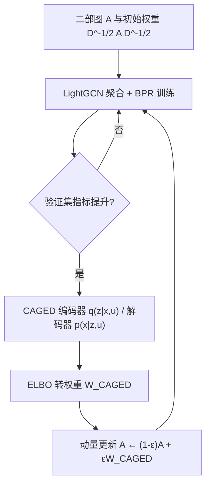

# Causality-aware Graph Aggregation Weight Estimator for Popularity Debiasing in Top-K Recommendation (面向 Top-K 推荐的因果感知图聚合权重估计器)

- **会议/期刊**: CIKM 2025
- **作者与机构**: Yue Que, Yingyi Zhang, Xiangyu Zhao, Chen Ma（香港城市大学、大连理工大学）
- **推荐链路定位**: 召回（图协同过滤表征学习）
- **研究方向**: 去偏公平与工业架构 / 图神经网络推荐
- **论文原文**: [https://arxiv.org/abs/2510.04502v1](https://arxiv.org/abs/2510.04502v1)
- **开源代码**: [https://github.com/QueYork/CAGED](https://github.com/QueYork/CAGED)

## TL;DR (1分钟核心速览)

图协同过滤的邻域聚合会被高度数节点主导，形成流行度回声室。本文证明 LightGCN 的聚合权重 $\tilde{A}=D^{-1/2}AD^{-1/2}$本质上是因果推断中后门调整的一个特例，其权重对应历史交互似然$p(x|u)$，而 GCN 用逆平方根度数比粗暴近似该分布，缺乏最优性保证。作者提出 CAGED：以 VAE 式编码器-解码器优化交互似然的 ELBO 来逼近无偏聚合权重，并用动量更新平滑注入。在三个数据集上，全库排序下小众物品 Recall@20 相对 LightGCN 提升 19.50%–22.05%，整体 Recall@20 提升 1.45%–3.07%。

## Background & Motivation (背景与核心矛盾)

- **主流范式**: 以 LightGCN 为代表的二部图邻域聚合，逐层用 $1/\sqrt{|N(u)||N(i)|}$ 加权求和生成节点表征，是 Top-K 推荐的事实标准骨干。
- **前人局限**: 现有去偏分两派——边重构（AdvDrop、GALORE 增删边）与聚合重加权（APDA、AdjNorm 调边权）。二者共同的缺陷是：(1) 把聚合机制当作黑盒直接接受，只做外部修补，缺乏"聚合合理性"的理论刻画与最优性保证；(2) 直接用训练早期未收敛的表征去估计去偏权重，噪声反噬，训练与去偏失衡（GALORE、APDA 在部分数据集上整体指标甚至负增益）。
- **核心洞察 (Key Insight)**: 作者构造因果图 $U\to X, X\to V, X\to Y, V\to Y$，指出历史交互$X$是满足后门准则的混淆变量，且$X$反映用户流行度分布，故对$X$去混淆即等价于流行度去偏。进一步推导发现：单层聚合恰好写成期望形式$\mathbb{E}_{x\sim p(x|u)}[F(u)e_x^{(l-1)}]$，其中$p(x|u)\propto 1/\sqrt{|N(x)|}$——即 GCN 的聚合权重$=F(u)\cdot p(x|u)$，是后门调整的一个特例。
- **本文切入点**: 既然聚合权重就是历史似然，那就别用度数比近似它，而是显式学习真实的 $p_\theta(x|u)$ 并回填为聚合权重。

<figure class="paper-figure" markdown="span">
  <figcaption>图1：流行度偏差的玩具示例。节点𝑢1、𝑖1为流行节点，其余为小众节点。在该二分图的聚合过程中（左），流行节点聚合整个对侧集合，而小众节点只能纳入其共同的流行邻居（右）。</figcaption>
</figure>

## Method (核心方法设计)

### 1. 整体框架 (Overall Architecture)

CAGED 挂在 LightGCN 骨干旁：每个训练 epoch 分两阶段，第一阶段 LightGCN 用当前聚合权重矩阵 $\tilde{A}^{(t)}$正常训练 BPR；若验证集指标提升，则进入第二阶段，用当前表征训练 CAGED 的编码器-解码器，输出 ELBO 损失并转化为候选权重矩阵$W_{CAGED}$，再以混合因子$\epsilon$动量式累加进$\tilde{A}^{(t)}$。推理时仅保留更新后的$\tilde{A}$ 与 LightGCN，CAGED 分支不参与线上打分，零额外推理开销。

### 2. 关键设计拆解 (Key Designs)

1. **图聚合 = 后门调整的因果等价（理论基石）**：前人只把聚合当工程算子。本文把 $p(y|u,do(v))$按后门调整展开为$\mathbb{E}_{x\sim p(x|u)}[p(y|u,v,x)]$，并证明堆叠$L$层后的内积$\boldsymbol{e}_u^\top\boldsymbol{e}_v$仍保持同一期望形式，从而把"聚合权重"与"历史似然"严格对齐。这一等价把去偏问题从"调权重"转化为"估分布"，给出了缺失的最优性语义：最优聚合权重应正比于真实$p_\theta(x|u)$。

2. **ELBO 驱动的权重估计器（核心算子）**：真实 $p_\theta(x|u)$因闭环反馈而不可观测，故引入隐变量$z$（刻画系统曝光机制），令$p_\phi(z|x,u)\sim\mathcal{N}(\mu,\sigma^2 I)$、先验$\mathcal{N}(0,I)$，优化

$$\mathcal{L}_{ELBO}=\lambda\|\boldsymbol{e}_x-\hat{\boldsymbol{e}}_x\|_2^2+\beta\sum_{k=1}^{K}\tfrac{1}{2}\left(\mu_k^2+\sigma_k^2-\log\sigma_k^2-1\right)$$

其中重构项对应 $\log p_\theta(x|z,u)$，KL 项做正则。训练收敛后取$F(u)\cdot\exp(-\mathcal{L}_{ELBO})$ 作为新聚合权重。直觉：重构误差越小说明该边越符合"去混淆后的真实交互倾向"，权重越大；流行度带来的虚假高频交互因难以被低维隐空间重构而被压低。

3. **两阶段训练 + 动量更新（工程稳定器）**：直接替换权重会因 CAGED 权重与邻接归一化权重尺度错位而 loss 爆炸（消融中 w/o-MU 直接不收敛）。故设更新条件（仅验证提升才更新）保证输入表征质量，并用 $\tilde{A}^{(t)}=(1-\epsilon)\tilde{A}^{(t-1)}+\epsilon W_{CAGED}$渐进混合，兼顾平滑收敛与早期去偏有效性。总损失为$\mathcal{L}_{BPR}+\mathcal{L}_{ELBO}$，负采样沿用 BPR 的均匀单负样本，无额外难负采样设计。

## Experimental Setup & Evaluation Protocol (实验设置与评估协议)

- **数据集与预处理**: MovieLens-1M 二值化为仅保留评分 5；Epinions 采用 APDA 裁剪版。

| 数据集 | #Users | #Items | #Interactions | 密度 | 场景说明 |
| :--- | :---: | :---: | :---: | :---: | :--- |
| MovieLens | 6,040 | 3,952 | 1,000,209 | 0.04190 | 电影显式评分 |
| Pinterest | 55,186 | 9,916 | 1,463,556 | 0.00267 | 图像 pin 隐式反馈 |
| Epinions | 11,496 | 11,656 | 327,942 | 0.00245 | 商品评论平台 |

- **数据划分与防穿越**: 按 7:1:2 比例随机划分训练/验证/测试；测试集按帕累托原则将度数前 20% 物品划为流行物品，其余为小众物品，用于分组评测。
- **排名评测协议**: 采用无偏 **Full-Ranking**（全库未交互物品排序），指标 Recall@20 与 NDCG@20；显著性用双侧 t 检验 $p<0.05$。
- **对比基线与超参**: 图去偏基线 AdvDrop、GALORE、APDA、AdjNorm；模型无关基线 Reg、IPS、MACR；骨干统一 LightGCN，3 层聚合、$d=256$、Adam、batch 2048；$\lambda,\beta\in[0,1.4]$步长 0.2，$\epsilon,\eta_2\in\{10^{-4},10^{-3},10^{-2}\}$。

## Key Experimental Results (实验关键数据)

### 1. 主实验对比 (Main Results)

| 数据集 | 方法 | R@20 (All) | N@20 (All) | R@20 (Niche) | N@20 (Niche) | R@20 (Pop) |
| :--- | :--- | :---: | :---: | :---: | :---: | :---: |
| MovieLens | LightGCN | 0.2758 | 0.4803 | 0.0440 | 0.0434 | 0.3605 |
| | APDA | 0.2754 | 0.4787 | 0.0490 | 0.0474 | 0.3571 |
| | IPS | 0.2772 | 0.4808 | 0.0511 | 0.0519 | 0.3590 |
| | AdjNorm | 0.2785 | 0.4837 | 0.0430 | 0.0356 | 0.3656 |
| | **CAGED** | **0.2800** | **0.4852** | **0.0537** | **0.0533** | **0.3619** |
| | Improv. | +1.52%* | +1.02%* | +22.05%* | +22.81%* | +0.39%* |
| Pinterest | LightGCN | 0.1627 | 0.1739 | 0.0715 | 0.0507 | 0.2657 |
| | APDA | 0.1657 | 0.1772 | 0.0742 | 0.0526 | 0.2679 |
| | IPS | 0.1654 | 0.1764 | 0.0843 | 0.0606 | 0.2474 |
| | **CAGED** | **0.1677** | **0.1790** | **0.0857** | **0.0609** | 0.2604 |
| | Improv. | +3.07%* | +2.93%* | +19.86%* | +20.12%* | -1.99%* |
| Epinions | LightGCN | 0.1239 | 0.1656 | 0.0241 | 0.0187 | 0.1883 |
| | IPS | 0.1253 | 0.1664 | 0.0253 | 0.0195 | 0.1914 |
| | APDA | 0.1245 | 0.1661 | 0.0260 | 0.0199 | 0.1933 |
| | **CAGED** | **0.1257** | **0.1674** | **0.0288** | **0.0226** | **0.1916** |
| | Improv. | +1.45%* | +1.09%* | +19.50%* | +20.86%* | +1.75%* |

### 2. 消融实验 (Ablation Study)

| 变体 | MovieLens R@20 | Pinterest R@20 | Epinions R@20 | 说明 |
| :--- | :---: | :---: | :---: | :--- |
| w/o-TS | 0.2760 (-1.43%) | 0.1667 (-0.60%) | 0.1245 (-0.95%) | 去掉两阶段训练，固定表征预训练 |
| w/o-UC | 0.2783 (-0.61%) | 0.1672 (-0.30%) | 0.1225 (-2.55%) | 去掉验证提升更新条件 |
| w/o-MU | 0.1147 (-59.04%) | 0.0809 (-51.76%) | 0.0232 (-81.54%) | 去掉动量更新，直接替换权重 |
| CAGED | 0.2800 | 0.1677 | 0.1257 | 完整模型 |

### 3. 关键实验发现 (Key Findings)

1. **去偏收益高度集中在小众物品**：CAGED 在小众物品上 Recall@20 提升 19.50%–22.05%，而整体仅 1.45%–3.07%，说明增益来自"注意力从头部向尾部迁移"而非全局表征变强；代价是 Pinterest 流行物品 R@20 下降 1.99%，属于典型的精度-公平权衡。
2. **动量更新是不可替代的稳定器**：w/o-MU 在三个数据集上分别崩塌 59.04%/51.76%/81.54%，远超其他消融项，证明 CAGED 权重与邻接归一化权重存在尺度错位，渐进混合是收敛的必要条件而非锦上添花。
3. **KL 项存在数据集依赖的敏感性**：MovieLens 与 Pinterest 上 $\beta=0$（丢弃 KL）Recall 最优，而 Epinions 上$\beta=1$ 最佳，说明隐空间正则强度需按数据曝光机制调参；编码器/解码器 3 层为最优，4 层在 MovieLens、Epinions 上 NDCG 反降，出现过拟合。

## Highlights & Limitations (亮点、对比与审稿批判)

- **与代表作对比 (vs. Prior Work)**: 与 APDA/AdjNorm 的本质区别在于——后者用启发式度量（节点内积、归一化幂次）直接改边权，本文则先证明"聚合权重 = 历史似然"再学习该分布，具备因果语义与最优性目标；与 MACR 等因果方法相比，本文不满足于外部损失加权，而是把因果调整下沉到图聚合算子内部，直接作用于信息传播路径。
- **可迁移亮点**: (1) "把 GCN 聚合重写为后门调整期望"的推导范式可迁移到任意图推荐骨干（如 NGCF、SGL）的偏差分析；(2) 动量式权重注入 + 验证门控的两阶段训练，是任何"外部模块生成图权重"方案的通用稳定化模板。
- **审稿级局限批判**: (1) 权重估计是全局单套 $W_{CAGED}$，未做逐层似然估计（作者自认的 future work），而 GCN 逐层聚合的偏差累积机制不同，单层共享可能限制上限；(2) 训练需额外跑 CAGED 分支且依赖验证集门控，训练开销与调参维度（$\lambda,\beta,\epsilon,\eta_2$）明显增加，论文未给出训练时间对比；(3) 仅三个中小规模数据集、单一 LightGCN 骨干，缺少工业级千万级交互与线上 A/B 验证。

## Rating (四维评分)

- **方法创新性 (Novelty)**: ⭐⭐⭐⭐ （"聚合即后门调整"的等价推导扎实且有理论美感，但 VAE+动量的工程组合本身不算全新）
- **评估协议与实验扎实度 (Protocol & Experiments)**: ⭐⭐⭐⭐ （Full-Ranking + 小众/流行分组 + 显著性检验 + 完整消融，但数据集规模偏小、缺训练开销分析）
- **写作与数学规范度 (Clarity & Rigor)**: ⭐⭐⭐⭐ （从 Eq.6 到 Eq.9 的期望形式推导链条清晰，符号统一；ELBO 到权重的转换略依赖启发式缩放）
- **工业落地与复现价值 (Industrial & Practical Value)**: ⭐⭐⭐⭐ （推理零额外开销、代码已开源，但训练期双模块与多超参调优对工程落地构成门槛）

