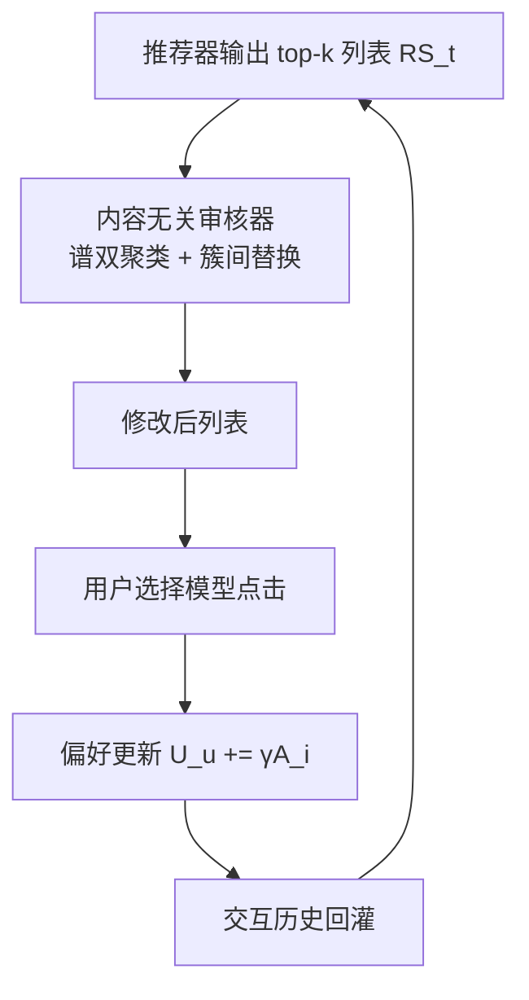

# Content-Agnostic Moderation for Stance-Neutral Recommendation (面向立场中立推荐的内容无关审核)

- **会议/期刊**: CIKM 2025
- **作者与机构**: Nan Li, Bo Kang, Tijl De Bie（根特大学 IDLab）
- **推荐链路定位**: 重排（对内容推荐器 top-$k$ 列表做后处理审核）
- **研究方向**: 去偏公平与工业架构 / 多任务学习与列表级重排
- **论文原文**: [论文原文链接](https://arxiv.org/abs/2405.18941v1)
- **开源代码**: 暂未开源

## TL;DR (1分钟核心速览)

个性化推荐会通过反馈回路把用户推向极端立场，而传统内容审核（content-aware moderation）需读取内容本身，存在审查争议。本文提出**内容无关审核（content-agnostic moderation）**：仅用用户-物品交互这类关系属性，对推荐列表做后处理以打散用户-物品共簇。作者先证明通用设定下无法保证达成目标立场分布（非确定性定理），再给出两种可行路径（代理推断 + 平等曝光），并设计 Random Dispersal (RD) 与 Similarity-based Dispersal (SD)。在自建闭环仿真环境（4 种媒体分布场景、$k=5$、$T=60$）中，RD/SD 将 JSD-O 从 0.20 降至约 0.13、JSD-G 从 0.48 降至约 0.35，CTR 仅降 11%–12%，远优于 RR/KC 的 22%–25% 降幅。

## Background & Motivation (背景与核心矛盾)

- **主流范式**: 新闻/社交推荐按用户历史兴趣做个性化排序，天然强化既有立场；现有缓解手段是内容审核（过滤或降权极端立场内容），如 DSA 立法所设想的那样。
- **前人局限**: ① 内容审核必须读取内容并选择性压制特定观点，易被指为审查、触及言论自由红线；② 现有后处理（流行度抑制、多边公平、RoundRobin）优化的是曝光公平或多样性，**并不直接以立场中立为目标**，且多依赖用户/物品画像。
- **核心洞察 (Key Insight)**: 立场信息虽属"内在属性"，但推荐系统本身是从交互中学习用户偏好的，因此**交互矩阵中隐含了立场的代理信号**；只要打散由立场同质性形成的用户-物品共簇，就能在不看内容的前提下间接均衡立场曝光。
- **本文切入点**: 把"审核"从内容层下移到**关系层（交互/曝光计数）**，用谱双聚类识别紧密共簇并做列表级替换，从而在规避审查争议的同时降低极化。

## Method (核心方法设计)

### 1. 整体框架 (Overall Architecture)

系统是一个闭环仿真：每个时间步 $t$，推荐器为每个用户输出长度$k=5$的有序列表$RS_t$；若启用审核，审核器仅凭$RS_t$与聚合推荐矩阵$RM_{agg,t}$修改列表；用户按相似度+噪声的选择模型点击，并以线性影响模型$U_u \leftarrow U_u + \gamma A_i$更新偏好；交互历史回灌推荐器进入下一轮，共$T=60$步。审核器全程被禁止访问用户偏好矩阵$U$与物品立场矩阵$A$（二者仅用于仿真与评测）。

### 2. 关键设计拆解 (Key Designs)

1. **非确定性定理与两条可行路径（理论边界）**：作者证明仅凭关系属性无法保证达成目标立场分布 $D$——总可构造两个关系属性不可区分、却需要不同审核的推荐配置$\pi'$与$\pi''$。破局依赖两个可证可行的条件：**(a) 代理式审核**，即推荐器足够准确时，交互可反推立场代理；**(b) 平等曝光强制**，当物品池立场均匀分布时，令每物品曝光相等$e_i = e_j\ (\forall i,j)$即可收敛到中立，形式化为$\sum_{i\in I_s} e_i / \sum_{j\in I} e_j = 1/|S|$。这解释了为何方法效果强依赖推荐器精度与媒体分布。

2. **Cluster Dispersal：RD 与 SD（核心创新）**：对聚合推荐矩阵 $RM_{agg,t}$做谱分解得到用户-物品双聚类，保留 Silhouette 分数超过阈值$\beta=0.45$的"紧密簇"；对簇内用户，把原列表中$\alpha$ 个最不偏好物品替换为**其他簇**的物品——RD 随机采样，SD 则按谱嵌入相似度采样。直觉是：紧密共簇正是立场同质化的载体，跨簇替换等价于在不读取内容的情况下"稀释"同质曝光，且替换的是列表尾部低偏好位，故 CTR 损失可控。

3. **训练目标、负采样与推理效率**：本文无端到端训练损失，审核是纯推理期后处理；RD/SD 只需一次谱分解 + 每用户 $\alpha$次替换，计算开销比 KC 的混合整数规划**快至少 100 倍**，适合在线部署。对比基线 KC 用软阈值约束全局流行度（式 1，$\lambda$ 越小审核越强），RR 用自调整配额的硬阈值轮转。

## Experimental Setup & Evaluation Protocol (实验设置与评估协议)

- **数据集与预处理**: 半合成仿真数据，$m=100$用户、$n=3000$物品，立场集$S=\{L,C,R\}$；用户偏好按 PEW 调查比例$56/11/33$ 生成；含 bootstrap 阶段（每用户先看 10 篇随机文章，冷物品补曝光至剩余 <0.5%）。

| 场景 | 物品立场分布 | 说明 |
| :--- | :---: | :--- |
| S1 均衡基线 | 各 $n/3$ | 中立环境基准 |
| S2 双极内容 | L/R 各 0.45n，C 0.1n | 中间派稀缺的分裂媒体 |
| S3 左翼宣传主导 | L 0.8n，C/R 各 0.1n | 最严苛条件 |
| S4 右翼偏好放大 | 同 S1，右倾用户偏好向量放大 | 模拟意见领袖 |

- **数据划分与防穿越 (Splitting Strategy)**: 时间步滚动仿真（$T=60$），每步只用截至$t$ 的聚合交互，无未来信息泄漏。
- **排名评测协议 (Ranking Protocol)**: 闭环全列表曝光评估（每用户每步 $k=5$ 全部展示），非采样排序；指标为 CTR、JSD-O（整体立场分布与均匀分布的 JS 距离）、JSD-G（分组平均 JS 距离）、UMS（用户平均立场）、UMOE（意见极端度方差均值）。
- **对比基线与超参设置**: 推荐器含 Oracle-CB（理想内容模型）、Inaccurate-CB、MF、PP、Random；审核器含无审核、RR、KC（$\lambda\in\{0.6,0.4\}$）、RD/SD（$\alpha\in\{1,2\}$，$\beta=0.45$）；用户影响系数$\gamma\in\{0,0.001,0.01\}$；显著性用$t$检验（$p<0.05$/$p<0.01$）。

## Key Experimental Results (实验关键数据)

### 1. 主实验对比 (Main Results)

Oracle-CB + 用户偏好更新设定下（表 3），CTR 与 JSD 的权衡：

| 方法 | S1 CTR | S1 JSD-O | S1 JSD-G | S3 CTR | S3 JSD-O | S3 JSD-G |
| :--- | :---: | :---: | :---: | :---: | :---: | :---: |
| 无审核 | **0.879** | 0.201 | 0.481 | **0.866** | 0.255 | 0.439 |
| RR | 0.661 (-24.8%) | 0.109 | 0.294 | 0.671 (-22.5%) | 0.364 | 0.385 |
| KC | 0.762 (-13.3%) | **0.108** | 0.338 | 0.746 (-13.9%) | 0.298 | 0.344 |
| RD | 0.767 (-12.7%) | 0.131 | 0.342 | 0.767 (-11.4%) | 0.220 | 0.328 |
| SD | 0.772 (-12.1%) | 0.126 | 0.357 | 0.776 (-10.4%) | **0.188** | **0.328** |

无审核推荐器对比（表 2）显示：MF 相对 Oracle-CB 的 CTR 降幅达 29.4%–47.6%，PP 达 34.9%–55.5%，且 JSD 并不必然更优（S3 中 PP 的 JSD-O 反升至 0.421）。

### 2. 消融实验 (Ablation Study)

以"审核强度/推荐器精度"为消融维度（表 5、表 6，S1 场景）：

| 配置 | CTR | JSD-O | JSD-G | 结论 |
| :--- | :---: | :---: | :---: | :--- |
| Inaccurate-CB 无审核 | 0.667 | 0.050 | 0.167 | 基线 |
| + RD ($\alpha=1$) | 0.613 (-8.2%) | **0.028** | **0.123** | 仍有效 |
| + SD ($\alpha=1$) | 0.612 (-8.2%) | 0.040 | 0.132 | 仍有效 |
| Random 无审核 | 0.522 | 0.020 | 0.041 | 基线 |
| + RD | 0.502 (-3.8%) | 0.021 | 0.042 | 几乎无增益 |
| + SD | 0.488 (-6.5%) | 0.045 | 0.059 | 反而变差 |

### 3. 关键实验发现 (Key Findings)

1. **审核收益与推荐器精度强正相关**：Oracle-CB 下 SD 把 S3 的 JSD-O 从 0.255 压到 0.188（降 26%），而 Random 推荐器下 RD/SD 的 JSD 变化不显著甚至反向（0.020→0.045），定量印证了代理式审核依赖上游推荐器准确刻画偏好的理论假设。
2. **簇离散化在 CTR-中立性权衡上全面优于阈值法**：RD/SD 的 CTR 降幅仅 10.4%–14.2%，而 RR 达 22.5%–24.8%；且在 S3 中 KC 的 JSD-O 反而从 0.255 升至 0.298（审核失效），RD/SD 则稳定降至 0.19–0.22，说明基于共簇结构的替换比全局流行度阈值更鲁棒。
3. **审核能实质改变用户意见动态**：无审核时 UMOE 从 0.082 升至 0.113–0.134（更极端），RD/SD 将其压回 0.105 左右；S3 中无审核使 UMS 左移至 -0.199，SD 将其拉回 -0.194，且 JSD-G(read) 从 0.477 降至 0.425，表明曝光层的中立化可传导至消费层。

## Highlights & Limitations (亮点、对比与审稿批判)

- **与代表作对比 (vs. Prior Work)**: 相比 Liu 等与 Zhang 等的反馈回路审计工作，本文不止于"诊断"而是给出可部署的审核算法；相比 Seymen 等的背包约束流行度抑制与 Patro 等的 RoundRobin 公平重排，本文首次把优化目标从"曝光公平/多样性"换成"立场中立"，且完全抛弃内容与画像依赖；相比 Badami 等基于评分的极化检测，本文的极化定义落在立场分布而非评分极值。
- **可迁移亮点**: ① "谱双聚类 + 跨簇尾部替换"是一种极轻量的列表去同质化算子，可迁移到信息茧房缓解、跨域多样性重排；② 用交互矩阵反推敏感属性的代理思路，可迁移到无法获取内容标签的隐私受限场景。
- **审稿级局限批判**: ① 全部结论建立在半合成仿真与线性意见更新模型上，用户模型稍作替换（如非线性/有界信任模型）结论可能翻转，缺乏真实平台验证；② 方法效果对媒体分布与推荐器精度高度敏感，S3 宣传主导场景下中立化幅度有限，且 $\beta$、$\alpha$ 的选取缺乏自适应机制。

## Rating (四维评分)

- **方法创新性 (Novelty)**: ⭐⭐⭐⭐ （首次系统提出内容无关审核并给出非确定性定理划界，谱双聚类离散化算子简洁且有理论动机）
- **评估协议与实验扎实度 (Protocol & Experiments)**: ⭐⭐⭐ （四场景 × 五推荐器 × 四审核器的矩阵式仿真较完整，但全为半合成数据、无真实平台或线上验证）
- **写作与数学规范度 (Clarity & Rigor)**: ⭐⭐⭐⭐ （定理陈述与两条可行路径的推导清晰，指标定义完备，仿真参数交代充分）
- **工业落地与复现价值 (Industrial & Practical Value)**: ⭐⭐⭐⭐ （纯后处理、比 KC 快百倍、无需内容特征，工程接入成本极低；但代码未开源、真实场景有效性待验证）

