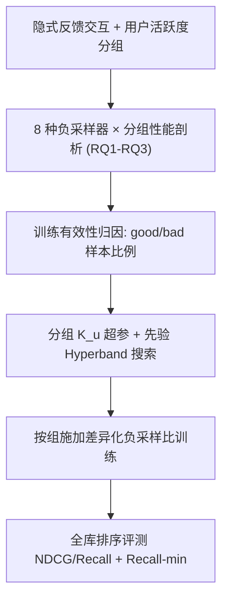

# Evaluating and Addressing Fairness Across User Groups in Negative Sampling for Recommender Systems (负采样中用户群体公平性的评估与修正)

- **会议/期刊**: CIKM 2025
- **作者与机构**: Yueqing Xuan, Mark Sanderson, Jeffrey Chan (RMIT University)；Kacper Sokol (ETH Zurich)
- **推荐链路定位**: 召回（隐式反馈协同过滤训练阶段）
- **研究方向**: 去偏公平与工业架构 / 协同过滤与双塔召回
- **论文原文**: [https://arxiv.org/abs/2304.07487v3](https://arxiv.org/abs/2304.07487v3)
- **开源代码**: [https://github.com/xuanxuanxuan-git/fair_ns](https://github.com/xuanxuanxuan-git/fair_ns)

## TL;DR (1分钟核心速览)

本文针对隐式反馈推荐中负采样策略的用户侧公平性问题：现有 8 种 SOTA 负采样器（RNS/PNS/DNS/DENS/MixGCF/AHNS/AdaSIR/DNS(M,N)）在固定推荐器下均对活跃用户显著优于非活跃用户，且增大负采样比 $K$虽提升数据集平均指标，却让活跃用户"富者愈富"、非活跃用户性能反降。作者提出按用户活跃度分组分配差异化$K$（非活跃组小$K$、活跃组大$K$），用带先验的 Hyperband 搜索各组最优$K$。在 4 个数据集、2 个骨干（MF/LightGCN）、全库排序协议下，NDCG@20 相对全局$K{=}16$ 提升 2–10%，最差组 Recall@20-min 提升更显著（约 6% vs 整体 3%）。

## Background & Motivation (背景与核心矛盾)

- **主流范式**: 隐式反馈 CF 用 BPR 成对损失训练，负采样器从用户未交互集中抽取负例；SOTA 硬负采样器（DNS、MixGCF、DENS）利用用户正反馈个性化选负例，普遍以数据集平均指标为优化目标。
- **前人局限**: ① 公平性评估仅覆盖随机采样（RNS），未考察广泛部署的用户级个性化硬采样器；② "增大 $K$ 提升平均性能"的结论也仅在 RNS/MixGCF 上验证，未检验各用户子群是否同等受益。
- **核心洞察 (Key Insight)**: 数据极度不均衡（ML-1M 中 25% 用户贡献 60%+ 交互，Book Crossing 中 Group 4 贡献 80% 训练数据），硬采样器为活跃用户选出更具信息量的负例，非活跃用户则拿到大量"坏样本"（假阴性/噪声），训练有效性随 $K$ 增大而系统性分化。
- **本文切入点**: 把负采样比 $K$从"全局超参"重构为"分组超参"，用理论训练有效性框架（good/bad 样本比例）解释分化机理，再用带先验的 Hyperband 求解分组$K$ 组合。

## Method (核心方法设计)

### 1. 整体框架 (Overall Architecture)

论文并非提出新网络结构，而是"诊断—归因—修正"三段式框架：先按训练集交互数将用户等量划分为 $n$组（默认$n{=}4$，Group 1 最不活跃、Group 4 最活跃），在固定骨干（MF/LightGCN）下对 8 种采样器做分组性能剖析（RQ1–RQ3）；再用 Wu et al. 的训练有效性框架量化各组 good/bad 负例比例，解释$K$增大时活跃组有效性上升、非活跃组下降的机理；最后将各组$K_u$视为超参，用带先验的 Hyperband 在$K_u\in[1,16]$ 内搜索最优组合（RQ4），训练时按用户所属组施加对应负采样数。

### 2. 关键设计拆解 (Key Designs)

1. **分组性能变化差异度量（Definition 1 & 2）**：痛点在于平均指标掩盖子群分化。定义组 $u$在$K_2>K_1$下的相对性能变化$\Delta(u)=\frac{M(u)|_{K_2}-M(u)|_{K_1}}{M(u)|_{K_1}}$，公平分配要求$\Delta(u_1)=\Delta(u_2)$；多组多$K$时用 Kendall's$W$检验"活跃组增益恒最大"的排序持续性。$W\to 1$ 即证明"富者愈富"是稳定结构而非噪声——这是把公平问题转化为可检验统计假设的关键一步。

2. **分组特定负采样比 + 带先验 Hyperband（InformedHB）**：组合空间随组数与 $K$取值指数爆炸，逐组合重训不可行。将每组$K_u$作为 Hyperband 的独立超参，并从 RQ3 结论注入先验：非活跃组从$K\approx4$附近采样、活跃组从$K\approx12$ 附近采样，构建配置池后由 Successive Halving 早停淘汰。先验使收敛所需配置数减少至多 9 倍，且与无先验版本收敛到同一最优解，保证稳健性。

3. **训练目标与推理开销**：仍用多负例 BPR，$\mathcal{L}_{\text{BPR+}}=-\sum_{(u,i)\in Y}\sum_{j=1}^{K_u}\ln\sigma(\hat{y}(u,i)-\hat{y}(u,j))$，唯一改动是$K$由全局常数变为$K_u$（按用户组查表）。负例由原采样器抽取（Uniform/流行度/硬负例），推理阶段零额外开销；训练开销随$K_u$线性增长（DNS+MF 在 ML-1M 上$K{=}1$每 epoch 35s、$K{=}16$ 为 406s），故上界锁在 16。

## Experimental Setup & Evaluation Protocol (实验设置与评估协议)

- **数据集与预处理**: Amazon Beauty 与 Yelp 2022 施加 `5-core` 过滤，评分二值化为隐式反馈：

| 数据集 | #Users | #Items | #Interactions | 密度 | 特征/场景说明 |
| :--- | :---: | :---: | :---: | :---: | :--- |
| Amazon Beauty | 22,363 | 12,101 | 198,502 | 0.07% | 小规模、稀疏 |
| ML-1M | 6,040 | 3,706 | 1,000,209 | 4.47% | 中等规模、稠密 |
| Book Crossing | 15,798 | 38,093 | 585,579 | 0.10% | 中等规模、稀疏、失衡最严重 |
| Yelp 2022 | 287,116 | 148,523 | 4,392,169 | 0.01% | 大规模、极稀疏 |

- **数据划分与防穿越**: 固定比例 `70%/10%/20%` 训练/验证/测试划分（所有方法均非时序，故不用时间戳切分）。
- **排名评测协议**: 无偏 `Full-Ranking`（对用户训练集外全部物品排序），$k{=}20$，报告 NDCG@20、Recall@20 及最差组指标 Recall@20-min。
- **对比基线与超参**: 8 种采样器（RNS/PNS/DNS/DNS(M,N)/AdaSIR/AHNS/DENS/MixGCF）× 2 骨干（MF/LightGCN，MixGCF 仅配 LightGCN）；嵌入维度 $d{=}64$、batch 2048、LightGCN 3 层、候选集$M\in\{4,6,8,10\}$；每组实验重复 3 次取均值。

## Key Experimental Results (实验关键数据)

### 1. 主实验对比 (Main Results)

全局 $K{=}16$vs. 分组$K_u$（InformedHB），节选代表性结果（NDCG@20 / Recall@20-min）：

| 骨干 | 采样器 | ML-1M NDCG (K=16→HB) | ML-1M R@20-min | Beauty NDCG | Beauty R@20-min | BookCrossing NDCG | BookCrossing R@20-min |
| :--- | :--- | :---: | :---: | :---: | :---: | :---: | :---: |
| MF | RNS | 0.322 → **0.330** | 0.121 → **0.137** | 0.032 → **0.035** | 0.043 → **0.048** | 0.028 → **0.031** | 0.038 → **0.040** |
| MF | DNS | 0.337 → **0.341** | 0.125 → **0.131** | 0.037 → **0.040** | 0.055 → **0.061** | 0.038 → **0.041** | 0.052 → **0.058** |
| MF | DENS | 0.331 → **0.335** | 0.123 → **0.128** | 0.036 → **0.038** | 0.055 → **0.058** | 0.039 → **0.042** | 0.056 → **0.069** |
| MF | AHNS | 0.296 → **0.312** | 0.120 → **0.158** | 0.034 → **0.037** | 0.051 → **0.057** | 0.025 → **0.031** | 0.035 → **0.049** |
| LightGCN | DNS | 0.346 → **0.348** | 0.127 → **0.131** | 0.044 → **0.045** | 0.070 → **0.076** | 0.039 → **0.041** | 0.049 → **0.054** |
| LightGCN | MixGCF | 0.347 → **0.349** | 0.128 → **0.132** | 0.043 → **0.044** | 0.071 → **0.075** | 0.037 → **0.039** | 0.038 → **0.041** |
| LightGCN | AHNS | 0.324 → **0.339** | 0.114 → **0.165** | 0.038 → **0.040** | 0.069 → **0.071** | 0.021 → **0.028** | 0.028 → **0.036** |

### 2. 消融实验 (Ablation Study)

| 配置 | 关键结论（Kendall's $W$ / 收敛成本） |
| :--- | :--- |
| 组数 $n{=}2/4/7/10$|$W$ 恒为 1 或接近 1（如 DNS 在 Beauty 上 1.00/0.91/0.87/0.86），"活跃组增益最大"排序稳定成立 |
| 替代分组准则 ATP / IF | $W$ 仅 0.02–0.15，几乎无分化 → 活跃度是唯一有效分组维度 |
| InformedHB vs. 无先验 HB | 收敛到同一最优配置，但无先验需多探索至多 9 倍配置 |
| $n{=}4$vs.$n{=}7$| 更细分组可略增收益，但$n>4$后组间差异收窄、$n>10$收敛过慢，$n{=}4$ 为性价比平衡点 |

### 3. 关键实验发现 (Key Findings)

1. **公平性缺口是结构性的**：所有 8 种采样器下 Group 4 的 NDCG 相对全体均值高出 60%+，Group 1–3 系统性低于均值；失衡越重缺口越大（Book Crossing 最严重，Group 4 占 80% 训练数据），且硬采样器（如 AHNS）并未缓解反而在 ML-1M/Yelp 上对低活跃组惩罚更重。
2. **$K$增大是"富者愈富"的放大器**：$K$从 1 增至 16 时 Group 4 增益持续为正且最大，Group 1/2 在多个数据集上（Beauty-DNS、BookCrossing-DNS 等）性能反而低于$K{=}1$；平均指标的上升主要由 Group 3/4 驱动，掩盖了底层退化。
3. **分组 $K_u$同时提升效用与公平**：相对全局$K{=}16$，NDCG/Recall 普遍提升 2–10%，而最差组 Recall@20-min 增益更大（Beauty 上约 6% vs. 整体 3%），AHNS 在 ML-1M 上 R@20-min 从 0.120 跃至 0.158（+31.7%），说明修正主要红利落在被边缘化群体。

## Highlights & Limitations (亮点、对比与审稿批判)

- **与代表作对比 (vs. Prior Work)**: 相较 Anelli et al. 与 Li et al. 仅基于 RNS 的用户侧公平评估，本文首次把评估扩展到 6 种用户级个性化硬采样器；相较 Wu et al. 的采样 softmax 与 Chen et al. 的物品组自适应分布（item-side），本文转向 user-side 且不改采样分布、只调各组采样预算，工程侵入性极低。
- **可迁移亮点**: ① "把全局超参拆成子群超参 + 先验加速搜索"的范式可直接迁移到学习率、正则权重、对比温度等训练期超参的公平调优；② 用 good/bad 样本比例做训练有效性归因，可作为负采样器诊断的通用工具。
- **审稿级局限批判**: ① 分组依赖训练集交互数，需预先知道用户活跃度，对严格零交互冷启动用户无定义，且分组边界（等量分位）本身是超参；② 搜索需对每组组合反复重训，虽比网格快 9 倍但仍是离线一次性调优，用户活跃度漂移时需重跑；③ 实验仅覆盖 MF/LightGCN 两个非时序骨干，未验证序列模型或图对比学习场景下结论是否成立。

## Rating (四维评分)

- **方法创新性 (Novelty)**: ⭐⭐⭐ （不提出新网络，但首次系统揭示负采样比与用户侧公平的耦合，并以训练有效性理论给出机理归因，问题定义本身具开创性）
- **评估协议与实验扎实度 (Protocol & Experiments)**: ⭐⭐⭐⭐⭐ （4 数据集 × 8 采样器 × 2 骨干 × 全库排序，含 $n$与分组准则消融、Kendall's$W$ 统计检验、3 次重复，覆盖度在公平性实证研究中罕见）
- **写作与数学规范度 (Clarity & Rigor)**: ⭐⭐⭐⭐ （Definition 1/2 形式化清晰、RQ 驱动结构严谨；但理论部分借用既有框架，未给出新的收敛或泛化界）
- **工业落地与复现价值 (Industrial & Practical Value)**: ⭐⭐⭐⭐ （改动仅为按组查表设 $K_u$，推理零开销、代码全开源；但离线搜索成本与活跃度漂移维护是上线前需评估的工程代价）

