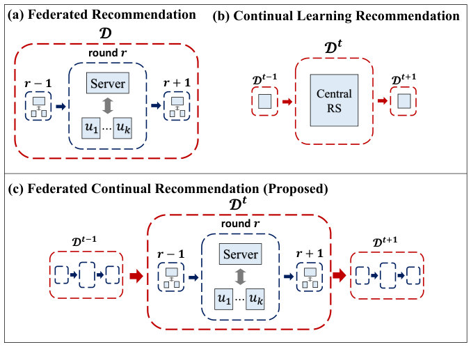
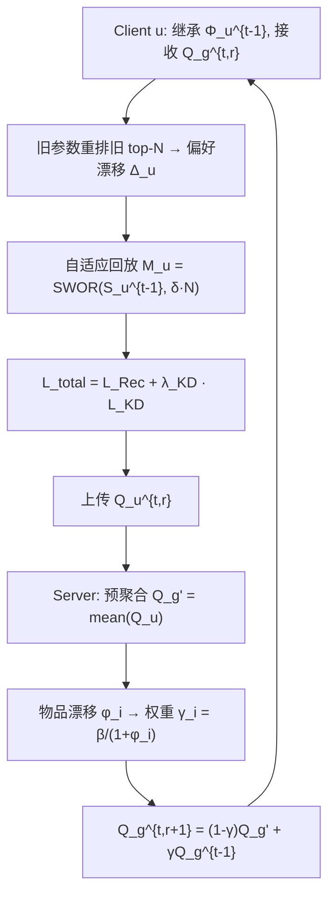
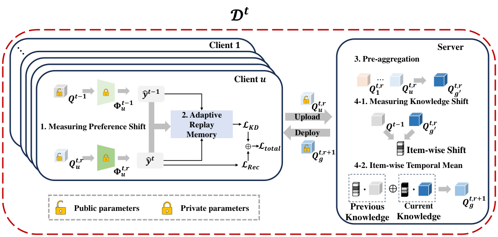

# Federated Continual Recommendation (联邦持续推荐)

- **会议/期刊**: CIKM 2025 (Full Research Paper)
- **作者与机构**: Jaehyung Lim, Wonbin Kweon, Woojoo Kim, Junyoung Kim, Seongjin Choi, Dongha Kim, Hwanjo Yu (POSTECH; UIUC)
- **推荐链路定位**: 召回（联邦协同过滤表征学习）
- **研究方向**: 去偏公平、可信隐私与工业架构 / 序列与会话推荐
- **论文原文**: [https://arxiv.org/abs/2508.04792v3](https://arxiv.org/abs/2508.04792v3)
- **开源代码**: [https://github.com/Jaehyung-Lim/F3CRec-CIKM-25](https://github.com/Jaehyung-Lim/F3CRec-CIKM-25)

## TL;DR (1分钟核心速览)

本文指出 FedRec 假设数据静态、CLRec 假设数据集中，二者在"流式数据 + 隐私约束"下均失效，据此提出 **FCRec** 新任务。方法 F3CRec 在客户端用**排序差异度量偏好漂移**并自适应决定回放样本量，在服务端用**物品级时序均值**按嵌入漂移加权融合新旧知识。在 4 个数据集 × 3 个 FedRec 骨干、Full-Ranking 协议下，N@20 相对 Fine-Tuning 平均提升 5.6%–32.1%，相对最强基线 SPP 提升 2%–16%。

## Background & Motivation (背景与核心矛盾)

- **主流范式**: FedRec 以用户为 client 本地训练、服务端聚合公共物品嵌入（FedMF/FedNCF/PFedRec）；CLRec 以结构正则或回放记忆应对偏好漂移。
- **前人局限**: ① 结构正则类 CLRec（DICRec/DPN 等）依赖全局 user-item / user-user 图，联邦下每个 client 只见自身交互，无法构建；② 回放类 CLRec（RLP2/SPP）依赖全局共享历史样本或全局参数，联邦下样本无法跨用户共享，退化为局部记忆。
- **核心洞察 (Key Insight)**: 联邦场景中唯一可跨轮次保留的"历史"是**用户自己的私有参数**与**服务端公共物品嵌入**——前者可反推用户旧偏好排序，后者可度量物品协同信号的漂移速率。二者恰好分别对应 client 端与 server 端的持续学习锚点。
- **本文切入点**: 把"保留多少旧知识"从全局统一超参改为**用户级 / 物品级的自适应标量**，且该标量仅由本地可得的排序或嵌入距离计算，天然满足隐私约束。

<figure class="paper-figure" markdown="span">
  <figcaption>图1：(a) FedRec、(b) CLRec 与 (c) FCRec（本文提出）的概念对比。</figcaption>
</figure>

## Method (核心方法设计)

### 1. 整体框架 (Overall Architecture)

每个数据块 $\mathcal{D}_t$内进行$R$轮联邦训练：服务端下发全局物品嵌入$Q_g^{t,r}$，client$u$以其初始化本地物品嵌入$Q_u^{t,r}$、并继承上一块的私有参数$\Phi_u^{t-1}$；本地训练时先用旧参数对旧 top-$N$列表重排序得到偏好漂移$\Delta_u^{t,r}$，据此采样回放集$M_u^{t,r}$并施加 KD 损失；训练完成后仅上传$Q_u^{t,r}$，服务端先做朴素平均得$Q_{g'}^{t,r}$，再与上一块全局嵌入$Q_g^{t-1}$做物品级凸组合得到$Q_g^{t,r+1}$。整个流程不传输任何交互数据或私有参数。

<figure class="paper-figure" markdown="span">
  <figcaption>图2：F3CRec 的整体框架</figcaption>
</figure>

### 2. 关键设计拆解 (Key Designs)

1. **基于排序差异的偏好漂移度量 + 自适应回放（Client 端）**：痛点在于联邦下无法访问旧交互，无法判断用户是否"变心"。作者用旧参数 $\theta_u^{t-1}$在旧块上取 top-$N$集合$S_u^{t-1}=\{i_1^t,\dots,i_N^t\}$，在新块训练第$r$ 轮时用当前参数重新排序该集合，以排名位移量度量漂移：
$$\Delta_u^{t,r}=\sum_{k=1}^{N}\left|r_u^{t,r}(i_k^t)-k\right|$$
再由 $\delta_u^{t,r}=\exp(-\epsilon\cdot\Delta_u^{t,r})$得到一致性采样率，回放集$M_u^{t,r}=\mathrm{SWOR}(S_u^{t-1},\lfloor\delta_u^{t,r}\cdot N\rfloor)$。直觉：漂移大 →$\delta$小 → 少回放、多适应；漂移小 → 多回放、强保留。指数函数单调、值域$(0,1]$、无需裁剪，天然适配"概率式采样率"语义。

2. **物品级时序均值（Server 端）**：痛点在于服务端无私有参数，无法像 client 那样构造 top-$N$，且不同物品的协同信号演化速率差异极大（热门/长尾、稳定/漂移）。作者以预聚合嵌入与上一块全局嵌入的归一化平方距离度量物品漂移：
$$\phi_i^{t,r}=\frac{1}{\sqrt{d}}\left\|Q_{g,i}^{t-1}-Q_{g',i}^{t,r}\right\|_2^2,\qquad \gamma_i^{t,r}=\frac{\beta}{1+\phi_i^{t,r}}$$
最终 $Q_{g,i}^{t,r+1}=(1-\gamma_i^{t,r})Q_{g',i}^{t,r}+\gamma_i^{t,r}Q_{g,i}^{t-1}$。因$\phi_i>0$保证$\gamma_i\in(0,\beta]$，构成合法凸组合，无需额外归一化；漂移大的物品自动降低历史权重，避免旧嵌入拖累新协同信号。

3. **训练目标、负采样与推理效率**：总损失 $\mathcal{L}_{total}^{t,r}(u)=\mathcal{L}_{Rec}^{t,r}(u)+\lambda_{KD}\mathcal{L}_{KD}^{t,r}(u)$，其中$\mathcal{L}_{KD}$为对回放集$M_u^{t,r}$的二元交叉熵蒸馏（教师为$\mathcal{D}_{t-1}$模型，学生为当前模型），$\mathcal{L}_{Rec}$为隐式反馈 BCE。负采样沿用各骨干默认策略（未引入额外难负样本挖掘）。推理开销与骨干一致，额外成本仅为每轮一次 top-$N$重排（$O(N\log N)$）与一次$O(|I_t|d)$ 的服务端加权，可忽略。

## Experimental Setup & Evaluation Protocol (实验设置与评估协议)

- **数据集与预处理**: 过滤交互数 < 10 的用户/物品（Lastfm-2K 为 < 5）；按时间戳切分为 4 个块，前 60% 交互为 base block $\mathcal{D}_0$，后 40% 按时间均分为$\mathcal{D}_1,\mathcal{D}_2,\mathcal{D}_3$；每个增量块内按 80%/10%/10% 划分 train/valid/test。

| 数据集 | #Users (D0→D3) | #Items (D0→D3) | #Interactions (D0/D1) | 稀疏度 (D0→D3) |
| :--- | :---: | :---: | :---: | :---: |
| ML-100K | 587 → 943 | 1,136 → 1,152 | 58,771 / 13,060 | 91.19% → 98.80% |
| ML-Latest-Small | 374 → 609 | 1,982 → 2,269 | 48,665 / 10,814 | 93.43% → 99.22% |
| Lastfm-2K | 834 → 1,165 | 4,112 → 4,259 | 41,415 / 9,203 | 98.79% → 99.81% |
| HetRec2011 | 1,177 → 2,113 | 6,128 → 6,829 | 505,146 / 112,254 | 93.00% → 99.22% |

- **数据划分与防穿越 (Splitting Strategy)**: 全局时间戳切分 + 块内比例划分；训练 $\mathcal{D}_t$时严格禁止回访$\mathcal{D}_{0..t-1}$ 的交互（non-revisiting 约束），仅允许通过参数/回放集间接保留旧知识。
- **排名评测协议 (Ranking Protocol)**: 无偏 **Full-Ranking**（对全库未交互物品排序），仅在当前块内有交互的用户上评测，指标 N@20 与 R@20，训练完该块后统一评测。
- **对比基线与超参设置**: 骨干为 FedMF / FedNCF / PFedRec；基线为 FT、Reg（MSE 约束参数偏移）、KD（top-$N$蒸馏）、RLP2（误差记忆回放）、SPP（稳定性-可塑性代理回放）。嵌入维度$d=32$，batch 512，client 每轮 1 个本地 epoch，SGD；$\lambda_{KD}\in[10^{-5},1]$按 10 倍搜索，$N\in\{30,50\}$，$\epsilon$按数据集量级取$10^{-3}/10^{-4}/10^{-5}$，$\beta\in[0,1]$步长 0.05；最优结果经 paired t-test，$p\le 0.05$ 标 `*`。

## Key Experimental Results (实验关键数据)

### 1. 主实验对比 (Main Results)

下表摘取 FedMF 骨干下 N@20 的三块均值（D1–D3 Avg），完整结果见原文 Table 2：

| Dataset | 指标 | FT | Reg | KD | RLP2 | SPP | **F3CRec** | Improv. (vs FT) |
| :--- | :---: | :---: | :---: | :---: | :---: | :---: | :---: | :---: |
| ML-100K | N@20 | 0.0885 | 0.0945 | 0.1034 | 0.0965 | 0.1023 | **0.1098\*** | +21.00% |
| ML-100K | R@20 | 0.1496 | 0.1505 | 0.1680 | 0.1666 | 0.1729 | **0.1924\*** | +21.36% |
| ML-Latest-Small | N@20 | 0.0629 | 0.0672 | 0.0758 | 0.0588 | 0.0711 | **0.0758\*** | +32.12% |
| ML-Latest-Small | R@20 | 0.0909 | 0.1049 | 0.1083 | 0.0790 | 0.1016 | **0.1138\*** | +27.30% |
| Lastfm-2K | N@20 | 0.0535 | 0.0519 | 0.0600 | 0.0416 | 0.0498 | **0.0600\*** | +27.30% |
| Lastfm-2K | R@20 | 0.0947 | 0.0964 | 0.1008 | 0.0801 | 0.0872 | **0.1008\*** | +16.91% |
| HetRec2011 | N@20 | – | 0.0819 | 0.0866 | 0.0740 | 0.0809 | **0.0866\*** | +7.30% |
| HetRec2011 | R@20 | – | 0.1053 | 0.1125 | 0.0967 | 0.1019 | **0.1125\*** | +6.26% |

跨骨干看：FedNCF 上 F3CRec 相对 FT 提升 13.76%–24.33%（N@20），PFedRec 上提升 5.57%–15.30%，提升幅度随骨干个性化程度增强而收窄。

### 2. 消融实验 (Ablation Study)

FedMF 骨干，ML-100K / Lastfm-2K：

| 变体 | ML-100K N@20 | 降幅 | Lastfm-2K N@20 | 降幅 |
| :--- | :---: | :---: | :---: | :---: |
| **F3CRec** | **0.1034** | – | **0.0600** | – |
| w/o c.c（去客户端持续学习） | 0.0969 | -6.35% | 0.0536 | -10.65% |
| w/o a.r.m（固定 top-$N$ 回放） | 0.0996 | -3.71% | 0.0534 | -11.06% |
| w/o s.c（去服务端持续学习） | 0.0941 | -8.96% | 0.0545 | -9.15% |
| w/o i.t.m（统一权重时序均值） | 0.0993 | -4.01% | 0.0545 | -9.19% |
| FT（无任何持续学习） | 0.0855 | -17.36% | 0.0471 | -21.45% |

### 3. 关键实验发现 (Key Findings)

1. **服务端保留比客户端保留更"刚需"**：去掉服务端持续学习（w/o s.c）在 ML-100K 上掉 8.96%，比去掉整个客户端持续学习（-6.35%）更严重。说明联邦聚合本身会系统性冲刷旧物品嵌入，服务端时序均值是防止全局知识遗忘的第一道闸门。
2. **自适应回放对"动态用户"收益最大**：按偏好漂移分位切分后，Lastfm-2K 上动态用户的性能退化率从 SPP 的 0.5480 降至 0.7162 对应的 F3CRec 0.3374（静态用户 0.2993），即漂移度量确实把"该多保留"与"该多适应"的用户区分开了；而 w/o a.r.m 在动态用户上退化率 0.4567，接近 SPP 水平，证明固定回放量对漂移用户几乎无效。
3. **物品级加权拉开静态/动态物品的排序变化差距**：ML-100K 上 F3CRec 的静态-动态物品排名变化率差为 0.2726，w/o i.t.m 仅 0.2484；Lastfm-2K 上差距从 0.2614 扩大到 0.4887。说明 $\gamma_i=\beta/(1+\phi_i)$ 让稳定物品的协同信号被更强保留、漂移物品更快更新，而非"一刀切"地平均新旧嵌入。

## Highlights & Limitations (亮点、对比与审稿批判)

- **与代表作对比 (vs. Prior Work)**: 与 SPP 的本质区别在于 SPP 用统一的稳定性-可塑性代理对**所有用户和所有物品**施加同一保留强度，F3CRec 把保留强度拆成用户级 $\delta_u$与物品级$\gamma_i$两个自适应标量；与 RLP2 的区别在于 RLP2 依赖误差记忆中的全局错分样本，联邦下退化为局部记忆且无漂移感知；与 Reg/KD 的区别在于二者分别只做"无差别参数约束"与"全量 top-$N$ 蒸馏"，均不区分用户偏好是否真的发生迁移。
- **可迁移亮点**: ① "用旧参数对旧 top-$N$ 重排序、以排名位移量度量漂移"这一技巧不依赖任何原始交互回访，可直接迁移到任何禁止存储历史样本的隐私受限场景（如端侧推荐、LDP 场景）；② 服务端"预聚合 + 按嵌入距离加权凸组合"的两步式聚合，可作为通用插件替换 FedAvg，用于缓解联邦场景下的全局表征遗忘。
- **审稿级局限批判**: ① 隐私保护仅用 Laplace 噪声做"松散 LDP 动机"的实验验证（Table 8），未给出形式化隐私预算 $(\varepsilon,\delta)$与效用-隐私曲线的理论刻画，噪声强度$\lambda$增大时 ML-Latest-Small 的 N@20 从 0.0758 掉到 0.0602（约 -20%），实用性边界未讨论；② 偏好漂移度量依赖 top-$N$列表的排名位移，当$N$取 30/50 而用户历史极稀疏（Lastfm-2K 稀疏度 99.8%）时，$S_u^{t-1}$本身噪声极大，论文未对$N$ 的敏感性与稀疏用户子集做分桶分析；③ 实验仅在 4 个中小规模公开数据集与 3 个经典骨干上验证，缺少工业级千万级物品库下的通信开销与收敛轮数报告。

## Rating (四维评分)

- **方法创新性 (Novelty)**: ⭐⭐⭐⭐ （首次形式化 FCRec 任务，客户端排序漂移 + 服务端物品漂移的双端自适应保留机制设计巧妙且隐私友好，但单点技术均为已有组件的重新组合）
- **评估协议与实验扎实度 (Protocol & Experiments)**: ⭐⭐⭐⭐ （4 数据集 × 3 骨干 × 3 增量块的矩阵式实验 + Full-Ranking + paired t-test 较扎实，但缺少大规模与稀疏用户分桶分析）
- **写作与数学规范度 (Clarity & Rigor)**: ⭐⭐⭐⭐ （FCRec 约束定义清晰、公式紧凑、算法伪代码完整，$\gamma_i\in(0,\beta]$ 的凸组合合法性有交代；隐私部分的形式化稍弱）
- **工业落地与复现价值 (Industrial & Practical Value)**: ⭐⭐⭐⭐ （模型无关、可插拔到任意 FedRec 骨干，额外开销仅为一次 top-$N$重排与$O(|I_t|d)$ 加权；代码已开源，工程迁移成本低）

