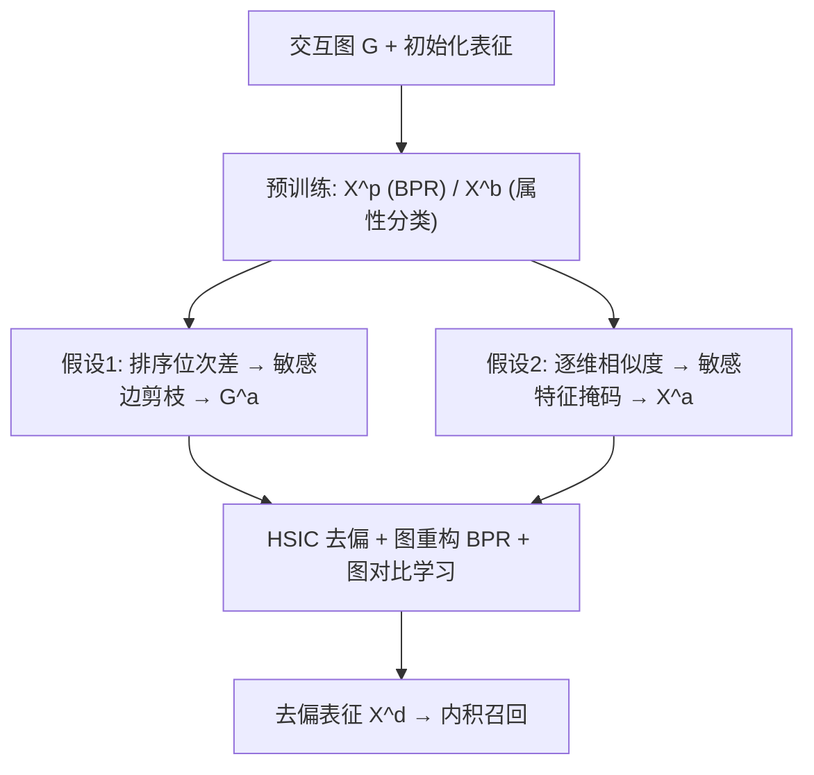
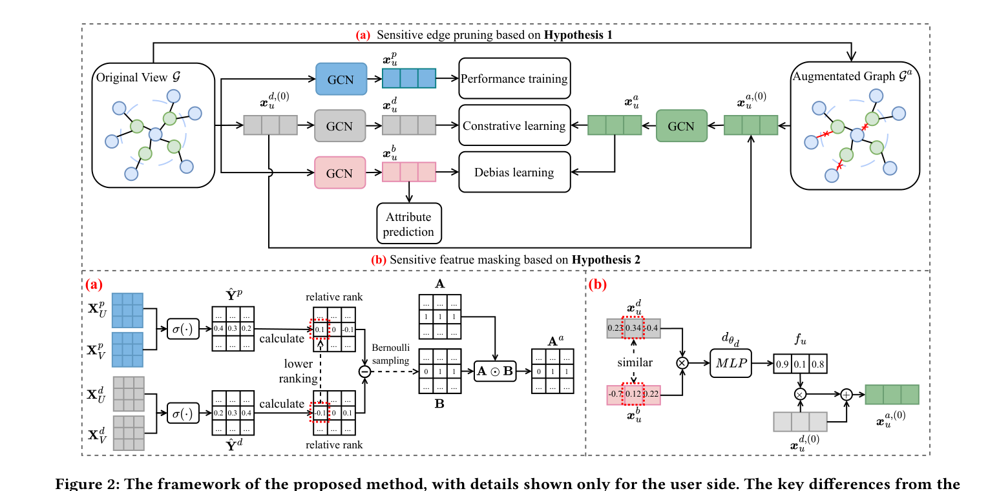

# Improving Recommendation Fairness via Graph Structure and Representation Augmentation (基于图结构与表征增广的推荐公平性改进)

- **会议/期刊**: CIKM 2025
- **作者与机构**: Tongxin Xu, Wenqiang Liu, Chenzhong Bin 等（桂林电子科技大学；Johns Hopkins University；暨南大学）
- **推荐链路定位**: 召回（LightGCN 图召回表征学习）
- **研究方向**: 去偏公平与工业架构 / 图神经网络推荐
- **论文原文**: [https://arxiv.org/abs/2508.19547v1](https://arxiv.org/abs/2508.19547v1)
- **开源代码**: [https://github.com/LokHsu/FairDDA](https://github.com/LokHsu/FairDDA)

## TL;DR (1分钟核心速览)

GCN 推荐中敏感属性会沿同质图结构广泛传播放大偏见，而现有去偏方法只改损失不改数据、增广方法又粗暴破坏用户偏好导致效用大跌。本文提出 FairDDA：用两条先验假设（性能排序 vs 公平排序的位次差定位敏感边、去偏表征与有偏表征的逐维相似度定位敏感特征）驱动"敏感边剪枝 + 敏感特征掩码"双增广，再以 HSIC 最小化增广表征与有偏表征的依赖、用图对比学习对齐原图与增广图。在 ML-1M / LastFM 全库排序下，DP@10 相对次优分别降 3.4% / 16.1%，EO@10 降 7.6% / 8.6%，且 NDCG 不降反升。

## Background & Motivation (背景与核心矛盾)

- **主流范式**: 以 LightGCN 为骨干，通过正则约束、对抗学习、解耦/互信息最小化（FairGo、FairMI、FairIB、FairCoRe）在表征学习阶段压制敏感信息。
- **前人局限**: ① 这些方法只改优化目标，忽视**数据本身的不平衡**（如 ML-1M 中男性评分行为更多、偏好动作/科幻），偏见在源头就已被编码，公平提升天花板低；② 数据增广路线（FDA 生成跨组对称交互、随机掩码边）为求组间平衡而**扭曲真实偏好**，效用显著下滑。
- **核心洞察 (Key Insight)**: GCN 的同质性效应会让敏感属性沿交互图扩散——即使良性特征维度也会在消息传递中"吸收"敏感属性（图 1），因此**必须在图结构与特征维度两个层面同时切断敏感信息通路**，而非仅在损失端约束。
- **本文切入点**: 用两条可操作先验假设把"哪条边/哪一维特征是敏感的"显式定义出来，从而做**精准、最小破坏**的增广。

## Method (核心方法设计)

### 1. 整体框架 (Overall Architecture)

模型先并行预训练三套表征：性能导向表征 $\mathbf{X}^p$（BPR 训练，含偏好也混入敏感信息）、有偏表征$\mathbf{X}^b$（属性分类交叉熵训练，最大化敏感信息编码）、去偏表征$\mathbf{X}^d$（最终用于推荐）。基于$\mathbf{X}^p$与$\mathbf{X}^d$的排序差异剪枝敏感边得到增广图$\mathcal{G}^a$，基于$\mathbf{X}^d$与$\mathbf{X}^b$的逐维相似度掩码敏感特征得到增广表征$\mathbf{X}^a$；随后用 HSIC 去偏损失切断$\mathbf{X}^a$与$\mathbf{X}^b$的统计依赖，用图重构 BPR + 对比学习把增广图语义回灌到$\mathbf{X}^d$，最终以$\mathbf{X}^d$ 做内积召回。

<figure class="paper-figure" markdown="span">
  <figcaption>图2：所提方法的框架，仅展示用户侧的细节。与物品侧结构的主要区别如下：i）有偏物品表示的训练不包含属性预测任务；ii）物品侧不应用去偏学习方法。</figcaption>
</figure>

### 2. 关键设计拆解 (Key Designs)

1. **假设 1 驱动的敏感边剪枝（结构增广）**：痛点是不知哪条交互边携带偏见。作者用"同一物品在性能排序与公平排序中的相对位次差"定义剪枝概率：先算 $\Delta r^p_u(v)=\hat{y}^p_{uv}-\bar{y}^p_u$与$\Delta r^d_u(v)$，再令$p_{uv}=\exp(\Delta r^d_u(v)-\Delta r^p_u(v))$并截断到$[0,1]$，按伯努利采样得掩码$\mathbf{B}$，$\mathbf{A}^a=\mathbf{A}\odot\mathbf{B}$。直觉：**在公平模型里被降权的边正是偏见来源**，剪掉它即最小破坏地去除偏见通路。因采样不可导，用 Gumbel-Softmax 重参数化$\hat{B}_{uv}=1/(1+\exp(-(\log p_{uv}+g)/\tau))$ 做前向离散、反向直通梯度。

2. **假设 2 驱动的敏感特征掩码（表征增广）**：痛点是有偏表征与去偏表征共享部分维度，需定位"哪一维在泄露敏感信息"。以逐元素积 $\mathbf{x}^d_u\odot\mathbf{x}^b_u$送入检测器$d_{\theta_d}$，得掩码向量$\mathbf{f}_u=\exp(-\sigma(d_{\theta_d}(\mathbf{x}^d_u\odot\mathbf{x}^b_u)))$，增广表征为$\mathbf{X}^{a,(0)}=\mathbf{X}^{d,(0)}+\mathbf{X}^{d,(0)}\odot\mathbf{F}$。直觉：**两表征在某维高度相似即该维敏感**，掩码后削弱该维贡献。

3. **训练目标、负采样与推理效率**：主损失 $\mathcal{L}_{all}=\mathcal{L}_{BPR}+\lambda_r\mathcal{L}_{recon}+\lambda_c\mathcal{L}_{cl}+\lambda_d\mathcal{L}_{dl}$，其中去偏项$\mathcal{L}_{dl}=\mathrm{HSIC}(\mathbf{X}^a_U,\mathbf{X}^b_U)=\mathrm{trace}(\mathbf{K}_a\mathbf{H}\mathbf{K}_b\mathbf{H})/(m-1)^2$（RBF 核），对比项$\mathcal{L}_{cl}$用余弦相似度做双向 InfoNCE 对齐$\mathbf{x}^d$与$\mathbf{x}^a$。负采样沿用 BPR 的均匀负采样（每正样本 1 负）。复杂度：GCN 主干$O(L(M+N)d)$，HSIC 额外$O(m^2d+m^3)$，对比学习$O((M+N)^2d)$——**全库成对相似度是主要开销**。

## Experimental Setup & Evaluation Protocol (实验设置与评估协议)

- **数据集与预处理**:

| 数据集 | #Users | #Items | #Interactions | 密度 | 特征/场景说明 |
| :--- | :---: | :---: | :---: | :---: | :--- |
| ML-1M | 6,040 | 3,952 | 1,000,209 | 4.19% | 电影评分，敏感属性=性别（附录另测 21 类职业） |
| LastFM-360K | 48,386 | 21,711 | 2,045,305 | 0.19% | 音乐社交，敏感属性=性别 |

- **数据划分与防穿越 (Splitting Strategy)**: 沿用 FairCoRe/FairIB 等前作的统一划分设置以保证可比性（原文未额外强调时间戳切分）。
- **排名评测协议 (Ranking Protocol)**: 效用用 $Recall$、$NDCG$（TopK∈{10,20,30}）；公平用$DP=JSD(P_{G_0},P_{G_1})$（推荐曝光分布组间 JS 散度）与$EO=JSD$（基于命中集$R_u\cap TopK_u$ 的机会均等），**越低越公平**。属全库 Top-K 排序评估。
- **对比基线与超参设置**: 9 个基线覆盖正则（BP）、对抗（Adv/FairGo/FairGNN）、增广（FDA）、解耦/互信息（FairRec/FairMI/FairIB/FairCoRe），全部以 LightGCN 为骨干；$d=64$、$L=3$、lr=0.001、batch 2048/4096，$\lambda_r,\lambda_c,\lambda_d$网格搜索，10 次运行取均值并报$p$ 值。

## Key Experimental Results (实验关键数据)

### 1. 主实验对比 (Main Results)

| 数据集 | 方法 | NDCG@10↑ | Recall@10↑ | DP@10↓ | EO@10↓ |
| :--- | :--- | :---: | :---: | :---: | :---: |
| ML-1M | LightGCN | 0.2018 | 0.1511 | 0.2919 | 0.3609 |
| ML-1M | FairGo | 0.1822 | 0.1336 | 0.2728 | 0.3382 |
| ML-1M | FairGNN | 0.1964 | 0.1466 | 0.1472 | 0.2608 |
| ML-1M | FairMI | 0.2128 | 0.1586 | 0.1337 | 0.2228 |
| ML-1M | FairIB | 0.2001 | 0.1505 | 0.1405 | 0.2038 |
| ML-1M | FairCoRe | 0.2136 | 0.1591 | 0.1225 | 0.1983 |
| ML-1M | **FairDDA** | **0.2138** | **0.1601** | **0.1183** | **0.1833** |
| ML-1M | Improv.% | +0.1% | +0.6% | **-3.4%** | **-7.6%** |
| LastFM | LightGCN | 0.1971 | 0.1572 | 0.2860 | 0.3508 |
| LastFM | FairMI | 0.1976 | 0.1576 | 0.1312 | 0.2402 |
| LastFM | FairIB | 0.1892 | 0.1512 | 0.1321 | 0.2319 |
| LastFM | FairCoRe | 0.1989 | 0.1574 | 0.1219 | 0.2316 |
| LastFM | **FairDDA** | **0.2001** | 0.1569 | **0.1023** | **0.2117** |
| LastFM | Improv.% | +0.6% | -0.3% | **-16.1%** | **-8.6%** |

（Improv.% 为相对次优基线；ML-1M 上 DP/EO 的 $p$值分别为 4.7e-3 / 6.0e-3，LastFM 为 1.7e-4 / 3.1e-3，均$p<0.05$。）

### 2. 消融实验 (Ablation Study)

| 数据集 | 变体 | NDCG@10 | Recall@10 | DP@10 | EO@10 |
| :--- | :--- | :---: | :---: | :---: | :---: |
| ML-1M | LightGCN | 0.2018 | 0.1511 | 0.2919 | 0.3609 |
| ML-1M | w/o 去偏学习 ($\mathcal{L}_{dl}$) | 0.2156 | 0.1741 | 0.2462 | 0.3018 |
| ML-1M | w/o 边剪枝 (EP) | 0.2140 | 0.1606 | 0.1251 | 0.1909 |
| ML-1M | w/o 特征掩码 (FM) | 0.2073 | 0.1563 | 0.1291 | 0.1953 |
| ML-1M | **FairDDA** | 0.2138 | 0.1601 | **0.1183** | **0.1833** |
| LastFM | w/o 去偏学习 | 0.2073 | 0.1688 | 0.2235 | 0.2941 |
| LastFM | w/o 边剪枝 | 0.1980 | 0.1571 | 0.1042 | 0.2158 |
| LastFM | w/o 特征掩码 | 0.2004 | 0.1574 | 0.1163 | 0.2231 |
| LastFM | **FairDDA** | 0.2001 | 0.1569 | **0.1023** | **0.2117** |

### 3. 关键实验发现 (Key Findings)

1. **去偏学习是公平的"总闸"**：去掉 $\mathcal{L}_{dl}$ 后 ML-1M 的 NDCG 反而冲到 0.2156（全场最高），但 DP 从 0.1183 恶化到 0.2462、EO 到 0.3018——说明增广图本身只是"信息增密器"，没有 HSIC 约束就完全丧失公平性，二者是效用-公平的显式开关。
2. **边剪枝是"低代价公平"**：去掉 EP 后 ML-1M 效用几乎不变（NDCG 0.2140 vs 0.2138），但 DP 从 0.1183 升至 0.1251、EO 升至 0.1909，证明按排序位次差剪边能精准命中偏见通路而不伤偏好。
3. **特征掩码对数据密度敏感**：去掉 FM 在稠密 ML-1M 上效用下降（0.2073），但在稀疏 LastFM 上效用反升（0.2004）——稀疏场景下敏感/非敏感维度的可辨识监督信号不足，掩码反而误伤有效维度，提示该模块需按密度自适应调节。

## Highlights & Limitations (亮点、对比与审稿批判)

- **与代表作对比 (vs. Prior Work)**: 相比 FairIB/FairCoRe 仅在损失端做互信息/解耦约束，本文把去偏前移到**数据层**（剪边+掩码），从源头减少偏见注入；相比 FDA 强行构造跨组对称交互，本文用排序位次差与逐维相似度做**定向、最小破坏**的增广，因而在公平大幅提升的同时 NDCG 不降反升（0.2138 vs LightGCN 0.2018）。
- **可迁移亮点**: ① "性能模型 vs 公平模型的排序位次差"可作为通用的**偏见边/样本定位信号**，可迁移到序列推荐中的偏见物品识别；② 用"有偏表征与去偏表征的逐维相似度"做特征级敏感度打分，可复用于 CTR 模型的特征去偏与特征筛选。
- **审稿级局限批判**: ① 对比学习需对全部 $M+N$节点做成对相似度，复杂度$O((M+N)^2d)$，在 LastFM 这种 4.8 万用户规模上已偏重，工业亿级场景难以直接落地；② 公平评估仅覆盖性别（二分类）与附录的职业（多分类），未涉及交叉属性（性别×年龄）与流行度/位置等其它偏见维度，且缺少线上 A/B 与长尾分桶分析，公平结论的泛化性有待验证。

## Rating (四维评分)

- **方法创新性 (Novelty)**: ⭐⭐⭐⭐ （两条先验假设把"敏感边/敏感特征"从抽象概念落为可计算量，结构+表征双增广的组合有新意，但 HSIC 与对比学习本身属成熟工具）
- **评估协议与实验扎实度 (Protocol & Experiments)**: ⭐⭐⭐⭐ （两数据集 + 9 基线 + 消融 + 超参 + t-SNE + 多类敏感属性附录，$p$ 值齐全；扣分在于划分细节交代简略、缺长尾分桶与线上验证）
- **写作与数学规范度 (Clarity & Rigor)**: ⭐⭐⭐⭐ （假设—算子—损失的推导链条清晰，Gumbel 重参数化与复杂度分析完整；DP/EO 两式符号重复书写略显冗余）
- **工业落地与复现价值 (Industrial & Practical Value)**: ⭐⭐⭐ （代码已开源、剪枝复杂度线性可接受，但全库对比学习的二次复杂度与三阶段预训练流程在亿级工业图上开销偏高）

