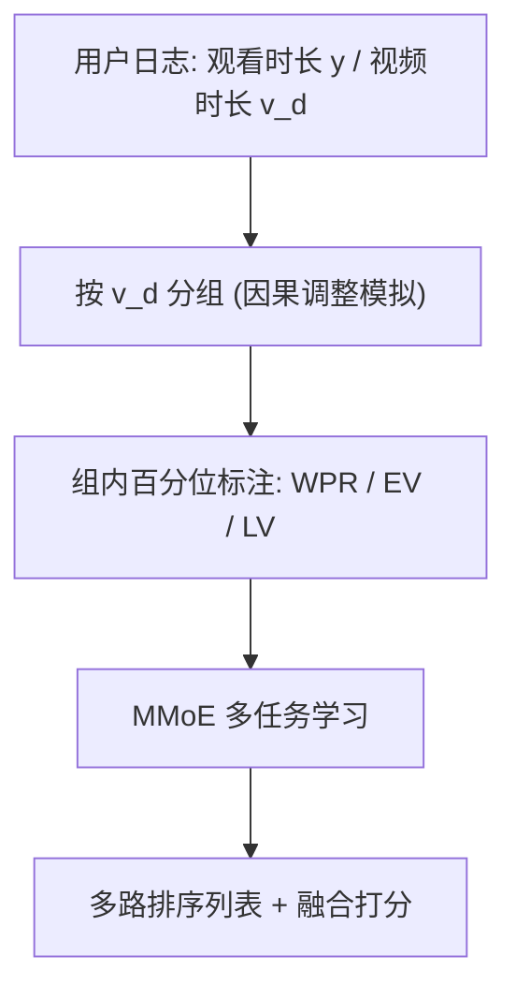
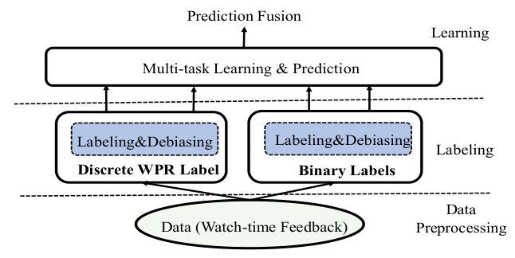

# Leveraging Watch-time Feedback for Short-Video Recommendations: A Causal Labeling Framework (利用观看时长反馈的短视频推荐：一种因果标注框架)

- **会议/期刊**: CIKM 2023
- **作者与机构**: Yang Zhang, Yimeng Bai, Fuli Feng 等（中国科学技术大学）；Jianxin Chang, Xiaoxue Zang, Song Lu, Jing Lu, Yanan Niu, Yang Song（快手科技）
- **推荐链路定位**: 精排（多任务排序，标签层改造）
- **研究方向**: 去偏公平与工业架构 / 多任务学习与列表级重排
- **论文原文**: [https://arxiv.org/abs/2306.17426v2](https://arxiv.org/abs/2306.17426v2)
- **开源代码**: 暂未开源

## TL;DR (1分钟核心速览)

短视频推荐高度依赖观看时长，但主流做法把时长直接当回归标签，既浪费了"完播/有效观看"等丰富语义，又继承了视频时长带来的混淆偏差。本文提出 DML 框架：用分位数把观看时长转成渐进式百分位标签 WPR 与二值标签 EV/LV，并在**标注阶段**按视频时长（及用户/物品特征）分组独立标注，以模拟因果调整中的后门调整，从而无需改动模型结构即可去偏。在快手 462 亿样本工业数据上，离线 AUC/GAUC/MAE/MAPE/RMSE 全面最优，线上 A/B 观看时长最高 +2.23%、App 使用 +0.77%。

## Background & Motivation (背景与核心矛盾)

- **主流范式**: 以 WLR（按时长加权逻辑回归）、TR（直接回归时长）、OR（序数回归）、D2Q（分位数 + 后门调整）为代表，把观看时长当作单一回归目标或加权信号。
- **前人局限**: 其一，直接标注丢失语义——"完播"这类强偏好信号与"看了 3 秒"在 MSE 下被同等对待；其二，时长是混淆因子，长视频天然获得更长的绝对观看时长，模型学到的是"视频多长"而非"用户多喜欢"。
- **核心洞察 (Key Insight)**: 推荐排序本质关心**相对顺序**而非绝对秒数；若把时长映射为总体分布中的百分位秩，标签天然有界、均衡、抗长尾离群点，且与排序目标对齐。
- **本文切入点**: 把去偏从"训练期改模型"前移到"标注期改标签"——按偏置因子分组后组内独立做百分位标注，组间标签分布一致，等价于在标签层面完成因果调整。

## Method (核心方法设计)

### 1. 整体框架 (Overall Architecture)

系统分三段：数据预处理（日志清洗、统计特征）→ 标注与去偏（本文核心，产出 WPR 与 EV/LV 多语义标签）→ 多任务学习（MMoE 架构，每个标签一个任务头，服务期可输出多路排序列表作为备选推荐通道）。关键点在于去偏完全发生在标注环节，模型与训练流程保持原样，因此可直接套用到线上已有推荐系统。

<figure class="paper-figure" markdown="span">
  <figcaption>图1：应用我们的DML框架的系统工作流程概览，涉及三个主要组成部分：数据预处理、标注和多任务学习。</figcaption>
</figure>

### 2. 关键设计拆解 (Key Designs)

1. **渐进式百分位标签 WPR（把绝对秒数变成相对秩）**：将训练样本按时长升序排列，按比例 $q_1,\dots,q_N$切成$N$组，第$n$组样本的标签取前缀和$y^{wpr}=\sum_{n'=1}^{n}q_{n'}$。若取等频$q_n=1/N$，0–3 秒区间会挤进 41 个标签值（与 40–90 秒区间同数），模型被迫在无意义的短时差上耗费容量；故作者强制$q_1\ge q_2\ge\cdots\ge q_N$，让短时长区间更粗、长时长区间更细，并经验性地令$1/y^{wpr}\approx a\lceil\ln y\rceil^2+b\lceil\ln y\rceil+c$。直觉：标签有界于$[0,1]$、分布均衡、对超长离群点鲁棒，且保序性与排序目标一致。

2. **标注期因果去偏（用分组模拟后门调整）**：因果图（图 2）中视频时长 $V_d$既是$V_r\to Y$的混淆因子，又直接作用于$Y$，其直接效应与用户偏好纠缠。后门调整要求$\sum_{v_d}P(Y|U,V_r,v_d)P(v_d)$，本文用两步模拟：① 按$v_d$分组，组内独立跑 WPR 生成，对应"同组内$v_d$影响相同、可直接比较"；② 各组标签分布相同，对应"跨组枚举同一$P(v_d)$"。于是去偏标签为
$$y^{dwpr}=g_{wpr}\left(x,y;\mathcal{D}_{v_d};\{q_1,\dots,q_N\}\right)$$
即仅把生成域从全库 $\mathcal{D}$换成同 duration 组$\mathcal{D}_{v_d}$。对 EV/LV 二值标签同理：$y^{dev}=\mathbb{I}\left(y\ge t_{50}(\mathcal{D}_{v_d})\right)$，并进一步在物品侧与用户侧做更细分组$y^{vev}=\mathbb{I}(y\ge t_{50}(\mathcal{D}_v))$、$y^{uev}=\mathbb{I}(y\ge t_{50}(\mathcal{D}_u))$，缓解冷门视频/低活用户被系统性压成负样本的问题。

3. **训练目标、负采样与推理效率**：总损失为各任务损失加权和 $\mathcal{L}=\sum_{k}\lambda_k\mathcal{L}_k$，WPR 走回归（MSE）、EV/LV 走交叉熵，与点击、完播等既有任务共享 MMoE 底层。无额外负采样设计（精排全曝光样本）。推理开销与基线完全一致——去偏只发生在离线标注，线上零成本，这是相对 D2Q/DCR 的核心工程优势。

## Experimental Setup & Evaluation Protocol (实验设置与评估协议)

- **数据集与预处理**: 快手工业日志，无 5-core 过滤（全量曝光样本）：

| 数据集 | #Users | #Items | #Interactions | 稀疏度/密度 | 特征/场景说明 |
| :--- | :---: | :---: | :---: | :---: | :--- |
| Kuaishou 日活日志 | 3.455 亿 | 4510 万 | 462 亿/天 | 极稀疏（人均 133.7 次/天） | 含视频时长、观看时长；历史行为均值 1.45 万、截断 10 万 |

- **数据划分与防穿越 (Splitting Strategy)**: 全局时间戳切分——前 23 小时样本训练，随后 1 小时测试。
- **排名评测协议 (Ranking Protocol)**: 离线为 watch-time 预测评测（AUC/GAUC 排序指标 + MAE/MAPE/RMSE 精度指标），分位数类方法统一反变换回秒数再算误差；线上为 5 天连续 A/B，Featured-Video Tab 与 Slide Tab 双通道。
- **对比基线与超参设置**: TR / WLR / OR / D2Q 四类基线，全部嵌入同一 MMoE 多任务框架以保证公平；Embedding 层 AdaGrad lr=0.05，DNN 用 Adam lr=5e-6，batch=8192。

## Key Experimental Results (实验关键数据)

### 1. 主实验对比 (Main Results)

| Methods | AUC ↑ | GAUC ↑ | MAE ↓ | MAPE ↓ | RMSE ↓ |
| :--- | :---: | :---: | :---: | :---: | :---: |
| TR | 0.6597 | 0.6397 | 24.1743 | 3.6892 | 45.4747 |
| WLR | 0.6711 | 0.6551 | 23.5743 | 3.1528 | 43.3776 |
| OR | 0.6727 | 0.6474 | 22.8930 | 3.5017 | 44.3891 |
| D2Q | 0.6732 | 0.6581 | 22.6728 | 2.7342 | 45.5293 |
| **DML** | **0.6763** | **0.6617** | **21.7657** | **2.6039** | **42.7735** |
| Improv. vs 最优基线 | +0.46% | +0.55% | +4.00% | +4.77% | +1.39% |

线上 A/B（相对 WLR 控制组，5 天均值）：

| 方法 | Featured WT | Featured AU | Slide WT | Slide AU |
| :--- | :---: | :---: | :---: | :---: |
| D2Q | +0.273% | +0.114% | +0.358% | +0.135% |
| DML($y^{wpr}$) | +0.694% | +0.207% | +0.648% | +0.228% |
| DML($y^{dwpr}$) | +1.048% | +0.332% | +1.080% | +0.412% |
| **DML($y^{dwpr},\{y^{dev},y^{vev},y^{uev}\}$)** | **+2.230%** | **+0.773%** | **+2.057%** | **+0.709%** |
| DML($y^{dwpr},\{y^{dlv},y^{vlv},y^{ulv}\}$) | +1.549% | +0.566% | +1.284% | +0.555% |

### 2. 消融实验 (Ablation Study)

| 变体 | 关键结论（GAUC / MAE 趋势） |
| :--- | :--- |
| w/o DG（去掉时长分组） | 明显下降，验证分组去偏的必要性 |
| w/o WPR（改用完播率标签） | 明显下降，说明百分位标签优于比率标签 |
| w/ EF-WPR（等频 $q_k=1/N$） | 劣于原版，短时长区间过度密集 |
| w/ EW-WPR（等宽分箱） | 劣于原版，标签不均衡且跨组分布不一致 |
| w/o $y^{dev}$/$y^{vev}$/$y^{uev}$ | 三者均有用，其中时长去偏贡献最大 |

### 3. 关键实验发现 (Key Findings)

1. **去偏是主要增益来源**：线上仅用未去偏 $y^{wpr}$得 +0.694%，换成$y^{dwpr}$ 后跳到 +1.048%，说明时长混淆在标签层就被截断，收益不依赖模型改造。
2. **多语义标签互补而非冗余**：叠加 EV 三路去偏标签后从 +1.048% 升至 +2.230%（翻倍），而 LV 组合仅 +1.549%，表明"有效观看"语义比"长观看"更贴近真实兴趣。
3. **精度指标增益远大于排序指标**：MAE 相对最优基线降 4.00%、MAPE 降 4.77%，而 AUC 仅 +0.46%，说明 WPR 的渐进分箱主要修正了时长尺度上的系统性偏差，而非重排头部顺序。

## Highlights & Limitations (亮点、对比与审稿批判)

- **与代表作对比 (vs. Prior Work)**: 相比 D2Q（同样用后门调整，但需在模型内拟合 duration-dependent 分位数），DML 把去偏搬到标注层，模型零改动；相比 DCR（因果估计需改模型结构），DML 完全预处理化；相比 WLR（隐式加权），DML 显式拆出多种语义任务。
- **可迁移亮点**: ① "分组独立标注 + 组间同分布"这一招可平移到任何存在混淆因子的连续反馈（如阅读时长、播放完成度）；② 用全特征分组替代不可观测偏置因子的组合，是工业场景下规避稀疏分组的实用技巧。
- **审稿级局限批判**: ① 分位比例 $\{q_n\}$与$a,b,c$ 全靠人工经验调参，论文自认未来需自动化，超参敏感度未做系统扫描；② 离线仅评测 watch-time 预测，缺少排序级指标（如 NDCG/HR）与冷启动、长尾分桶分析，去偏对冷门视频的实际扶持效果只能靠线上总量指标间接佐证。

## Rating (四维评分)

- **方法创新性 (Novelty)**: ⭐⭐⭐⭐ （把因果后门调整"降维"到标注阶段，思路简洁且有因果图支撑，但单点技巧性大于理论深度）
- **评估协议与实验扎实度 (Protocol & Experiments)**: ⭐⭐⭐⭐ （462 亿样本工业数据 + 5 天双通道线上 A/B 极具说服力，扣分在离线仅有时长预测指标、缺分桶分析）
- **写作与数学规范度 (Clarity & Rigor)**: ⭐⭐⭐⭐ （WPR 生成四步与去偏两步映射讲得清楚，但 $q_n$ 的经验公式与超参来源交代偏简）
- **工业落地与复现价值 (Industrial & Practical Value)**: ⭐⭐⭐⭐⭐ （纯离线标注改造、线上零推理开销、已在快手部署，是少见的"改标签即上线"方案；可惜未开源）

