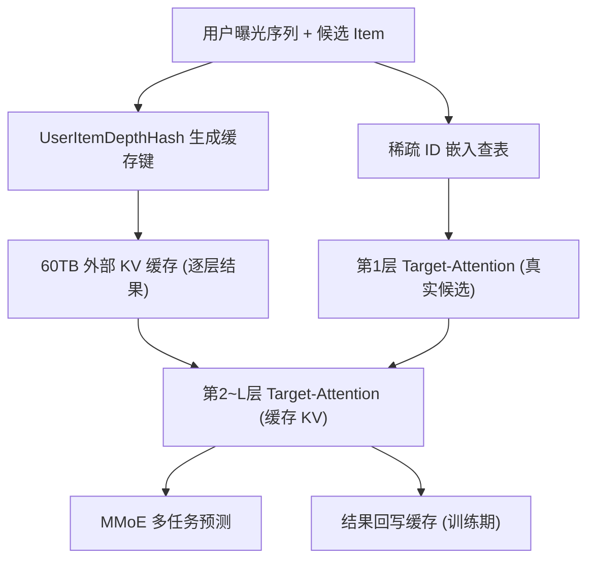
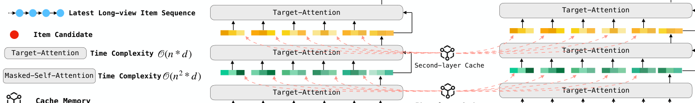

# MARM: Unlocking the Future of Recommendation Systems through Memory Augmentation and Scalable Complexity (通过记忆增强与可扩展复杂度解锁推荐系统未来)

- **会议/期刊**: CIKM 2025
- **作者与机构**: Xiao Lv, Jiangxia Cao, Shijie Guan, Xiaoyou Zhou, Zhiguang Qi, Yaqiang Zang, Ming Li, Ben Wang, Kun Gai, Guorui Zhou（快手科技；Kun Gai 独立）
- **推荐链路定位**: 精排（并扩展至召回、粗排）
- **研究方向**: 去偏公平、可信隐私与工业架构 / 序列推荐
- **论文原文**: [https://arxiv.org/abs/2411.09425v3](https://arxiv.org/abs/2411.09425v3)
- **开源代码**: 暂未开源

## TL;DR (1分钟核心速览)

工业精排模型的数据与稀疏参数（>200B）早已不是瓶颈，真正昂贵的是毫秒级推理的 FLOPs，因此 NLP 的 Scaling-Law 无法直接迁移。本文提出 MARM：把多层 masked self-attention 的中间结果按 `(user, item, depth)` 哈希写入 60TB 外部缓存，推理时用低复杂度的 target-attention 直接查表，将单模块复杂度从 $O(n^2 d)$降为$O(n d)$，从而把单层 TA 扩展为多层。在快手短视频 3000 万用户真实日志上，离线 GAUC 相对提升 0.43%，线上人均播放时长 +2.079%，推理仅增加约 15ms。

## Background & Motivation (背景与核心矛盾)

- **主流范式**: 工业精排沿用「数百手工特征 + 多任务 MoE」架构，用户序列兴趣由 DIN/SIM/TWIN 等**单层 target-attention** 抽取，深度始终被 FLOPs 锁死在 1 层。
- **前人局限**: ① 直接堆叠 self-attention（如 HSTU）复杂度 $O(n^2 d)$，在$n>1000$ 的长序列上不可承受；② 线上一次请求需同时为 50~8000 个候选打分，朴素多层注意力对同一用户序列反复重算，重复计算被放大数千倍。
- **核心洞察 (Key Insight)**: 推荐模型与 LLM 的资源结构恰好相反——流式数据无限、稀疏参数存储廉价（>200B），而稠密 DNN 仅约 0.1B、FLOPs 极度昂贵；且用户行为序列具有**时间序**，历史前缀的注意力结果对后续候选是复用的。
- **本文切入点**: 用「存储换计算」，把昂贵模块的计算结果缓存下来，使复杂度随缓存规模线性增长，提出**缓存缩放律 (Cache Scaling-Law)**。

## Method (核心方法设计)

### 1. 整体框架 (Overall Architecture)

MARM 是一个 decoder-only 式的多层兴趣抽取器：序列生成器产出用户最近曝光序列 $[Iid_1,\dots,Iid_n]$，经稀疏特征查表得到 ID 嵌入；同时按 `UserItemDepthHash(UidX, [Iid...], i)` 生成哈希键，从外部 KV 缓存中取出第$i$ 层的历史注意力结果。前向时第 1 层用真实候选做 target-attention，第 2~L 层则用「上一层 query 输出 × 缓存中的 key/value」逐层递推，最终输出送入 MMoE 多任务头。训练阶段在流式样本上边算边写缓存，推理阶段只读缓存，实现训练/推理共享同一份记忆。

<figure class="paper-figure" markdown="span">
  <figcaption>图 2：MARM 的动机，利用缓存思想将高 FLOPs 的自注意力降低为低 FLOPs 的目标注意力。</figcaption>
</figure>

### 2. 关键设计拆解 (Key Designs)

1. **缓存化多层目标注意力（Cache-as-Attention）**：痛点是用 SA 堆深度会带来 $O(n^2 d)$且候选间重复计算。MARM 将第$i$ 层的注意力改写为对缓存键值的目标注意力：
$\boldsymbol{h}^{i+1}_{Y,U}=\text{TA}_i\!\left(\boldsymbol{h}^{i}_{Y,U},\,[\boldsymbol{c}^{i}_{1,U},\dots,\boldsymbol{c}^{i}_{n,U}]\right),\quad \boldsymbol{c}^{i}_{j,U}=\text{CacheLookUp}\!\left(\text{Hash}(U,Iid_j,i)\right)$其中$\boldsymbol{c}^{i}_{j,U}\in\mathbb{R}^{d}$是历史 item$j$在第$i$层的冻结计算结果。直觉：历史前缀的表示与当前候选无关，可离线算好；在线只需让 query 逐层「读记忆」，复杂度降为$O(L\cdot n\cdot d)$。

2. **缓存生命周期与梯度截断设计**：与 NLP 的 KV Cache 不同，MARM 的缓存①在**训练阶段**生成而非推理阶段；②具有**长期生命周期**（用户行为无终点）；③缓存的是**最终 query 输出**而非 K/V，节省存储。反向传播时梯度不穿过缓存键值，只从后层 query 传向前层 K/V，等价于对历史表示做 stop-gradient。作者论证：流式推荐只训一个 epoch、曝光过的 item 不再复现，底层参数漂移慢，因此冻结缓存不会显著损害效果。

3. **训练目标、负采样与推理效率**：沿用工业多任务损失（点击/点赞/评论/长播等加权 BCE），不做额外负采样（精排为全候选二分类）。总损失即各任务交叉熵加权和 $\mathcal{L}=\sum_{t}\lambda_t \mathcal{L}_{\text{BCE}}^{(t)}$。推理开销：部署版$L=4,n=6000,d=128$ 占用 60TB 存储、100 张 A10，在线排序总耗时约 15ms（嵌入拉取 5ms + 前向 10ms），仅为 HSTU 方案（约 1000 张 A10）算力成本的 1/10。

## Experimental Setup & Evaluation Protocol (实验设置与评估协议)

- **数据集与预处理**: 快手短视频真实场景过去 6 个月日志，流式训练（streaming training），不做 5-core 过滤。

| 数据集 | #Users | #Items | #Interactions | 稀疏度/密度 | 特征/场景说明 |
| :--- | :---: | :---: | :---: | :---: | :--- |
| Kuaishou (工业) | ~30M | ~62M | 人均 133 条/天 | 极稀疏 | 短视频曝光日志，多任务标签（点击/点赞/长播等） |

- **数据划分与防穿越 (Splitting Strategy)**: 采用**流式时间序训练**（按天滚动），报告最后一天的 GAUC 与 loss 均值，天然避免未来信息穿越。
- **排名评测协议 (Ranking Protocol)**: 离线采用工业全量日志上的 **GAUC**（按用户样本数加权的 AUC）与 AUC，非采样排序；线上采用严格 A/B 实验。
- **对比基线与超参设置**: Baseline（sum-pooling）、DIN（$n=50$）、SIM Soft（$n=15000$）、TWIN（$n=15000$）、TWIN V2（$n=100000$）、HSTU*（$n=2000$，4 层）；MARM 固定$d=128$，序列长度 6000，最大深度$L=4$，报告 mean±std。

## Key Experimental Results (实验关键数据)

### 1. 主实验对比 (Main Results)

个体实验（各模块单独加入 Baseline）：

| 模型 | AUC | GAUC | FLOPs |
| :--- | :---: | :---: | :---: |
| Baseline | 0.8233 | 0.7093 | — |
| DIN | 0.8235 | 0.7010 | 3.3M |
| SIM Soft | 0.8241 | 0.7109 | 4.6M |
| TWIN | 0.8249 | 0.7142 | 90M |
| TWIN V2 | 0.8251 | 0.7147 | 150M |
| MARM (L=1) | 0.8256 | 0.7157 | 127M (←2.7B*) |
| MARM (L=2) | 0.8262 | 0.7169 | 164M (←5.4B*) |
| **MARM (L=4)** | **0.8270** | **0.7183** | 238M (←10.5B*) |
| **Improv.** | **+0.19%** | **+0.36%** | — |

集成实验（逐模块叠加）：Baseline → +SIM Soft (GAUC 0.7111) → +TWIN (0.7156) → +TWIN V2 (0.7167) → +HSTU* (0.7168) → **+MARM L=4 (0.7210)**，AUC 0.8286，相对 Baseline **GAUC +0.43% / AUC +0.22%**，而 FLOPs 仅 302.6M（未缓存版需 10.57B）。

线上 A/B（三阶段）：

| 阶段 | 1D 留存 | 3D 留存 | 人均时长 | 播放时长 | 点赞 |
| :--- | :---: | :---: | :---: | :---: | :---: |
| 召回 | +0.02% | +0.009% | +0.489% | +0.456% | +0.167% |
| 粗排 | +0.01% | +0.01% | +0.276% | +0.260% | +0.100% |
| **精排** | **+0.07%** | **+0.13%** | **+1.314%** | **+1.370%** | **+0.605%** |

### 2. 消融实验 (Ablation Study)

| 配置 | GAUC | 说明 |
| :--- | :---: | :--- |
| L=0（等价 DIN） | 0.7093 | 单层 TA 基线 |
| L=1 | 0.7157 | 引入 1 层缓存注意力 |
| L=2 | 0.7169 | 深度 +1 |
| L=4 | 0.7183 | 深度 +3，持续增益 |
| 固定 $C$，增大$n$vs 增大$L$| — | 小缓存时增$n$ 更优；大缓存时二者可比 |

### 3. 关键实验发现 (Key Findings)

1. **深度是新的增长维度**：在 $n$从 50 增至 6400 时，$L$ 从 0 加到 4 仍带来单调 GAUC 提升（0.7093→0.7183），说明缓存把「深度」从不可用资源变成了可用资源，这是单层 TA 范式无法触及的。
2. **缓存规模呈幂律收益**：以 $C=L\cdot n\cdot d$为横轴，GAUC 随$C$增大呈明显 power-law 上升；且当$C$足够大时，不同$(L,n)$ 组合性能趋同（如 6400×128），给出「同等缓存预算下可灵活分配深度与长度」的工程指导。
3. **各层关注不同历史**：GSU Top-k 的层间独立比例超过 50%，任意两层直接重叠 <20%，证明多层缓存并非冗余复制，而是形成了互补的兴趣表达；同时 MARM 仅用 6000 序列长度即超越使用 100000 长度的 TWIN V2。

## Highlights & Limitations (亮点、对比与审稿批判)

- **与代表作对比 (vs. Prior Work)**: 与 HSTU 的本质区别在于 HSTU 用 $O(n^2 d)$的 masked self-attention 并靠样本聚合降本，而 MARM 用外部缓存把训练与推理都降到$O(nd)$，代价是 60TB 存储；与 TWIN/TWIN V2 相比，MARM 不靠更长序列或层次聚类，而是靠「深度」取胜，且可作为插件叠加在 TWIN 之上继续涨点。
- **可迁移亮点**: ①「缓存 query 输出而非 K/V」可显著压缩存储，适用于任何前缀可复用的序列建模；②召回/粗排/精排共享同一份缓存，天然提升级联一致性，这一跨阶段复用思路可直接迁移到多阶段推荐系统。
- **审稿级局限批判**: ① 缓存冻结导致梯度不跨层回传，长期看可能限制底层表示随兴趣漂移而更新，论文仅以「流式单 epoch + 底层参数漂移慢」定性论证，缺乏定量敏感性分析；② 60TB 存储与哈希键设计对冷启动用户/新 item 的命中率未做讨论，且实验仅在单一短视频场景、单一数据集上验证，泛化性证据偏弱。

## Rating (四维评分)

- **方法创新性 (Novelty)**: ⭐⭐⭐⭐ （「缓存即注意力」把存储换计算做到极致，并提出可验证的缓存缩放律，但本质是 KV-cache 思想在推荐场景的工程化重构）
- **评估协议与实验扎实度 (Protocol & Experiments)**: ⭐⭐⭐⭐ （离线个体+集成双协议、线上三阶段 A/B、FLOPs 与成本对比齐全，但仅单场景单数据集，缺跨域复现）
- **写作与数学规范度 (Clarity & Rigor)**: ⭐⭐⭐⭐ （复杂度推导与缓存梯度分析清晰，公式简洁；但部分符号（如 $Iid^i_U$）排版略乱，缩放律仅给经验曲线无拟合公式）
- **工业落地与复现价值 (Industrial & Practical Value)**: ⭐⭐⭐⭐⭐ （已服务数千万 DAU 超一年、线上时长累计 +5%，15ms 延迟与 1/10 算力成本极具说服力；可惜未开源）

