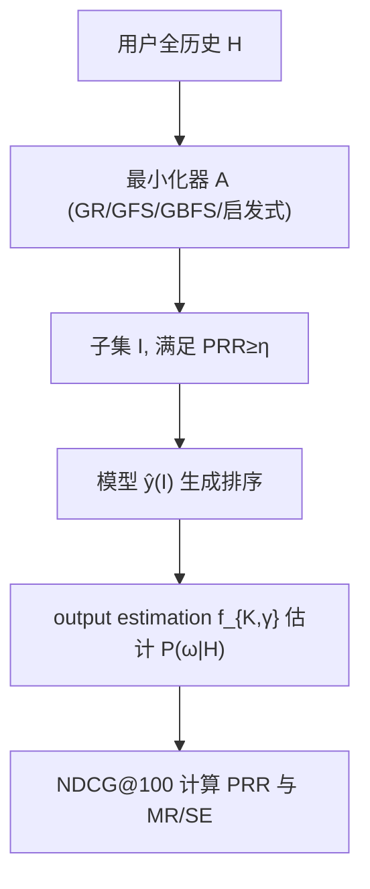

# What Data is Really Necessary? A Feasibility Study of Inference Data Minimization for Recommender Systems (推理阶段究竟需要哪些数据？推荐系统推理数据最小化的可行性研究)

- **会议/期刊**: CIKM 2025
- **作者与机构**: Jens Leysen, Marco Favier, Bart Goethals (University of Antwerp; Monash University)
- **推荐链路定位**: 推理阶段（post-training 用户历史裁剪，服务于召回/排序模型的输入侧）
- **研究方向**: 去偏公平、可信隐私与工业架构 / 数据最小化与合规
- **论文原文**: [https://arxiv.org/abs/2508.21547v1](https://arxiv.org/abs/2508.21547v1)
- **开源代码**: [https://github.com/Djensonsan/cikm2025-data-minimization](https://github.com/Djensonsan/cikm2025-data-minimization)

## TL;DR (1分钟核心速览)

GDPR 等法规要求"数据最小化"，但推荐系统长期依赖全量用户历史。本文指出前人"统一大小 $k$子集"的 size-constrained 范式忽视了数据必要性因人而异，转而提出 **performance-constrained 最小化**：为每个用户寻找满足相对性能阈值$\eta$的最小历史子集$I\subseteq H$，并设计后向 **Greedy Removal (GR)** 算法。在 Netflix/MovieLens/MSD 三数据集、EASE 与 ItemKNN 两模型上，$\eta=0.98$ 时 EASE 可将历史压至 49.3%–67.3%、ItemKNN 低至 15.5%，测试集 PRR 与目标阈值高度吻合，验证了技术可行性。

## Background & Motivation (背景与核心矛盾)

- **主流范式**: 现有推理数据最小化工作（Biega et al.、Rendle & Zhang）均采用 **size-constrained** 形式——为所有用户统一选取固定大小 $k$ 的交互子集，再最大化整体性能。
- **前人局限**: 其一，统一 $k$ 无法刻画"必要性"的用户依赖性，偏好复杂、建模困难用户的必要数据量天然更大；其二，固定大小约束把优化目标错置为"给定预算下最大化性能"，而非"给定性能下最小化数据"，与法律语义脱节。
- **核心洞察 (Key Insight)**: 图 1 显示即便历史长度相近的用户，其最小化比率 (MR) 仍呈显著纵向离散——说明除历史长度外，偏好复杂度等隐因子才是决定"必要性"的关键，故必要性必须逐用户定义。
- **本文切入点**: 将约束从"数据大小"翻转为"相对性能保留率 PRR $\geq \eta$"，并论证后向删除比前向选择更契合该目标。

## Method (核心方法设计)

### 1. 整体框架 (Overall Architecture)

模型不改动推荐算法本身，而是在**推理输入侧**做数据治理：给定已训练模型 $\hat{y}$（EASE / ItemKNN）与用户全历史$H$，最小化器$A$输出子集$I=A(H)$，用$I$替代$H$作为模型输入生成排序，并以全历史排序为基准计算 PRR。由于真实$P(\omega|H)$不可得，采用 Rendle & Zhang 的 **output estimation**：用模型自身排名经参数函数$f_{K,\gamma}$ 反推交互概率，从而在单用户粒度上获得稠密可分的评估信号；随后在独立测试集上以 hold-out 验证 PRR 是否达标。

### 2. 关键设计拆解 (Key Designs)

1. **性能约束式问题形式化（Performance-Constrained Minimization）**：针对统一 $k$ 无法表达用户异质必要性的痛点，改为逐用户求解
$$\arg\min_{I\subseteq H}|I|\quad \text{s.t.}\quad \mathrm{PRR}=\frac{\mathcal{R}_H(\hat{y}(I))}{\mathcal{R}_H(\hat{y}(H))}\geq\eta$$
其中 $\eta\in[0,1]$为相对性能阈值。相对（而非绝对）约束使每个用户与自身全历史基线比较，规避了跨用户性能不可比的问题，也让$|I|$ 可自由浮动。

2. **Greedy Removal 后向删除算法**：前向 GFS 每步最大化即时增益，易纳入"性能强但非必要"的交互，导致子集偏大。GR 从全历史出发，每步删除使性能损失最小且删除后仍满足 $\mathrm{PRR}\geq\eta$的交互$\omega^\*=\arg\max_{\omega}\mathcal{R}_H(\hat{y}(I\setminus\{\omega\}))$，直至无可删。其优势有二：始终在完整交互上下文中评估删除，更好保留交互间复杂依赖；且全程维持可行解，提前终止亦合法。

3. **训练目标、负采样与推理效率**：本文无训练损失（模型复用现成 EASE/ItemKNN），核心成本是最小化过程本身，用 **Sample Efficiency (SE)** 即模型推理调用次数度量。GR 在严格 $\eta$下反而更省：$\eta=1.0$ 时 Netflix/EASE 上 GR 仅 308 次推理，而 GFS 需 7,619 次、GBFS 需 37,315 次——因为高阈值下只需少量删除即可收敛，而后向搜索天然贴近可行域。

## Experimental Setup & Evaluation Protocol (实验设置与评估协议)

- **数据集与预处理**: 按 Liang et al. 默认流程过滤低活跃用户/物品，评分 >4 视为正交互：

| 数据集 | #Users | #Items | #Interactions | 密度 | 场景说明 |
| :--- | :---: | :---: | :---: | :---: | :--- |
| MovieLens25M | 160,770 | 19,937 | 12.4M | 0.39% | 电影评分二值化 |
| Netflix | 463,435 | 17,769 | 56.9M | 0.69% | 电影评分二值化 |
| Million Song | 571,355 | 41,140 | 33.6M | 0.14% | 播放计数二值化 |

- **数据划分与防穿越 (Splitting Strategy)**: 采用 **Strong Generalization**——用户级随机划分 train/val/test 且用户不重叠；val/test 内每用户 80% 交互为 fold-in（模型输入）、20% 为 hold-out（评估）。另设 1,000 用户独立验证集调 $f_{K,\gamma}$的$\gamma,K$。
- **排名评测协议 (Ranking Protocol)**: 单用户粒度评估，指标为 NDCG@100（约束与主指标）、Recall@20/50；ground truth 用 output estimation $f_{K,\gamma}(i)=\mathbb{I}(i\leq K)\frac{(i+1)^\gamma-(K+1)^\gamma}{2^\gamma-(K+1)^\gamma}$ 而非稀疏 hold-out，以获稠密分级信号。
- **对比基线与超参设置**: 启发式 RS / MP / LP / EmbSim 与贪心 GFS / GBFS($L=5$) / GR；模型为 EASE（L2 正则经 val 调优）与 ItemKNN，均取自 RecPack；$\eta\in\{0.98,0.99,1.0\}$。

## Key Experimental Results (实验关键数据)

### 1. 主实验对比 (Main Results)

$\eta=0.98$ 下贪心算法 MR(%) 与 SE(#) 对比（MR 越低越好）：

| Model | Dataset | GFS MR | GBFS MR | **GR MR** | GR SE |
| :--- | :--- | :---: | :---: | :---: | :---: |
| EASE | Netflix | 77.3 | 71.5 | **49.3** | 6,258 |
| EASE | ML25M | 75.0 | 68.4 | **60.8** | 1,896 |
| EASE | MSD | 75.4 | 72.3 | **67.3** | 834 |
| ItemKNN | Netflix | 30.1 | 27.0 | 30.0 | 7,221 |
| ItemKNN | ML25M | 18.3 | **15.5** | 22.6 | 2,559 |
| ItemKNN | MSD | 58.2 | 54.5 | **49.1** | 1,079 |

$\eta=1.0$严格约束下，EASE 几乎不可削减（MR 97.8%–99.8%），ItemKNN 仍可削减至 Netflix 92.5%、MSD 88.2%（GR），而 GFS/GBFS 均 >95.9%。测试集验证（Netflix,$\eta=0.98$）：EASE 全历史 NDCG=0.382，GR 最小化后 0.375（PRR 98.2%），与目标 98% 高度吻合。

### 2. 消融实验 (Ablation Study)

按用户历史长度分箱（$\eta=0.99$，EASE/Netflix）考察 MR 与 SE：

| 历史分箱 | RS MR | MP MR | EmbSim MR | GFS MR | GBFS MR | **GR MR** | GR SE |
| :--- | :---: | :---: | :---: | :---: | :---: | :---: | :---: |
| (0, 88) | 96.2 | 89.7 | 92.4 | 86.6 | 82.6 | **77.8** | 368 |
| [88, 176) | 95.0 | 88.0 | 88.5 | 87.0 | 83.0 | **64.3** | 5,012 |
| [176, 264) | 94.8 | 87.5 | 86.7 | 88.5 | 85.4 | **56.3** | 16,223 |
| [264, 352) | 95.0 | 87.4 | 86.0 | 89.7 | 87.2 | **50.4** | 34,679 |
| [352, 440) | 95.1 | 86.9 | 85.4 | 90.6 | 87.7 | **46.0** | 60,783 |

### 3. 关键实验发现 (Key Findings)

1. **GR 在严格约束下全面占优，宽松约束下前向法反超**：$\eta=1.0$时 GR 在 ItemKNN/Netflix 上 MR=92.5% 而 GFS/GBFS >99.5%；但$\eta=0.98$ 的 ItemKNN/ML25M 上 GBFS 以 15.5% 反超 GR 的 22.6%——说明最优最小化策略本身依赖技术设定，不存在普适算法。
2. **历史越长，相对削减空间越大但计算代价越高**：EASE/Netflix 上 GR 的 MR 从最短箱 77.8% 单调降至最长箱 46.0%，同时 SE 从 368 暴涨至 60,783，呈现"削减收益与计算成本同向增长"的张力。
3. **同长度用户内部方差巨大**：图 1 中相同历史长度处 MR 纵向散布显著，证明历史长度之外还存在偏好复杂度等隐因子；这意味着任何仅按数据量定义的"必要性"标准都难以成立。

## Highlights & Limitations (亮点、对比与审稿批判)

- **与代表作对比 (vs. Prior Work)**: 相较 Biega et al. 与 Rendle & Zhang 的 size-constrained 统一 $k$子集，本文把约束翻转为逐用户相对性能阈值，使"必要性"可随用户浮动；相较 GFS/GBFS 的前向增量构建，GR 的后向删除在完整上下文内评估、全程可行，严格$\eta$ 下同时取得更低 MR 与更低 SE。
- **可迁移亮点**: (1) 用模型自身输出经 $f_{K,\gamma}$ 反推稠密 ground truth，可迁移到任何需要单用户粒度评估的离线实验；(2) 按历史长度分箱 + 95 分位截断的分层分析范式，适合诊断长尾用户上的方法异质性。
- **审稿级局限批判**: 其一，仅验证 EASE/ItemKNN 两个 item-item 相似度模型，未涉及神经模型或序列模型，而 GR 的逐项删除在深度模型上推理成本可能不可接受；其二，output estimation 以模型自身排序定义"真值"，存在自我印证风险，且结论高度依赖 $\eta$、指标与$K$ 等"看似任意"的技术选择，削弱了向法规标准转化的说服力。

## Rating (四维评分)

- **方法创新性 (Novelty)**: ⭐⭐⭐⭐ （问题形式化从 size-constrained 翻转为 performance-constrained 是概念层面的实质推进，GR 算法本身较朴素但动机清晰）
- **评估协议与实验扎实度 (Protocol & Experiments)**: ⭐⭐⭐⭐ （三数据集 × 两模型 × 三阈值 × 七算法覆盖充分，且有独立测试集验证 PRR 对齐，但缺神经模型与线上验证）
- **写作与数学规范度 (Clarity & Rigor)**: ⭐⭐⭐⭐⭐ （PRR/MR/SE 定义干净，问题形式化与算法伪代码严谨，技术设定依赖性的讨论诚实且有洞察）
- **工业落地与复现价值 (Industrial & Practical Value)**: ⭐⭐⭐ （代码与配置全开源、结论对合规实践有直接参考价值，但 GR 的 SE 在长历史上达数万次推理，线上规模化仍需更高效算法）

