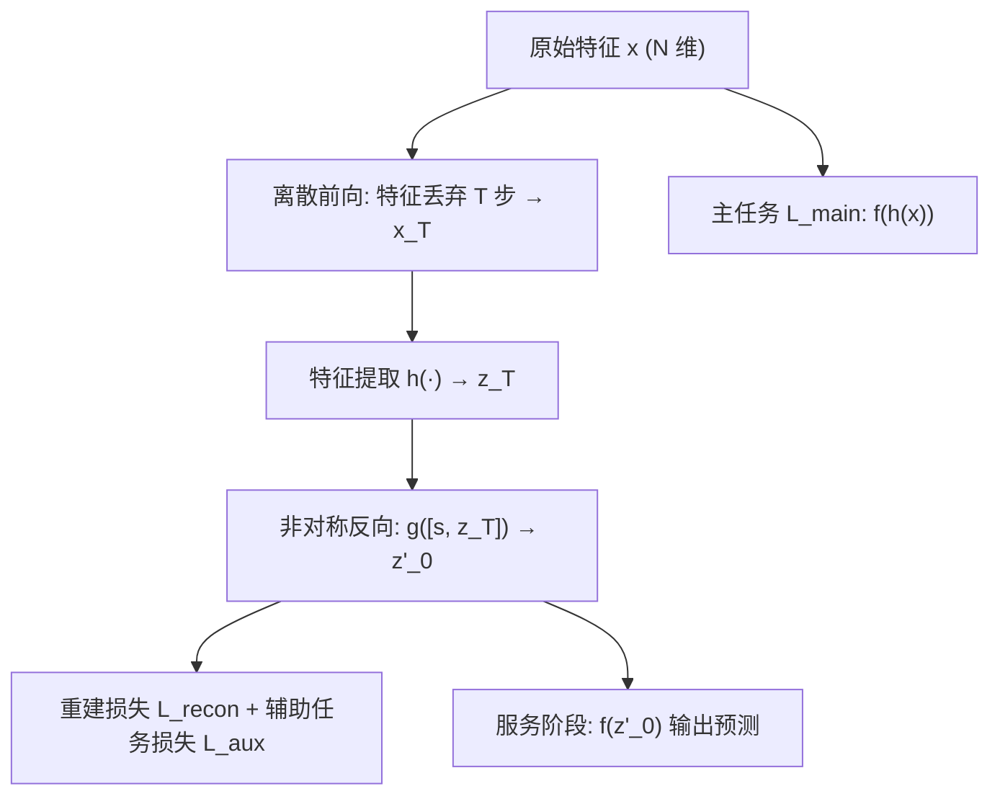
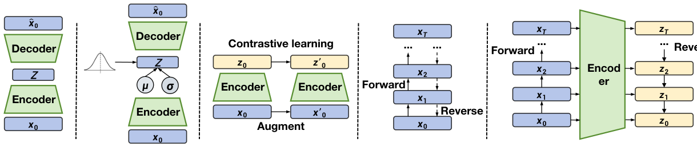

# Asymmetric Diffusion Recommendation Model (非对称扩散推荐模型)

- **会议/期刊**: CIKM 2025
- **作者与机构**: Yongchun Zhu, Guanyu Jiang, Jingwu Chen (通讯), Feng Zhang, Xiao Yang, Zuotao Liu — 字节跳动（抖音音乐）
- **推荐链路定位**: 精排（可插拔于任意 DCN-V2 类排序基座）
- **研究方向**: 生成式推荐与离散语义ID / CTR预估与特征交叉
- **论文原文**: [https://arxiv.org/abs/2508.12706v1](https://arxiv.org/abs/2508.12706v1)
- **开源代码**: 暂未开源

## TL;DR (1分钟核心速览)

现有扩散推荐（如 DiffRec）在连续空间用对称高斯噪声加噪/去噪，但推荐样本本质是离散的（ID、性别、序列），高斯扰动生成的隐表征不对应任何真实样本，且会淹没个性化信息。本文提出 AsymDiffRec：前向在原始特征空间做**特征丢弃**（离散噪声，模拟线上特征缺失），反向在**隐空间**做非对称去噪重建，并加任务导向辅助损失保个性。抖音音乐 40B 工业数据上 UAUC 相对提升 +1.682%，全量 A/B 活跃天数 +0.131%、时长 +0.166%。

## Background & Motivation (背景与核心矛盾)

- **主流范式**: 以 Autoencoder / VAE / 自监督对比学习增强排序模型的隐表征；近期 DiffRec 等把扩散过程作为辅助训练任务，用标准高斯噪声做对称前向-反向。
- **前人局限**: ① **离散数据空间错配**——推荐样本来自离散空间，对隐表征加连续高斯噪声得到的"增广样本"无法对应任何真实样本，学到的抗噪性对推荐无意义；② **个性化信息被腐蚀**——对称加噪-重建迫使模型把注意力放在还原高斯噪声上，而个性化信号恰是线上服务最需要的。
- **核心洞察 (Key Insight)**: 工业推荐中"特征缺失"才是真实且高频的噪声形态；若把噪声定义为特征丢弃，则加噪样本本身就是真实可出现的样本，去噪即"特征补全"。
- **本文切入点**: 前向在原始特征空间做离散丢弃、反向直接在隐空间重建，形成**非对称扩散**，并把扩散模块从"仅训练期辅助"升级为"训练+服务双阶段"使用。

## Method (核心方法设计)

### 1. 整体框架 (Overall Architecture)

输入原始特征 $\boldsymbol{x}$经特征提取器$h(\cdot)$得隐表征$\boldsymbol{z}=h(\boldsymbol{x})$，基座预测$\hat{y}=f(\boldsymbol{z})$。训练时随机采样步数$T\sim\text{Uniform}(0,N)$，前向对原始特征逐步丢弃$T$个特征得$\boldsymbol{x}_T$，再经$h$得含噪表征$\boldsymbol{z}_T$；反向由去噪函数$g(\cdot)$结合步嵌入$\boldsymbol{s}$重建$\boldsymbol{z}'_0$，同时受重建损失与任务辅助损失约束。服务阶段直接把线上含缺失特征的样本视作含噪输入，经$g$补全后送入$f$ 预测。

<figure class="paper-figure" markdown="span">
  <figcaption>图1：(a) 自编码器、(b) 变分自编码器、(c) 自监督方法、(d) 扩散推荐（DiffRec）以及(e) 所提出的 AsymDiffRec 的示意图。</figcaption>
</figure>

### 2. 关键设计拆解 (Key Designs)

1. **离散前向过程（Feature Dropout 作为噪声算子）**：高斯噪声的痛点是与离散特征空间不匹配 $\to$定义单步前向$q(\boldsymbol{x}_t|\boldsymbol{x}_{t-1})$为按均匀概率丢弃一个特征，$T$步即丢弃$T$个特征得到$\boldsymbol{x}_T$ $\to$ 直觉：丢弃后的样本仍是"合法"的真实推荐样本（线上特征缺失普遍存在），因此增广分布与真实分布同支撑，学到的鲁棒性可直接迁移到服务阶段。

2. **非对称反向过程（隐空间去噪 + 步嵌入）**：若在原始空间重建再抽特征，会经历"反向重建 $\to$特征提取"两次信息损失$\to$令反向直接在隐空间进行，去噪函数输入为步嵌入与含噪表征的拼接$\boldsymbol{z}'_0=g([\boldsymbol{s},\boldsymbol{z}_T])$，其中$\boldsymbol{s}\in\{0,1\}^N$ 标记哪些特征被丢弃，提供缺失位置信息；重建目标为
$$\mathcal{L}_{recon}=\lVert \boldsymbol{z}'_0-\boldsymbol{z}_0\rVert^2 .$$
直觉：一步跨空间完成"补全+表征"，避免二次压缩，且 $\boldsymbol{s}$ 让去噪器知道该补哪里。

3. **任务导向优化与服务期复用**：仅重建 $\boldsymbol{z}_0$可能把个性信号当噪声抹平$\to$ 引入辅助损失
$$\mathcal{L}_{aux}=-y\log f(\boldsymbol{z}'_0)-(1-y)\log(1-f(\boldsymbol{z}'_0)),$$
总损失 $\mathcal{L}=\mathcal{L}_{main}+\mathcal{L}_{recon}+\mathcal{L}_{aux}$。负采样沿用基座二分类样本构造（曝光日志正负标签，无额外负采样器）。服务期$\boldsymbol{z}'_0=g([\boldsymbol{s},h(\boldsymbol{x}_0)])$，去噪器仅为两层 MLP、$d=128$，线上推理 12.6 ms vs 基座 12.1 ms，开销近乎可忽略。

## Experimental Setup & Evaluation Protocol (实验设置与评估协议)

- **数据集与预处理**: 仅用自建工业数据集（作者指出公开数据缺乏 200+ 稠密特征，无法支撑特征丢弃前向）：

| 数据集 | #Users | #Items | #Interactions | 稀疏度/密度 | 特征/场景说明 |
| :--- | :---: | :---: | :---: | :---: | :--- |
| DouyinMusic-40B | >1000 万 DAU | 音乐曲库（未披露） | >400 亿样本 | 极稠密曝光日志 | 每样本 200+ 特征：性别/年龄/曲风/情绪/场景等非 ID 特征 + 多类 ID 个性化特征；2024.09–10 共 10 周，标签为"收藏" |

- **数据划分与防穿越 (Splitting Strategy)**: 工业曝光日志按时间跨度采集（10 周），未明确披露比例；线上 A/B 为一个月全量实验，天然无穿越。
- **排名评测协议 (Ranking Protocol)**: 离线采用 **AUC** 与 **UAUC**（按用户样本量加权的人均 AUC），报告相对基座的 RelaImpr；线上采用按用户聚合的 Active Day / Duration 主指标与 Like / Finish / DisLike / Play 约束指标，附 95% 置信区间。
- **对比基线与超参设置**: 基座为 DCN-V2 多任务模型；对比 CDAE、MultiVAE、SSL（自监督）、DiffRec；隐维度 $d=128$，去噪器两层 MLP；线上 A/B 覆盖 100% 用户（>2000 万），显著性以置信区间是否跨零判定。

## Key Experimental Results (实验关键数据)

### 1. 主实验对比 (Main Results)

线上 A/B（相对基座 DCN-V2 多任务的相对提升，括号为 95% CI）：

| 模型 | Active Day | Duration | Like | Finish | DisLike | Play |
| :--- | :---: | :---: | :---: | :---: | :---: | :---: |
| AsymDiffRec | **+0.131%** | **+0.166%** | **+0.285%** | **+0.353%** | -2.469% (CI 跨零) | **+0.256%** |

离线 DouyinMusic-40B（AUC / UAUC 及相对提升）：

| 模型 | AUC | RelaImpr | UAUC | RelaImpr |
| :--- | :---: | :---: | :---: | :---: |
| Base Model (DCN-V2) | 0.92267 | - | 0.61578 | - |
| CDAE | 0.92220 | -0.051% | 0.61600 | +0.036% |
| MultiVAE | 0.92285 | +0.020% | 0.61834 | +0.416% |
| SSL | 0.92297 | +0.033% | 0.62009 | +0.700% |
| DiffRec | 0.92307 | +0.043% | 0.62152 | +0.932% |
| **AsymDiffRec** | **0.92359** | **+0.100%** | **0.62614** | **+1.682%** |

### 2. 消融实验 (Ablation Study)

| 变体 | AUC | RelaImpr | UAUC | RelaImpr |
| :--- | :---: | :---: | :---: | :---: |
| AsymDiffRec (full) | **0.92359** | **+0.100%** | **0.62614** | **+1.682%** |
| w/o recon | 0.92276 | +0.010% | 0.62025 | +0.726% |
| w/o aux | 0.92248 | -0.021% | 0.62069 | +0.797% |

### 3. 关键实验发现 (Key Findings)

1. **UAUC 增益远大于 AUC（+1.682% vs +0.100%）**：说明收益主要来自用户内排序（个性化区分度）而非全局排序，与"保个性"的设计动机严格自洽；DiffRec 的 UAUC 增益仅 +0.932%，印证高斯噪声确实稀释了个性信号。
2. **去掉辅助损失比去掉重建损失更致命**：w/o aux 的 AUC 甚至低于基座（-0.021%），说明纯重建目标会把个性信息当噪声抹平，任务导向损失是防止表征"去个性化"的必要约束。
3. **线上约束指标同向改善**：Like +0.285%、Finish +0.353%、Play +0.256%，DisLike 变化在 CI 内不显著，说明增益不是靠牺牲体验换取的短期指标；且推理仅增 0.5 ms，具备全量部署可行性。

## Highlights & Limitations (亮点、对比与审稿批判)

- **与代表作对比 (vs. Prior Work)**: 与 DiffRec 的本质差异在于噪声空间（离散特征丢弃 vs 连续高斯）与反向空间（隐空间一步补全 vs 原始空间逐步重建）；与 SSL 相比，二者都构造"真实增广样本"，但 AsymDiffRec 的增广由 $T$ 步丢弃显式控制噪声强度且服务期复用去噪器；与 CDAE/MultiVAE 相比，不再要求重建原始输入，而是重建隐表征并直接对齐下游任务。
- **可迁移亮点**: ① "把线上真实缺陷（特征缺失）当作噪声算子"这一思路可迁移到任何存在系统性缺失的推荐场景（如新用户画像缺失、跨域字段不全）；② 训练期辅助模块在服务期复用（test-time denoising）是低成本涨点范式，去噪器仅两层 MLP 即可上线。
- **审稿级局限批判**: ① **评估可复现性弱**——仅用单一自建工业数据集，无公开基准，且未披露数据划分比例与训练细节，学界难以复现对比；② **增益量级与消融粒度偏薄**——线上 +0.131% 虽显著但幅度小，消融仅拆两个损失，未分析丢弃步数 $T$ 的分布敏感性、去噪器深度影响，也未与"随机特征掩码 + MLP"这一朴素强基线对比，难以完全排除增益来自正则化而非扩散结构本身。

## Rating (四维评分)

- **方法创新性 (Novelty)**: ⭐⭐⭐⭐ （离散特征丢弃替代高斯噪声、非对称隐空间反向的视角切中扩散推荐的核心错配，但结构本身较简洁）
- **评估协议与实验扎实度 (Protocol & Experiments)**: ⭐⭐⭐ （全量 A/B 与 40B 数据极具说服力，但仅单数据集、无公开基准、消融维度偏少）
- **写作与数学规范度 (Clarity & Rigor)**: ⭐⭐⭐⭐ （公式精简、算法流程清晰，5 页短文信息密度高；但部分符号与训练细节略欠展开）
- **工业落地与复现价值 (Industrial & Practical Value)**: ⭐⭐⭐⭐ （抖音音乐全量部署、推理仅 +0.5 ms，工程价值明确；可惜未开源，学界复现门槛高）

