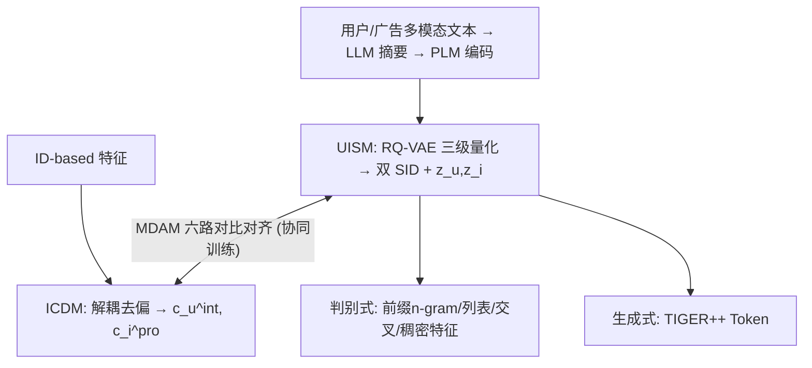
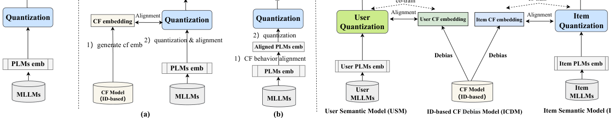
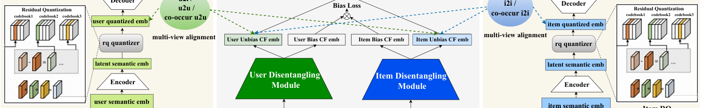

# DAS: Dual-Aligned Semantic IDs Empowered Industrial Recommender System (双对齐语义ID赋能的工业推荐系统)

- **会议/期刊**: CIKM 2025
- **作者与机构**: Wencai Ye, Mingjie Sun, Shaoyun Shi, Peng Wang, Wenjin Wu, Peng Jiang（快手科技）
- **推荐链路定位**: 召回 / 精排 / 端到端生成式（SID 作为稀疏特征与生成式 Token 双路复用）
- **研究方向**: 生成式推荐与离散语义ID / 去偏公平与工业架构
- **论文原文**: [https://arxiv.org/abs/2508.10584v2](https://arxiv.org/abs/2508.10584v2)
- **开源代码**: 暂未开源

## TL;DR (1分钟核心速览)

MLLMs 语义 ID 缺乏协同信号，与下游判别/生成任务错位；现有两阶段对齐（LETTER、QARM）先量化后对齐，存在信息损失且对齐策略僵化。本文提出单阶段 DAS：RQ-VAE 量化与 ID-based CF 去偏模型协同训练，并用双 u2i、双 i2i/u2u、双共现 i2i/u2u 三路对比对齐最大化互信息。在快手十亿级工业数据上，CTR 任务 AUC 由 0.8037 提升至 0.8061，线上全场景 eCPM +3.48%、冷启动 +8.98%。

## Background & Motivation (背景与核心矛盾)

- **主流范式**: 用 MLLMs 多模态 embedding 经 RQ-VAE 量化为层级语义 ID（SID），再作为稀疏特征喂给判别式 CTR 模型（如 Zheng et al.）或作为 Token 喂给 TIGER 类生成式检索。
- **前人局限**: 两阶段方案分两类——"CF 先行"（LETTER：先训 CF 再量化对齐）与"对齐先行"（QARM：先对齐多模态表征再量化）。二者共同缺陷是量化与对齐解耦优化，量化误差不可回传修正；且对齐策略被固化在某一阶段，无法按需自适应。
- **核心洞察 (Key Insight)**: 对齐的本质是最大化 SID 与 CF 信号的互信息，而互信息最大化要求两个表征在同一优化回路中互相塑造；此外 CF 侧存在严重流行度/从众偏置（20% 广告贡献 80% 收入），若直接对齐会把偏置注入码本、加剧长尾塌缩。
- **本文切入点**: 把量化器与去偏 CF 模型放进同一训练图协同优化，并在用户侧与广告侧同时做量化（Dual Learning），用多视角对比损失显式拉近 SID 与去偏 CF 表征。

## Method (核心方法设计)

### 1. 整体框架 (Overall Architecture)

DAS 由三模块构成：UISM 用 RQ-VAE 分别对用户/广告的 MLLMs 语义 embedding 做三级残差量化，得到双 SID 与量化表征 $z_u,z_i$；ICDM 用解耦去偏网络从 ID 特征中剥离用户从众表征与广告流行度表征，输出无偏兴趣$c_u^{int}$与无偏内容$c_i^{pro}$；MDAM 在协同训练中执行六路对比对齐，把 CF 协同信号注入量化表征。训练完成后，SID 与 SID-Embs 以四种特征形态（前缀 n-gram ID、列表 ID、交叉匹配计数、稠密向量）注入判别式链路，或以 TIGER++ 形式注入生成式链路。

<figure class="paper-figure" markdown="span">
  <figcaption>图2：语义ID构建方法对比。(1) 无对齐，(2) 两阶段对齐，(3) 本文方法：单阶段双对齐。</figcaption>
</figure>
<figure class="paper-figure" markdown="span">
  <figcaption>图3：DAS的实现。UISM模块在量化过程中利用RQ-VAE，ICDM模块使用解耦去偏网络获得无偏的CF表示，在UISM与ICDM的协同训练过程中，通过MDAM模块实现CF与语义ID之间的对齐。</figcaption>
</figure>

### 2. 关键设计拆解 (Key Designs)

1. **单阶段协同量化-对齐（One-stage Co-training）**：两阶段方案中量化损失与对齐损失各自独立下降，量化残差无法感知对齐目标。DAS 将 RQ-VAE 语义正则与 CF 损失、对齐损失合并为单一目标 $\mathcal{L}_{All}=\mathcal{L}_{Sem\_all}+\alpha\mathcal{L}_{CF\_all}+\beta\mathcal{L}_{Align\_all}$，梯度从对齐项直接回传至码本，使码本在保持重建精度的同时被协同信号塑形。直觉上，这等价于在量化空间中做"有监督的码本分配"，避免了两阶段的信息瓶颈。

2. **ID-based CF 去偏（ICDM）**：直接对齐有偏 CF 表征会把流行度偏置写进码本，导致码字使用率下降、长尾加剧。ICDM 借鉴解耦域适应，将用户表征拆为 $c_u^{int}$（兴趣）与$c_u^{con}$（从众），广告拆为$c_i^{pro}$（内容）与$c_i^{pop}$（流行度），并用相似性约束与正交约束分离二者：

$$\mathcal{L}_{dis}=\sum_{b}\left(1-\frac{c_u^{con}(c_u^{c})^\top}{\|c_u^{con}\|\|c_u^{c}\|}\right)+\sum_{b}\frac{\|c_u^{con}(c_u^{int})^\top\|^2}{\|c_u^{con}\|\|c_u^{int}\|}$$

即让偏置分量逼近真实偏置特征、同时与无偏分量正交，从而保证 $c_u^{int},c_i^{pro}$ 只承载兴趣与内容信号。

3. **多视角双对齐（MDAM）与训练目标**：仅对齐 u2i 只能捕捉"点击过"这一稀疏监督，无法约束同用户/同广告邻域的结构。MDAM 设计三组对称损失：双 u2i（$z_u\leftrightarrow c_i^{pro}$、$c_u^{int}\leftrightarrow z_i$）、双 i2i/u2u（同一样本内 SID 与去偏 CF 表征的 InfoNCE）、双共现 i2i/u2u（借助 memory bank 拉近共享同一用户/广告的 SID 对）。以 u2u 为例：

$$\mathcal{L}_{a\_u2u\_z_u}=-\frac{1}{B}\sum_{b}\log\frac{\exp(\langle z_u^b,c_u^{int,b}\rangle)}{\sum_{j=1}^{B}\exp(\langle z_u^b,c_u^{int,j}\rangle)}$$

负样本全部采用 in-batch 采样（免额外负采样器），六项相加得 $\mathcal{L}_{Align\_all}$。推理侧仅需一次前向量化，SID 在线实时生成，开销与普通双塔相当。

## Experimental Setup & Evaluation Protocol (实验设置与评估协议)

- **数据集与预处理**: 因公开数据集与工业需求错位，全部实验基于快手广告平台真实数据：

| 数据集 | #Users | #Items | #Interactions | 稀疏度/密度 | 特征/场景说明 |
| :--- | :---: | :---: | :---: | :---: | :--- |
| 快手 CTR 数据 | ~1 亿 | 800 万 | 18 亿 | 极稀疏 | 用户-广告点击，判别式任务 |
| 快手生成式数据 | ~5000 万 | — | 近 15 天序列（长度≥10） | 序列稀疏 | 生成式 next-SID 预测 |

- **数据划分与防穿越 (Splitting Strategy)**: CTR 任务按时间顺序 80%/20% 切分（全局时间戳切分）；生成式任务采用 `Leave-One-Out`。
- **排名评测协议 (Ranking Protocol)**: CTR 任务报告 AUC / UAUC / GAUC（用户级分组 AUC，缓解用户维度偏置）；生成式任务报告 HR@5/10 与 NDCG@5/10，属全库序列生成式评测而非采样排序。
- **对比基线与超参设置**: 基线含 CTR Model（MMoE+SeNet 在线模型）、+MLLMs Emb、+SID (Raw RQ)、+ASID (LETTER) 及 DAS 各消融变体；RQ-VAE 设 $L=3$层码本、每层$N=512$、码字维度 32，用户/广告语义维度$d_2=1024$、$d_1=256$，损失权重$\alpha=1,\beta=0.5,\gamma=0.1$；TIGER++ 基于 T5，4 层编解码、1300 万参数。

## Key Experimental Results (实验关键数据)

### 1. 主实验对比 (Main Results)

CTR 任务（用户侧与广告侧特征分别增强，取广告侧增强列）：

| 对齐机制 | 模型变体 | AUC | UAUC | GAUC | 相对 CTR Model |
| :--- | :--- | :---: | :---: | :---: | :---: |
| No | CTR Model | 0.8037 | 0.7736 | 0.7422 | — |
| No | +MLLMs Emb | 0.8038 | 0.7739 | 0.7425 | +0.01% |
| No | +SID (Raw RQ) | 0.8043 | 0.7743 | 0.7428 | +0.07% |
| Two Stage | +ASID (LETTER) | 0.8046 | 0.7747 | 0.7432 | +0.11% |
| One Stage | +ASID (Biased DAS) | 0.8050 | 0.7748 | 0.7434 | +0.16% |
| One Stage | +ASID (Debiased DAS) | 0.8052 | 0.7753 | 0.7437 | +0.19% |
| One Stage | +ASID (No-dual DAS) | 0.8054 | 0.7757 | 0.7442 | +0.21% |
| One Stage | **+ASID (Full DAS)** | **0.8061** | **0.7764** | **0.7448** | **+0.30%** |

生成式任务（TIGER 架构）：

| 方法 | HR@5 | HR@10 | NDCG@5 | NDCG@10 |
| :--- | :---: | :---: | :---: | :---: |
| TIGER | 0.02184 | 0.02701 | 0.01515 | 0.01712 |
| TIGER+ | 0.02326 | 0.02957 | 0.01611 | 0.01804 |
| **TIGER++** | **0.02344** | **0.02973** | **0.01632** | **0.01838** |

### 2. 消融实验 (Ablation Study)

MDAM 三路对齐的逐项移除（CTR 任务）：

| 模型变体 | AUC | UAUC | GAUC |
| :--- | :---: | :---: | :---: |
| DAS (Full) | **0.8061** | **0.7764** | **0.7448** |
| w.o. dual u2i | 0.8055 | 0.7757 | 0.7442 |
| w.o. dual i2i/u2u | 0.8059 | 0.7761 | 0.7446 |
| w.o. dual co-i2i/u2u | 0.8057 | 0.7760 | 0.7445 |

### 3. 关键实验发现 (Key Findings)

1. **单阶段优于两阶段，去偏再增益**：LETTER 式两阶段 AUC 0.8046，单阶段有偏 DAS 升至 0.8050，加入 ICDM 去偏后达 0.8052——说明量化-对齐解耦的信息损失是主要瓶颈，而去偏在单阶段框架内可进一步释放对齐收益。
2. **双学习贡献最大**：No-dual DAS（0.8054）到 Full DAS（0.8061）的 +0.0007 AUC 是全部消融中最大单步增益，验证用户侧 SID 与广告侧 SID 的对称量化比单侧对齐更能拉近跨视角表征。
3. **去偏直接改善码本健康度**：一级码本可视化显示，有偏对齐（ICBM）使用率降至 81%/72%、困惑度 455/396，而 ICDM 恢复至 89%/83%、544/479，接近无对齐水平——证明偏置注入会压缩码字多样性，去偏是维持码本表达力的必要条件。

## Highlights & Limitations (亮点、对比与审稿批判)

- **与代表作对比 (vs. Prior Work)**: 相较 LETTER 的"先训 CF 再量化对齐"，DAS 把对齐写进量化训练回路，消除两阶段信息瓶颈；相较 QARM 的"先对齐多模态再量化"，DAS 保留量化器可学习性并额外引入用户侧量化；相较 TIGER 仅用广告 SID，TIGER++ 将用户 ID 升级为对齐 SID，HR@5 相对提升约 7.3%。
- **可迁移亮点**: (1) "去偏后再对齐"的思路可迁移到任何跨模态表征与行为表征融合场景，避免把流行度偏置固化进离散码本；(2) 前缀 n-gram + 列表 + 交叉匹配计数三类 SID 特征工程，是把离散 ID 接入现有判别式链路的低成本范式。
- **审稿级局限批判**: (1) 全部实验基于快手私有数据，无公开数据集复现，且未开源代码，学术可比性受限；(2) 六路对比损失 + 双 RQ-VAE + 解耦去偏网络的联合训练引入 $\alpha,\beta,\gamma$ 等多个敏感超参，论文未给出敏感性分析，工业复现调参成本可能较高。

## Rating (四维评分)

- **方法创新性 (Novelty)**: ⭐⭐⭐⭐ （单阶段协同量化-对齐 + 双学习 + 去偏对齐三件套组合新颖，但各组件均为已有技术的工程化重组，理论分析以互信息直觉为主）
- **评估协议与实验扎实度 (Protocol & Experiments)**: ⭐⭐⭐⭐ （十亿级工业数据 + 判别/生成双任务 + 多周线上 A/B 与冷启动分桶，扎实；但缺公开数据集与超参敏感性实验）
- **写作与数学规范度 (Clarity & Rigor)**: ⭐⭐⭐ （框架图与因果图清晰，但公式 (3)(4) 存在符号笔误与括号不匹配，部分损失项下标定义略含糊）
- **工业落地与复现价值 (Industrial & Practical Value)**: ⭐⭐⭐⭐⭐ （已全量部署服务 4 亿 DAU，eCPM +3.48%、冷启动 +8.98%，判别式与生成式双路复用，落地价值极高；扣分项为未开源）

