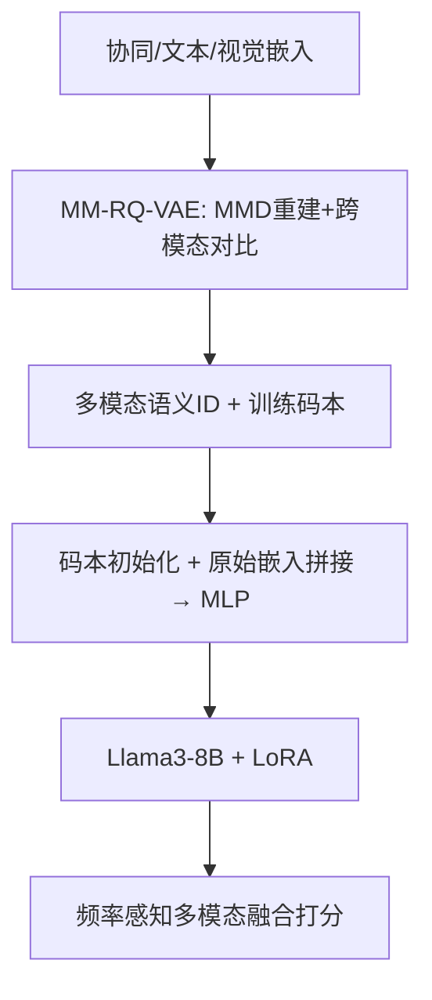
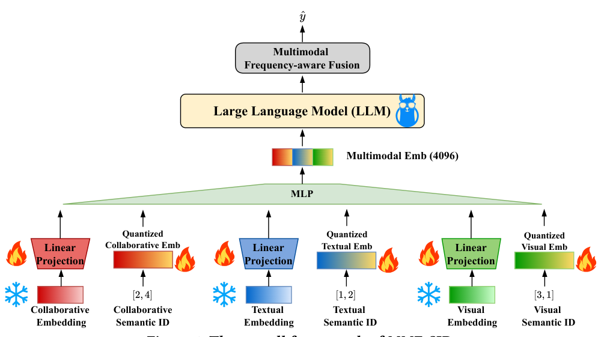

# Empowering Large Language Model for Sequential Recommendation via Multimodal Embeddings and Semantic IDs (以多模态嵌入与语义ID赋能大语言模型序列推荐)

- **会议/期刊**: CIKM 2025 (Full Research Paper)
- **作者与机构**: Yuhao Wang, Maolin Wang, Xiangyu Zhao (香港城市大学); Junwei Pan, Yuan Wang, Yue Liu, Dapeng Liu, Jie Jiang (腾讯); Xinhang Li (清华大学)
- **推荐链路定位**: 精排 / 端到端生成式（LLM 打分式检索）
- **研究方向**: 生成式推荐与离散语义ID / 多模态推荐
- **论文原文**: [https://arxiv.org/abs/2509.02017v1](https://arxiv.org/abs/2509.02017v1)
- **开源代码**: [https://github.com/Applied-Machine-Learning-Lab/MME-SID](https://github.com/Applied-Machine-Learning-Lab/MME-SID)

## TL;DR (1分钟核心速览)

现有 LLM4SR 把预训练低维协同嵌入线性投影进 LLM 空间，导致 **98% 以上维度坍缩**；而 TIGER 式语义ID丢弃训练好的码本、下游随机初始化，造成 **94.5% 距离偏序信息遗忘**。本文提出 MME-SID：用 LLM2CLIP 抽取文本/视觉嵌入，经 MM-RQ-VAE（MMD 重建 + 跨模态对比对齐）生成多模态语义ID，并以训练码本初始化 LLM 侧嵌入，LoRA 微调 + 频率感知融合打分。在 Amazon 三数据集 Leave-One-Out 全库排序下，nDCG@5 相对最强基线提升 4.42%–10.47%。

## Background & Motivation (背景与核心矛盾)

- **主流范式**: LLM4SR 分两派——TALLRec 式指令微调文本生成，与 TIGER/LC-Rec 式把物品量化成语义ID当作新 token 做自回归生成；协同信息则通过线性投影注入 LLM token 空间。
- **前人局限一（嵌入坍缩）**: 由 $\mathrm{rank}(\boldsymbol{W}\boldsymbol{E}_c+\boldsymbol{b}) \le \mathrm{rank}(\boldsymbol{E}_c)+1$可知，$D_c=64$ 的协同嵌入投影到 4096 维后仍只占据低维子空间，实测 98% 维度坍缩；传统多嵌入（ME）补救在 LLM 框架下增益微弱。
- **前人局限二（灾难性遗忘）**: 语义ID仅保留层级结构，量化码本被丢弃后随机重训，Kendall's $\tau$ 从 0.3714 掉到 0.0550，即 94.5% 的行为-目标距离偏序信息丢失。
- **核心洞察**: 两问题构成两难——只用低维协同嵌入必坍缩，随机新嵌入表虽不坍缩但代价高且遗忘；破局点在于**用多模态信息天然扩维**，同时**把量化码本本身搬进 LLM**。
- **本文切入点**: 多模态嵌入 + 语义ID 双通道输入，码本初始化替代随机初始化。

## Method (核心方法设计)

### 1. 整体框架 (Overall Architecture)

两阶段闭环：**编码阶段**先用 SASRec 取协同嵌入 $\boldsymbol{E}_c$、LLM2CLIP 取文本/视觉嵌入$\boldsymbol{E}_t,\boldsymbol{E}_v$，送入 MM-RQ-VAE 做三模态残差量化，输出多模态语义ID与训练好的码本；**微调阶段**把「原始嵌入线性投影」与「语义ID码本求和（量化嵌入）」拼接后过 MLP 映射到$D_{\text{LLM}}$，作为行为序列 token 输入 Llama3-8B-instruct，仅用 LoRA（约 0.19% 参数）微调，最后以频率感知权重融合 LLM 隐状态与各模态目标物品嵌入做点积打分。

<figure class="paper-figure" markdown="span">
  <figcaption>图1：MME-SID 的整体框架。</figcaption>
</figure>

### 2. 关键设计拆解 (Key Designs)

1. **MMD 重建损失替代 MSE（保距离偏序）**：MSE 只最小化欧氏距离，不约束距离分布形状。改用特征核（高斯核）MMD 对齐原始与解码嵌入的分布：$\mathcal{L}_{\text{Recon}}=\sum_{j}\text{MMD}^2_K\big(\text{SG}(\boldsymbol{s}_j),\hat{\boldsymbol{s}}_j\big)$，其中$\text{MMD}_K(P,Q)=\|\boldsymbol{\mu}_P-\boldsymbol{\mu}_Q\|_{\mathcal{H}_K}$。特征核的核均值保留分布全部统计量，故量化后行为-目标距离偏序得以留存（$\tau$ 从 0.3714 升至 0.4436）。

2. **跨模态对比对齐（抓模态间关联）**：三模态各自量化易丢失模态间一致性，故以 InfoNCE 将量化协同嵌入 $\hat{\boldsymbol{z}}_c$分别与$\hat{\boldsymbol{z}}_t,\hat{\boldsymbol{z}}_v$对齐（文-视已由 LLM2CLIP 同空间，无需再对齐）：$\mathcal{L}_{\text{Align}}=\mathcal{L}_{c\text{-}t}+\mathcal{L}_{c\text{-}v}$，总目标$\mathcal{L}_{\text{MM-RQ-VAE}}=\mathcal{L}_{\text{Recon}}+\beta\mathcal{L}_{\text{Align}}+\gamma\sum_j\mathcal{L}_{\text{RQ-VAE}}$。直觉：协同信号是推荐主模态，用它锚定语义空间可让量化码本同时编码「同模态距离」与「跨模态语义」。

3. **码本初始化 + 频率感知融合（抗遗忘、抗冷启）**：语义ID嵌入 $\boldsymbol{E}_{\text{SID}^l_j}$直接用训练好的码本$\boldsymbol{CE}_{\text{SID}^l_j}$初始化，而非随机；输入为$\big[\boldsymbol{W}_j(\boldsymbol{X}\cdot\text{SG}(\boldsymbol{E}_j))+\boldsymbol{b}_j,\ \sum_l \boldsymbol{E}_{\text{SID}^l_j}\big]$拼接后过 MLP，同时保留原始距离信息与层级结构。打分侧按物品频次$q_i$经$\log(q_i+1)$归一化后由 MLP 输出融合权重$\{w_x,w_c,w_t,w_v\}$，$\hat{y}=w_x\odot(\boldsymbol{o}_{\text{LLM}}\boldsymbol{E}_x^\top)+\sum_j w_j\odot(\boldsymbol{o}_{\text{LLM}}\tilde{\boldsymbol{e}}_j^\top)$，使冷/热门物品自适应调节各模态贡献。训练用 BCE，负采样为训练集内未交互物品（全库排序评测）。

## Experimental Setup & Evaluation Protocol (实验设置与评估协议)

- **数据集与预处理**: Amazon 三品类 `5-core`（用户与物品均 ≥5 交互），剔除缺标题或图片的物品：

| 数据集 | #Users | #Items | #Interactions | 稀疏度 | 特征/场景说明 |
| :--- | :---: | :---: | :---: | :---: | :--- |
| Beauty | 22,332 | 12,086 | 198,215 | 99.93% | 标题+图片，美妆 |
| Toys & Games | 19,121 | 11,757 | 165,221 | 99.93% | 玩具 |
| Sports & Outdoors | 35,092 | 18,090 | 292,007 | 99.95% | 户外运动 |

- **数据划分与防穿越**: `Leave-One-Out`——序列第 $(N-1)$项为训练目标、第$N$ 项为测试目标；任务定义为预测评分 >3 的二分类。
- **排名评测协议**: 对目标物品与全库未交互物品打分做 `Full-Ranking` 排序，指标 HR@$\{5,10,20\}$与 nDCG@$\{5,10,20\}$，3 次运行取均值。
- **对比基线与超参**: 单模态 SASRec / E4SRec / ME，多模态 Concat / Concat&MLP / CTRL-MM / TIGER-MM / MOTOR / LETTER；统一 Llama3-8B-instruct 骨干、RQ-VAE 量化。$D_c=64$、$D_t=D_v=1280$、$D_{\text{LLM}}=4096$，码本 4 层 × 256（Sports 为 300），LoRA rank 8 / alpha 16，$\alpha=1,\beta=10^{-3},\gamma=1$，$t$-test$p<0.05$ 显著性。

## Key Experimental Results (实验关键数据)

### 1. 主实验对比 (Main Results)

| 数据集 | 指标 | SASRec | E4SRec | Concat&MLP | CTRL-MM | TIGER-MM | LETTER | **Ours-full** | Improv. |
| :--- | :--- | :---: | :---: | :---: | :---: | :---: | :---: | :---: | :---: |
| Beauty | HR@20 | 0.0903 | 0.1040 | 0.1177 | 0.1224 | 0.0945 | 0.0833 | **0.1342**★ | 9.64% |
| Beauty | nDCG@5 | 0.0243 | 0.0388 | 0.0404 | 0.0430 | 0.0329 | 0.0262 | **0.0475**★ | 10.47% |
| Beauty | nDCG@20 | 0.0392 | 0.0527 | 0.0571 | 0.0602 | 0.0463 | 0.0408 | **0.0663**★ | 10.13% |
| Toys | HR@20 | 0.1022 | 0.1064 | 0.1184 | 0.1179 | 0.0889 | 0.0852 | **0.1223**★ | 3.29% |
| Toys | nDCG@5 | 0.0357 | 0.0433 | 0.0444 | 0.0429 | 0.0354 | 0.0343 | **0.0472**★ | 4.42% |
| Toys | nDCG@20 | 0.0500 | 0.0566 | 0.0602 | 0.0586 | 0.0468 | 0.0449 | **0.0634**★ | 5.32% |
| Sports | HR@20 | 0.0522 | 0.0650 | 0.0667 | 0.0652 | 0.0551 | 0.0503 | **0.0778**★ | 8.36% |
| Sports | nDCG@5 | 0.0132 | 0.0218 | 0.0194 | 0.0181 | 0.0167 | 0.0149 | **0.0253**★ | 8.12% |
| Sports | nDCG@20 | 0.0220 | 0.0312 | 0.0299 | 0.0287 | 0.0251 | 0.0226 | **0.0367**★ | 7.62% |

### 2. 消融实验 (Ablation Study)

Beauty 数据集，指标 nDCG@20（图 5(b)）：

| 变体 | 关键改动 | nDCG@20 趋势 |
| :--- | :--- | :---: |
| **MME-SID (full)** | 完整模型 | 最优 |
| MME-random | 量化嵌入换成同参数量随机嵌入表 | 明显下降 |
| SE-random | 仅随机初始化 ID 嵌入（同 E4SRec 参数量） | 大幅下降 |
| w/o Fusion | 去掉频率感知融合 | 下降 |
| MME-SID-random | 语义ID嵌入随机初始化 | 下降（$\tau$ 仅 0.0508） |
| SE-SID-MSE | MSE 替代 MMD 重建 | 下降（$\tau=0.3714$ vs 0.4436） |

### 3. 关键实验发现 (Key Findings)

1. **多模态+语义ID是抗坍缩主因**：SASRec/E4SRec 的 4096 维嵌入在第 64 维后急剧坍缩，而 MME-SID 在占 98% 维度的第 65–4096 维上坍缩程度最低，直接对应 nDCG@20 从 0.0527 升至 0.0663；且目标物品需独立嵌入表 $\boldsymbol{E}_x$ 才能进一步缓解坍缩。
2. **MMD 的收益来自抗遗忘而非抗坍缩**：SE-SID-MMD 与 SE-SID-MSE 的输入嵌入坍缩程度相当，但前者 $\tau=0.4436$ 高于后者 0.3714，说明性能增益应归因于距离偏序保留。
3. **码本初始化是遗忘的关键闸门**：随机初始化后微调 $\tau$跌至 0.0508（几乎全忘），码本初始化后保持$\tau=0.2727$；同时 TIGER-MM/MOTOR/LETTER 等纯语义ID生成式方法全面垫底，挑战了「仅用语义ID做生成式检索」的通行做法。

## Highlights & Limitations (亮点、对比与审稿批判)

- **与代表作对比**: 相比 TIGER/LC-Rec 的「丢弃码本 + 自回归逐码生成」，本文保留码本并改为**一次前向打分全库排序**，输入从 $D_{\text{LLM}}\times N\times L$降为$D_{\text{LLM}}\times N$，且多模态天然区分物品、无需处理语义ID碰撞；相比 E4SRec/CoLLM 的单模态线性投影，本文用多模态+量化双通道真正扩维。
- **可迁移亮点**: ① 用特征核 MMD 替代 MSE 作为任何 VQ/RQ 码本的重建损失，普适于生成式检索的 tokenizer；② 码本初始化下游嵌入这一「量化-下游一致性」技巧可迁移到任何 semantic ID + LLM 流水线。
- **审稿级局限批判**: ① 依赖 LLM2CLIP + Llama3-8B 双大模型，编码阶段离线成本与显存开销未量化，工业亿级物品的码本训练可行性存疑；② 评测仅限 Amazon 三品类、二分类 >3 评分设定与 LOO 单目标，缺少采样排序对比与线上 A/B，频率感知融合的权重可解释性也未展开。

## Rating (四维评分)

- **方法创新性 (Novelty)**: ⭐⭐⭐⭐ （首次系统识别 LLM4SR 的坍缩-遗忘两难，并用秩不等式与 Kendall's $\tau$ 给出可验证的量化诊断）
- **评估协议与实验扎实度 (Protocol & Experiments)**: ⭐⭐⭐⭐ （三数据集全库排序 + 9 个基线 + 显著性检验齐全，但缺采样排序与线上验证）
- **写作与数学规范度 (Clarity & Rigor)**: ⭐⭐⭐⭐ （两难动机推导清晰、公式紧凑，RQ-VAE 与融合模块的符号略密）
- **工业落地与复现价值 (Industrial & Practical Value)**: ⭐⭐⭐⭐ （代码开源、LoRA 仅调 0.19% 参数、推理比 TIGER 更省，但双大模型离线成本是落地门槛）

