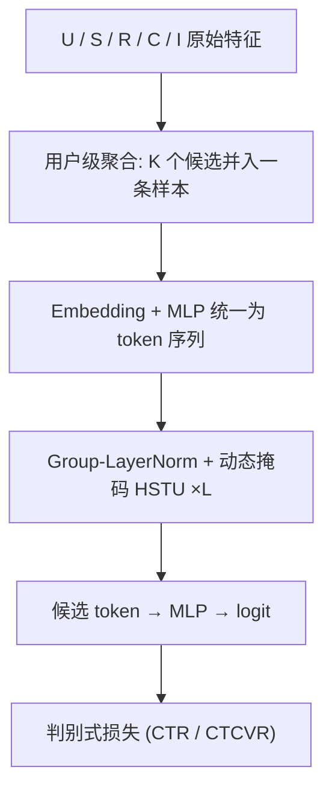

# MTGR: Industrial-Scale Generative Recommendation Framework in Meituan (美团工业级生成式推荐框架)

- **会议/期刊**: CIKM 2025
- **作者与机构**: Ruidong Han, Bin Yin, Shangyu Chen 等，美团 (Meituan)
- **推荐链路定位**: 精排 (Ranking)
- **研究方向**: 生成式推荐与离散语义 ID / CTR 预估与特征交叉
- **论文原文**: [https://arxiv.org/abs/2505.18654v4](https://arxiv.org/abs/2505.18654v4)
- **开源代码**: 暂未开源

## TL;DR (1分钟核心速览)

生成式推荐 (GRM) 具备良好 Scaling Law，但要求抛弃传统 DLRM 精心构造的交叉特征，作者实测该退化**无法被放大模型规模补偿**。MTGR 将交叉特征并入候选 token，并以「用户级样本聚合」让同一用户 $K$ 个候选共享一次 HSTU 前向，配合 Group-LayerNorm 与动态掩码。在美团 10 天工业日志上，MTGR-large 相比最强 DLRM (UserTower-SIM) 单样本前向 FLOPs 达 65×，离线 CTCVR GAUC 相对提升 1.47%，线上 2% 流量 A/B 中 UV_CTCVR +1.02%、推理成本反降 12%。

## Background & Motivation (背景与核心矛盾)

- **主流范式**: 工业精排近十年由 DLRM 主导，靠 Target Attention 处理行为序列、靠 MLP 交叉模块学习用户-候选交互；近期 GRM 以 HSTU 类 Transformer 做 next-token 预测，验证了推荐领域的 Scaling Law。
- **前人局限**: ① DLRM 的交叉模块对每个候选独立前向，计算随候选数**线性增长**，扩参即意味着不可接受的线上延迟；② GRM 为构造纯 token 序列必须剥离候选-用户交叉特征，作者发现该性能损失**放大模型也补不回来**。
- **核心洞察 (Key Insight)**: 交叉特征本质是「用户侧信息 × 候选侧信息」的乘积型先验，只要把它塞进候选 token 内部，就能在保留信息的同时让用户侧编码被 $K$个候选复用，从而把推理成本从$O(K)$压到近似$O(1)$。
- **本文切入点**: 重排数据组织方式（而非改模型范式），用一次用户级前向同时为整批候选打分。

## Method (核心方法设计)

### 1. 整体框架 (Overall Architecture)

输入沿用 DLRM 的全部特征：用户画像 $\mathbf{U}$、长序列$\vec{S}$、实时序列$\vec{R}$、交叉特征$\mathbf{C}$与候选特征$\mathbf{I}$。关键改动是把$\mathbf{C}$与$\mathbf{I}$合并为候选 token，并把同一用户在一个窗口内的$K$个候选聚合成单条样本$\mathcal{D}=[\mathbf{U},\vec{S},\vec{R},[\mathbf{C},\mathbf{I}]_1,\dots,[\mathbf{C},\mathbf{I}]_K]$。标量特征各自成 token，序列中每个物品经 Embedding 拼接 + MLP 升维为一个 token，统一到$d_{model}$后送入$L$ 层 HSTU 编码器；候选 token 的输出经一个小 MLP 得到 logit，用判别式损失（CTR/CTCVR）训练。推理时同一 request 的候选一次性前向，天然规避候选数线性开销。

### 2. 关键设计拆解 (Key Designs)

1. **用户级样本聚合 (User Sample Aggregation)**：痛点在于 DLRM 每个 (user, item) 对独立成样本，用户侧编码被重复计算 $K$次。MTGR 将同用户$K$ 个候选拼成一条序列，训练样本量从「所有候选」压缩到「所有用户」，推理时一次前向产出全部候选分数，使推理成本对候选数呈**次线性**。这正是 65× FLOPs 下训练成本不变、推理反降 12% 的结构性来源。

2. **Group-LayerNorm (GLN)**：用户、长序列、实时序列、候选四类 token 来自完全不同的语义空间，直接共享 LayerNorm 会让分布差异互相污染。GLN 按域分组归一化，使各域在进入注意力前分布对齐：
$$\tilde{X} = \mathrm{GroupLN}(X),\quad \tilde{X}\ \text{按域 } \{U, S, R, I\} \text{ 分组统计均值方差}$$
消融显示去掉 GLN 后 CTR GAUC 掉 0.0017，接近 small→medium 的整段增益。

3. **动态掩码 (Dynamic Masking)**：因果掩码在聚合窗口内会泄漏未来信息（晚间行为泄漏给下午候选）。MTGR 设三条规则：静态序列 $\mathbf{U},\vec{S}$对全体可见（全注意力）；动态序列$\vec{R}$ 严格按时间因果可见；候选 token 仅自见（对角掩码）。注意力更新为
$$\tilde{V} = \mathrm{silu}(K^{\top}Q)\,(N_U+N_{\vec{S}}+N_{\vec{R}}+N_I)^{-1}\,M\,V,\quad X = \mathrm{MLP}(\mathrm{GroupLN}(\tilde{V}\odot U))+X$$
其中 $M$ 即上述定制掩码，除以总 token 数作为平均因子以稳定深层训练。

4. **训练目标与工程优化**：损失为 CTR 与 CTCVR 的加权 BCE（判别式而非 next-token 生成），负样本即同 request 内未点击候选，无需额外负采样。系统侧基于 TorchRec 重构：动态哈希表支持流式增删 ID、All-to-all 前去重加速查表、按序列长度动态调整每卡 batch size 做负载均衡、copy/dispatch/compute 三流流水线 + bf16 + 定制 cutlass attention kernel，吞吐较原生 TorchRec 提升 1.6–2.4×，可跑 100+ GPU。

## Experimental Setup & Evaluation Protocol (实验设置与评估协议)

- **数据集与预处理**: 因公开数据集几乎不含交叉特征，作者自建美团外卖工业日志数据集（10 天离线 / 6 个月线上训练）：

| 数据集 | #Users | #Items | #Interactions (Exposure) | 稀疏度/密度 | 特征/场景说明 |
| :--- | :---: | :---: | :---: | :---: | :--- |
| Train | 0.21 B | 4,302,391 | 23.74 B | 点击 1.08 B / 购买 0.18 B | 含丰富手工交叉特征、长行为序列 |
| Test | 3,021,198 | 3,141,997 | 76.86 M | 点击 4.55 M / 购买 0.77 M | 外卖精排真实流量 |

- **数据划分与防穿越 (Splitting Strategy)**: 按时间切分（10 天日志取后段为测试），线上用最近 6 个月数据训练后直接部署对比，属**全局时间戳切分**。
- **排名评测协议 (Ranking Protocol)**: 离线采用 AUC 与 GAUC（按用户分组平均 AUC，更贴近同用户内排序），未使用采样负例排序，评估对象为真实曝光样本上的 CTR / CTCVR 二分类排序质量。
- **对比基线与超参设置**: DLRM 侧含 DNN-SIM、MoE-SIM（4 专家）、MultiEmbed-SIM、Wukong-SIM、UserTower-SIM/E2E（最强基线，qFormer + 16 专家 MoE，复杂度约为 MoE 的 3×）；MTGR 设 small ($L{=}3,d{=}512,h{=}2$, 5.47 GFLOPs)、medium ($L{=}5,d{=}768$, 18.59)、large ($L{=}15,d{=}768$, 55.76)。序列长度$|\vec{S}|{\le}1000$、$|\vec{R}|{\le}100$，Adam 优化器，学习率随规模从$3\times10^{-4}$降至$1\times10^{-4}$；离线指标提升 0.001 即视为显著。

## Key Experimental Results (实验关键数据)

### 1. 主实验对比 (Main Results)

| Model | CTR AUC | CTR GAUC | CTCVR AUC | CTCVR GAUC |
| :--- | :---: | :---: | :---: | :---: |
| DNN-SIM | 0.7432 | 0.6679 | 0.8737 | 0.6504 |
| MoE-SIM | 0.7484 | 0.6698 | 0.8750 | 0.6519 |
| MultiEmbed-SIM | 0.7501 | 0.6715 | 0.8766 | 0.6525 |
| Wukong-SIM | 0.7568 | 0.6759 | 0.8800 | 0.6530 |
| UserTower-SIM | 0.7593 | 0.6792 | 0.8815 | 0.6550 |
| UserTower-E2E | 0.7576 | 0.6787 | 0.8818 | 0.6548 |
| MTGR-small | 0.7631 | 0.6826 | 0.8840 | 0.6603 |
| MTGR-medium | 0.7645 | 0.6843 | 0.8849 | 0.6625 |
| **MTGR-large** | **0.7661** | **0.6865** | **0.8862** | **0.6646** |
| **Impr.%** | **+0.90%** | **+1.07%** | **+0.50%** | **+1.47%** |

线上 A/B（2% 流量，基线为持续学习 2 年的 UserTower-SIM）：MTGR-small / medium / large 的 PV_CTR 分别 +1.04% / +2.29% / +1.90%，UV_CTCVR 分别 +0.04% / +0.62% / **+1.02%**；离线 CTCVR GAUC 相对基线分别 +0.0154 / +0.0182 / +0.0288。

### 2. 消融实验 (Ablation Study)

| 变体 | CTR AUC | CTR GAUC | CTCVR AUC | CTCVR GAUC |
| :--- | :---: | :---: | :---: | :---: |
| MTGR-small | **0.7631** | **0.6826** | **0.8840** | **0.6603** |
| w/o cross features | 0.7495 | 0.6689 | 0.8736 | 0.6514 |
| w/o GLN | 0.7606 | 0.6809 | 0.8826 | 0.6585 |
| w/o dynamic mask | 0.7620 | 0.6810 | 0.8828 | 0.6587 |

### 3. 关键实验发现 (Key Findings)

1. **交叉特征是命门而非可选项**：去掉交叉特征后 CTCVR GAUC 从 0.6603 跌至 0.6514，甚至低于最强 DLRM 的 0.6550——即 MTGR-large 相对 DLRM 的全部增益被一次性抹平，直接印证了摘要中「scaling 无法补偿交叉特征缺失」的判断。
2. **GLN 与动态掩码各自贡献约半档模型规模**：两者移除后 GAUC 分别掉 0.0017 与 0.0016，与 small→medium 的增益（+0.0022）同量级，说明异构语义空间对齐与防泄漏掩码是 HSTU 在推荐域落地的必要适配，而非锦上添花。
3. **Scaling Law 在工业指标上成立且可外推**：随 HSTU 层数 (2→8)、$d_{model}$(128→1024)、序列长度 (100→5000) 单调平滑提升，CTCVR GAUC 增益与$\log_2(\text{FLOPs})$ 呈幂律；线上随训练 token 数增加，相对 DLRM 的优势持续放大，large 版在 CTCVR GAUC 上的累计增益超过过去一年所有优化的总和。

## Highlights & Limitations (亮点、对比与审稿批判)

- **与代表作对比 (vs. Prior Work)**: 与 HSTU (Zhai et al.) 相比，MTGR 不追求万亿参数与 next-token 生成，而是把生成式架构降维成「保留交叉特征的判别式精排器」，工程可落地性远高；与 UserTower 这类只扩用户塔的 DLRM 变体相比，MTGR 让用户与候选在同一注意力序列内交互，而非靠外挂 qFormer 事后融合；与 Wukong / MultiEmbed 这类扩交叉模块的方法相比，MTGR 把推理复杂度从 $O(K)$ 降到次线性，是范式级而非模块级差异。
- **可迁移亮点**: ①「把交叉特征塞进候选 token + 用户级聚合」这一数据重排技巧可平移到任何需要为大批候选打分的 Transformer 精排模型；②动态掩码的三条规则（静态全可见 / 动态因果 / 候选自见）是聚合窗口内防信息泄漏的通用模板。
- **审稿级局限批判**: ① 全部实验基于美团单一业务自建数据，公开数据集缺席，交叉特征收益的可复现性与跨域泛化性无法被社区独立验证；② 用户级聚合使 batch 内序列长度方差极大，依赖动态 batch size 与定制 kernel 才能跑通，中小团队复现门槛高；③ 线上 large 版 PV_CTR (+1.90%) 反而低于 medium (+2.29%)，作者未给出解释，规模与线上收益并非严格单调，存在超参/流量分配敏感性问题。

## Rating (四维评分)

- **方法创新性 (Novelty)**: ⭐⭐⭐⭐ （数据重排 + 用户级聚合的思路朴素但切中 GRM 落地要害，GLN 与动态掩码为扎实的工程化增量）
- **评估协议与实验扎实度 (Protocol & Experiments)**: ⭐⭐⭐⭐ （10 天工业日志 + 6 个月线上训练 + 2% 流量 A/B 极具说服力，但缺公开数据集与多次重复实验的显著性检验）
- **写作与数学规范度 (Clarity & Rigor)**: ⭐⭐⭐⭐ （公式简洁、掩码规则图示清晰，但部分符号如 $N_I$与$K$ 混用，系统章节偏工程叙述）
- **工业落地与复现价值 (Industrial & Practical Value)**: ⭐⭐⭐⭐⭐ （已在美团主流量全量部署，训练成本持平、推理降 12%，是近两年少见的完整工业闭环验证）

