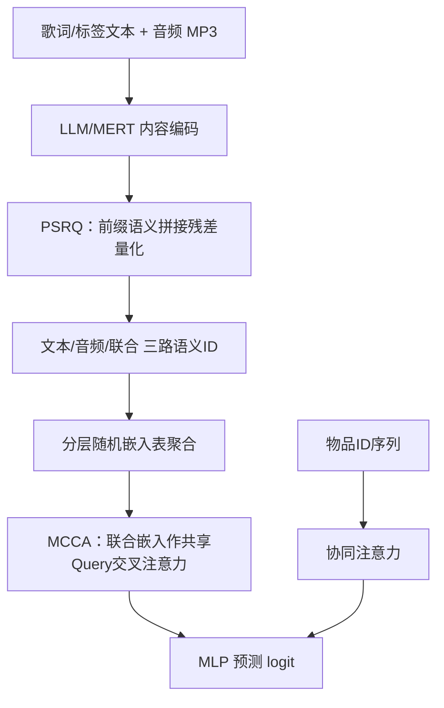
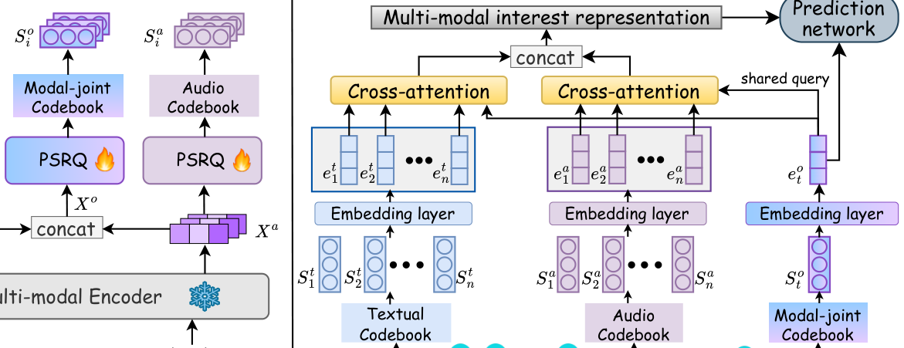

# Progressive Semantic Residual Quantization for Multimodal-Joint Interest Modeling in Music Recommendation (面向音乐推荐多模态联合兴趣建模的渐进语义残差量化)

- **会议/期刊**: CIKM 2025
- **作者与机构**: Shijia Wang, Tianpei Ouyang, Qiang Xiao, Dongjing Wang, Yintao Ren, Songpei Xu, Da Guo, Chuanjiang Luo（网易云音乐、杭州电子科技大学）
- **推荐链路定位**: 精排（Ranking Stage，语义 ID 特征工程 + 端到端排序模型）
- **研究方向**: 生成式推荐与离散语义 ID / 多模态推荐
- **论文原文**: [https://arxiv.org/abs/2508.20359v1](https://arxiv.org/abs/2508.20359v1)
- **开源代码**: 暂未开源

## TL;DR (1分钟核心速览)

音乐推荐中，RQ/RQ-VAE 类语义 ID 存在**层间语义漂移**（深层残差逐渐脱离原始内容语义），而 QARM/OneRec 式先对比融合再量化会**抹平模态独有信号**、M3CRS 式独立建模又丢失跨模态协同。本文提出两阶段框架：阶段一 PSRQ 在每层 K-means 输入中拼接"原始向量 − 当前残差"的前缀语义项，显式锚定原始语义；阶段二 MCCA 以模态联合码本嵌入作共享 Query，对文本/音频/联合三路语义 ID 序列做交叉注意力。在 Amazon Baby、Music4all 与网易云工业数据上，冷启动 AUC 相对最优基线提升 1.76%/0.50%/1.20%，线上 collect +2.81%、新歌 collect +5.98%。

## Background & Motivation (背景与核心矛盾)

- **主流范式**: 以 TIGER 为代表的工作用 RQ-VAE 将多模态内容特征映射为分层语义 ID，再接入 DIN/DLRM 类排序模型，使静态内容特征获得端到端可训练性并缓解冷启动。
- **前人局限一（模态内语义退化）**: RQ 每层仅对残差做 K-means，纯几何近似使深层码字与原始语义解耦——如图 1(c) 所示，第二层聚类已呈碎片化离散分布，生成的 ID 偏离物品真实语义。
- **前人局限二（模态间建模缺口）**: QARM/OneRec 先对比学习融合再量化，压制了歌词、音色等模态独有细粒度信号；M3CRS 用独立嵌入表保留模态特性，却完全放弃音频-歌词互补的跨模态协同。
- **核心洞察 (Key Insight)**: 残差 $X^m_l$只承载"尚未被解释的部分"，而$X^m - X^m_l$ 恰是"已被前缀码本解释的部分"——把后者拼回聚类输入，即可让每层码字同时感知全局语义锚点。
- **本文切入点**: 用前缀语义拼接改造量化算子（PSRQ），再用共享联合码本作 Query 的交叉注意力（MCCA）同时建模模态专有与跨模态兴趣。

## Method (核心方法设计)

### 1. 整体框架 (Overall Architecture)

框架分两阶段。**阶段一（特征工程，离线）**：文本特征由 Baichuan2-7B / LLaMA3.2-1B 抽取、音频由 MERT-v1-95M 抽取，分别经 PSRQ 生成文本语义 ID $S^t_i$、音频语义 ID$S^a_i$，并将两模态向量拼接后经 PSRQ 生成联合语义 ID$S^o_i$。**阶段二（排序建模，端到端）**：为每层码本分配随机初始化嵌入表（不用聚类中心，保证可训练），按式 (3) 逐层求和得到用户历史序列的文本/音频/联合语义嵌入序列；以目标物品的联合语义嵌入$e^o_t$为共享 Query，对三路序列做交叉注意力得到多模态兴趣表征$h^z_u$，同时对 ID 嵌入序列做同构注意力得到协同兴趣$h^r_u$，拼接后经 MLP 输出点击 logit，交叉熵训练。

<figure class="paper-figure" markdown="span">
  <figcaption>图 3：我们的推荐框架的整体工作流程。尽管阶段 2 仅突出核心的交叉注意力组件，我们额外对模态联合序列和 ID 嵌入序列进行了序列建模。</figcaption>
</figure>

### 2. 关键设计拆解 (Key Designs)

1. **PSRQ 前缀语义残差量化（锚定原始语义）**：痛点在于 RQ 第 $l$层输入仅剩残差，语义逐层稀释。PSRQ 将第$l$ 层聚类输入改为残差与"已解释前缀"的拼接：
$$C_l = \text{K-means}\left(X^m_l \oplus (X^m - X^m_l),\, k\right),\quad X^m_l = X^m_{l-1} - \text{NearestRep}(X^m_{l-1}, C_{l-1})$$
其中 $C_1 \in \mathbb{R}^{k\times d}$，$C_2 \sim C_l \in \mathbb{R}^{k\times 2d}$。直觉上，$X^m - X^m_l$ 是原始语义的"压缩摘要"，把它与残差并置后，K-means 在 2d 空间中同时受"待解释细节"与"已解释全局语义"约束，深层码字不再漂移（图 1(d) 显示第二层聚类仍保持与原始流派的语义关联）。检索时每层仍取最近簇心 ID，ID 长度与 RQ 完全一致，**不增加任何存储或解码开销**。

2. **MCCA 多码本交叉注意力（共享 Query 桥接模态）**：痛点在于各模态语义空间不一致，直接拼接融合会丢失模态细节。MCCA 以目标物品联合语义嵌入 $e^o_t$ 作为**所有模态共享的 Query**，对每路历史序列独立做注意力：
$$h^z_u = \sum_{j=1}^{n} \text{Attention}(e^z_j \oplus e^o_t)\cdot e^z_j,\quad z\in\{t,a,o\}$$
共享 Query 把三路表征投影到同一"联合语义坐标系"下，既保留各模态独立聚合路径（模态专有），又通过同一 Query 隐式对齐跨模态相关性；目标物品只用联合码本嵌入，避免推理时多路拼接带来的额外开销。

3. **训练目标与推理效率**：采用标准二分类交叉熵 $\mathcal{L} = -\frac{1}{N}\sum_j [y_j\log\sigma(\hat{y}_j) + (1-y_j)\log(1-\sigma(\hat{y}_j))]$，负样本为"播放未收藏"（工业）/ 低评分（Amazon）/ 单次播放（Music4all），即**隐式负采样而非全库 softmax**。语义 ID 在离线阶段一次性生成并冻结，在线仅需查表 + 注意力，与 DIN 同量级；嵌入维度$d'=64$，历史截断 20。

## Experimental Setup & Evaluation Protocol (实验设置与评估协议)

- **数据集与预处理**:

| 数据集 | #Users | #Items | #Interactions | 稀疏度/密度 | 特征/场景说明 |
| :--- | :---: | :---: | :---: | :---: | :--- |
| Amazon Baby | 81,423 | 33,652 | 230,444 | 8.4e-5 | 图像 CNN + LLaMA3.2 文本；评分≥4 为正 |
| Industrial | 4,926,656 | 1,387,247 | 8,696,093 | 1.4e-6 | 网易云一周日志；Baichuan2-7B 文本 + MERT 音频 |
| Music4all | 14,127 | 99,596 | 2,597,382 | 1.8e-3 | LLaMA3.2 文本 + MERT 音频；重复播放为正 |

- **冷启动定义**: 交互数少于 30 的物品标记为冷启动物品，单独报告 Cold AUC。
- **数据划分与防穿越**: 按时间戳构建用户交互序列（时序构造，未显式声明全局时间戳切分比例），目标物品取序列后继正交互。
- **排名评测协议**: 采用 **AUC（All AUC / Cold AUC）+ Logloss** 的二分类点估计协议，负样本为规则构造的隐式负例（非 Full-Ranking 全库排序），因此指标绝对值偏低但组间可比。
- **对比基线与超参**: 基线含 VBPR、SimTier+MAKE、DIN、QARM；量化对比含 PQ/VQ/RQ/RQ-VAE；嵌入维度 $d'=64$，簇数$k=\{64,256,128\}$，层数$l=\{3,4,3,3\}$，Adam 优化器，单 epoch 训练。

## Key Experimental Results (实验关键数据)

### 1. 主实验对比 (Main Results)

| 方法 | Baby All AUC | Baby Cold AUC | Ind. All AUC | Ind. Cold AUC | M4all All AUC | M4all Cold AUC |
| :--- | :---: | :---: | :---: | :---: | :---: | :---: |
| VBPR | 0.6466 | 0.5377 | 0.7407 | 0.7229 | 0.6217 | 0.5174 |
| SimTier+MAKE | 0.6213 | 0.5286 | 0.7537 | 0.7446 | 0.6871 | 0.6041 |
| DIN | 0.6492 | 0.5487 | 0.7599 | 0.7382 | 0.7260 | 0.6699 |
| QARM | 0.6557 | 0.5681 | 0.7628 | 0.7429 | **0.7347** | 0.7336 |
| **PSRQ+MCCA** | **0.6573** | **0.5781** | **0.7636** | **0.7535** | **0.7347** | **0.7373** |
| Improv. | +0.24% | +1.76% | +1.04% | +1.20% | +0.00% | +0.50% |

### 2. 消融实验 (Ablation Study)

**(a) 量化方法对比（统一挂载 DIN，仅文本模态）**

| 量化方式 | Baby Cold AUC | Ind. Cold AUC | M4all Cold AUC |
| :--- | :---: | :---: | :---: |
| DIN（无语义 ID） | 0.5487 | 0.7382 | 0.6699 |
| +PQ | 0.5515 | 0.7387 | 0.7321 |
| +VQ | 0.5569 | 0.7411 | 0.7317 |
| +RQ | 0.5546 | 0.7334 | 0.7327 |
| +RQ-VAE | 0.5533 | 0.7400 | 0.7322 |
| **+PSRQ** | **0.5610** | **0.7442** | **0.7331** |

**(b) MCCA 组件消融**

| 变体 | Baby Cold AUC | Ind. Cold AUC | M4all Cold AUC |
| :--- | :---: | :---: | :---: |
| w/o MSC（去模态专有码本） | 0.5549 | 0.7424 | 0.7281 |
| w/o MJC（去联合码本/共享 Query） | 0.5619 | 0.7467 | 0.7364 |
| **PSRQ+MCCA** | **0.5781** | **0.7535** | **0.7373** |

### 3. 关键实验发现 (Key Findings)

1. **PSRQ 的增益集中在冷启动而非全量**: 表 3 中 PSRQ 在 Baby 冷启动 AUC 上比 RQ 高 0.64pt、比 RQ-VAE 高 0.77pt，而 All AUC 差距仅 0.1pt 量级——说明前缀语义约束主要修复的是"长尾物品语义 ID 偏离真实语义"的问题，头部物品本就靠协同信号兜底。
2. **两路码本缺一不可，且联合码本对冷启动更关键**: 去掉模态专有码本（w/o MSC）使 Baby 冷启动 AUC 从 0.5781 跌至 0.5549（−2.3pt），跌幅大于去掉联合码本（0.5619）；但在 Music4all 上 w/o MJC 的 All AUC（0.7353）反超完整模型（0.7347），印证作者所述"跨模态协同主要服务于泛化/冷启动，对热门物品收益有限"。
3. **线上收益显著大于离线，且新歌受益最大**: 线上对比 DLRM 基线，collect +2.81%、full_play +0.95%；而 30 天内新歌的 collect +5.98%、full_play +2.2%、收听时长 +3.05%——约为整体增益的两倍，与离线 Cold AUC 的提升方向一致，构成"离线冷启动指标 → 线上新内容消费"的完整证据链。

## Highlights & Limitations (亮点、对比与审稿批判)

- **与代表作对比**: 相比 TIGER/RQ-VAE，PSRQ 不改 ID 长度、不加解码开销，仅改 K-means 输入构造，是极低成本的算子级替换；相比 QARM 的"先融合后量化"，本文保留模态独立码本避免信号压制；相比 M3CRS 的"完全独立建模"，共享联合 Query 补回了跨模态协同。
- **可迁移亮点**: (1) "残差 ⊕ 已解释前缀"的拼接思路可直接移植到任何 RQ 类语义 ID 生成（短视频、电商图文），且兼容 RQ-VAE 的编码器结构；(2) 用目标物品的联合语义嵌入作跨模态共享 Query，是一种轻量的模态对齐手段，可替代昂贵的对比预训练对齐。
- **审稿级局限批判**: (1) 评估仅用 AUC/Logloss 点估计协议，负样本由规则构造（播放未收藏、单次播放），未做 Full-Ranking 全库排序，指标绝对值偏低且对负采样策略敏感，与主流 Top-K 排序文献不可直接比较；(2) 单 epoch 训练使 SimTier+MAKE 等基线明显欠拟合（Baby 上甚至低于 VBPR），基线公平性存疑；此外 PSRQ 的簇数 $k$与层数$l$ 按数据集手工设定，缺少敏感度分析，且拼接使第 2 层起码本维度翻倍，大规模物品库下的离线量化成本未讨论。

## Rating (四维评分)

- **方法创新性 (Novelty)**: ⭐⭐⭐⭐ （前缀语义拼接是简洁且有物理直觉的算子级改进，但本质仍是 RQ 的输入构造微调，理论分析以 PCA 可视化为主，缺乏量化误差上界推导）
- **评估协议与实验扎实度 (Protocol & Experiments)**: ⭐⭐⭐ （三数据集 + 线上 A/B 完整，冷启动分桶有价值；但仅 AUC 点估计、无 Full-Ranking、单 epoch 致基线欠拟合、缺超参敏感度）
- **写作与数学规范度 (Clarity & Rigor)**: ⭐⭐⭐⭐ （两阶段流程与公式 (2)(4) 表述清晰，RQ 与 PSRQ 检索差异配图直观；式 (1) 中 $X^t_2$ 疑似笔误、部分符号下标不统一）
- **工业落地与复现价值 (Industrial & Practical Value)**: ⭐⭐⭐⭐⭐ （已上线网易云服务千万级用户，ID 长度不变、在线开销与 DIN 同量级，新歌 collect +5.98% 的收益对内容平台极具吸引力；可惜未开源）

