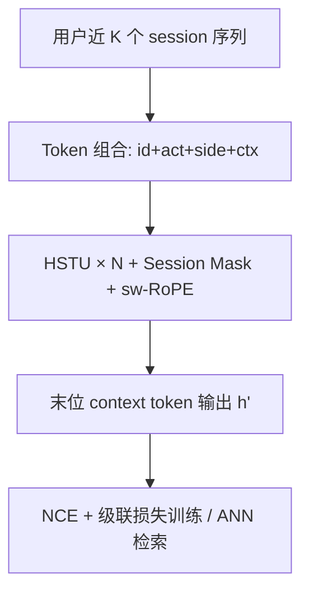
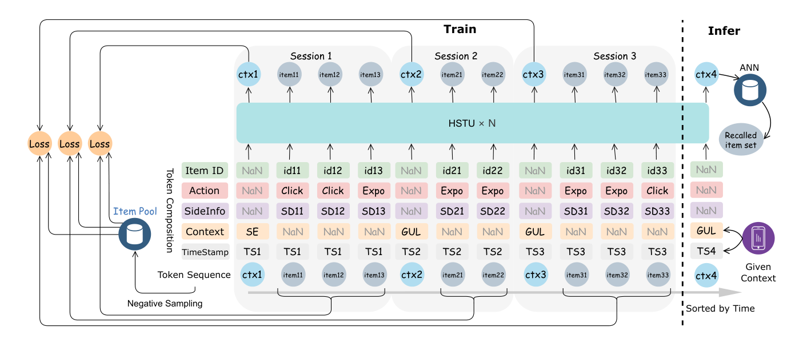

# TBGRecall: A Generative Retrieval Model for E-commerce Recommendation Scenarios (面向电商推荐场景的生成式召回模型)

- **会议/期刊**: CIKM 2025
- **作者与机构**: Zida Liang, Changfa Wu, Dunxian Huang, Weiqiang Sun, Ziyang Wang, Yuliang Yan, Jian Wu, Yuning Jiang, Bo Zheng, Ke Chen, Silu Zhou, Yu Zhang（上海交通大学 / 阿里巴巴）
- **推荐链路定位**: 召回（生成式端到端召回）
- **研究方向**: 生成式推荐与离散语义ID / 序列与会话推荐
- **论文原文**: [https://arxiv.org/abs/2508.11977v2](https://arxiv.org/abs/2508.11977v2)
- **开源代码**: 暂未开源

## TL;DR (1分钟核心速览)

现有生成式召回沿用逐 token 自回归（NTP），强行给同一 session 内同时曝光的无序商品注入虚假顺序依赖，既损害精度又拖慢推理。本文提出 **Next Session Prediction (NSP)**：把用户序列切成「session token + 无序 item token」块，用 Session Mask 屏蔽 session 内互看，仅让 context token 与正/负样本做对比学习，推理时一次前向产出用户向量走 ANN。在 RecFlow 与淘宝工业数据上 HR@4000 达 8.20%/29.45%，线上成交额 +2.16%。

## Background & Motivation (背景与核心矛盾)

- **主流范式**: 生成式召回分两派——LLM 语义增强/直接生成（受语义对齐所限），以及 TIGER/HSTU/E4SRec 等稀疏 ID 或语义 ID 的序列转导模型，后者在工业界更可落地。
- **前人局限**: ① 逐 token 自回归假设 session 内 item 存在先后因果，但推荐请求是「一次性返回一批无序候选」，item 间并无因果，虚假依赖污染建模；② 推理需迭代解码 $N$ 步才能凑齐候选集，与 ANN 召回基础设施天然错位，在线开销大。
- **核心洞察 (Key Insight)**: 用户交互发生在曝光**之后**，真正的因果只存在于**跨 session**（上一轮行为影响下一轮意图），session 内部应视为无序集合。
- **本文切入点**: 把「生成下一个 item」重构为「生成下一个 session 的意图向量」，用一次前向替代自回归解码。

## Method (核心方法设计)

### 1. 整体框架 (Overall Architecture)

输入为用户最近 $K$个 session 按时间拼接的序列$\mathcal{Q}=[c^{(1)},i^{(1)}_1,\dots,c^{(K)},i^{(K)}_1,\dots,c^{(K+1)}]$，每个 token 由 item ID、行为类型（曝光/点击）、side info（类目、价格、卖家）与场景四类 embedding 求和构成。主干为$N$层 HSTU，经 Session Mask 与 session-wise RoPE 编码后，取末位 context token$c^{(K+1)}$的输出$h'_{c^{(K+1)}}$ 作为用户意图向量，与 item 池做内积并 ANN 检索 top-k。训练侧以 NCE 对比损失为主，叠加点击/成交级联损失与多场景归一化。

<figure class="paper-figure" markdown="span">
  <figcaption>图1：TBGRecall 结构。该图展示了模型的整体架构、序列的构建、token 的组成以及损失的计算。由于两类 token 对应不同的输入，部分输入会被定义为 NaN，并且它们也有对应的 embedding。</figcaption>
</figure>

### 2. 关键设计拆解 (Key Designs)

1. **Next Session Prediction + Session Mask（核心范式）**：痛点是无序 item 被强行自回归。做法是在因果掩码之上再叠加一层掩码，使同一 session 内 item 之间互不可见，仅 context token 可见其 session 内全部 item、后续 session 可见前序全部 token；位置编码改用 session 索引共享的 sw-RoPE。效果是 session 内 item 并行编码、互不干扰，一次前向即得意图向量，天然对齐 ANN 召回。

2. **MSP + TSN + MoE（容量与信号增强）**：MSP 沿 session 维度做多步预测（类比 MTP），为 context token 引入更长程的跨 session 监督信号，缓解局部决策；TSN 针对 context 与 item 两类 token 语义分布差异，在 embedding 与首层 Transformer 使用独立线性投影，零额外推理开销；FFN 换为 DeepSeekMoE（24 routed + 1 shared，top-2 激活）提升同 FLOPS 下的知识容量。

3. **损失、负采样与部分增量训练**：总损失按场景 $s$ 归一化聚合：
$$\mathcal{L}_{NSP}=\sum_{s\in\mathcal{S}}\frac{1}{N_s}\left(\mathcal{L}^{(s)}_{NCE}+\mathcal{L}^{(s)}_{click}+\mathcal{L}^{(s)}_{pay}\right)$$
其中 $\mathcal{L}_{NCE}$以 session 内曝光 item 为正、从全库随机采负；$\mathcal{L}_{click}$以点击为正、同 session 未点击曝光为负；$\mathcal{L}_{pay}$ 以成交为正、同 session 未成交点击为负，形成「曝光→点击→成交」级联加权。负采样为分布式加权随机（十亿级商品池分片）。PIT 将用户随机分 10 桶，每轮仅用单桶最近 10 天数据训练，1/10 数据量即可当日完成并上线，且长期迭代覆盖全量数据不丢失。

## Experimental Setup & Evaluation Protocol (实验设置与评估协议)

- **数据集与预处理**:

| 数据集 | #Users | #Items | #Interactions | 稀疏度/密度 | 特征/场景说明 |
| :--- | :---: | :---: | :---: | :---: | :--- |
| RecFlow | 30,968 | 3,242,884 | 30,255,736 | 极稀疏 | 快手公开数据，含丰富上下文 |
| TaoBao | 0.5B | 0.5B | 1.2 trillion | 极稀疏 | 淘宝首页猜你喜欢真实流量日志 |

- **数据划分与防穿越 (Splitting Strategy)**: 按用户时间序组织最近 $K$ 个 session，以新到达 session 的 context token 预测该 session 内 item，属时间序前向预测，无未来信息泄漏。
- **排名评测协议 (Ranking Protocol)**: 采用 HR@K（K=20/100/500/1000/2000/4000），对全 item 池打分排序，属全库排序口径；训练负采样为全库随机负。
- **对比基线与超参设置**: 基线含 YoutubeDNN、SASRec、BERT4Rec、FDSA、HSTU，以及淘宝生产级双塔 Online 与每日训练版 Online(DT)。HSTU 配置 Block=4、Length=5120、Dim=512；Adam（稠密）+ Adagrad（稀疏），lr=$1\times10^{-3}$；MoE 为 24 routed + 1 shared、top-2 激活。

## Key Experimental Results (实验关键数据)

### 1. 主实验对比 (Main Results)

| 模型 | RecFlow HR@1000 | RecFlow HR@4000 | TaoBao HR@1000 | TaoBao HR@4000 |
| :--- | :---: | :---: | :---: | :---: |
| YoutubeDNN | 1.02% | 3.28% | 4.75% | 9.22% |
| SASRec | 1.96% | 6.53% | 6.40% | 11.70% |
| BERT4Rec | 1.87% | 6.09% | 2.50% | 5.96% |
| FDSA | 1.41% | 4.32% | 5.30% | 10.14% |
| HSTU | 2.19% | 7.38% | 7.01% | 13.11% |
| Online | - | - | 13.36% | 23.57% |
| Online(DT) | - | - | 15.44% | 26.45% |
| **TBGRecall** | **3.85%** | **8.20%** | **16.62%** | **29.45%** |
| Improv. (vs 最强基线) | +75.8% | +11.1% | +7.6% | +11.3% |

### 2. 消融实验 (Ablation Study)

| 变体 | HR@20 | HR@500 | HR@1000 | HR@4000 |
| :--- | :---: | :---: | :---: | :---: |
| TBGRecall | **1.53%** | **11.81%** | **16.62%** | **29.45%** |
| w/o TSN | 1.51% | 11.67% | 16.42% | 28.88% |
| w/o MSP | 1.35% | 10.59% | 15.08% | 27.28% |
| w/o MoE | 1.46% | 11.41% | 16.08% | 28.47% |
| w/o sw-RoPE | 1.32% | 10.67% | 15.20% | 27.36% |

### 3. 关键实验发现 (Key Findings)

1. **MSP 与 sw-RoPE 是两大主力**：去掉 MSP 使 HR@4000 从 29.45% 掉到 27.28%（-2.17pt），去掉 sw-RoPE 掉到 27.36%，二者贡献远超 TSN（-0.57pt），说明跨 session 长程监督与 session 级位置编码才是 NSP 范式成立的关键。
2. **数据新鲜度 > 数据体量**：PIT 仅用 1/10 数据、128 卡 11 小时即达 HR@4000=29.45%，与 1280 卡全量增量训练的 29.76% 几乎持平；而常规全量训练因 10 天部署延迟仅 23.76%，Stochastic Length 省时 70% 却掉 9% 性能。
3. **线上真实增益**：在淘宝首页猜你喜欢 5% 流量 7 天 A/B 中，TBGRecall 抢占 23.94% 的总曝光份额，成交笔数 +0.60%、成交金额 +2.16%，验证了会话级非自回归召回在生产多策略竞争下的竞争力。

## Highlights & Limitations (亮点、对比与审稿批判)

- **与代表作对比 (vs. Prior Work)**: 相比 TIGER 的语义 ID 逐 token 自回归，TBGRecall 保留稀疏 ID 但改为 session 级并行生成，推理从 $N$ 步解码降为 1 次前向；相比 HSTU 的纯序列转导，本文显式引入 Session Mask 与 context token 监督，把「序列建模」真正改造成「召回对齐」；相比生产双塔 Online(DT)，HR@4000 提升 3pt 且无需独立 item 塔。
- **可迁移亮点**: ① Session Mask + sw-RoPE 的「块内无序、块间有序」建模范式可直接迁移到任何一次性返回候选集的召回/粗排场景；② PIT 的分桶轮转增量训练是十亿参数级模型日更的通用工程解。
- **审稿级局限批判**: ① 主实验仅报告 HR，缺少 NDCG/MRR 等位置敏感指标，且 RecFlow 上 HR@20 绝对值仅 0.26%，头部精度仍偏弱；② 未与 TIGER 类语义 ID 方法直接对比，稀疏 ID 与语义 ID 的公平性存疑；③ PIT 的分桶代表性与 10 天窗口长度缺乏敏感性分析，超参依赖较强。

## Rating (四维评分)

- **方法创新性 (Novelty)**: ⭐⭐⭐⭐ （NSP 范式直击自回归与召回无序性的本质矛盾，Session Mask 设计简洁且有物理直觉）
- **评估协议与实验扎实度 (Protocol & Experiments)**: ⭐⭐⭐⭐ （公开+工业双数据集、全库 HR 排序、消融与线上 A/B 齐全，但缺位置敏感指标与语义 ID 基线）
- **写作与数学规范度 (Clarity & Rigor)**: ⭐⭐⭐⭐ （损失与掩码定义清晰，工程细节详实，部分公式排版略粗糙）
- **工业落地与复现价值 (Industrial & Practical Value)**: ⭐⭐⭐⭐⭐ （十亿级参数分布式训练 + 近线服务 + PIT 日更全链路落地，线上成交额 +2.16%，工程参考价值极高）

