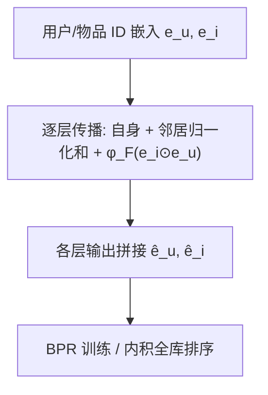
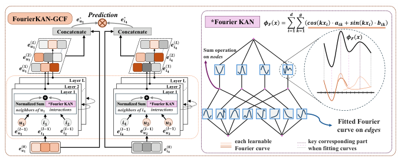

# Enhancing Graph Collaborative Filtering with FourierKAN Feature Transformation (以 FourierKAN 特征变换增强图协同过滤)

- **会议/期刊**: CIKM 2025 (Short Paper)
- **作者与机构**: Jinfeng Xu, Jinze Li, Shuo Yang, Edith Ngai (香港大学); Zheyu Chen (香港理工大学); Wei Wang (深圳北理莫斯科大学); Xiping Hu (北京理工大学)
- **推荐链路定位**: 召回 (GCF 骨干表征学习)
- **研究方向**: 图神经网络与知识图谱推荐 / 协同过滤与双塔召回
- **论文原文**: [https://arxiv.org/abs/2406.01034v3](https://arxiv.org/abs/2406.01034v3)
- **开源代码**: [https://anonymous.4open.science/r/FourierKAN-GCF-r](https://anonymous.anonymous.4open.science/r/FourierKAN-GCF-r)

## TL;DR (1分钟核心速览)

LightGCN 以"特征变换无用"为由删除了 NGCF 的全部变换矩阵，但本文通过细粒度消融发现：被删的 $W_1$确实冗余，而交互表征聚合项$W_2(\boldsymbol{e}_i\odot\boldsymbol{e}_u)$携带不可替代的交互信息，删除反而掉点。作者据此提出 FourierKAN-GCF：保留交互项、用 Fourier 级数型 KAN 替代$W_2$，在保持表达力的同时降低训练难度。在 MOOC/Amazon/Gowalla 三数据集、7:1:2 时间切分 + Full-Ranking 协议下，R@20 相对 LightGCN 提升 7.8%/5.8%/7.2%，且作为骨干替换可使 SimGCL、LightGCL、RecDCL 全面涨点。

## Background & Motivation (背景与核心矛盾)

- **主流范式**: 以 LightGCN 为代表的"去变换、去非线性"轻量图卷积已成为 GCF 事实标准骨干，后续 SGL/SimGCL/LightGCL 等均以其为底座。
- **前人局限**: LightGCN 对 NGCF 的否定存在两处不公平——(a) 未对 $W_1$与$W_2$做分离消融，直接整体删除；(b) 连带删除了交互表征聚合项$W_2(\boldsymbol{e}_i\odot\boldsymbol{e}_u)$ 却未给出理由。
- **核心洞察 (Key Insight)**: 作者复现 6 个 NGCF 变体（表 1）发现：删 $W_1$ 稳定涨点（MOOC R@20 0.3361→0.3377），但删整个交互聚合项 `NGCF-i` 在三数据集全面掉点（Gowalla 0.1755→0.1739），甚至低于 `NGCF-f1`。即"特征变换并非无用，只是 MLP 式变换训练太难"。
- **本文切入点**: 保留有价值的交互项，把难训的 MLP 变换换成 Fourier KAN——用可学习傅里叶系数拟合边上的非线性函数，兼顾表达力与优化友好性。

## Method (核心方法设计)

### 1. 整体框架 (Overall Architecture)

模型沿用 NGCF 的多层消息传播骨架：每层对目标节点自身、邻居嵌入、以及边上的交互项 $\boldsymbol{e}_i\odot\boldsymbol{e}_u$三路求和后过非线性，其中交互项不再乘$W_2$，而是送入单层 Fourier KAN$\phi_F(\cdot)$ 做逐维傅里叶展开；各层输出拼接（而非 LightGCN 的加权平均）得到最终用户/物品表征，以 BPR 损失端到端训练，推理时以内外积排序全库物品。

<figure class="paper-figure" markdown="span">
  <figcaption>图1：FourierKAN-GCF 概览。</figcaption>
</figure>

### 2. 关键设计拆解 (Key Designs)

1. **Fourier KAN 变换模块（替代 $W_2$）**：标准 KAN 用 B-spline 拟合边上激活函数，虽表达力强但样条基训练慢、对网格敏感。本文改用傅里叶级数展开，把每个输入维度$x_i$分解为$g$ 阶正余弦基的线性组合：
$$\phi_F(\boldsymbol{x})=\sum_{i=1}^{d}\sum_{k=1}^{g}\left(\cos(kx_i)\cdot a_{ik}+\sin(kx_i)\cdot b_{ik}\right)$$
其中 $a_{ik},b_{ik}$可训练，网格大小$g$控制频率项数。直觉上，全局正余弦基比局部样条更平滑、梯度更稳，且$g$ 提供了"表达力—训练难度"的连续调节旋钮。

2. **非对称消息传播（保留 $W_1$删除、保留交互项）**：基于表 1 的实证结论，去掉冗余的$W_1\boldsymbol{e}$ 自变换，但保留交互聚合：
$$\boldsymbol{e}_u^{(l+1)}=\sigma\!\left(\frac{\boldsymbol{e}_u^{(l)}+\sum_{i\in\mathcal{N}_u}\left[\boldsymbol{e}_i^{(l)}+\phi_F(\boldsymbol{e}_i^{(l)}\odot\boldsymbol{e}_u^{(l)})\right]}{\sqrt{|\mathcal{N}_u||\mathcal{N}_i|}}\right)$$
物品侧对称。这样既避免了 $W_1$ 带来的优化负担，又恢复了 LightGCN 丢弃的"边级交互信号"通道。

3. **训练目标、负采样与推理效率**：采用标准 BPR 损失 $\mathcal{L}=\sum_{(u,i_p,i_n)}-\ln\sigma(\hat{\boldsymbol{e}}_u^\top\hat{\boldsymbol{e}}_{i_p}-\hat{\boldsymbol{e}}_u^\top\hat{\boldsymbol{e}}_{i_n})+\lambda\|\Theta\|^2$，负样本为均匀随机采样（每正样本 1 负）。辅以 message dropout 与 node dropout 抑制过拟合。单 epoch 耗时 4.6s/3.7s/29.8s，仅比 LightGCN（4.3s/3.5s/26.4s）高约 7%–13%，远低于 NGCF 与 IMP-GCN。

## Experimental Setup & Evaluation Protocol (实验设置与评估协议)

- **数据集与预处理**:

| 数据集 | #Users | #Items | #Interactions | 稀疏度 | 特征/场景说明 |
| :--- | :---: | :---: | :---: | :---: | :--- |
| MOOC | 82,535 | 1,302 | 458,453 | 99.57% | 课程平台，物品极少、相对稠密 |
| Amazon | 50,677 | 16,897 | 454,529 | 99.95% | Video Games 评论，极稀疏 |
| Gowalla | 29,859 | 40,989 | 1,027,464 | 99.92% | LBS 签到，规模最大 |

- **数据划分与防穿越 (Splitting Strategy)**: 按交互时间戳排序后做 **7:1:2 比例划分**（train/val/test），属时间序切分，避免未来信息泄漏。
- **排名评测协议 (Ranking Protocol)**: **Full-Ranking 全库未交互物品排序**（非采样），报告 Recall@{20,50} 与 NDCG@{20,50}，指标可信度高。
- **对比基线与超参设置**: 基线含 5 个 GCN 骨干（NGCF、LR-GCCF、LightGCN、UltraGCN、IMP-GCN）及 KAN-GCF 变体；嵌入维度统一 $d=64$，Xavier 初始化，Adam 优化，$\lambda=1$，层数$L\in\{1..4\}$，$g\in\{1,2,4,8\}$，dropout 比例$\{0,0.1,0.2,0.3\}$；显著性以$p<0.05$ 标注。

## Key Experimental Results (实验关键数据)

### 1. 主实验对比 (Main Results)

| 数据集 / 指标 | NGCF | LightGCN | UltraGCN | IMP-GCN | KAN-GCF | **FourierKAN-GCF** | Improv. vs LightGCN |
| :--- | :---: | :---: | :---: | :---: | :---: | :---: | :---: |
| MOOC R@20 | 0.3361 | 0.3307 | 0.3194 | 0.2788 | 0.3417 | **0.3564** | +7.8% |
| MOOC N@20 | 0.1894 | 0.1811 | 0.1962 | 0.1717 | 0.2024 | **0.2147** | +18.6% |
| Amazon R@20 | 0.0379 | 0.0447 | 0.0459 | 0.0461 | 0.0451 | **0.0473** | +5.8% |
| Amazon N@20 | 0.0196 | 0.0227 | 0.0230 | 0.0232 | 0.0229 | **0.0252** | +11.0% |
| Gowalla R@20 | 0.1755 | 0.1830 | 0.1798 | 0.1808 | 0.1922 | **0.1962** | +7.2% |
| Gowalla N@20 | 0.1013 | 0.1152 | 0.1059 | 0.1060 | 0.1142 | **0.1179** | +2.3% |
| #T (Gowalla) | 37.5s | 26.4s | 33.8s | 143.6s | 32.9s | **29.8s** | 近 LightGCN |

### 2. 消融实验 (Ablation Study)

| 变体 | MOOC R@20 | Amazon R@20 | Gowalla R@20 | 说明 |
| :--- | :---: | :---: | :---: | :--- |
| FourierKAN-GCF | **0.3564** | **0.0473** | **0.1962** | 完整模型 |
| w/o MD | 0.3523 | 0.0452 | 0.1920 | 去 message dropout |
| w/o ND | 0.3527 | 0.0452 | 0.1908 | 去 node dropout |
| KAN-GCF (标准样条 KAN) | 0.3417 | 0.0451 | 0.1922 | 换回 B-spline KAN |

### 3. 关键实验发现 (Key Findings)

1. **交互项是涨点主因，而非单纯换激活函数**：KAN-GCF 已比 LightGCN 高（Gowalla 0.1922 vs 0.1830），说明恢复交互聚合项贡献了主要增益；Fourier 化再在 KAN 基础上额外 +2.1%（0.1922→0.1962），证明傅里叶基比样条基更易训。
2. **两种 dropout 缺一不可且量级相当**：去掉 MD/ND 在 Gowalla 分别掉 0.0042/0.0054，在 Amazon 均掉 0.0021，说明交互项引入的额外参数确实需要双重正则来抑制过拟合。
3. **骨干可插拔性带来一致增益**：将 SimGCL/LightGCL/RecDCL 的 LightGCN 骨干替换为 FourierKAN-GCF，Gowalla R@20 分别从 0.2028→0.2084、0.1888→0.2007、0.1993→0.2051，说明增益与自监督信号正交、可叠加。

## Highlights & Limitations (亮点、对比与审稿批判)

- **与代表作对比 (vs. Prior Work)**: 相较 LightGCN 的"一刀切删除"，本文用分离消融纠正了其对 NGCF 的过度否定，恢复交互项；相较 NGCF 的 MLP 变换，Fourier KAN 以全局正余弦基替代局部样条，训练开销仅比 LightGCN 高约 10%；相较标准 KAN-GCF，傅里叶基在同等参数下更稳、更易调。
- **可迁移亮点**: (1) "分离消融再下结论"的实验方法论可直接用于审视其他被简化掉的 GNN 组件；(2) 用 $g$作为表达力旋钮、按数据稀疏度自适应（稠密 MOOC 取$g=4$，稀疏集取$g=2$）的调参经验具备普适参考价值。
- **审稿级局限批判**: (1) 仅在 3 个中小规模公开集验证，缺少工业级千万级交互与线上 A/B，Fourier 展开在高维 $d$下的$O(dg)$开销未做复杂度分析；(2) 拼接式多层聚合与 NGCF 一致，未讨论与 LightGCN 加权和聚合的正交组合，且$g$、dropout 需逐数据集网格搜索，超参敏感度较高。

## Rating (四维评分)

- **方法创新性 (Novelty)**: ⭐⭐⭐ （以 Fourier 级数替换 KAN 样条基属工程性改良，但"重审特征变换必要性"的问题视角有价值）
- **评估协议与实验扎实度 (Protocol & Experiments)**: ⭐⭐⭐⭐ （Full-Ranking + 时间切分规范，含分离消融、兼容性与敏感度分析，惟数据集规模偏小、缺线上验证）
- **写作与数学规范度 (Clarity & Rigor)**: ⭐⭐⭐⭐ （动机—实证—方法的逻辑链清晰，公式简洁；但部分符号如 $\hat{\boldsymbol{e}}_i$的下标$L_0$ 存在笔误）
- **工业落地与复现价值 (Industrial & Practical Value)**: ⭐⭐⭐⭐ （即插即用骨干、开销接近 LightGCN、已匿名开源，落地门槛低）

