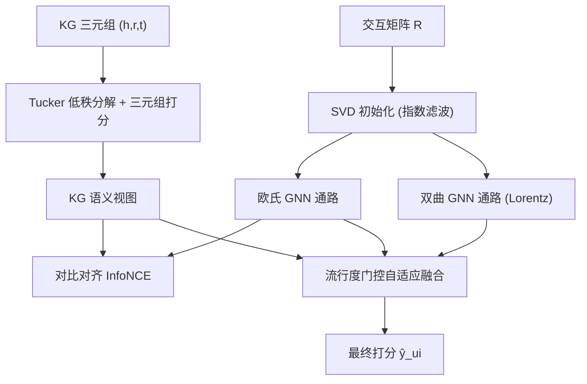
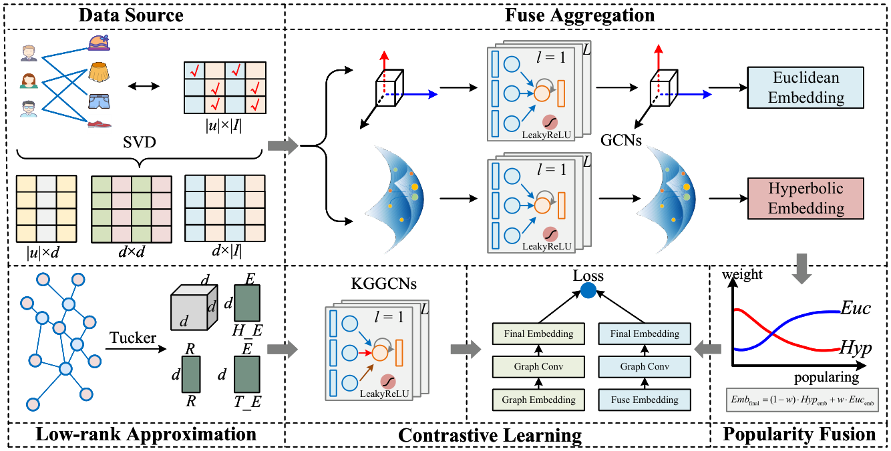

# SPARK: Adaptive Low-Rank Knowledge Graph Modeling in Hybrid Geometric Spaces for Recommendation (混合几何空间下的自适应低秩知识图谱推荐建模)

- **会议/期刊**: CIKM 2025
- **作者与机构**: Binhao Wang, Yutian Xiao, Maolin Wang, Zhiqi Li, Tianshuo Wei, Ruocheng Guo, Xiangyu Zhao (香港城市大学、北京航空航天大学等)
- **推荐链路定位**: 召回 (Top-N 排序)
- **研究方向**: 图神经网络与知识图谱推荐 / 冷启动与长尾推荐
- **论文原文**: [https://arxiv.org/abs/2509.11094v1](https://arxiv.org/abs/2509.11094v1)
- **开源代码**: [https://github.com/Applied-Machine-Learning-Lab/SPARK](https://github.com/Applied-Machine-Learning-Lab/SPARK)

## TL;DR (1分钟核心速览)

针对知识图谱推荐中 KG 噪声、长尾实体稀疏、纯欧氏几何难以刻画层次结构、以及多源信号静态融合这四大痛点，SPARK 提出四阶段流水线：Tucker 低秩分解去噪 KG、SVD 初始化欧氏+双曲(Lorentz)并行 GNN、SVD 协同视图与 KG 语义视图的对比对齐、以及按物品流行度动态门控的几何/语义融合。在 Amazon-Book、Alibaba-iFashion、Yelp2018 三个数据集上采用 8:1:1 划分与全库排序评测，R@10 相对最强基线 HCMKR 分别提升 10.8%、5.0%、6.2%，长尾物品嵌入分布显著更均衡。

## Background & Motivation (背景与核心矛盾)

- **主流范式**: KG 增强推荐以 GNN 在用户-物品图与 KG 上传播语义，近年 HGCF/HICF/LKGR/HCMKR 等引入双曲几何刻画层次结构。
- **前人局限**: 其一，多数方法默认 KG 是"干净"的，直接在图卷积中传播噪声三元组，稀疏长尾实体受害最深；其二，纯欧氏 GNN 对树状/幂律结构失真大，而纯双曲方法又丢失了欧氏空间对同质协同关系的建模优势。
- **核心洞察 (Key Insight)**: 真实数据（图 1）呈现典型长尾度分布，头部物品靠协同信号即可学好，长尾物品则更依赖高质量 KG 语义与双曲层次先验——因此"融合权重应当随流行度变化"，而非一刀切。
- **本文切入点**: 先降噪再几何建模，最后用流行度门控把协同、KG 语义、双曲/欧氏几何四路信号按物品冷热动态配比。

## Method (核心方法设计)

### 1. 整体框架 (Overall Architecture)

输入为隐式交互矩阵 $\mathbf{R}$与 KG 三元组集合。第一阶段用 Tucker 分解学习实体/关系嵌入并做三元组打分，产出抗噪的 KG 语义表示；第二阶段对$\mathbf{R}$做 SVD，取前$k_s$ 奇异向量经指数滤波后作为欧氏与双曲两条并行 GNN 通路的共享初始化，在用户-物品图上分别做欧氏卷积与 Lorentz 流形卷积；第三阶段用 InfoNCE 对齐 SVD 协同视图与 KG 语义视图；第四阶段按物品流行度计算门控权重，动态混合欧氏内积得分与双曲负距离得分，输出最终排序分。训练端到端联合优化推荐 BPR 损失、对比损失、Tucker 三元组损失与 L2 正则。

<figure class="paper-figure" markdown="span">
  <figcaption>图 2：SPARK 的整体架构。该框架集成了 (1) 基于 Tucker 评分对 KG 三元组进行知识图谱（KG）表示学习；(2) 在用户-物品交互图上，于并行的欧几里得空间和双曲（Lorentz 模型）空间中运行 SVD 初始化的混合几何 GNN；(3) SVD 导出的协同视图与 KG 增强的语义视图的对比对齐；(4) 流行度感知的自适应融合，以动态组合信号用于最终推荐。</figcaption>
</figure>

### 2. 关键设计拆解 (Key Designs)

1. **Tucker 低秩 KG 去噪**：痛点在于原始 KG 三元组含噪且长尾实体连接稀少，直接传播会放大噪声。本文用可学习核心张量 $\mathbf{W}\in\mathbb{R}^{d_c\times d_c\times d_c}$建模三元组多线性交互，打分$s(h,r,t)=\langle\psi(\mathrm{BN}(\mathbf{h}'),\mathrm{BN}(\mathbf{r}');\mathbf{W}),\mathrm{BN}(\mathbf{t}')\rangle$，并以 BPR 式成对损失拉开正/负三元组。相比 CP 分解，核心张量提供更强多路建模容量，低秩压缩天然抑制噪声，为下游提供紧凑鲁棒的实体先验。

2. **SVD 初始化 + 双曲/欧氏并行 GNN**：GNN 随机初始化在稀疏图上收敛差，本文用 $\mathbf{H}^{(0)}_{U,E}=\mathbf{U}_s\,\mathrm{diag}(f(\boldsymbol{\Sigma}_s))\,\mathbf{F}_S$（$f(\sigma_j)=e^{\beta\sigma_j}$强化主奇异方向）注入全局协同先验。双曲通路在 Lorentz 流形上运算：先经$\log_o(\cdot)$投到切空间做聚合，再经$\exp_o(\cdot)$映回流形，层更新为$\mathbf{H}^{(l)}_H=(w_s\otimes_M\exp_o(\mathrm{Agg}^{(l)}_{\text{hyp}}(\log_o(\mathbf{H}^{(l-1)}_H))))\oplus_M((1-w_s)\otimes_M\mathbf{H}^{(l-1)}_H)$。直觉是：欧氏通路管同质协同，双曲通路以低失真嵌入树状层次，二者互补覆盖不同关系形态。

3. **流行度感知融合、训练目标与推理**：静态融合无法兼顾冷热物品，本文用 $w'_i=\sigma_{\text{gate}}(p_i;\theta_{\text{gate}})$依流行度$p_i$生成门控，最终得分$\hat{y}_{ui}=w'_i\langle\mathbf{H}^{\text{final}}_{U,E},\mathbf{H}^{\text{final}}_{I,E}\rangle+(1-w'_i)(-d_{\mathcal{L}}(\mathbf{H}^{\text{final}}_{U,H},\mathbf{H}^{\text{final}}_{I,H}))$，热门物品偏欧氏协同、长尾物品偏 KG 增强的双曲语义。总损失$\mathcal{L}=\mathcal{L}_{\text{REC}}+\lambda_{CL}\mathcal{L}_{CL}+\lambda_{Tucker}\mathcal{L}_{Tucker}+\lambda_{REG}\mathcal{L}_{REG}$，负采样沿用 BPR 均匀采样，推理为双空间内积/距离的加权和，无额外近邻检索开销。

## Experimental Setup & Evaluation Protocol (实验设置与评估协议)

- **数据集与预处理**: 三个公开基准，统计如下（稀疏度均 >99.9%）：

| 数据集 | #Users | #Items | #Interactions | 稀疏度 | KG 实体/关系/三元组 |
| :--- | :---: | :---: | :---: | :---: | :--- |
| Amazon-Book | 70,679 | 24,915 | 847,733 | 99.952% | 88,572 / 39 / 2,557,746 |
| Alibaba-iFashion | 114,737 | 30,040 | 1,781,093 | 99.948% | 59,156 / 51 / 279,155 |
| Yelp2018 | 45,919 | 45,538 | 1,185,068 | 99.943% | 90,961 / 42 / 1,853,704 |

- **数据划分与防穿越**: 采用 `8:1:1` 比例划分训练/验证/测试，超参在验证集上网格搜索，测试集仅用于最终报告。
- **排名评测协议**: 采用 `Full-Ranking` 全库未交互物品排序，指标为 Recall@{10,20} 与 NDCG@{10,20}，对测试集全体用户取平均。
- **对比基线与超参设置**: 基线覆盖 CF 类 (LightGCN, SGL)、SVD 增强 (SVD-GCN)、双曲类 (HGCF, HICF)、KG 类 (KGCN, KGAT, KGIN, KGCL, LKGR, HCMKR)；统一嵌入维度 $d=64$、batch 1024、Adam 优化器，学习率搜索$\{10^{-4},2\times10^{-4},5\times10^{-4}\}$，层数$\{1,2,3,4\}$，显著性检验$p<0.05$。

## Key Experimental Results (实验关键数据)

### 1. 主实验对比 (Main Results)

| Model | Amazon R@10 | Amazon N@10 | Fashion R@10 | Fashion N@10 | Yelp R@10 | Yelp N@10 |
| :--- | :---: | :---: | :---: | :---: | :---: | :---: |
| LightGCN | 0.1339 | 0.0803 | 0.0762 | 0.0424 | 0.0589 | 0.0393 |
| SVD-GCN | 0.1773 | 0.1028 | 0.1082 | 0.0602 | 0.0816 | 0.0492 |
| HICF | 0.1496 | 0.0943 | 0.0903 | 0.0509 | 0.0709 | 0.0479 |
| KGCL | 0.1593 | 0.0957 | 0.0997 | 0.0543 | 0.0754 | 0.0536 |
| LKGR | 0.1662 | 0.1025 | 0.1141 | 0.0681 | 0.0832 | 0.0557 |
| HCMKR | 0.1793 | 0.1073 | 0.1231 | 0.0689 | 0.0957 | 0.0571 |
| **SPARK** | **0.1987\*** | **0.1154\*** | **0.1293\*** | **0.0753\*** | **0.1016\*** | **0.0624\*** |
| Improv.% | +10.8% | +6.9% | +5.0% | +9.3% | +6.2% | +9.3% |

### 2. 消融实验 (Ablation Study)

| 变体 | Amazon R@10 | Amazon N@10 | Fashion R@10 | Yelp R@10 |
| :--- | :---: | :---: | :---: | :---: |
| SPARK (Full) | 0.1987 | 0.1154 | 0.1293 | 0.1016 |
| w/o HypGeom | 0.1845 | 0.1067 | 0.1201 | 0.0924 |
| w/o SVDInit | 0.1856 | 0.1074 | 0.1213 | 0.0941 |
| w/o CL | 0.1901 | 0.1089 | 0.1235 | 0.0956 |
| w/o Tucker | 0.1923 | 0.1105 | 0.1247 | 0.0973 |
| w/o PopFus | 0.1959 | 0.1126 | 0.1224 | 0.0948 |

### 3. 关键实验发现 (Key Findings)

1. **双曲通路是性能支柱**：移除 HypGeom 在 Amazon-Book 上 R@10 掉 7.15%、N@10 掉 7.54%，为所有消融中最大跌幅，说明 Lorentz 空间对层次/幂律结构的低失真建模是长尾语义的核心来源。
2. **SVD 初始化提供不可替代的协同先验**：w/o SVDInit 在 Amazon-Book 上 R@10 降 6.59%，且稀疏度最高的 Alibaba-iFashion 同样显著下降，印证全局协同先验对稀疏图收敛的关键作用；Tucker 去噪与对比对齐分别贡献约 3.2% 与 4.3% 的 R@10 增益。
3. **流行度门控虽直接增益较小（R@10 约 1.4%），但配合 t-SNE 可视化（图 4）可见其真正价值**：SPARK 的头部（前 10%）与尾部（后 10%）物品嵌入高度交织，而 KGCL 呈明显分离、HCMKR 仍残留尾部独立簇，说明门控让长尾物品获得与热门物品可比拟的语义位置，而非被推向稀疏边缘。

## Highlights & Limitations (亮点、对比与审稿批判)

- **与代表作对比 (vs. Prior Work)**: 相比 KGCL 仅做 KG 对比增广、HCMKR 仅把双曲几何与 KG 拼接，SPARK 的差异在于"先降噪、再双几何、后按流行度配比"的三段式解耦；相比 SVD-GCN 只利用 SVD 初始化欧氏 GNN，本文把 SVD 先验同时注入双曲通路并作为对比视图锚点。
- **可迁移亮点**: (1) 用 Tucker 核心张量做 KG 预去噪再送入 GNN，可低成本移植到任何 KG 增强推荐管线；(2) 以物品流行度作为门控输入动态调节多路表征权重，是缓解长尾偏置的轻量通用技巧。
- **审稿级局限批判**: 其一，四阶段流水线叠加 Tucker 分解、双 GNN 与对比学习，训练与调参开销明显高于单通路基线，论文未报告推理延迟与显存对比；其二，流行度门控仅以交互频次为输入，未考虑时间动态与用户侧冷启动，且长尾收益主要靠 t-SNE 定性佐证，缺少按流行度分桶的定量指标表。

## Rating (四维评分)

- **方法创新性 (Novelty)**: ⭐⭐⭐⭐ （Tucker 去噪 + 双曲/欧氏并行 + 流行度门控的组合式创新，单点不算全新但系统性整合有说服力）
- **评估协议与实验扎实度 (Protocol & Experiments)**: ⭐⭐⭐⭐ （三数据集 Full-Ranking、11 个基线、完整消融与超参分析，惟缺长尾分桶定量与效率对比）
- **写作与数学规范度 (Clarity & Rigor)**: ⭐⭐⭐⭐ （Lorentz 流形算子与融合公式定义清晰，但部分模块如 KGGCNNs 聚合细节略简）
- **工业落地与复现价值 (Industrial & Practical Value)**: ⭐⭐⭐⭐ （代码已开源、模块可插拔，但多阶段训练成本与门控调参对线上部署提出一定要求）

