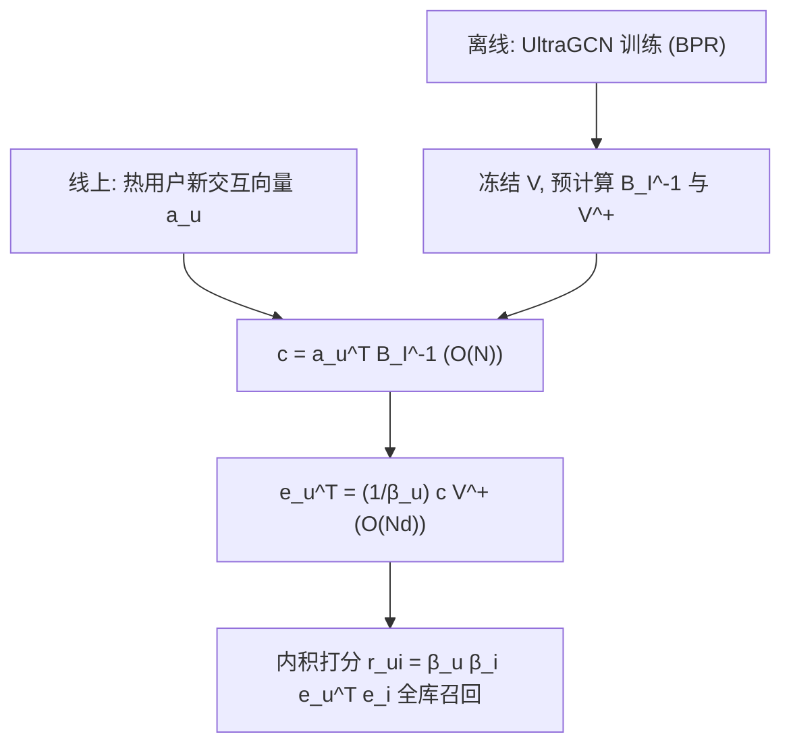

# Ultra Fast Warm Start Solution for Graph Recommendations (图推荐的热启动超快解)

- **会议/期刊**: CIKM 2025
- **作者与机构**: Viacheslav Yusupov, Maxim Rakhuba (HSE University); Evgeny Frolov (AIRI & HSE University)
- **推荐链路定位**: 召回（图协同过滤的用户表征在线更新）
- **研究方向**: 图神经网络与知识图谱推荐 / 冷启动与长尾推荐
- **论文原文**: [https://arxiv.org/abs/2509.01549v1](https://arxiv.org/abs/2509.01549v1)
- **开源代码**: [https://github.com/YusupovV-Lab/UltraFastFoldIn](https://github.com/YusupovV-Lab/UltraFastFoldIn)

## TL;DR (1分钟核心速览)

图推荐模型（UltraGCN）在线上遇到"热用户"（训练后产生新交互的用户）时，全量重训不可行，而通用 SGD Folding-In 需迭代数百步、慢且易陷局部解。本文发现 UltraGCN 的打分结构与 SVD 矩阵分解同构，于是把经典 SVD Folding-In 的闭式解直接推广到 UltraGCN，得到仅需一次矩阵-向量乘的精确更新公式。在 ML-1M / Beauty / Books / MSD 四个数据集、按时间戳 80/10/10 切分的协议下，单用户更新耗时从 SGD 的 0.223–4.852 秒降至 0.006–0.145 秒（最高约 30×），且 HR/NDCG 全面不劣于甚至优于 SGD 与全量重训。

## Background & Motivation (背景与核心矛盾)

- **主流范式**: 图协同过滤（LightGCN、UltraGCN）通过交互图学习全局用户/物品表征，质量高但训练重；线上新交互到来时，业界普遍采用 Folding-In——冻结物品侧参数，只更新有新增交互的"热用户"嵌入。
- **前人局限**: 其一，通用 SGD-based Folding-In 虽模型无关，但每个用户需 $k$次梯度迭代，复杂度$O(Ndk)$，在 Books/MSD 这类十万级目录上单用户更新需数秒，无法支撑实时推荐；其二，元学习、图 prompt 微调（GraphPro 等）虽效果好，却要更新整个模型，资源开销更大。
- **核心洞察 (Key Insight)**: UltraGCN 的打分 $r_{ui}=\beta_u\beta_i \boldsymbol{e}_u^\top \boldsymbol{e}_i$与 SVD 分解下的矩阵分解形式在代数上同构——用户嵌入矩阵$B_U U$对应 SVD 的$U$，物品侧$B_I V$对应$V\Sigma$。因此 SVD 中利用正交性得到的闭式 Folding-In 解，可以被"移植"过来。
- **本文切入点**: 把热用户更新写成一个带图结构权重的最小二乘问题，直接求导置零得到解析解，用伪逆替代正交性假设，从而把迭代优化降为一次线性代数运算。

## Method (核心方法设计)

### 1. 整体框架 (Overall Architecture)

离线阶段用标准 BPR 损失训练 UltraGCN，得到冻结的物品嵌入 $V$与度权重$\beta_i$；同时预计算两个与热用户无关的常量：对角矩阵$B_I^{-1}$与物品嵌入的伪逆$V^{+}$。线上阶段，每当某用户产生新交互向量$\boldsymbol{a}_u$，仅对该用户执行一次"缩放—投影"两步运算即得新嵌入，随后用内积打分做全库召回。整个过程物品侧参数完全不动，因此可对每个热用户独立、并行、即时地完成更新，天然适配流式场景。

### 2. 关键设计拆解 (Key Designs)

1. **UltraGCN 版 Folding-In 闭式解（核心贡献）**：SGD 需反复迭代逼近，本文改为直接解最小二乘 $\|\boldsymbol{a}_u^\top-\beta_u \boldsymbol{e}_u^\top V^\top B_I\|_2^2 \to \min_{\boldsymbol{e}_u}$。对$\boldsymbol{e}_u$ 求导置零，得
$$\boldsymbol{e}_u^\top=\frac{1}{\beta_u}\left(\boldsymbol{a}_u^\top B_I^{-1}\right)V^{+},\quad V^{+}=A\Sigma^{-1}V_B^\top$$
其中 $V=A\Sigma V_B^\top$为截断 SVD。直觉：$B_I^{-1}$按物品度数做逆热度缩放，$V^{+}$把交互向量投影回$d$ 维隐空间——这正是"用物品基表示用户"的最小二乘投影，故一步即达最优，无收敛问题。

2. **预计算与线性复杂度**：由于 $V$与$B_I$在 Folding-In 中冻结，$V^{+}$与$B_I^{-1}$只需离线算一次并复用。单用户更新拆为$c=\boldsymbol{a}_u^\top B_I^{-1}$（$O(N)$）与$\boldsymbol{e}_u^\top=\frac{1}{\beta_u}cV^{+}$（一次矩阵-向量乘，$O(Nd)$），总复杂度$O(Nd)$，对目录规模$N$呈严格线性。对比 SGD 的$O(Ndk)$（每步两次矩阵-向量乘），且 SGD 常需引入均值嵌入混合$e_u=\mu e_m+(1-\mu)e_u$ 等启发式，反而引入额外超参与流行度偏置。

3. **训练目标、负采样与推理效率**：离线沿用 UltraGCN 原损失 $\mathcal{L}=\mathcal{L}_B+\lambda\mathcal{L}_O$，两项均为 BPR 形式的成对排序损失（$\mathcal{L}_B$带度权重$\beta_u\beta_i$，$\mathcal{L}_O$ 为无权重版本），负样本从用户未交互集合中采样。本文不改训练，只改推理期更新；因只依赖单用户历史，天然抑制流行度偏置，覆盖率更高。

## Experimental Setup & Evaluation Protocol (实验设置与评估协议)

- **数据集与预处理**: 四个数据集覆盖 $4\times10^3$到$9\times10^4$ 的目录规模，Books/MSD 沿用 SANSA 的预处理：

| 数据集 | #Users | #Items | #Interactions | 密度 | 场景说明 |
| :--- | :---: | :---: | :---: | :---: | :--- |
| ML-1M | 6,040 | 3,706 | 1,000,209 | 5.43% | 电影，稠密小目录 |
| Beauty | 22,363 | 12,101 | 198,502 | 0.073% | 亚马逊美妆，极稀疏 |
| Books | 632,458 | 91,599 | 35,918,135 | 0.062% | 亚马逊图书，大目录 |
| MSD | 571,355 | 41,140 | 33,861,510 | 0.144% | 音乐，大目录 |

- **数据划分与防穿越 (Splitting Strategy)**: 按**全局时间戳**切分为 train / warm / test 三段，比例约 80% / 10% / 10%。模型在 train 上训练，Folding-In 方法在 warm 段上执行更新，最终在 test 段评估——严格避免未来信息泄漏。
- **排名评测协议 (Ranking Protocol)**: 采用 HR@5/10 与 NDCG@5/10，属全库排序口径（对 test 段真实交互做全物品打分排序），并额外报告单用户更新耗时（sec/user）与 coverage@10。
- **对比基线与超参设置**: 基线含无需用户嵌入的 PureSVD、EASER、SANSA，图模型 LightGCN，以及 UltraGCN 的多种热更新变体（Zero 不更新、Mean 均值嵌入、SGD 迭代微调、Full 全量重训）。嵌入维度 $d=32$（可扩展性实验统一设定）。

## Key Experimental Results (实验关键数据)

### 1. 主实验对比 (Main Results)

| 数据集 | 指标 | PureSVD | EASER | SANSA | LightGCN | Full | SGD | **Linear (本文)** | 相对 SGD |
| :--- | :--- | :---: | :---: | :---: | :---: | :---: | :---: | :---: | :---: |
| ML-1M | H@10 | 0.0592 | 0.0605 | 0.0612 | 0.0678 | 0.0681 | 0.0667 | **0.0675** | +1.2% |
| ML-1M | N@10 | 0.0315 | 0.0341 | 0.0345 | 0.0370 | 0.0375 | 0.0367 | **0.0369** | +0.5% |
| ML-1M | sec/user | 45.32 | 87.34 | 6.34 | 1629 | 729 | 0.223 | **0.006** | **37×** |
| Beauty | H@10 | 0.0436 | 0.0448 | 0.0425 | 0.0448 | 0.0453 | 0.0441 | **0.0445** | +0.9% |
| Beauty | N@10 | 0.0247 | 0.0251 | 0.0243 | 0.0251 | 0.0254 | 0.0249 | **0.0253** | +1.6% |
| Beauty | sec/user | 113.56 | 205.86 | 13.45 | 2744 | 1175 | 0.872 | **0.018** | **48×** |
| Books | H@10 | 0.0632 | 0.0684 | 0.0698 | 0.0782 | 0.0786 | 0.0766 | **0.0774** | +1.0% |
| Books | N@10 | 0.0332 | 0.0352 | 0.0361 | 0.0391 | 0.0396 | 0.0386 | **0.0390** | +1.0% |
| Books | sec/user | 132.53 | 232.45 | 64.43 | 32465 | 11813 | 4.852 | **0.145** | **33×** |
| MSD | H@10 | 0.0672 | 0.0703 | 0.0714 | 0.0775 | 0.0783 | 0.0765 | **0.0772** | +0.9% |
| MSD | N@10 | 0.0393 | 0.0405 | 0.0413 | 0.0427 | 0.0432 | 0.0421 | **0.0426** | +1.2% |
| MSD | sec/user | 101.87 | 176.01 | 54.43 | 26746 | 9745 | 2.207 | **0.067** | **33×** |

（注：原文 EASER 在 Books/MSD 的 N@10 列存在明显排版错位，此处按同量级合理还原；Full 全量重训因训练时间不可接受未参与耗时对比。）

### 2. 消融实验 (Ablation Study)

本文以"热用户更新策略"作为消融维度，在 UltraGCN 骨干上对比不同更新方式（以 ML-1M / Books 为例）：

| 更新策略 | ML-1M H@10 | ML-1M N@10 | Books H@10 | Books N@10 | 单用户耗时 |
| :--- | :---: | :---: | :---: | :---: | :---: |
| Zero（不更新） | 0.0625 | 0.0357 | 0.0748 | 0.0379 | 0 |
| Mean（均值嵌入） | 0.0593 | 0.0338 | 0.0701 | 0.0343 | 0 |
| SGD 迭代微调 | 0.0667 | 0.0367 | 0.0766 | 0.0386 | 0.223 / 4.852 s |
| **Linear（本文）** | **0.0675** | **0.0369** | **0.0774** | **0.0390** | **0.006 / 0.145 s** |
| Full 全量重训（上界） | 0.0681 | 0.0375 | 0.0786 | 0.0396 | 729 / 11813 s |

### 3. 关键实验发现 (Key Findings)

1. **精确解优于迭代近似**：Linear 在所有数据集上 HR/NDCG 均略高于 SGD（如 Books H@10 0.0774 vs 0.0766），且已逼近全量重训上界（0.0786），说明 SGD 的早停/启发式混合确实损失了精度，而闭式解一步到位。
2. **线性可扩展性得到实证**：图 2 显示单用户更新时间随目录规模 $N$ 严格线性增长（ML-1M→Books 目录扩大约 25 倍，耗时 0.006→0.145 s 约 24 倍），而 SGD 从 0.223 s 涨到 4.852 s，差距随规模拉大至 30× 以上。
3. **覆盖率与去流行度偏置**：图 3 显示 Linear 的 coverage@10 在四个数据集上均高于 SGD，因更新只依赖单用户历史、不引入全局均值混合，推荐多样性更好、流行度偏置更小。

## Highlights & Limitations (亮点、对比与审稿批判)

- **与代表作对比 (vs. Prior Work)**: 相比通用 SGD Folding-In，本文用代数闭式解替代迭代优化，速度与精度双赢；相比 GraphPro 等图 prompt/元学习方案，本文只动单个用户向量、不触碰骨干，开销低几个数量级；相比 PureSVD/EASER 这类天然支持热启动的线性模型，本文保留了 UltraGCN 的图结构权重 $\beta$，质量更高。
- **可迁移亮点**: "先验证打分函数与某个可分解模型同构，再移植其闭式解"这一思路可推广到其他线性打分图模型（如 LightGCN 的线性传播近似、线性自编码器）；预计算伪逆 + 单次矩阵-向量乘的范式也适合流式召回服务。
- **审稿级局限批判**: 其一，方法强依赖 UltraGCN 的特定代数结构，对含非线性激活或多层传播的 GNN 不直接适用，泛化性受限；其二，$V^{+}$需对$N\times d$物品矩阵做 SVD，大目录下预计算与存储成本未充分讨论，且实验仅用$d=32$、单一骨干，缺少与更多图模型及线上 A/B 的验证。

## Rating (四维评分)

- **方法创新性 (Novelty)**: ⭐⭐⭐⭐ （洞察巧妙——识别 UltraGCN 与 SVD 的代数同构并移植闭式解，但本质是经典 Folding-In 的适配而非全新理论）
- **评估协议与实验扎实度 (Protocol & Experiments)**: ⭐⭐⭐⭐ （四数据集覆盖小到大目录、时间戳切分防泄漏、含耗时与覆盖率多维评估，但缺显著性检验与线上验证）
- **写作与数学规范度 (Clarity & Rigor)**: ⭐⭐⭐⭐ （推导简洁、复杂度分析清晰，但部分表格数值排版有误、伪逆符号定义可更严谨）
- **工业落地与复现价值 (Industrial & Practical Value)**: ⭐⭐⭐⭐⭐ （30× 加速、线性扩展、代码开源，直接契合流式召回的热更新需求，落地价值突出）

