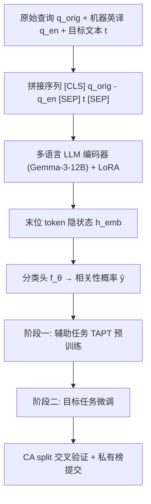

# Alibaba International E-commerce Product Search Competition DcuRAGONs Team Technical Report (阿里国际电商商品搜索竞赛 DcuRAGONs 团队技术报告)

- **会议/期刊**: CIKM 2025（竞赛技术报告）
- **作者与机构**: Thang-Long Nguyen-Ho, Minh-Khoi Pham, Hoang-Bao Le（都柏林城市大学 DCU, School of Computing / ADAPT SFI）
- **推荐链路定位**: 召回（Query–Item / Query–Category 相关性判别，作为检索前置过滤与召回打分器）
- **研究方向**: 大语言模型推荐 / 冷启动与长尾推荐（低资源语言零样本泛化）
- **论文原文**: [https://arxiv.org/abs/2510.25428v1](https://arxiv.org/abs/2510.25428v1)
- **开源代码**: [https://github.com/nhtlongcs/e-commerce-product-search](https://github.com/nhtlongcs/e-commerce-product-search)

## TL;DR (1分钟核心速览)

本文面向阿里国际（AliExpress/Lazada/Daraz/Trendyol/Miravia）真实多语言搜索日志中的两个二分类相关性任务（Query–Category、Query–Item），核心痛点是查询噪声大、语码混用、且存在训练中完全未见的低资源语言。团队提出纯"数据中心"方案：以 Gemma-3-12B 为骨干，叠加**翻译增强（原文+英译拼接）**、**跨任务监督式 TAPT 两阶段训练**与**类别感知查询分组交叉验证（CA split）**，配合 LoRA 高效微调。最终以 $F^{avg}_1 = 0.5F^{QC}_1+0.5F^{QI}_1$ 为指标，在私有榜取得 QC 89.36% / QI 88.81%，位列竞赛第一。

## Background & Motivation (背景与核心矛盾)

- **主流范式**: 电商相关性判别通常走"多语言预训练编码器 + 分类头"路线，工业界多用 XLM-R 级别的小模型以保证吞吐；竞赛场景则普遍直接对目标任务做单阶段微调。
- **前人局限**: 其一，小模型（XLM-R 550M、Qwen3-0.6B）表征容量不足，在噪声大、语码混用的查询上 QC 仅 82.0%、QI 仅 80.5%；其二，通用多语言 LLM 缺乏电商领域术语/缩写/类目语义的先验，直接微调易过拟合且对未见语言泛化差。
- **核心洞察 (Key Insight)**: 作者观察到两个可被"数据工程"利用的结构性事实——(a) 英文可作为跨语言的**语义枢轴（pivot）**，把低资源语言锚定到高资源语义空间；(b) 同一 query 会在数据集中重复出现、同一类目前缀（如 `Electronics>Audio Devices`）共享可迁移语义，因此**朴素随机划分会造成严重泄漏**，验证分数虚高。
- **本文切入点**: 不做新网络结构，而是用"翻译增强 + 跨任务 TAPT + 防泄漏分组划分"三件套，把 12B 多语言 LLM 的潜力在 15B 参数限制内榨干。

## Method (核心方法设计)

### 1. 整体框架 (Overall Architecture)

输入侧将原始查询 $q_{orig}$与机器英译$q_{en}$拼接，与目标文本$t$（类目路径或商品详情）组成单序列送入多语言编码器；取末位非 padding token 的隐状态$h_{emb}$ 经分类头输出相关性概率。训练分两阶段：先在**辅助任务**（QC↔QI 互为辅助）上做监督式 TAPT，再在目标任务上以相同超参微调；全程用 LoRA 适配器，仅训练低秩增量参数。验证侧采用 CA split 生成无泄漏的折划分，最终以两任务正类 F1 的均值作为提交指标。

### 2. 关键设计拆解 (Key Designs)

1. **翻译增强的双语拼接（Translation Augmentation）**：痛点是低资源/未见语言在微调阶段几乎无监督信号。做法是把英译作为通用枢轴与原文并列输入：$x=[\text{CLS}]\,q_{orig}\!-\!q_{en}\,[\text{SEP}]\,t\,[\text{SEP}]$。保留$q_{orig}$是为了不丢失原文的细粒度语言线索（在训练覆盖充分的语言上避免性能回退），而$q_{en}$ 则在未见语言上提供高资源语义锚点——本质是一种**免参数的跨语言对齐**，比训练对齐层更省算力。

2. **任务自适应预训练 TAPT（跨任务知识迁移）**：痛点是通用 LLM 不熟悉电商术语与 query–item 语义模式。做法是在目标任务微调前，先用另一相关任务的标注数据做同构的监督交叉熵预训练：$\mathcal{L}=-\frac{1}{N}\sum_{j=1}^{N}y_j\log p_\theta(y_j\mid x_j)$。两阶段共享同一损失与超参，使模型先"进入电商域"再"学具体任务"，从而缓解噪声/类别不平衡下的过拟合并稳定收敛。

3. **类别感知查询分组划分 CA split（防泄漏评估）**：QI 任务按**完全相同的 query 文本**分组，保证同一 query 不跨折；QC 任务额外引入"类目前 $N$级前缀"作为 category group（如$N=2$ 时 `Electronics>Audio Devices`），同组类目全部锁进同一折。这样验证集强制模型面对**完全未见的 query 与未见叶子类目**，把"字符串重叠带来的虚假高分"剔除，使离线分数与隐藏测试集表现对齐。

4. **训练目标、负采样与推理效率**：总损失即上述正类加权的交叉熵（二分类，无显式负采样环节，负例由数据标注天然给出）；优化器 AdamW，学习率 $1\text{e-}5$，batch size 8，线性调度，5 epoch，4×A100-80G + DeepSpeed + 混合精度 + 梯度累积；LoRA 使可训练参数占比极低，推理为单次前向打分，可直接作为召回链路的轻量相关性过滤器。

## Experimental Setup & Evaluation Protocol (实验设置与评估协议)

- **数据集与预处理**: 数据来自阿里 AIDC 五大平台真实多语言搜索日志，覆盖 100+ 国家、20+ 语言；官方未在报告中给出精确用户/物品量级，仅说明含 QC 与 QI 两个子集。清洗步骤为去冗余空格、统一小写、剔除空查询；**未使用任何外部数据**以符合竞赛规则。

| 数据集 | #Users | #Items | #Interactions | 稀疏度/密度 | 特征/场景说明 |
| :--- | :---: | :---: | :---: | :---: | :--- |
| QC 子集 | 未披露 | 类目树（层级路径） | 未披露 | — | 查询–类目相关性，含多语言与低资源语言 |
| QI 子集 | 未披露 | 商品条目 | 未披露 | — | 查询–商品相关性，同一 query 多次出现 |

- **数据划分与防穿越 (Splitting Strategy)**: 自定义 **CA split**（Query-Grouped + Category-Grouped 交叉验证），QI 按 query 文本分组、QC 按类目前缀分组，均按语言与标签分布做分层；本质是"未见 query / 未见类目"的**冷启动式划分**，而非 Leave-One-Out 或随机比例划分。
- **排名评测协议 (Ranking Protocol)**: 非排序类评测，两任务均为**二分类**，指标为正类 $F_1$，最终$F^{avg}_1=0.5\times F^{QC}_1+0.5\times F^{QI}_1$；报告公开榜（public）与私有榜（private）分数，交叉验证折上报告均值与标准差。
- **对比基线与超参设置**: 基线为 XLM-RoBERTa(550M)、Qwen2-7B/14B、Qwen3-0.6B/7B/14B、Gemma-2-9B、Gemma-3-12B；参数上限 15B；LoRA 微调，学习率 $1\text{e-}5$，batch 8，5 epoch。

## Key Experimental Results (实验关键数据)

### 1. 主实验对比 (Main Results)

阶段一（公开榜，跨折均值±标准差）：

| 模型 | 多语言 | CA/TA | QC F1% | QI F1% |
| :--- | :---: | :---: | :---: | :---: |
| XLM-RoBERTa (550M) | ✗ | ✗/✗ | 82.00 ±0.80 | 80.52 ±1.29 |
| Qwen3-0.6B | ✓ | ✗/✗ | — | 78.50 |
| Qwen3-14B | ✓ | ✗/✗ | 88.38 | — |
| Gemma-2-9B | ✗ | ✓/✓ | 88.83 ±0.10 | 88.20 ±0.21 |
| Gemma-3-12B | ✓(140) | ✓/✓ | 89.14 ±0.15 | — |
| **Best (Gemma-3-12B + TAPT)** | ✓ | ✓/✓ | **89.36** | **88.45** |

阶段二（私有榜，最高折）：

| 架构 | TAPT | CA | TA | QC F1% | QI F1% |
| :--- | :---: | :---: | :---: | :---: | :---: |
| Gemma3-12B | ✗ | ✓ | ✓ | 89.22 | 88.79 |
| **Gemma3-12B** | ✓ | ✓ | ✓ | **89.36 (+0.14)** | **88.81 (+0.02)** |

### 2. 消融实验 (Ablation Study)

| 配置 | QC F1% | QI F1% | 说明 |
| :--- | :---: | :---: | :--- |
| XLM-R → Gemma-2-9B（仅换骨干） | 82.00 → 88.83 | 80.52 → 88.20 | 骨干规模+多语言预训练贡献最大 |
| Gemma-2-9B → Gemma-3-12B | 88.83 → 89.14 | — | 继续扩参收益递减 |
| w/o TAPT（私有榜） | 89.22 | 88.79 | 去掉跨任务预训练 |
| w/ TAPT（私有榜） | 89.36 | 88.81 | 两任务均正向 |

### 3. 关键实验发现 (Key Findings)

1. **骨干规模与多语言覆盖是最大增益源**：从 XLM-R 到 Gemma-2-9B，QC 提升 6.83 个点（82.00→88.83），QI 提升 7.68 个点；但 9B→12B 仅 +0.31，说明"暴力扩参"已进入平台期，后续增益需靠领域预训练或结构归纳偏置。
2. **TAPT 的增益虽小但方向一致且稳定**：私有榜上 QC +0.14、QI +0.02，在竞赛末段属于"难以撬动"的区间，且两任务同时为正，佐证跨任务电商域预训练确实提供了可迁移的 query–item 语义先验，而非随机波动。
3. **评估协议本身是本文的隐性贡献**：CA split 通过 query 分组与类目前缀分组切断了字符串重叠捷径，使离线分数与隐藏测试集对齐——这也解释了为何小模型在公开榜上的分数（如 Qwen3-0.6B QI 78.50）显著低于大模型，差距被真实暴露而非被泄漏掩盖。

## Highlights & Limitations (亮点、对比与审稿批判)

- **与代表作对比 (vs. Prior Work)**: 与常规"XLM-R + 单阶段微调"的工业相关性判别相比，本文不改结构而改数据管线，用翻译枢轴 + TAPT 把 12B LLM 的跨语言能力显式激活；与同期 LLM4Rec 中动辄指令微调/构造偏好对的方案相比，本文更接近"轻量判别式适配"，成本低、可直接嵌入召回过滤环节；与常规随机/分层划分相比，CA split 在评估严谨性上是明确的方法论增量。
- **可迁移亮点**: (1) "原文 + 英译"双语拼接是一种零训练成本的跨语言对齐技巧，可直接迁移到跨境搜索、多语言评论理解等任务；(2) 按业务层级前缀（类目前 $N$ 级）做分组划分，可推广到任何带层级标签的推荐评估（如频道–子频道、品牌–品类），有效防止离线虚高。
- **审稿级局限批判**: 其一，报告未给出数据集规模、类别分布与推理延迟，且 TAPT 增益仅 +0.14/+0.02，缺乏多种子与显著性检验，难以判断统计可靠性；其二，翻译增强对低质量机器翻译的噪声未做系统评估，且 QC/QI 未做统一多任务建模、也未显式利用类目层级结构作为归纳偏置，超参搜索受算力限制，泛化结论的边界仍不清晰。

## Rating (四维评分)

- **方法创新性 (Novelty)**: ⭐⭐⭐ （无新网络结构，创新集中在数据管线与评估协议，工程导向明确但理论新颖度有限）
- **评估协议与实验扎实度 (Protocol & Experiments)**: ⭐⭐⭐⭐ （CA split 防泄漏设计是亮点，主实验覆盖 7 个骨干模型，但缺显著性检验与多种子）
- **写作与数学规范度 (Clarity & Rigor)**: ⭐⭐⭐⭐ （公式简洁、流程清晰，但数据集统计与超参细节披露不足）
- **工业落地与复现价值 (Industrial & Practical Value)**: ⭐⭐⭐⭐⭐ （代码已开源，LoRA + 单次前向打分可直接部署为召回相关性过滤器，竞赛第一背书）

