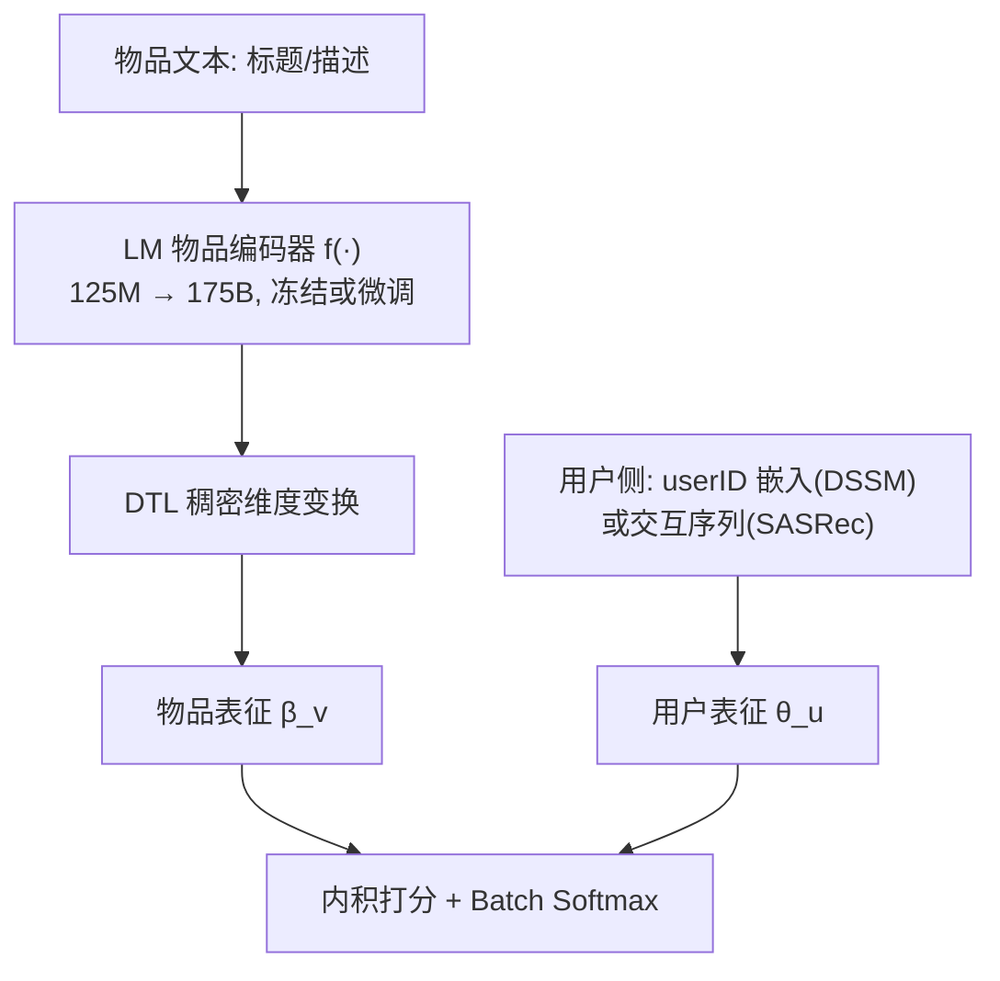
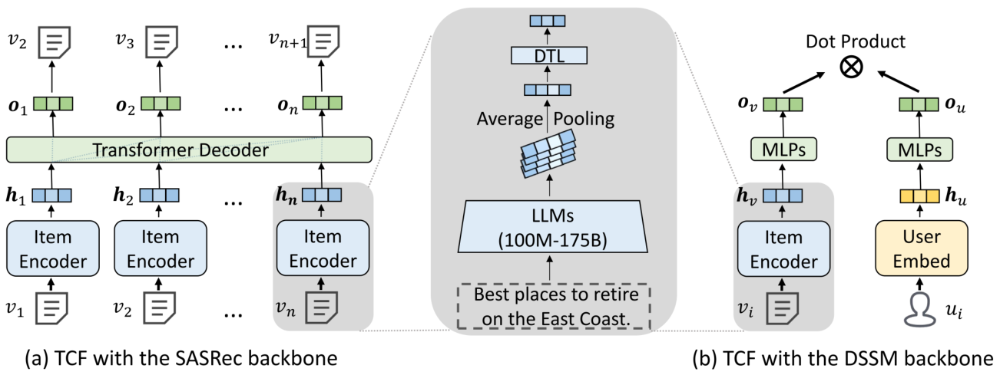

# Exploring the Upper Limits of Text-Based Collaborative Filtering Using Large Language Models: Discoveries and Insights (用大语言模型探索文本协同过滤的性能上限：发现与洞见)

- **会议/期刊**: CIKM 2025
- **作者与机构**: Ruyu Li, Wenhao Deng, Yu Cheng, Zheng Yuan, Jiaqi Zhang, Fajie Yuan（西湖大学）
- **推荐链路定位**: 召回（物品表征侧）
- **研究方向**: 大语言模型推荐 / 冷启动与通用表征
- **论文原文**: [https://arxiv.org/abs/2305.11700v2](https://arxiv.org/abs/2305.11700v2)
- **开源代码**: [https://github.com/westlake-repl/TCF](https://github.com/westlake-repl/TCF)

## TL;DR (1分钟核心速览)

本文不是提出新算法，而是对 TCF 范式做一次"极限压力测试"：把物品文本编码器从 125M 逐级放大到 175B（OPT 全系 9 档），在 MIND/HM/Bili 三数据集、DSSM 与 SASRec 两种骨干上做全库排序评测。结论是：缩放仍在涨（SASRec 骨干下 Bili 提升 58.4%），但 175B 冻结表征仍打不过微调的 125M；不过在 SASRec 骨干下，**冻结 175B 已能与 IDCF 打平**，这是对"必须端到端微调"旧结论的关键修正。

## Background & Motivation (背景与核心矛盾)

- **主流范式**: TCF 用语言模型把物品标题/描述编码为向量替代 itemID，再接入 DSSM 双塔或 SASRec 序列骨干；工业界因算力所限普遍采用"冻结编码器 + 离线预抽取特征"的两阶段方案。
- **前人局限**: 现有 TCF 工作几乎只用 word2vec/BERT/RoBERTa 这类 100M 级编码器，缩放效应在 top-$N$ 隐式反馈推荐上从未被验证；且多数"超越 IDCF"的宣称要么只在冷启动场景，要么在固定小 embedding 维度下比较，缺乏同骨干、同采样器、同损失的公平对照。
- **核心洞察 (Key Insight)**: 推荐模型 = 物品编码器 + 用户编码器，NLP 的缩放定律不能直接外推；而 ID 特征不可跨平台共享，是"一模型通吃"基础推荐模型的根本障碍，因此 TCF 的上限直接决定基础推荐模型是否可行。
- **本文切入点**: 不做新模型，而是用受控实验逐一回答四个命题——缩放是否有天花板、175B 是否给出通用物品表征、能否击败 IDCF、离通用推荐模型还有多远。

## Method (核心方法设计)

### 1. 整体框架 (Overall Architecture)

模型结构本身极简：物品文本（新闻标题 / 商品描述 / 视频标题）送入语言模型 $f(\cdot)$得到表征，经稠密维度变换层 DTL 对齐到推荐隐空间，再与用户侧表征做内积打分。用户侧有两种形态：DSSM 用 userID 嵌入经 MLP 输出$\theta_u$；SASRec 用最近交互物品序列经 Transformer 解码器输出$\theta_u$。训练统一采用工业界常用的 batch softmax 损失。真正的"方法"在于实验矩阵的设计：编码器规模（125M→175B）× 骨干（DSSM/SASRec）× 冻结/微调 × 数据集，构成一张可归因的缩放曲线。

<figure class="paper-figure" markdown="span">
  <figcaption>图1：在TCF中将LLM用作物品编码器，以SASRec/DSSM作为推荐骨干。DTL模块为稠密维度变换层。本研究中使用的物品或文本编码器可达175B参数。</figcaption>
</figure>

### 2. 关键设计拆解 (Key Designs)

1. **受控缩放实验矩阵（本文真正的"方法"）**：痛点是此前无人验证百亿级编码器在 top-$N$ 推荐上的行为。作者固定除编码器规模外的一切变量（同骨干、同损失、同超参搜索策略），仅对冻结编码器统一沿用 125M 调出的最优超参，从而让性能差异可归因于表征能力本身。这种"单变量控制"是结论可信的前提。
2. **冻结 vs 微调的通用性判据**：若 175B 表征真是"通用物品表征"，则存在权重 $w$使$y = w^{\top}\beta_v$即可适配下游，冻结应不劣于微调。作者据此设计对照：仅重训顶部两层（175B 因算力过高不重训），比较$\text{HR@10}$ 差异。该判据把抽象的"通用性"转化为可测量的操作定义。
3. **训练目标、负采样与推理效率**：损失为 batch softmax，即批内其余物品充当负样本（in-batch negative），无额外硬负采样；推理时对全库物品打分。冻结方案下物品表征可离线一次性抽取并缓存，在线仅需用户侧前向，这正是其相对端到端微调的工程价值所在。

## Experimental Setup & Evaluation Protocol (实验设置与评估协议)

- **数据集与预处理**: 剔除交互数少于 5 的用户（不考虑冷用户），每用户取最近 23 个物品构造序列（前 20 训练、第 22 验证、第 23 测试）；MIND/HM 各随机抽 20 万用户，Bili 抽 5 万；另构建 Bili8M 全量集用于预训练迁移实验。

| 数据集 | #Users | #Items | #Interactions | 特征/场景说明 |
| :--- | :---: | :---: | :---: | :--- |
| MIND | 200,000 | 54,246 | 2,920,730 | 新闻标题，点击 |
| HM | 200,000 | 85,019 | 3,160,543 | 商品描述，购买 |
| Bili | 50,000 | 22,377 | 723,071 | 视频标题，评论 |
| Bili8M | 8,880,000 | 408,000 | 104,450,865 | 预训练用大规模集 |

- **数据划分与防穿越 (Splitting Strategy)**: 按用户交互时间顺序的 `Leave-One-Out` 式切分（最后一条测试、倒数第二条调参），严格避免未来交互泄漏。
- **排名评测协议 (Ranking Protocol)**: 无偏 `Full-Ranking`，全库所有物品参与排序，指标为 HR@10（NDCG@10 与之一致性高，置于代码库）。
- **对比基线与超参设置**: 基线含 IDCF（同骨干）、word2vec、BERT-large、T5-XXL、LLaMA2-7B/13B/70B、MPT-30B、Falcon-40B、Mistral-7B/8×7B 及 OPT 全系；先对 IDCF 网格搜索最优超参，再在其邻域搜索 TCF；优化器 AdamW，dropout 0.1，权重衰减 0.1。

## Key Experimental Results (实验关键数据)

### 1. 主实验对比 (Main Results)

SASRec 骨干、冻结编码器下的 HR@10（%）：

| 编码器 | 年份 | MIND | HM | Bili |
| :--- | :---: | :---: | :---: | :---: |
| word2vec | 2013 | 15.21 | 8.08 | 2.66 |
| BERT-large | 2018 | 18.99 | 9.68 | 3.56 |
| T5-XXL | 2019 | 19.56 | 9.21 | 4.81 |
| LLaMA2-70B | 2023 | 19.84 | 9.80 | 6.79 |
| Falcon-40B | 2023 | 19.92 | 10.13 | 5.64 |
| Mistral-8×7B | 2023 | 19.74 | 10.71 | 5.98 |
| **OPT-175B** | 2022 | **20.24** | **11.11** | **7.05** |
| Improv. (125M→175B) | — | +6.1% | +18.6% | +58.4% |

TCF 与 IDCF 的正面交锋（HR@10，FR=冻结、FT=微调）：

| 数据 | SASRec-IDCF | SASRec-175B(FR) | SASRec-66B(FT) | DSSM-IDCF | DSSM-175B(FR) | DSSM-66B(FT) |
| :--- | :---: | :---: | :---: | :---: | :---: | :---: |
| MIND | 20.05 | 20.24 | **21.07** | **3.99** | 2.88 | 3.27 |
| HM | 12.02 | 11.11 | **13.29** | **6.79** | 2.09 | 2.35 |
| Bili | 7.01 | 7.05 | **8.15** | **2.27** | 2.00 | 2.04 |

零样本迁移（Bili8M 预训练 → 直接测试，HR@10）：

| 模型 | MIND | HM | QB |
| :--- | :---: | :---: | :---: |
| Random | 0.02 | 0.01 | 0.18 |
| 175B zero-shot | 0.13 | 0.39 | 4.30 |
| 175B 重训 | **20.24** | **11.11** | **29.90** |

### 2. 消融实验 (Ablation Study)

| 配置 | MIND | HM | Bili | 说明 |
| :--- | :---: | :---: | :---: | :--- |
| SASRec + 冻结 125M | 19.07 | 9.37 | 4.45 | 缩放起点 |
| SASRec + 冻结 175B | 20.24 | 11.11 | 7.05 | 缩放终点 |
| SASRec + 微调 125M | 高于冻结 175B | 高于冻结 175B | 高于冻结 175B | 通用性反证 |
| SASRec + 微调 66B | 21.07 | 13.29 | 8.15 | 全面超 IDCF |
| DSSM + 冻结 175B | 2.88 | 2.09 | 2.00 | 骨干瓶颈 |
| DSSM + 微调 66B | 3.27 | 2.35 | 2.04 | 仍不及 IDCF |

### 3. 关键实验发现 (Key Findings)

1. **缩放未饱和，但收益高度依赖文本信息量**：125M→175B 在 Bili 上带来 58.4% 提升，在 MIND 上仅 6.1%。原因是新闻标题语义自足、视频标题信息稀疏，编码器越强越能补足稀疏文本的语义缺口；13B→175B 曲线仍在上升，说明天花板尚未触及。
2. **"通用物品表征"假设被证伪**：微调 125M 的 TCF 全面优于冻结 175B，说明推荐域与 NLP 域存在显著语义鸿沟，用户偏好推断无法仅靠通用文本表征线性读出；但冻结 175B 已逼近微调 66B（HM 相对差距 16%），暗示未来更强模型可能缩小该差距。
3. **骨干选择比编码器规模更决定成败**：DSSM 下即便 175B 冻结或 66B 微调也全面落后 IDCF（MIND 2.88 vs 3.99），而 SASRec 下冻结 175B 已与 IDCF 打平（20.24 vs 20.05）。这说明 seq2seq 序列建模能更充分榨取文本表征，也修正了"TCF 必须端到端微调才能媲美 IDCF"的旧结论。

## Highlights & Limitations (亮点、对比与审稿批判)

- **与代表作对比 (vs. Prior Work)**: 相较以 BERT 级编码器为主的既有 TCF 研究，本文首次把规模推到 175B 并给出 top-$N$ 隐式反馈上的缩放证据；相较同期 Google 关于显式评分预测的缩放 preprint，本文聚焦更贴近工业的隐式反馈全库排序；相较"TCF 必须联合微调"的旧论断，本文证明冻结大模型在序列骨干下即可打平 IDCF，工程意义重大。
- **可迁移亮点**: ①"冻结 vs 微调"作为通用表征的可操作判据，可直接用于评估任何预训练表征的领域适配度；②离线缓存物品表征、在线只跑用户侧的两阶段部署范式，对算力受限场景极具参考价值。
- **审稿级局限批判**: ①全部结论基于离线数据，存在曝光偏置，线上表现未经 A/B 验证；②175B 未做全参数微调，冻结与微调的对比在最大规模处存在缺口，且 350M 档因 OPT 实现差异（LayerNorm 位置不同）出现异常低点，说明缩放曲线并非严格单调，结论对模型实现细节敏感。

## Rating (四维评分)

- **方法创新性 (Novelty)**: ⭐⭐⭐ （无新算法，但首次系统给出百亿级物品编码器的缩放证据与通用性反证，实证贡献稀缺）
- **评估协议与实验扎实度 (Protocol & Experiments)**: ⭐⭐⭐⭐⭐ （三数据集 × 两骨干 × 九档规模 × 冻结/微调 × 零样本，全库排序且同骨干公平对照，实验矩阵极为完整）
- **写作与数学规范度 (Clarity & Rigor)**: ⭐⭐⭐⭐ （四问四答结构清晰、结论与证据一一对应，但公式层面较浅，缺少复杂度与理论分析）
- **工业落地与复现价值 (Industrial & Practical Value)**: ⭐⭐⭐⭐ （代码数据全开源，"冻结大模型 + 序列骨干"路线可直接落地，但 175B 级实验的算力门槛限制了中小团队复现）

