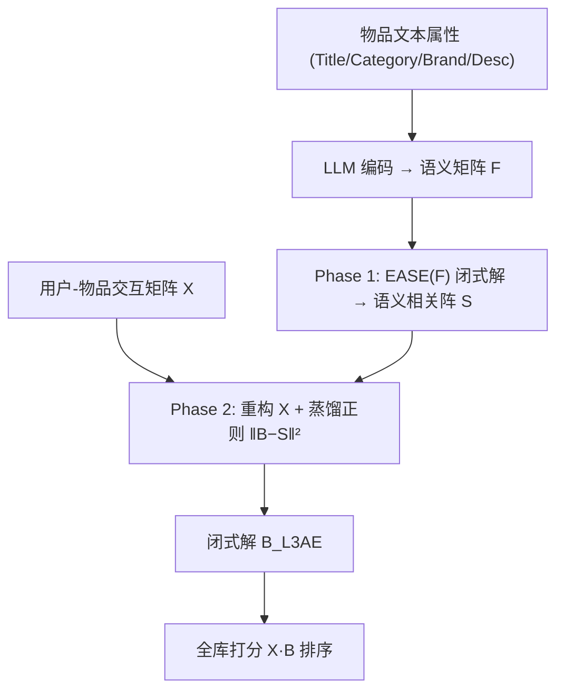

# LLM-Enhanced Linear Autoencoders for Recommendation (LLM 增强的线性自编码器推荐)

- **会议/期刊**: CIKM 2025
- **作者与机构**: Jaewan Moon, Seongmin Park, Jongwuk Lee（成均馆大学）
- **推荐链路定位**: 召回（item-to-item 全库打分）
- **研究方向**: 大语言模型推荐 / 协同过滤与双塔召回
- **论文原文**: [https://arxiv.org/abs/2508.13500v2](https://arxiv.org/abs/2508.13500v2)
- **开源代码**: [https://github.com/jaewan7599/L3AE_CIKM2025](https://github.com/jaewan7599/L3AE_CIKM2025)

## TL;DR (1分钟核心速览)

线性自编码器（LAE/EASE）虽以闭式解高效著称，但注入文本时只能用 multi-hot 标签共现，无法刻画"跑鞋 vs 运动鞋"这类语义近邻，长尾物品尤其吃亏。本文提出 L3AE：先用 LLM 物品向量 $F$走一遍 EASE 得到语义 item-item 相关阵$S$，再把$S$作为知识蒸馏目标正则化交互侧权重$B$，两阶段均有闭式解、保持全局最优。在 Amazon 三数据集、全库未交互排序协议下，R@20 平均较最强 LLM 增强基线 AlphaRec 提升 29.1%，N@20 提升 39.8%。

## Background & Motivation (背景与核心矛盾)

- **主流范式**: LLM-as-Extractor 路线下，RLMRec、AlphaRec 等把 LLM 物品向量作为初始化嵌入再训练图/非线性模型；线性侧则以 CEASE、Add-EASE 为代表，用 multi-hot 标签矩阵 $T$与交互矩阵$X$ 联合重构。
- **前人局限**: 其一，multi-hot 只反映词表共现，文本不同但概念相同的物品被当作无关，语义鸿沟无法弥合；其二，collective 法把异质数据塞进单一目标、additive 法只做权重线性插值，二者都忽略了跨源相关性，且无法按数据源特性分别调正则。
- **核心洞察 (Key Insight)**: 对 $X$与$F$做 PCA 后发现（图 2），$F$的奇异值高度集中于前几个主成分、有效秩极低，而$X$ 衰减平缓且尾部含稀疏噪声——两者谱结构截然不同，直接拼接或插值必然让一方被另一方"带偏"。
- **本文切入点**: 不在原始数据层融合，而在 **item-item 相关阵层** 融合：让语义侧先独立求出自己的最优相关阵，再以蒸馏正则"软约束"交互侧权重。

## Method (核心方法设计)

### 1. 整体框架 (Overall Architecture)

输入为交互矩阵 $X\in\{0,1\}^{m\times n}$与 LLM 编码的物品语义矩阵$F\in\mathbb{R}^{d\times n}$（prompt 拼接 Title/Category/Brand/Description，取末层 token 嵌入均值）。Phase 1 对$F$求解 EASE 型目标得到语义相关阵$S$；Phase 2 在$X$的重构目标上追加$\lVert B-S\rVert_F^2$蒸馏项求解最终权重$B$；推理时用$s_{ui}=X_{u*}\cdot B_{*i}$ 对全库未交互物品打分排序。两阶段均为凸问题，闭式解一次求出，无需梯度迭代。

### 2. 关键设计拆解 (Key Designs)

1. **语义相关阵构造（Phase 1，替代余弦相似度）**：直接算 $F$的余弦相似度只是协方差邻近度，忽略了物品流行度造成的共现偏置。本文把 EASE 搬到语义空间，学习权重阵$S$重构$F$：$\min_{S}\lVert F-FS\rVert_F^2+\lambda_F\lVert S\rVert_F^2,\ \text{s.t.}\ \mathrm{diag}(S)=0$，闭式解$S=I-P_F\cdot\mathrm{diagMat}(\mathbf{1}\oslash\mathrm{diag}(P_F))$，其中$P_F=(F^\top F+\lambda_F I)^{-1}$。EASE 的精度（逆协方差）打分从图模型视角比余弦更能反映语义空间的下游可用性——实验也验证了语义-only EASE 全面优于余弦。

2. **语义引导蒸馏正则（Phase 2，核心增量）**：若把 $S$直接当数据拼进重构目标，就退化为 collective 法。本文改为在 **权重空间** 蒸馏：$\min_{B}\lVert X-XB\rVert_F^2+\lambda_X\lVert B\rVert_F^2+\lambda_{KD}\lVert B-S\rVert_F^2,\ \text{s.t.}\ \mathrm{diag}(B)=0$，得
$$B_{L3AE}=I+\lambda_{KD}P_{KD}S-P_{KD}\cdot\mathrm{diagMat}(\boldsymbol{\mu}),\quad P_{KD}=\big(X^\top X+(\lambda_{KD}+\lambda_X)I\big)^{-1}.$$
直觉在于：$\lambda_{KD}$同时扮演"语义注入强度"与"交互侧额外 L2"双重角色，交互数据的等效正则变为$\lambda_{KD}+\lambda_X$，从而允许两个异质源各自获得最优正则尺度，而不像 collective 法被迫共享一个$\lambda$。

3. **训练目标、负采样与推理效率**：总损失即上式（无负采样、无 SGD），全流程仅两次 $n\times n$矩阵求逆，复杂度$O(n^3+mn^2)$，与 EASE 同阶；推理为一次稀疏向量-矩阵乘，天然适配 item-to-item 召回。实现上先按 EASE 定出交互侧理想正则$\lambda$，再强制约束$\lambda=\lambda_{KD}+\lambda_X$ 防止交互项被过正则。

## Experimental Setup & Evaluation Protocol (实验设置与评估协议)

- **数据集与预处理**: Amazon 2023 三数据集，保留评分 >3 的交互并做 `10-core` 过滤：

| 数据集 | #Users | #Items | #Interactions | 稀疏度 | 场景说明 |
| :--- | :---: | :---: | :---: | :---: | :--- |
| Games | 5,222 | 2,676 | 85,690 | 99.39% | 电子游戏 |
| Toys | 14,750 | 13,358 | 250,509 | 99.87% | 玩具 |
| Books | 25,300 | 30,966 | 640,901 | 99.92% | 图书 |

- **数据划分与防穿越 (Splitting Strategy)**: 按 `8:1:1` 比例划分 train/valid/test，验证集用于早停与调参。
- **排名评测协议 (Ranking Protocol)**: 无偏 `Full-Ranking`，对每个用户全部未交互物品打分排序，指标 R@{10,20} 与 N@{10,20}。
- **对比基线与超参设置**: 5 个非线性模型（LightGCN、SimGCL、RLMRec-Con/Gen、AlphaRec）与 7 个线性模型（Cos.、EASE、GF-CF、BSPM、SGFCF、CEASE、Add-EASE）；非线性侧隐层 32、Adam lr=0.001、batch 4096、早停 patience 50、五次运行取均值；LAE 侧 $\lambda,\lambda_X,\lambda_F\in\{0.1,\dots,1000\}$、$\lambda_{KD}\in\{10,\dots,300\}$网格搜索；与最优非线性模型的差异用双尾 t 检验，$p<0.0001$。

## Key Experimental Results (实验关键数据)

### 1. 主实验对比 (Main Results)

NV-Embed-V2 骨干下的核心结果（节选 R@20 / N@20）：

| 类别 | 模型 | Games R@20 | Games N@20 | Toys R@20 | Toys N@20 | Books R@20 | Books N@20 |
| :--- | :--- | :---: | :---: | :---: | :---: | :---: | :---: |
| 非线性 | LightGCN | 0.2199 | 0.0997 | 0.0811 | 0.0359 | 0.1456 | 0.0701 |
| 非线性 | SimGCL | 0.2286 | 0.1037 | 0.0914 | 0.0419 | 0.1631 | 0.0803 |
| 非线性+语义 | RLMRec-Con | 0.2431 | 0.1119 | 0.1088 | 0.0491 | 0.1668 | 0.0830 |
| 非线性+语义 | AlphaRec | 0.2482 | 0.1175 | 0.1180 | 0.0542 | 0.1676 | 0.0841 |
| 线性 | EASE | 0.2448 | 0.1172 | 0.1260 | 0.0645 | 0.2241 | 0.1236 |
| 线性 | SGFCF | 0.2651 | 0.1285 | 0.1361 | 0.0685 | 0.2302 | 0.1226 |
| 线性+multi-hot | CEASE | 0.2501 | 0.1193 | 0.1474 | 0.0733 | 0.2285 | 0.1231 |
| 线性+multi-hot | Add-EASE | 0.2565 | 0.1186 | 0.1462 | 0.0722 | 0.2284 | 0.1109 |
| **线性+语义** | **L3AE** | **0.2737** | **0.1335** | **0.1573** | **0.0810** | **0.2409** | **0.1315** |
| — | Improv. vs AlphaRec | +10.3% | +13.6% | +33.3% | +49.4% | +43.7% | +56.4% |

### 2. 消融实验 (Ablation Study)

融合方式对比（语义矩阵固定为 L3AE 的 $F$）：

| 数据集 | 模型 | R@10 | R@20 | N@10 | N@20 |
| :--- | :--- | :---: | :---: | :---: | :---: |
| Games | LLM-CEASE | 0.1937 | 0.2687 | 0.1111 | 0.1313 |
| Games | LLM-Add-EASE | 0.1929 | 0.2712 | 0.1115 | 0.1327 |
| Games | **L3AE** | **0.1966** | **0.2737** | **0.1128** | **0.1335** |
| Toys | LLM-CEASE | 0.1144 | 0.1556 | 0.0681 | 0.0791 |
| Toys | LLM-Add-EASE | 0.1136 | 0.1505 | 0.0685 | 0.0783 |
| Toys | **L3AE** | **0.1168** | **0.1573** | **0.0701** | **0.0810** |
| Books | LLM-CEASE | 0.1800 | 0.2401 | 0.1135 | 0.1303 |
| Books | LLM-Add-EASE | 0.1802 | 0.2386 | 0.1140 | 0.1305 |
| Books | **L3AE** | **0.1818** | **0.2409** | **0.1151** | **0.1315** |

### 3. 关键实验发现 (Key Findings)

1. **稀疏度越高，线性架构优势越大**：L3AE 相对 AlphaRec 的 R@20 增益从 Games 的 10.3% 单调放大到 Toys 33.3%、Books 43.7%，说明在 99.9% 稀疏场景下非线性模型的过拟合代价已超过其表达能力收益。
2. **融合方式本身贡献约 1.6% 的稳定增益**：在语义矩阵完全相同的条件下，L3AE 仍优于 LLM-CEASE / LLM-Add-EASE（Toys 上对 Add-EASE 的 R@20 增益达 4.5%），证明收益并非全部来自 LLM 向量，权重空间蒸馏的融合设计是独立有效的增量。
3. **正则约束是性能命门**：图 3(b) 显示当 $\lambda_{KD}+\lambda_X$偏离 EASE 的最优$\lambda$ 时性能急剧下滑，验证"交互侧等效正则守恒"这一设计约束的必要性；同时图 4 表明 LLM 参数量与效果仅弱相关——8B 的 Qwen3 反而不及 7B 的 NV-Embed-V2（其预训练含 AmazonReviews 电商语料），领域对齐比模型规模更关键。

## Highlights & Limitations (亮点、对比与审稿批判)

- **与代表作对比 (vs. Prior Work)**: 相比 CEASE/Add-EASE，本文用稠密 LLM 语义替代 multi-hot 词共现，并把融合从"数据拼接/权重插值"升级为"权重空间蒸馏"；相比 RLMRec/AlphaRec，本文不训练任何神经网络，保留闭式解与全局最优性，却在稀疏数据上反超非线性模型。
- **可迁移亮点**: 其一，"先在辅助模态上求 EASE 相关阵、再蒸馏进主模态权重"的两阶段范式可平移到多模态、知识图谱等任意 item-item 先验注入场景；其二，$\lambda=\lambda_{KD}+\lambda_X$ 的正则守恒约束是调参时防止异质源互相挤压的实用技巧。
- **审稿级局限批判**: 其一，$n\times n$矩阵求逆为$O(n^3)$，物品数上万后需分块或低秩近似，论文未给出大规模可行性分析；其二，语义矩阵完全离线固定，LLM 编码质量（prompt 模板、骨干选择）直接决定上限，且实验仅覆盖 Amazon 三域，缺少跨域/冷启动划分下的验证。

## Rating (四维评分)

- **方法创新性 (Novelty)**: ⭐⭐⭐⭐ （首次将 LLM 语义以知识蒸馏形式注入 LAE 闭式解，谱分析动机扎实，但各组件均为已有技术的巧妙重组）
- **评估协议与实验扎实度 (Protocol & Experiments)**: ⭐⭐⭐⭐ （全库排序 + 三骨干 + 显著性检验 + 融合方式消融较完整，缺冷启动划分与大规模可扩展性实验）
- **写作与数学规范度 (Clarity & Rigor)**: ⭐⭐⭐⭐⭐ （两阶段闭式解推导完整、约束条件与正则等效性解释清晰，符号统一）
- **工业落地与复现价值 (Industrial & Practical Value)**: ⭐⭐⭐⭐ （代码开源、无梯度训练、推理为一次稀疏矩阵乘，工程友好；但 $O(n^3)$ 求逆限制其超大规模物品库的直接部署）

