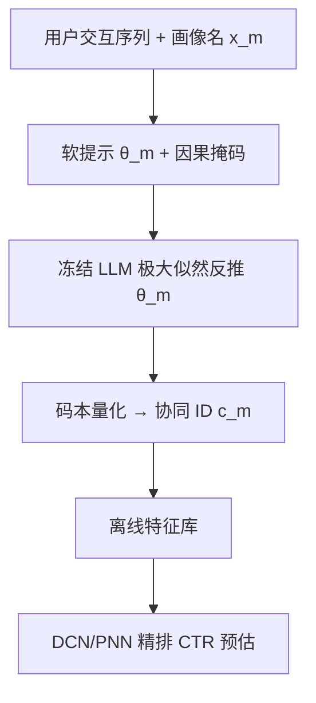
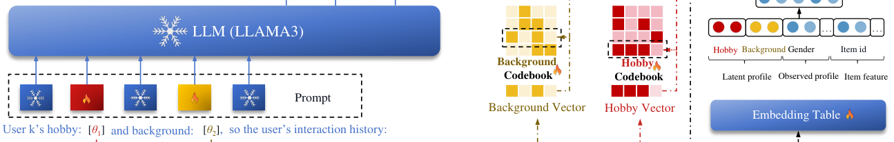

# Prompt Tuning as User Inherent Profile Inference Machine (提示调优作为用户固有画像推断机)

- **会议/期刊**: CIKM 2025
- **作者与机构**: Yusheng Lu, Zhaocheng Du 等（同济大学、华为诺亚方舟实验室、香港城市大学）
- **推荐链路定位**: 精排（特征增强，模型无关可插拔）
- **研究方向**: 大语言模型推荐 / CTR 预估与特征交叉
- **论文原文**: [https://arxiv.org/abs/2408.06577v3](https://arxiv.org/abs/2408.06577v3)
- **开源代码**: [https://github.com/Applied-Machine-Learning-Lab/UserIP-Tuning](https://github.com/Applied-Machine-Learning-Lab/UserIP-Tuning)

## TL;DR (1分钟核心速览)

推荐系统普遍缺失用户潜在画像（家庭背景、爱好等），直接用 LLM 生成画像文本会引入指令不稳定导致的文本噪声、语义-协同模态鸿沟与推理延迟。本文提出 UserIP-Tuning：把画像建模为提示模板中的可训练软 token，用因果掩码约束"画像名 $\to$软 token$\to$ 行为序列"的因果方向，以 EM 式极大似然反推软 token；再用受推荐损失监督的码本将其量化为稀疏协同 ID 存入特征库。在 4 个 Amazon/Yelp 数据集上 AUC 相对提升 4.77%/0.68%/3.49%/1.44%，线上 A/B 提升 7.47%。

## Background & Motivation (背景与核心矛盾)

- **主流范式**: KAR、LFM、PEPLER 等先用 LLM 以自然语言生成用户画像文本，再用 BERT 编码或直接拼入提示做推荐。
- **前人局限**: ① **因果倒置**——LLM 自回归地"先描述行为、后推画像"，而现实中画像是行为的因，语义错位损害泛化；② **文本噪声**——指令遵循不稳定与 CoT 冗余使生成画像夹杂大量无关词（图 1 中"个人品味"类白线噪声）；③ **模态鸿沟**——LLM 语义嵌入过于细粒度，RS 难以抽取协同信号；④ **推理低效**——十亿级 LLM 与 4096 维嵌入难以满足线上延迟。
- **核心洞察 (Key Insight)**: 画像本身是**不可观测的隐变量**，与其让 LLM"说"出来，不如把它当作提示中的可学习参数，用"行为序列的似然"反向推断——这正是 EM 的思想；推断后再压成离散 ID 即可绕开模态鸿沟。
- **本文切入点**: 软提示即画像、因果掩码即结构先验、码本量化即跨模态桥。

## Method (核心方法设计)

### 1. 整体框架 (Overall Architecture)

框架分三段闭环（图 3）：**UserIP 推断模块**冻结 LLM 全部参数，仅训练 $M$个画像软 token$\theta_1,\dots,\theta_M$，提示模板为 `[x1, θ1, x2, θ2, ..., D_task]`，其中$x_m$是画像名（如"This user's hobby is"），模型以生成真实交互序列的交叉熵为监督反推$\theta_m$；**UserIP 量化模块**为每类画像配一个大小$K_m$的码本，把$\theta_m$映射为最近码字索引$c_m$，并以推荐损失做直通梯度监督；**特征库**离线存储每个用户的$(c_1,\dots,c_M)$，线上仅需查表拼入 DCN 等任意精排模型，无需再跑 LLM。

<figure class="paper-figure" markdown="span">
  <figcaption>图3：UserIP-Tuning框架概览。此处展示了两个用户潜在画像：爱好和收入背景。UserIP-Tuning由UserIP推断模块、UserIP量化模块和预存的UserIP特征库组成。</figcaption>
</figure>

### 2. 关键设计拆解 (Key Designs)

1. **因果掩码软提示推断（Causal-Masked Soft Prompt）**：痛点是把画像名与软 token 交错排列后，注意力仍会串扰到无关词。本文设计下三角式块掩码，使 $\theta_m$只能关注自己的画像名$x_m$ 与行为 token，对其它画像名与任务描述完全屏蔽。推断目标为
$$\ell^{llm}_u=-\log P_{LLM}(y_{rec}\mid x_1,\theta_1,\dots,x_M,\theta_M)$$
直觉上这等价于在固定语言分布下做隐变量极大似然，作者进一步给出命题：画像类别数 $M$ 增大时该预测器趋近最优，为"多画像槽位"提供理论背书。

2. **协同监督的画像量化（Collaborative-Aware Quantization）**：LLM 语义空间中"语义远但协同近"的画像（啤酒-尿布式关联）会被纯语义量化错分。本文在标准 VQ 的承诺损失上叠加推荐损失，形成
$$\ell^{vec}_u=\sum_{m=1}^{M}\left[\|\mathrm{sg}[\theta_m]-v^k_m\|_2^2+\beta\|\theta_m-\mathrm{sg}[v^k_m]\|_2^2\right],\quad c_m=\arg\min_k\|\theta_m-v^k_m\|_2^2$$
第一项把码本拉向画像空间，第二项限制画像嵌入漂移速度；关键在于 $c_m$通过直通估计接受$\ell_{rec}$ 的梯度，使离散 ID 直接为 CTR 目标服务，而非仅为重建服务。

3. **训练目标与推理效率**：总损失 $\mathcal{L}=\ell^{llm}+\alpha\ell^{vec}+\gamma\ell^{rec}$，$\alpha=\beta=\gamma=0.001$；无需负采样（监督信号来自真实交互序列的下一 token 预测）。线上只需一次查表，实测 1.21s/万条，仅比纯 DCN 慢 0.28s，而 KAR 需 4.78s。

## Experimental Setup & Evaluation Protocol (实验设置与评估协议)

- **数据集与预处理**:

| 数据集 | #Users | #Items | #Interactions | 稀疏度 | 场景说明 |
| :--- | :---: | :---: | :---: | :---: | :--- |
| Clothing | 38,764 | 22,919 | 179,223 | 99.98% | Amazon 服饰鞋饰 |
| Movies | 7,506 | 7,360 | 441,783 | 99.20% | Amazon 影视 |
| Games | 2,490 | 8,912 | 19,927 | 99.91% | Amazon 电子游戏 |
| Yelp | 27,147 | 20,266 | 1,293,247 | 99.76% | 本地生活评论 |

- **数据划分与防穿越**: 按 8:1:1 比例随机划分训练/验证/测试（沿用 ReLLa 等 LLM4Rec 惯例），非时间切分，存在轻度未来信息泄漏风险。
- **排名评测协议**: 采用 CTR 式**逐样本二分类评估**（AUC、Logloss），而非 Full-Ranking 或 Sampled Ranking；相对提升按 $\text{R.I.}_{AUC}=\frac{AUC_{model}-0.5}{AUC_{base}-0.5}-1$计算，显著性$p\le 0.05$。
- **对比基线与超参**: 三类基线——浅层（FFM/AFM）、深层（DeepFM/AutoInt/ONN/PNN/DCN/DCNv2/FiBiNet 等）、LLM 类（KAR/PEPLER/ReLLa）；骨干为 Llama3-8B 与 Llama2-7B，嵌入 4096 维，batch=8，学习率 1e-3，爱好码本 $K_1=4$、背景码本$K_2=3$，下游 DCN 为 3 层、MLP 维度 (16,16)。

## Key Experimental Results (实验关键数据)

### 1. 主实验对比 (Main Results)

| 类型 | 方法 | Clothing AUC | Clothing Logloss | Movies AUC | Games AUC | Games Logloss | Yelp AUC |
| :--- | :--- | :---: | :---: | :---: | :---: | :---: | :---: |
| 浅层 | FFM | 0.5588 | 0.6212 | 0.7998 | 0.6946 | 0.8347 | 0.6931 |
| 深层 | DeepFM | 0.6015 | 0.5965 | 0.8061 | 0.7221 | 0.8659 | 0.7017 |
| 深层 | DCN | 0.6214 | 0.5322 | 0.8167 | 0.7317 | 0.7744 | 0.7259 |
| 深层 | DCNv2 | 0.6148 | 0.5848 | 0.8134 | 0.7263 | 0.7991 | 0.7237 |
| LLM | KAR | 0.6003 | 0.5925 | 0.8058 | 0.7136 | 0.8679 | 0.7146 |
| LLM | ReLLa | 0.6214 | 0.5320 | 0.8099 | 0.7322 | 0.7814 | 0.7290 |
| Ours | UserIP-Tuning-Llama2 | 0.6269 | 0.5126 | 0.8184 | 0.7393 | 0.7285 | 0.7314 |
| Ours | **UserIP-Tuning-Llama3** | **0.6272\*** | **0.5033\*** | **0.8189\*** | **0.7398\*** | **0.7225\*** | **0.7320\*** |
| — | **R.I. (AUC / Logloss)** | **4.77% / 5.73%** | — | **0.68% / 1.44%** | **3.49% / 7.18%** | — | **1.44% / 1.31%** |

### 2. 消融实验 (Ablation Study)

| 配置 | Clothing AUC | Clothing Logloss | Movies AUC | Games AUC | Games Logloss | Yelp AUC |
| :--- | :---: | :---: | :---: | :---: | :---: | :---: |
| w.o. quantization | 0.6201 | 0.5577 | 0.7966 | 0.7340 | 0.8429 | 0.7277 |
| K-Means 量化 | 0.6211 | 0.5318 | 0.8168 | 0.7297 | 0.8032 | 0.7307 |
| A.F. 聚类 | 0.6210 | 0.5567 | 0.8175 | 0.7301 | 0.8006 | 0.7308 |
| **UserIP-Tuning** | **0.6272** | **0.5033** | **0.8189** | **0.7398** | **0.7225** | **0.7320** |

### 3. 关键实验发现 (Key Findings)

1. **量化模块是最大增益来源**：去掉量化后 Clothing AUC 从 0.6272 掉到 0.6201、Games Logloss 从 0.7225 恶化到 0.8429；而 K-Means/A.F. 等纯语义聚类虽能部分恢复 AUC，却在 Logloss 上明显落后（Clothing 0.5318/0.5567 vs. 0.5033），证明协同监督的码本比语义聚类更能校准概率。
2. **码本宜小不宜大**：爱好码本从 4 增至 64 时 AUC 单调下降、Logloss 上升，背景码本在 $K_2=3$ 时最优（Games AUC 0.73931、Logloss 0.72851），说明过大码本把画像 ID 打散成冗余簇，反而稀释表征。
3. **可迁移且工业可用**：将画像 ID 迁移到 PNN/ONN/DCNv2 均带来一致增益（如 DCNv2 在 Clothing 上 AUC 0.6148→0.6263）；线上华为应用市场 Explore 页 7 天 A/B（2025-05-13 至 05-19）AUC 相对提升 7.4724%，推理仅 1.21s/万条，约为 KAR 的 1/4。

## Highlights & Limitations (亮点、对比与审稿批判)

- **与代表作对比 (vs. Prior Work)**: KAR 用提示"触发"画像文本再经 BERT 编码，噪声与延迟双高；ReLLa 走 LLM 全参/指令微调路线，成本重且未显式建模因果；PEPLER 依赖 LLM 生成画像做序列推荐。本文的本质差异是**把画像从"生成物"变为"可学习隐变量"**，并用离散 ID 完成语义到协同的落地。
- **可迁移亮点**: ① "软 token + 块因果掩码"可迁移到任何需要从行为反推隐因子的场景（如会话意图、场景标签）；② "推荐损失直通监督码本"可直接复用到 RQ-VAE 类语义 ID 生成式推荐，缓解纯重建目标与排序目标错位。
- **审稿级局限批判**: ① 评估仅用 AUC/Logloss 的逐样本二分类，缺少 Full-Ranking 的 Recall@K/NDCG@K，且 8:1:1 随机划分未做时间切分，存在信息泄漏隐忧；② 画像槽位数量 $M$、码本大小$K_m$ 需人工设定且对性能敏感（图 6/7），离线仍需跑一次 LLM 推断，冷启动新用户与画像漂移的更新机制未讨论。

## Rating (四维评分)

- **方法创新性 (Novelty)**: ⭐⭐⭐⭐ （把画像推断重构为软提示下的隐变量极大似然，因果掩码+协同码本组合新颖，并有命题级理论支撑）
- **评估协议与实验扎实度 (Protocol & Experiments)**: ⭐⭐⭐ （四数据集+迁移+消融+线上 A/B 完整，但仅 AUC/Logloss、随机划分、缺排序指标与显著性多数据集覆盖）
- **写作与数学规范度 (Clarity & Rigor)**: ⭐⭐⭐⭐ （公式与因果图清晰，EM 视角表述略松散，量化损失推导规范）
- **工业落地与复现价值 (Industrial & Practical Value)**: ⭐⭐⭐⭐⭐ （已上线 200 万 DAU，推理仅增 0.28s，代码开源，模型无关可插拔）

