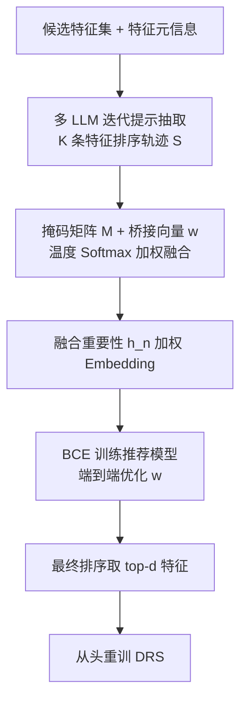
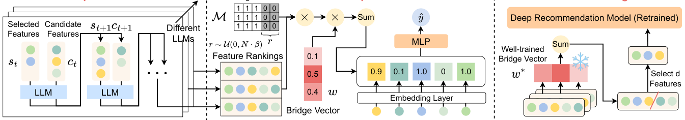

# SELF: Surrogate-light Feature Selection with Large Language Models in Deep Recommender Systems (面向深度推荐系统的代理轻量级 LLM 特征选择)

- **会议/期刊**: CIKM 2025
- **作者与机构**: Pengyue Jia, Xiaopeng Li, Yuhao Wang, Qidong Liu, Xiangyu Zhao (香港城市大学)；Zhaocheng Du, Yichao Wang, Huifeng Guo, Ruiming Tang (华为诺亚方舟实验室)
- **推荐链路定位**: 精排（CTR 预估前的特征工程环节）
- **研究方向**: 大语言模型推荐 / CTR 预估与特征交叉
- **论文原文**: [https://arxiv.org/abs/2412.08516v2](https://arxiv.org/abs/2412.08516v2)
- **开源代码**: 暂未开源（论文声称已释放代码，但未检测到公开仓库）

## TL;DR (1分钟核心速览)

深度推荐系统的特征选择长期依赖代理模型（树模型/门控网络/梯度敏感度）估计特征重要性，但在特征共线、高维稀疏、样本不足时代理模型本身欠拟合或过拟合，导致重要性估计失真。SELF 提出"代理轻量"范式：先用多个 LLM 通过迭代提示生成语义级特征重要性排序，再用一个可学习的桥接向量在推荐任务训练中对该排序做加权精炼与对齐，最后取 top-$d$ 特征重训模型。在 Movielens-1M / Aliccp / Kuairand 三个真实平台数据集上，SELF 的 AUC 全面超越 12 个 SOTA 基线（Movielens-1M 上 0.80480 vs. 次优 LPFS 0.80339），线上搜索广告 A/B 取得 CTR +3.01%、推理延迟 −13.6%。

## Background & Motivation (背景与核心矛盾)

- **主流范式**: 现有特征选择分三类——浅层统计法（Lasso/GBDT/RF/XGBoost）、门控法（AutoField/AdaFS/OptFS/LPFS）、敏感度法（Permutation/SFS/SHARK），三者本质上都先训练一个代理模型去逼近"特征→标签"映射，再以该模型的参数或梯度反推特征重要性。
- **前人局限**: 其一，冷启动或深层转化场景正样本极稀疏，代理模型欠拟合，重要性估计不可靠；其二，高基数特征众多时代理模型易过拟合，且难以刻画特征间的共线与互补依赖（如"经度"与"纬度"须成对出现才能定位地理坐标，代理模型往往只保留其一）。
- **核心洞察 (Key Insight)**: LLM 在海量网页语料上预训练，天然具备识别特征语义依赖与世界知识的能力，可在稀疏数据下给出合理的语义先验；但 LLM 的知识是通用域的，与具体推荐任务的数据分布存在 gap，不能直接替代数据驱动的代理模型。
- **本文切入点**: 让 LLM 只负责"语义排序"这一轻量环节，把"任务对齐"交给一个极小的桥接向量在推荐模型训练中端到端完成——即"代理轻量 (Surrogate-light)"，而非"代理替代"。

## Method (核心方法设计)

### 1. 整体框架 (Overall Architecture)

SELF 分三阶段闭环：(1) **特征重要性抽取**：将任务描述、数据集描述、特征元信息（名称/含义/类型/示例值/唯一值数）与已选/候选特征集组织成五段式提示，令 $K$个异构 LLM 各自迭代地从候选集中挑出一个最重要特征加入已选集，直至候选集为空，得到$K\times N$的特征选择轨迹矩阵$\mathbf{S}$；(2) **特征重要性精炼**：在推荐模型每个训练 batch 中，按 LLM 排序从最不重要端随机掩码$r\sim\mathcal{U}(0,N\cdot\beta)$个特征，用可学习桥接向量$\boldsymbol{w}$对$K$条排序加权融合，得到每个特征场的融合重要性$h_n$并加权其 embedding；(3) **重训**：用训练好的桥接向量计算最终排序，取 top-$d$ 特征从头重训推荐模型。

<figure class="paper-figure" markdown="span">
  <figcaption>图2：SELF概览。SELF包含三个阶段：(1) 特征重要性提取阶段，(2) 特征重要性精炼阶段，(3) 重训练阶段。</figcaption>
</figure>

### 2. 关键设计拆解 (Key Designs)

1. **迭代提示抽取 (Prompt Iteration)**：一次性让 LLM 输出全序会因任务过复杂而产生偏差，SELF 改为每步只问"从候选集中选一个最重要的特征加入已选集"，逐步收缩决策空间。第 $k$个 LLM 在第$t$ 步的选择与集合更新为
   $f_t^k=\mathrm{LLM}_k(\text{prompt},\boldsymbol{s}_t^k,\boldsymbol{c}_t^k),\quad \boldsymbol{s}_{t+1}^k=\boldsymbol{s}_t^k\cup\{f_t^k\},\ \boldsymbol{c}_{t+1}^k=\boldsymbol{c}_t^k\setminus\{f_t^k\}$其中$\boldsymbol{s}_0$ 初始化为 user ID 与 item ID 两个基础特征。单步决策让 LLM 聚焦于"当前最该补哪个特征"，同时天然规避已选特征带来的冗余，这正是代理模型难以捕捉的共线性问题。

2. **桥接向量与掩码精炼 (Bridge Vector + Masking)**：LLM 排序纯属语义先验，与任务重要性存在分布错配。SELF 引入可学习向量 $\boldsymbol{w}=[w_0,\dots,w_K]$，经温度缩放 Softmax 归一化为$\hat{w}_k=\mathrm{Softmax}(w_k\cdot e^{\tau})$，并对每个特征场聚合
   $h_n=\sum_{k=0}^{K}\hat{w}_k\sum_{t=0}^{N}\mathbb{I}[f_t^k=\boldsymbol{F}_n]\cdot m_t^k$其中$m_t^k$为掩码值（按排序从尾部随机置 0）。掩码迫使模型在"信息残缺"条件下学习，使桥接向量必须真正分辨哪条 LLM 排序在当前任务下更可信；温度$\tau$控制专家权重的锐度。最终 embedding 按$\boldsymbol{E}'=[h_1\hat{\boldsymbol{e}}_1,\dots,h_N\hat{\boldsymbol{e}}_N]$ 加权后送入 MLP。

3. **训练目标与推理开销**：以 CTR 二分类的 BCE 为损失 $\mathcal{L}=-\sum_i\left(y_i\log\hat{y}_i+(1-y_i)\log(1-\hat{y}_i)\right)$，桥接向量与推荐模型联合端到端优化，无需额外负采样。重训阶段将掩码值替换为线性衰减重要性$\mathrm{fi}_t^k=1-t/N$，聚合得$h_n^*=\sum_k\hat{w}_k^*\sum_t\mathbb{I}[f_t^k=\boldsymbol{F}_n]\cdot\mathrm{fi}_t^k$，取 top-$d$重训。LLM 调用仅在离线一次性完成（$K\times N$ 次），线上零额外开销，反而因特征裁剪降低推理延迟。

## Experimental Setup & Evaluation Protocol (实验设置与评估协议)

- **数据集与预处理**: 三个真实平台数据集，特征数从 9 到 96 覆盖"少特征—典型—多特征"三档：

| 数据集 | #Users | #Items | #Interactions | 特征数 | 场景说明 |
| :--- | :---: | :---: | :---: | :---: | :--- |
| Movielens-1M | 6,040 | 3,706 | 1,000,209 | 9 | 评分 >3 记为正样本 |
| Aliccp | 238,635 | 467,298 | 85,316,519 | 23 | 淘宝点击/转化 |
| Kuairand | 27,285 | 7,551 | 1,436,609 | 96 | 快手短视频 pure 版 |

- **数据划分与防穿越 (Splitting Strategy)**: Movielens-1M 与 Kuairand 采用 `7:2:1` 比例划分；Aliccp 沿用原始划分（50% 训练，其余验证/测试各半）。数据稀缺实验将训练+验证集缩减至原规模 5%。
- **排名评测协议 (Ranking Protocol)**: CTR 预估任务，报告 `AUC`（越高越好）与 `Logloss`（越低越好），非全库排序；论文指出 AUC 提升 0.001 即属显著。
- **对比基线与超参设置**: 12 个基线覆盖浅层（Lasso/GBDT/RF/XGBoost）、门控（AutoField/AdaFS/OptFS/LPFS）、敏感度（Permutation/SFS/SHARK）三类。Embedding 维度 $d=8$，batch size 4096，Adam lr=0.001；$K=3$（GPT-4、GPT-4o、GPT-3.5），最大掩码比$\beta=0.2$，温度$\tau=4.0$；每个实验重复 3 次取均值。

## Key Experimental Results (实验关键数据)

### 1. 主实验对比 (Main Results)

| 方法 | ML-1M AUC↑ | ML-1M Logloss↓ | Aliccp AUC↑ | Aliccp Logloss↓ | Kuairand AUC↑ | Kuairand Logloss↓ |
| :--- | :---: | :---: | :---: | :---: | :---: | :---: |
| No Selection | 0.78854 | 0.54367 | 0.61804 | 0.16190 | 0.77953 | 0.55872 |
| XGBoost | 0.80081 | 0.53075 | 0.61873 | 0.16176 | 0.77992 | 0.55806 |
| AutoField | 0.80315 | 0.53075 | 0.61922 | 0.16141 | 0.77997 | 0.55820 |
| LPFS | 0.80339 | 0.52822 | 0.61836 | 0.16189 | 0.77983 | 0.55824 |
| SHARK | 0.78904 | 0.54277 | 0.61928 | 0.16151 | 0.77995 | 0.55815 |
| SFS | 0.78927 | 0.54241 | 0.61897 | 0.16180 | 0.77981 | 0.55819 |
| **SELF** | **0.80480** | **0.52703** | **0.62015** | **0.16139** | **0.78002** | **0.55801** |
| Improv. vs 次优 | +0.18% | −0.23% | +0.14% | −0.01% | +0.01% | −0.01% |

### 2. 消融实验 (Ablation Study, Aliccp)

| 变体 | AUC↑ | Logloss↓ | 说明 |
| :--- | :---: | :---: | :--- |
| No Selection | 0.61804 | 0.16190 | 全特征基线 |
| w/o MM | 0.6189 左右 | 0.1615 左右 | 仅用单个 GPT-4 排序 |
| w/o IP | 0.6190 左右 | 0.1614 左右 | 一次性提示替代迭代提示 |
| w/o BV | 0.6193 左右 | 0.1614 左右 | 多 LLM 排序简单平均 |
| **SELF** | **0.62015** | **0.16139** | 完整模型 |

（消融数值以原文图 3 柱状图为准，此处为读图近似值。）

### 3. 关键实验发现 (Key Findings)

1. **数据越稀缺，SELF 优势越大**：训练集缩至 5% 后，Movielens-1M 上 SELF 达 AUC 0.72372，而 6 个基线（AdaFS 0.69554、OptFS 0.69641、LPFS 0.70213 等）反而低于 No Selection 的 0.70482——说明代理模型在欠拟合时给出的重要性信号是负资产，而 LLM 语义先验此时成为主要信息来源。
2. **特征数越少，增益越显著**：Movielens-1M（9 特征）上 SELF 相对 No Selection 的 AUC 提升约 2.06%，而 Kuairand（96 特征）仅约 0.06%，说明在特征冗余度低的小特征集上，精准剔除少数无关特征（如与 movie_id 高度共线的 title）收益最大。
3. **可迁移性与线上收益双验证**：SELF 选出的特征直接迁移到 FM/DeepFM/Wide&Deep/DCN 四个骨干均带来 AUC 提升（DCN 0.62271→0.62322），且越复杂的骨干增益越大；线上搜索广告部署后 RPM +0.63%、CTR +3.01%、推理延迟 −13.6%，验证了"离线 LLM 一次性调用 + 线上零开销"的工程可行性。

## Highlights & Limitations (亮点、对比与审稿批判)

- **与代表作对比 (vs. Prior Work)**: 与 AutoField/LPFS 等门控法相比，SELF 不把特征重要性完全托付给训练中的门控值，而是引入外部语义先验打破"代理模型自证"的循环；与纯 LLM 特征选择工作相比，SELF 用桥接向量显式对齐通用知识与任务分布，避免了 LLM 在推荐域上的知识 gap；与 SHARK/SFS 等敏感度法相比，SELF 在稀疏数据下不依赖可靠的梯度信号。
- **可迁移亮点**: (1) "多专家排序 + 可学习加权融合 + 随机掩码"这一组合可迁移到任何需要融合异构先验的排序/选择任务（如多路召回融合、多 LLM 标注聚合）；(2) 用线性衰减 $\mathrm{fi}_t=1-t/N$ 把离散排序转为连续重要性分数，是低成本将序数信号数值化的通用技巧。
- **审稿级局限批判**: (1) 依赖 GPT-4 等闭源商用 LLM，$K\times N$次调用在百级特征场景下成本与可复现性存疑，且 LLM 版本更新会导致排序漂移；(2) 主实验 AUC 提升幅度极小（Kuairand 仅 +0.00009），部分数据集上 Logloss 优势不足 0.001，统计显著性与实际业务收益的边界未被充分讨论；(3) 桥接向量仅$K+1$维，表达能力有限，且掩码比例$\beta$与温度$\tau$ 的敏感性分析仅覆盖单一数据集。

## Rating (四维评分)

- **方法创新性 (Novelty)**: ⭐⭐⭐⭐ （首次将"LLM 语义先验 + 代理模型任务精炼"以桥接向量形式统一，范式清晰，但各组件本身均为已有技术的组合）
- **评估协议与实验扎实度 (Protocol & Experiments)**: ⭐⭐⭐⭐ （三数据集 + 12 基线 + 迁移性 + 数据稀缺 + 超参 + 线上 A/B 覆盖完整，但主实验提升幅度小且缺显著性检验）
- **写作与数学规范度 (Clarity & Rigor)**: ⭐⭐⭐⭐ （三阶段流程与公式定义清楚，掩码矩阵与桥接向量推导完整，但消融仅以柱状图呈现、缺精确数值表）
- **工业落地与复现价值 (Industrial & Practical Value)**: ⭐⭐⭐⭐ （线上延迟反降 13.6% 极具说服力，但闭源 LLM 依赖与代码未实际公开削弱了复现性）

