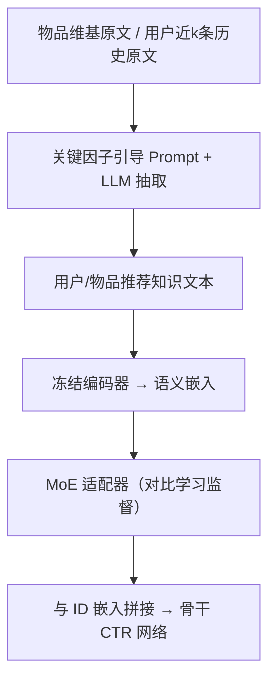
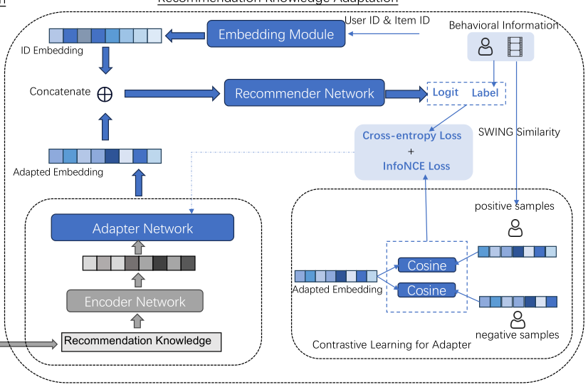

# TRAWL: External Knowledge-Enhanced Recommendation with LLM Assistance (LLM 辅助的外部知识增强推荐)

- **会议/期刊**: CIKM 2025
- **作者与机构**: Weiqing Luo, Chonggang Song, Lingling Yi, Gong Cheng（南京大学计算机软件新技术国家重点实验室、腾讯微信）
- **推荐链路定位**: 召回（线上用于相似物品召回池扩充）+ 精排特征增强（CTR 预估）
- **研究方向**: 大语言模型推荐 / CTR 预估与特征交叉
- **论文原文**: [https://arxiv.org/abs/2403.06642v2](https://arxiv.org/abs/2403.06642v2)
- **开源代码**: [internlm2-7b (所用 LLM 权重)](https://huggingface.co/internlm/internlm2-7b)（框架代码暂未开源）

## TL;DR (1分钟核心速览)

纯 ID 协同信号无法刻画物品内容相关性，而原始外部知识（维基百科长文）噪声大、且语义向量与行为向量存在空间鸿沟。TRAWL 用关键因子引导的 Prompt 让 LLM 同时完成"摘要去噪 + 常识推理"，产出用户/物品双侧推荐知识；再用 SWING 相似度构造正样本、以 InfoNCE 对比损失 + 多任务联合训练一个 MoE 适配器，把语义嵌入拉入推荐空间。在 MovieLens-1M 的 CTR 任务上，以 DIN/DIEN/DeepFM 三种骨干均取得最优 AUC 与 LogLoss（如 DIN 上 AUC 0.7812 vs. 无外部知识 0.7796），微信文章推荐 800 万用户线上 A/B 点击量 +0.310%、阅读时长 +0.360%、互动数 +0.543%。

## Background & Motivation (背景与核心矛盾)

- **主流范式**: 以用户/物品 ID 嵌入建模协同信号（DIN/DIEN/DeepFM 等 CTR 网络），外部知识增强则多走知识图谱实体链接或文本摘要路线。
- **前人局限**: ① 原始外部知识是自由长文本，有用信息高度分散，直接拼接反而引入噪声——实验中 `Raw` 知识在 DIN 上 AUC 仅 0.769，甚至低于不用外部知识的 0.7796；② 通用摘要模型（PEGASUS/CTRLsum）只做压缩不做常识推理，会丢掉"18 岁以下用户偏好奇幻片"这类隐式推荐信号，同样跑不过无知识基线。
- **核心洞察 (Key Insight)**: 抽取推荐知识本质是"带主题约束的摘要 + 常识推理"的复合任务，恰好落在 LLM 的能力区间内；而 LLM 直接生成知识（KAR 路线）受幻觉拖累，增益有限（DIN 上 0.7794）。
- **本文切入点**: 让 LLM 只做"从真实外部文本中抽取"而非"凭空生成"，再用行为监督的对比学习把语义嵌入适配到推荐空间，两个挑战分别由 Prompt 工程与适配器训练解耦解决。

## Method (核心方法设计)

### 1. 整体框架 (Overall Architecture)

框架分两段：**知识生成**阶段，对物品取维基页面原文，对用户取最近 $k$个交互物品的原文拼接（$\text{klg}_u=\text{klg}_1\oplus\cdots\oplus\text{klg}_k$），连同专家指定的关键因子（如题材、主题、奖项）与指令构造成 Prompt 送入 LLM，输出结构化的用户画像式偏好描述与物品属性描述；**知识适配**阶段，冻结语言编码器（BERT-base / bge-large-zh），用 MoE 适配器把语义嵌入映射到推荐空间，与 ID 嵌入拼接后送入任意骨干推荐网络。训练时适配器与推荐网络联合优化，推理时仅需一次离线 LLM 调用 + 轻量前向，线上用于相似物品召回扩充。

<figure class="paper-figure" markdown="span">
  <figcaption>图1：方法框架</figcaption>
</figure>

### 2. 关键设计拆解 (Key Designs)

1. **关键因子引导的双侧知识抽取**：痛点是无主题约束的摘要会漏掉推荐相关信号、且用户侧与物品侧描述口径不一致。做法是在 Prompt 中显式注入同一组关键因子，使用户侧（基于历史物品原文 + 人口属性）与物品侧（基于条目原文）产出对齐的语义描述，同时借 LLM 的常识推理把"年龄 35-44、教师"翻译成"偏好强角色、高制作水准、思辨主题"这类可直接用于匹配的偏好语句。有效性直觉：把"信息过滤"与"推理"两个子任务合并进一次生成，避免了摘要模型的信息损失。
2. **SWING 相似度正采样 + InfoNCE 适配器训练**：痛点是语义空间与行为空间不对齐，仅用推荐损失回传梯度信号太弱。TRAWL 用 SWING 相似度衡量行为近邻，缓解超级物品（super-item）对相似度估计的支配：
$$s(u,v)=\sum_{i\in I_u\cap I_v}\sum_{j\in I_u\cap I_v}\frac{1}{\alpha+\|U_i\cap U_j\|}$$
为每个用户/物品取 SWING 最高者作正样本，再以 InfoNCE 拉近正对：
$$\ell_{uu}=-\sum_{j=1}^{B}\log\frac{\exp(\mathbf{u}_j\cdot\mathbf{u}_{p_j}/\tau)}{\sum_{j'=1}^{B}\exp(\mathbf{u}_{j'}\cdot\mathbf{u}_{p_{j'}}/\tau)}$$
直觉：SWING 惩罚了"共现用户重叠度高"的伪相似对，使对比信号更贴近真实偏好结构；物品侧同构损失 $\ell_{ii}$ 对称施加。
3. **参数高效多任务联合训练**：总损失 $\mathcal{L}=\mathcal{L}_{rec}+w_1\ell_{uu}+w_2\ell_{ii}$，编码器全冻结，仅更新适配器与推荐网络；最优超参为$w_1=0.004$、$w_2=0.008$、$\tau=0.15$、batch 256、lr$1e{-}4$。负样本来自 in-batch 其余样本，无需额外负采样开销；LLM 调用完全离线，在线仅增加一次适配器前向，工程代价可忽略。

## Experimental Setup & Evaluation Protocol (实验设置与评估协议)

- **数据集与预处理**: 公开数据集 MovieLens-1M，外部知识取自维基百科 dump（按 WikiProject Movies 过滤电影实体，标题编辑距离匹配）；线上为微信文章推荐服务（800 万用户、100 万文章，知识库含 9600 万实体）。

| 数据集 | #Users | #Items | #Interactions | 稀疏度/密度 | 特征/场景说明 |
| :--- | :---: | :---: | :---: | :---: | :--- |
| MovieLens-1M | 6,640 | 3,883 | >1,000,000 | ~3.9% | 评分 >3 记为正样本，维基原文作外部知识 |
| WeChat 文章（线上） | 8M | 1M | — | — | 自建知识库 + 实体链接，Qwen1.5-7B 抽取 |

- **数据划分与防穿越 (Splitting Strategy)**: ML-1M 按**用户 8:1:1 比例划分**训练/验证/测试；线上正样本由前一日交互计算 SWING 相似度，避免未来信息泄漏。
- **排名评测协议 (Ranking Protocol)**: 本文任务是 CTR 预估而非 Top-N 排序，采用 **AUC 与 LogLoss** 两项指标，在全体样本上计算（非采样排序）；线上采用 A/B 实验的均值指标对比。
- **对比基线与超参设置**: 四类知识来源基线——`Raw`（原始知识直拼）、`w/o external knowledge`、`Basic Summary`（PEGASUS）、`Topic-focused Summary`（CTRLsum）、`LLM_KAR`（LLM 直接生成）；骨干网络为 DIN、DIEN、DeepFM 三种，验证 TRAWL 的算法无关性。编码器 BERT-base-uncased，LLM 为 internlm2-7b（线上 Qwen1.5-7B）。

## Key Experimental Results (实验关键数据)

### 1. 主实验对比 (Main Results)

MovieLens-1M CTR 任务（AUC 越高越好，LogLoss 越低越好）：

| Backbone | Knowledge Type | AUC | LogLoss |
| :--- | :--- | :---: | :---: |
| DIN | Raw | 0.7690 | 0.5639 |
| DIN | w/o external knowledge | 0.7796 | 0.5581 |
| DIN | Basic Summary | 0.7726 | 0.5625 |
| DIN | Topic-focused Summary | 0.7739 | 0.5602 |
| DIN | LLM_KAR | 0.7794 | 0.5545 |
| DIN | **TRAWL** | **0.7812** | **0.5538** |
| DIEN | w/o external knowledge | 0.7765 | 0.5599 |
| DIEN | LLM_KAR | 0.7776 | 0.5589 |
| DIEN | **TRAWL** | **0.7789** | **0.5572** |
| DeepFM | w/o external knowledge | 0.7788 | 0.5556 |
| DeepFM | LLM_KAR | 0.7787 | 0.5572 |
| DeepFM | **TRAWL** | **0.7792** | **0.5550** |

线上 A/B（微信文章推荐，800 万用户）：

| Model | Avg.CC | Avg.RS | Avg.IC |
| :--- | :---: | :---: | :---: |
| Online Model | 2.553 | 168.976 | 0.0618 |
| **TRAWL** | **2.561** | **169.584** | **0.0621** |
| Improv. | +0.310%±0.224% | +0.360%±0.302% | +0.543%±1.093% |

### 2. 消融实验 (Ablation Study)

| Backbone | Metric | TRAWL | w/o CL Loss | w/o Adapter |
| :--- | :--- | :---: | :---: | :---: |
| DIN | AUC | **0.7812** | 0.7767 (-0.58%) | 0.7749 (-0.81%) |
| DIN | LogLoss | **0.5538** | 0.5563 (+0.45%) | 0.5582 (+0.79%) |
| DIEN | AUC | **0.7789** | 0.7754 (-0.45%) | 0.7737 (-0.67%) |
| DIEN | LogLoss | **0.5572** | 0.5621 (+0.88%) | 0.5645 (+1.31%) |
| DeepFM | AUC | **0.7792** | 0.7750 (-0.54%) | 0.7732 (-0.77%) |
| DeepFM | LogLoss | **0.5550** | 0.5589 (+0.70%) | 0.5603 (+0.95%) |

### 3. 关键实验发现 (Key Findings)

1. **"去噪"比"加知识"更关键**：`Raw` 知识在 DIN 上 AUC 0.7690 反而低于无知识的 0.7796，说明原始长文本的噪声足以抵消语义增益；而 TRAWL 的 0.7812 相对无知识基线提升约 0.16 个 AUC 点，证明 LLM 抽取是外部知识生效的前提。
2. **摘要模型与 LLM 直接生成都不够**：PEGASUS/CTRLsum 在三种骨干上均跑不过 `Raw`（如 DIN 上 0.7726/0.7739 vs. 0.7690 虽略高但远低于 TRAWL），说明纯压缩丢失推荐信号；`LLM_KAR` 虽接近无知识基线（0.7794），但受幻觉限制无法超越"从真实文本抽取"的 TRAWL，验证了"辅助抽取而非生成"的设计选择。
3. **适配器与对比损失缺一不可，且对比损失贡献更大**：去掉 CL Loss 后 AUC 下降 0.45%–0.58%，再去掉整个适配器进一步降至 0.67%–0.81%，说明语义-行为空间鸿沟是主要瓶颈，而 SWING 正采样提供的监督信号是弥合鸿沟的核心驱动力；超参分析显示 $w_1$ 超过 0.01 后适配器会压过推荐主任务导致性能回落。

## Highlights & Limitations (亮点、对比与审稿批判)

- **与代表作对比 (vs. Prior Work)**: 相比 KAR/LLMRec/ONCE 等"让 LLM 直接生成知识"的路线，TRAWL 把 LLM 降级为抽取器，从源头规避幻觉；相比 UniSRec/KAR 用复杂 MoE 结构做适配，TRAWL 保持适配器结构简单，把创新放在 SWING 正采样的对比训练上，属于正交可叠加的改进；相比 DiffKG/KRDN 等图知识去噪方法，本文面向无结构自由文本，适用面更广但也不利用图结构先验。
- **可迁移亮点**: ① "关键因子对齐双侧 Prompt"可直接迁移到电商图文、短视频标签等需要用户-物品语义口径一致的知识注入场景；② SWING 正采样 + InfoNCE 的适配器训练范式与骨干无关，可低成本挂载到任意 CTR/召回模型上。
- **审稿级局限批判**: ① 公开实验仅 MovieLens-1M 单数据集，且 AUC 绝对增益仅约 0.1–0.2 个点，统计显著性未做检验，线上三项指标置信区间跨度较大（互动数 ±1.093%），增益稳健性存疑；② 依赖专家手工指定关键因子与维基实体链接质量，LLM 离线抽取成本与知识更新延迟未量化，冷启动物品若缺乏外部文本则方法退化。

## Rating (四维评分)

- **方法创新性 (Novelty)**: ⭐⭐⭐ （"LLM 抽取 + 对比适配"组合思路清晰但各组件均非首创，创新主要在 SWING 正采样与双侧关键因子对齐的工程化整合）
- **评估协议与实验扎实度 (Protocol & Experiments)**: ⭐⭐⭐ （三种骨干 + 五类知识基线 + 消融 + 线上 A/B 较完整，但仅单公开数据集、缺显著性检验与冷启动分桶分析）
- **写作与数学规范度 (Clarity & Rigor)**: ⭐⭐⭐⭐ （挑战-方法对应关系明确，公式简洁，超参敏感性分析到位；但部分符号如 $\alpha$ 取值与 SWING 复杂度未交代）
- **工业落地与复现价值 (Industrial & Practical Value)**: ⭐⭐⭐⭐ （LLM 调用全离线、编码器冻结、适配器轻量，已在微信 800 万用户规模验证，落地路径清晰；框架代码未开源略降复现便利度）

