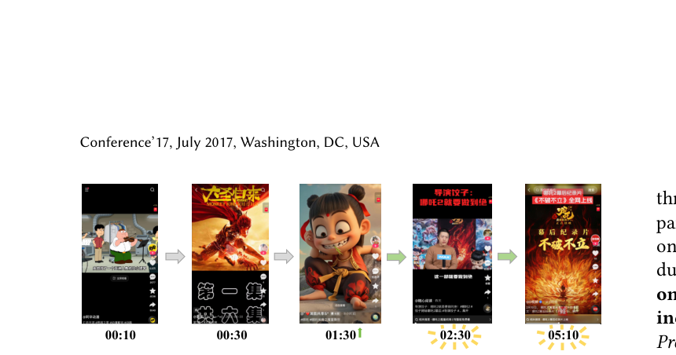
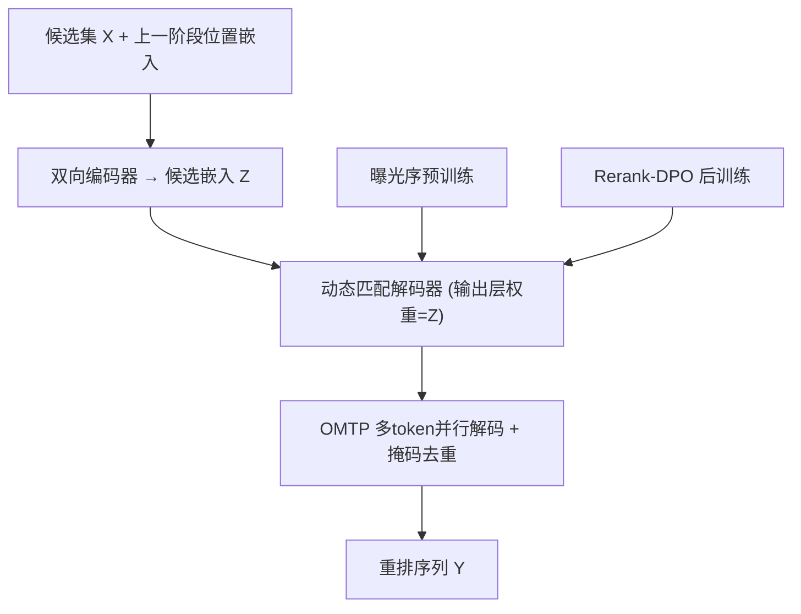
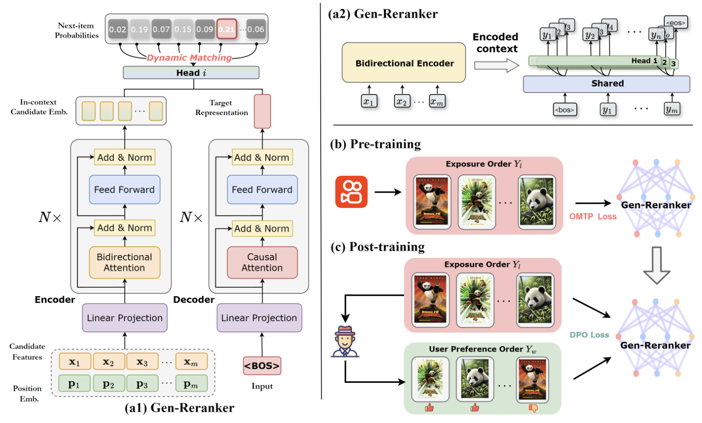

# GReF: A Unified Generative Framework for Efficient Reranking via Ordered Multi-token Prediction (基于有序多token预测的统一高效生成式重排框架)

- **会议/期刊**: CIKM 2025
- **作者与机构**: Zhijie Lin, Chenglei Dai, Shuai Lin, Enyun Yu (快手)；Zhuofeng Li, Haoxiang Zhang (上海大学)；Wentian Bao (独立)；Liang Zhao (Emory University)
- **推荐链路定位**: 重排 (Reranking)
- **研究方向**: 多任务学习与列表级重排 / 生成式推荐
- **论文原文**: [https://arxiv.org/abs/2510.25220v1](https://arxiv.org/abs/2510.25220v1)
- **开源代码**: 暂未开源

## TL;DR (1分钟核心速览)

针对两阶段 (generator-evaluator) 重排范式**生成器与评估器割裂导致无法端到端训练**、以及**自回归逐项解码推理延迟随序列长度线性增长**两大痛点，本文提出 GReF：以双向编码器 + 动态匹配自回归解码器构成 Gen-Reranker，先在曝光序上预训练、再用 Rerank-DPO 端到端对齐用户偏好（去掉评估器），并以有序多 token 预测 (OMTP) 并行解码。在 Avito 与快手工业数据集上，AUC 较 SOTA 的 NAR4Rec 分别提升 1.50%/1.33%，NDCG 提升 0.69%/0.73%，推理延迟 12.97ms 接近非自回归模型。

## Background & Motivation (背景与核心矛盾)

- **主流范式**: 重排分两类——一阶段方法 (PRM/DLCM) 对候选项逐项打分后贪心重排；两阶段方法 (PRS/PIER/DCDR/NAR4Rec) 用生成器产出多条候选序列、再由评估器按列表级分数择优。
- **前人局限**: ① 一阶段方法存在**内在矛盾**——重排改变了排列，项间相互影响随之变化，基于初始排列算出的精排分数不再可信；② 两阶段方法中生成器与评估器**割裂**，无法端到端训练，系统复杂度高、优化目标错位、泛化受限；③ 自回归生成器**逐项解码**，时间复杂度随序列长度线性增长，难以满足实时工业场景。
- **核心洞察 (Key Insight)**: 用户浏览行为本身具有强**因果依赖**（如图 1：看完《西游记之大圣归来》→ 浏览《哪吒》→ 再看哪吒系列 → 在末条视频停留数分钟），自回归建模天然契合这种时序逻辑；而推荐系统的**曝光序**蕴含了多级推荐系统沉淀的专家规则与上下文"世界知识"，是比稀疏点击反馈更充足的预训练信号。
- **本文切入点**: 用 DPO 把"评估"内化进生成器训练（去评估器、端到端），用 OMTP 把"逐项生成"改为"有序并行多 token 生成"（去延迟）。

<figure class="paper-figure" markdown="span">
  <figcaption>图1：具有因果依赖关系的用户浏览行为</figcaption>
</figure>

## Method (核心方法设计)

### 1. 整体框架 (Overall Architecture)

GReF 以 Gen-Reranker 为唯一模型：双向 Transformer 编码器对当前会话的 $m$个候选项（item 特征 + 上一阶段位置嵌入）做上下文编码得到$\mathbf{Z}=\{\mathbf{z}_1,\dots,\mathbf{z}_m\}$；自回归解码器逐步输出隐状态$\mathbf{h}_t$，并与$\mathbf{Z}$ 做**动态匹配**得到下一项分布。训练分三阶段：① 在曝光序上做 OMTP 预训练获得高质量初始化；② 用 Rerank-DPO 在偏好对上后训练，将序列级评估内化；③ 推理时 OMTP 并行解码 + 二值掩码去重。全流程无需独立评估器。

<figure class="paper-figure" markdown="span">
  <figcaption>图2：GReF 概览。GReF 由 Gen-Reranker 组成，其集成了双向编码器与带动态匹配的动态自回归解码器（a1）。具体而言，（a2）详细说明了 Gen-Reranker 如何通过 OMTP 同时生成多个未来项目。此外，GReF 采用结合预训练（b）与后训练（c）的有效训练框架。</figcaption>
</figure>

### 2. 关键设计拆解 (Key Designs)

1. **动态多物品预测 (Dynamic Multi-Item Prediction)**：推荐系统物品词表达十亿级且持续演化，标准全词表 softmax 不可行。本文直接用编码器输出的候选嵌入 $\mathbf{Z}$ **替换输出层权重**，构造 in-context 动态词表，只在当前候选集内归一化：
$$p_\theta(y_t\mid y_{0:t-1})=\frac{\exp(\mathbf{h}_t^\top \mathbf{z}_{y_t})}{\sum_{i=0}^{m}\exp(\mathbf{h}_t^\top \mathbf{z}_i)}$$
直觉：重排的输出空间本就是输入候选集的排列，把"从全库选 token"降维成"在候选集内匹配"，既消除十亿词表开销，又让打分天然携带列表上下文。

2. **Rerank-DPO 后训练（去评估器、端到端对齐）**：两阶段方法靠评估器择优，割裂训练。本文为曝光序中每项定义个性化分数 $S_i=\alpha\cdot\frac{1}{P_i}+\gamma\cdot U_i$（$P_i$为曝光位次，$U_i$为用户反馈 0/1），按$S_i$重排得到胜出序列$Y_w$，原曝光序为$Y_l$，构造偏好对后套用 DPO：
$$\mathcal{L}_{dpo}=-\min_{\pi_\theta}\mathbb{E}_{(Y_w,Y_l)}\Big[\log\sigma\Big(\beta\log\tfrac{\pi_\theta(Y_w)}{\pi_{ref}(Y_w)}-\beta\log\tfrac{\pi_\theta(Y_l)}{\pi_{ref}(Y_l)}\Big)\Big]$$
直觉：$\frac{1}{P_i}$项保留预训练学到的系统曝光知识、$U_i$ 项注入用户偏好，二者加权使对齐不破坏预训练知识；序列级偏好直接进损失，评估器被"内化"。

3. **有序多 token 预测 (OMTP) 与训练目标**：逐项解码延迟高。OMTP 用 $n$个输出头在**一次前向**中并行预测未来$n$ 项，并额外加**顺序损失**保证多头输出符合真实先后：
$$\mathcal{L}_{omtp}=\lambda_1\mathcal{L}_n+\lambda_2\mathcal{L}_o,\quad \mathcal{L}_o=-\sum_{t,\,S(Y^+)>S(Y^-)}\log\sigma\big(P_\theta(Y^+\mid y_{0:t-1})-P_\theta(Y^-\mid y_{0:t-1})\big)$$
其中 $\mathcal{L}_n$为多头交叉熵，$Y^+/Y^-$为按 NDCG 类打分函数$S$ 判定的正/负排列。总训练为"OMTP 预训练 → Rerank-DPO 后训练"两段式；负样本来自候选集内 in-context 竞争（无需全库负采样），推理时每步二值掩码屏蔽已选项。

## Experimental Setup & Evaluation Protocol (实验设置与评估协议)

- **数据集与预处理**:

| 数据集 | #Users | #Items | #Interactions/Requests | 稀疏度/密度 | 特征/场景说明 |
| :--- | :---: | :---: | :---: | :---: | :--- |
| Avito | 1.3M | 36M ads | 53M lists | 极稀疏 | 搜索页广告列表，每序列 5 个广告，前 21 天训练/后 7 天测试 |
| Kuaishou | 300M | 733M | 252M requests | 极稀疏 | 短视频，每请求 30 候选/10 曝光，预测是否入选曝光 10 条 |

- **数据划分与防穿越 (Splitting Strategy)**: Avito 采用**全局时间戳切分**（前 21 天训练、后 7 天测试）；Kuaishou 按请求级样本划分，预测"是否被选入曝光 10 条"。
- **排名评测协议 (Ranking Protocol)**: 采用 **AUC** 与 **NDCG** 两项列表级指标（沿用 DCDR/NAR4Rec/PIER 设定），非全库 Full-Ranking，而是在给定候选列表内评估重排质量。
- **对比基线与超参设置**: 7 个基线——pointwise (DNN, DCN)、一阶段 listwise (PRM)、两阶段 (Edge-Rerank, PIER, Seq2Slate, NAR4Rec)。编码器/解码器各 4 层 Transformer；Rerank-DPO 取 $\alpha=1,\gamma=1,\beta=0.1$；OMTP 取$n=4$（对齐快手一屏 4 视频）；Adam，学习率$5e{-6}$，batch 1024；5 个随机种子取均值。

## Key Experimental Results (实验关键数据)

### 1. 主实验对比 (Main Results)

| Method | Avito AUC | Avito NDCG | Kuaishou AUC | Kuaishou NDCG | 推理延迟 (ms) |
| :--- | :---: | :---: | :---: | :---: | :---: |
| DNN | 0.6614 | 0.6920 | 0.6866 | 0.7122 | 8.03 |
| DCN | 0.6623 | 0.7004 | 0.6879 | 0.7116 | 8.25 |
| PRM | 0.6881 | 0.7380 | 0.7119 | 0.7396 | 10.96 |
| Edge-Rerank | 0.6953 | 0.7203 | 0.7143 | 0.7401 | 10.45 |
| PIER | 0.7109 | 0.7401 | 0.7191 | 0.7387 | 13.69 |
| Seq2Slate | 0.7034 | 0.7225 | 0.7165 | 0.7383 | 67.34 |
| NAR4Rec | 0.7234 | 0.7409 | 0.7254 | 0.7425 | 12.67 |
| **GReF** | **0.7384** | **0.7478** | **0.7387** | **0.7498** | **12.97** |
| Improv.% (vs NAR4Rec) | +2.07% | +0.93% | +1.83% | +0.98% | +2.4% |

### 2. 消融实验 (Ablation Study)

| 配置 | AUC | NDCG | 说明 |
| :--- | :---: | :---: | :--- |
| 仅预训练 | 0.7361 | 0.7474 | 曝光序初始化已很强 |
| 仅后训练 (Rerank-DPO) | 0.6832 | 0.7103 | 冷启动直接 DPO 训练不稳/崩塌 |
| 预训练 + 后训练 | **0.7387** | **0.7498** | 完整两段式 |
| 预训练仅 $\mathcal{L}_n$（无$\mathcal{L}_o$） | 0.7373 | 0.7484 | 多头并行已接近全自回归 |
| 预训练 $\mathcal{L}_n+\mathcal{L}_o$ | **0.7387** | **0.7498** | 顺序损失带来增益 |

### 3. 关键实验发现 (Key Findings)

1. **后训练必须建立在预训练之上**：仅用 Rerank-DPO 直接训练时 AUC 从 0.7361 暴跌至 0.6832（-5.3pt），说明冷启动下对稀疏反馈直接做 RL 式 DPO 会训练不稳定甚至崩塌；而"预训练+后训练"相比仅预训练再涨 +0.26pt AUC / +0.24pt NDCG，验证了"曝光序初始化 → 偏好对齐"的级联必要性。
2. **OMTP 兼顾效率与精度**：去掉 OMTP 后延迟从 12.97ms 升至 24.29ms（近 2 倍），而仅用 $\mathcal{L}_n$多头并行（0.7373/0.7484）已接近完整自回归（0.7361/0.7474），叠加顺序损失$\mathcal{L}_o$ 再提升至 0.7387/0.7498——证明多 token 并行不仅提速，还能保持甚至提升精度。
3. **线上收益显著且集中在高互动行为**：快手 8% 流量一周 A/B 中，Views +0.33%、Long Views +0.42%（p<0.01，CI [0.31%,0.52%]）、Likes +1.19%、Comments +1.78%、Forwards +2.98%，转发/评论的大幅提升说明生成式重排更好地激发了深度互动而非仅曝光。

## Highlights & Limitations (亮点、对比与审稿批判)

- **与代表作对比 (vs. Prior Work)**: 相比 PIER/NAR4Rec 等两阶段方法，GReF 用 Rerank-DPO 把评估器内化，实现真正端到端；相比 Seq2Slate 的逐项指针解码（67.34ms），OMTP 将延迟压至 12.97ms（4×+ 加速）；相比 LLM4PR/LLM4Rerank 依赖零样本 LLM 的高推理成本，GReF 是轻量可实时部署的专用生成器。
- **可迁移亮点**: ① "用候选嵌入替换输出层权重"的动态 in-context 词表技巧，可迁移到任何候选集受限的生成式召回/重排；② "曝光序预训练 + 偏好对 DPO 后训练"的两段式范式，可复用到其他缺乏稠密反馈的排序任务。
- **审稿级局限批判**: ① 偏好对构造依赖 $\alpha,\gamma$手工加权与二值点击反馈，对反馈稀疏/多目标场景的鲁棒性未充分讨论；② 离线评估仅在 Avito（5 项序列）与快手两个数据集、以 AUC/NDCG 为主，缺少与排列级指标（如 list-level NDCG@k、多样性）的对比，且 OMTP 的$n=4$ 与 UI 强绑定，泛化性待验证。

## Rating (四维评分)

- **方法创新性 (Novelty)**: ⭐⭐⭐⭐ （动态 in-context 词表 + Rerank-DPO 去评估器 + 有序多 token 预测三件套组合新颖，但各组件均可溯源至 DPO/MTP 等已有工作）
- **评估协议与实验扎实度 (Protocol & Experiments)**: ⭐⭐⭐⭐ （公开+工业双数据集、7 基线、延迟对比与线上 A/B 齐全，但缺少排列级指标与更多数据集的泛化验证）
- **写作与数学规范度 (Clarity & Rigor)**: ⭐⭐⭐⭐ （公式推导清晰、符号统一，OMTP 顺序损失定义明确，复杂度分析略简）
- **工业落地与复现价值 (Industrial & Practical Value)**: ⭐⭐⭐⭐⭐ （快手 3 亿 DAU 全量部署、延迟接近非自回归、线上多指标显著提升，工程价值极高；可惜暂未开源）

