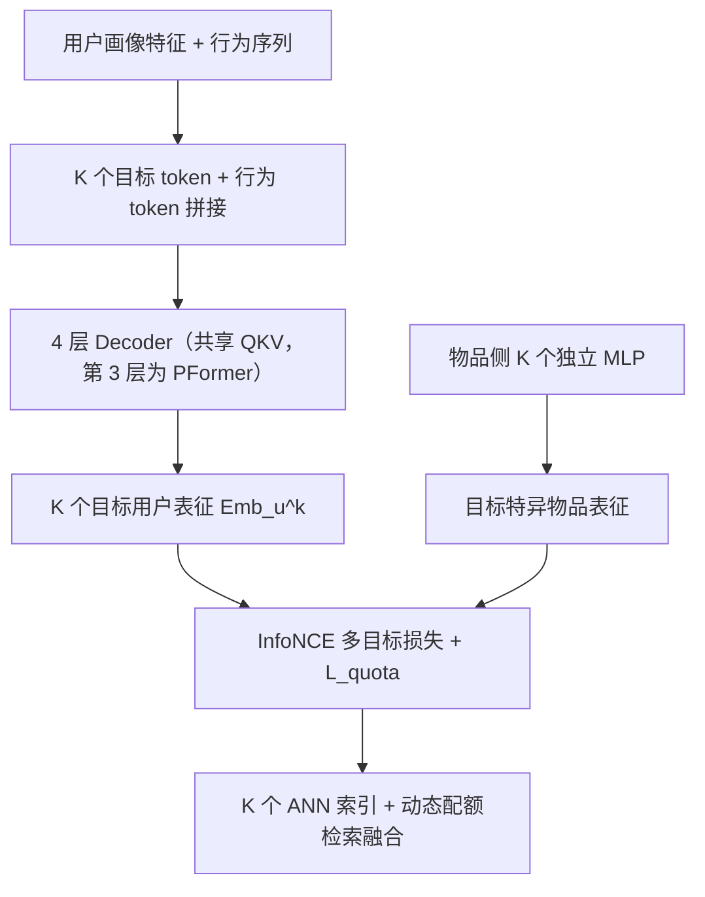
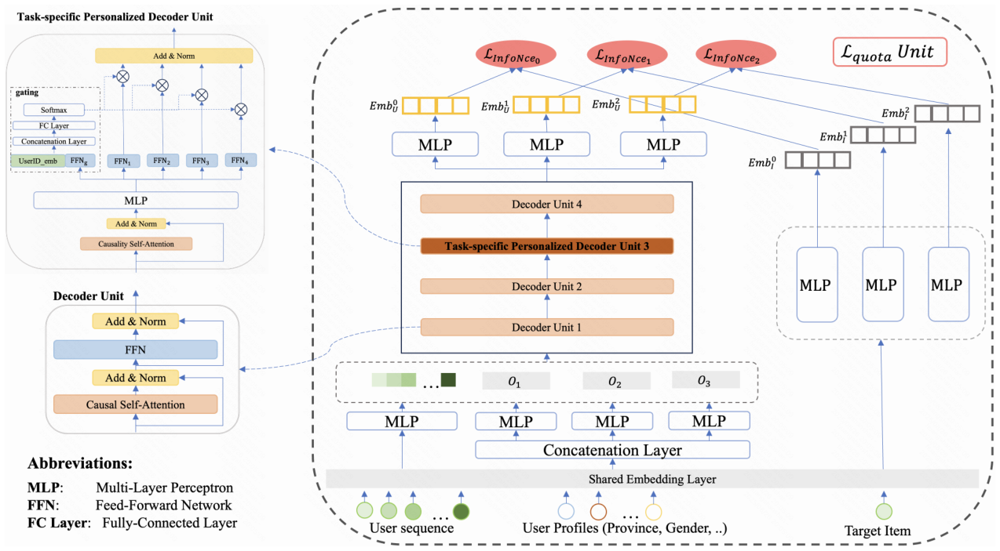
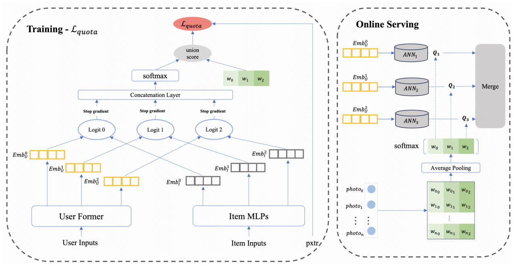

# MPFormer: Adaptive Framework for Industrial Multi-Task Personalized Sequential Retriever (面向工业多任务个性化序列召回的动态自适应框架)

- **会议/期刊**: CIKM 2025
- **作者与机构**: Yijia Sun, Shanshan Huang, Linxiao Che, Haitao Lu, Qiang Luo, Kun Gai, Guorui Zhou（快手科技）
- **推荐链路定位**: 召回（多目标 EBR 召回）
- **研究方向**: 多任务学习与列表级重排 / 协同过滤与双塔召回
- **论文原文**: [https://arxiv.org/abs/2508.20400v1](https://arxiv.org/abs/2508.20400v1)
- **开源代码**: 暂未开源

## TL;DR (1分钟核心速览)

工业推荐存在"多阶段优化错位"：精排已多目标化，召回仍是单目标，主流做法是并行多路单目标召回，导致训练/服务资源随目标数线性膨胀且无法处理弱耦合目标。MPFormer 提出目标条件化 Transformer，将 $K$ 个目标 embedding 作为 token 拼入用户行为序列共享一次注意力计算，并用精排融合分数监督学习物品级目标权重、聚合为用户级动态召回配额。在快手 6 天生产日志（50 亿训练交互）上，pro_lvr 的 Recall@100 从 57.27% 提升至 66.15%，线上 7 天 A/B 总观看时长 +0.426%，推理资源降低 66.7%。

## Background & Motivation (背景与核心矛盾)

- **主流范式**: 召回采用双塔 EBR + ANN 检索，精排采用多目标联合优化（CTR、观看时长、转化率）；为对齐精排，工业界普遍并行部署 $K$ 条单目标召回通路。
- **前人局限**: 其一，多模型范式保持目标纯度但训练与服务开销随 $K$ 线性增长，且跨目标信息流被割裂；其二，单模型范式（MVKE 的 MoE 虚拟专家、DMTL 蒸馏、MOPPR 列表损失）依赖预定义标签层级或级联目标，难以处理短视频场景中弱耦合、无包含关系的目标（pro_lvr / max_time / vtr 样本空间互不包含）。
- **核心洞察 (Key Insight)**: 作者发现用户/设备 ID 特征会主导学习，使不同目标的用户表征余弦相似度异常偏高（表征坍缩为 ID 映射），剔除 ID 后相似度回归近零正态分布，目标特异特征才得以学习；同时，物品侧共享 MLP 会使 Recall@100 掉 5%、NDCG@100 掉 6%，说明物品侧必须目标解耦。
- **本文切入点**: 用"目标即 token"的方式把多目标塞进同一个 Transformer 序列，让注意力在行为模式与目标语义之间建立动态交互，再用精排分数作为监督信号学出用户级动态配额。

## Method (核心方法设计)

### 1. 整体框架 (Overall Architecture)

用户侧输入由两部分构成：$K$个独立两层 MLP 对用户画像特征（年龄、性别、地域等稀疏 embedding，刻意不含用户 ID）变换得到的目标个性化 token$\mathbf{O}_k$，以及近期观看/点击/长播序列经 MLP 投影后的行为 token。二者拼接为长度$n+K$的序列送入 4 层 decoder stack，其中第三层替换为 PFormer 注入细粒度用户个性化，其余层为标准 decoder unit 且$K$个目标共享 QKV。最终取第$L$层对应$\mathbf{O}_k$位置的隐状态经 MLP 得到目标$k$的用户表征。物品侧用$K$ 个独立 MLP 生成目标特异物品 embedding，与用户表征做内积后经 InfoNCE 训练；线上为每个目标维护独立 ANN 索引，按动态配额并行检索后融合去重。

<figure class="paper-figure" markdown="span">
  <figcaption>图 1：所提出的 MPFormer 模型架构。(a) 用户侧输入由两部分组成：通过对用户画像特征应用 𝐾 个独立 MLP 生成的任务特定个性化 token，以及近期观看历史序列。(b) 四层 transformer 堆栈处理输入；第三层实例化为我们的 PFormer 以注入细粒度用户个性化，其余层遵循标准 Decoder Unit 设计。最终提取 𝐾 个隐藏状态作为多任务表示。(c) 联合损失函数将全部 𝐾 个任务的 InfoNCE 损失与</figcaption>
</figure>

### 2. 关键设计拆解 (Key Designs)

1. **目标条件化注意力与共享 QKV（Objective-Conditioned Transformer）**：传统 target-aware attention（如 DIN）要求物品与行为直接交互，与双塔召回约束不兼容；本文将 $K$个目标 embedding 直接追加到行为序列尾部，即$\mathbf{H}^{(0)}=\{\mathbf{t}_1,\dots,\mathbf{t}_n,\mathbf{O}_1,\dots,\mathbf{O}_K\}\in\mathbb{R}^{d\times(n+K)}$，用因果掩码自注意力让目标 token 从行为序列中"读取"与自身语义相关的模式。关键在于 QKV 跨目标共享：独立 QKV 的复杂度为$\mathcal{O}_{\text{independent}}=K\cdot\mathcal{O}((n+1)d^2+(n+1)^2d)$，共享后降为$\mathcal{O}_{\text{shared}}=\mathcal{O}((n+K)d^2+(n+K)^2d)$，二次项不再随$K$ 线性膨胀——实验证明独立 QKV 带来 1.4 倍模型体积与 80% 额外训练机器，却只换来约 2% 的 Recall@100 提升，性价比极低。

2. **PFormer 门控专家层（Task-specific Personalized Decoder Unit）**：仅在第三层注入专家模块，避免堆叠专家带来的二次开销。以用户 ID 与设备 ID 拼接的 $\mathbf{E}_u$作为门控信号：$\text{gate\_score}_i=\text{softmax}(\mathbf{W}_g[\mathbf{E}_u;\text{FFN}_g(\mathbf{x})]+\mathbf{b}_g)$，再经 top-$k$专家选择后加权聚合$\text{P-FFN}(\mathbf{x})=\sum_{i=1}^{\text{expertCut}}\text{gate\_score}_i\odot\text{FFN}_i(\mathbf{x})$。直觉是：ID 信息不适合进入主表征（会引发坍缩），但适合作为"路由信号"决定该用户应激活哪一组目标特异参数，从而在单层内实现用户级个性化而不污染语义空间。

3. **动态配额分配与训练目标**：物品级权重 $w_{ik}$以精排融合分数$pscore_i$为监督（对$s_k(u,i)$停梯度）学习：$\mathcal{L}_{\text{quota}}=\frac{1}{|\mathcal{N}|}\sum_{(u,i)\in\mathcal{N}}\left(pscore_i-\sum_{k=1}^{K}w_{ik}s_k(u,i)\right)^2$，且只在正样本（实际曝光物品）上计算——负样本从未展示，$pscore$无定义，限定正样本可规避分布漂移。线上对用户最近$n$个交互物品的权重做 softmax 聚合得$\tilde{\mathbf{w}}_u$，配额$Q_k(u)=\lfloor\tilde{w}_{uk}\cdot Q_{\text{total}}\rfloor$。总损失为$\mathcal{L}=\sum_{k\in K}\alpha_k\mathcal{L}_k$，其中$\mathcal{L}_k$为温度缩放 InfoNCE，$\alpha_k=\frac{\log(1+\gamma/|\mathcal{I}_k^+|)}{\sum_{k'}\log(1+\gamma/|\mathcal{I}_{k'}^+|)}$按标签频次反比重加权，抑制点击类高频目标压制稀有目标。负采样采用扩展 in-batch 策略：每个正样本对保留三个目标标签、共享$N-1$个负样本，内存从$\mathcal{O}(N^2)$降至$\mathcal{O}(N)$。

<figure class="paper-figure" markdown="span">
  <figcaption>图 2：动态配额分配机制。(a) 损失计算（L𝑞𝑢𝑜𝑡𝑎）：对于每个物品 𝑖 和目标 𝑘，权重 𝑤𝑖𝑘 使用后续阶段的排序分数作为监督信号进行学习。(b) 在线服务：推理时，系统计算各目标权重 {𝑤𝑘}𝐾</figcaption>
</figure>

## Experimental Setup & Evaluation Protocol (实验设置与评估协议)

- **数据集与预处理**: 快手短视频生产日志，连续 6 天，前 5 天 50 亿交互作训练、第 6 天 10 亿作测试；每条记录含用户 ID、物品 ID、观看时长、点击标志、时间戳及 15+ 侧特征。三个目标定义为：pro_lvr（观看时长超过该用户近 100 次曝光序列的 75 分位，样本占比 83%）、max_time（观看时长显著长于过去 $k$ 个物品，样本占比 15%）、vtr（观看时长归一化目标，样本占比 77%），三者样本空间无严格包含关系。

| 数据集 | #Users | #Items | #Interactions | 稀疏度/密度 | 特征/场景说明 |
| :--- | :---: | :---: | :---: | :---: | :--- |
| Kuaishou 离线基准 | 4 亿+ DAU 采样 | 十亿级物品池 | 50 亿训练 / 10 亿测试 | 极稀疏 | 短视频，15+ 侧特征，3 个弱耦合目标 |

- **数据划分与防穿越 (Splitting Strategy)**: 全局时间戳切分（第 1–5 天训练，第 6 天测试），严格按天隔离避免未来信息泄漏。
- **排名评测协议 (Ranking Protocol)**: 报告 Recall@{10,50,100} 与 NDCG@{1,10,100}，未明示是否全库排序，从指标量级（Recall@100 达 66%）推断为大规模候选池排序评估；线上采用 7 天实时 A/B，10% 流量随机分流。
- **对比基线与超参设置**: 基线为 KuaiFormer（Transformer 序列召回）、ComiRec（4 个兴趣头）、MVKE（4 个虚拟专家）；线上对比 Baseline（3 条 KuaiFormer 独立通路）、MPFormer_wo_dq（无动态配额）、MPFormer_w_eq（固定均分配额）。总候选容量统一为 $C=3000$。

## Key Experimental Results (实验关键数据)

### 1. 主实验对比 (Main Results)

| 目标 | 指标 | MVKE | ComiRec | KuaiFormer | MPFormer | Improv. |
| :--- | :--- | :---: | :---: | :---: | :---: | :---: |
| pro_lvr | Recall@50 | 15.44 | 40.46 | 45.84 | **56.55** | +23.4% |
| pro_lvr | Recall@100 | 27.57 | 52.99 | 57.27 | **66.15** | +15.5% |
| pro_lvr | NDCG@10 | 1.83 | 10.46 | 13.09 | **20.27** | +54.8% |
| max_time | Recall@50 | 11.79 | 50.12 | 36.99 | **63.91** | +27.5% |
| max_time | Recall@100 | 19.92 | 61.34 | 48.87 | **71.89** | +17.2% |
| max_time | NDCG@10 | 1.47 | 15.84 | 9.31 | **26.03** | +64.3% |
| vtr | Recall@50 | 13.88 | 44.09 | 35.80 | **53.99** | +22.5% |
| vtr | Recall@100 | 25.86 | 55.23 | 48.07 | **64.50** | +16.8% |
| vtr | NDCG@10 | 1.33 | 12.34 | 8.11 | **18.38** | +48.9% |

线上 A/B（相对提升）：总观看时长 **+0.426%**、总 App 使用时长 **+0.195%**、平均观看时长 **+0.455%**、Real Show −0.411%（优于 wo_dq 的 −0.840% 与 w_eq 的 −0.618%）。

### 2. 消融实验 (Ablation Study)

| 配置 | pro_lvr R@100 | max_time R@100 | vtr R@100 | pro_lvr N@100 | max_time N@100 | vtr N@100 |
| :--- | :---: | :---: | :---: | :---: | :---: | :---: |
| MPFormer | **0.662** | **0.719** | **0.645** | **0.270** | **0.324** | **0.253** |
| w/ item_shared_mlp | 0.633 | 0.691 | 0.626 | 0.254 | 0.306 | 0.249 |
| w/ independent_QKV | 0.683 | 0.735 | 0.662 | 0.283 | 0.335 | 0.262 |

### 3. 关键实验发现 (Key Findings)

1. **物品侧解耦是刚需，用户侧共享是划算的**：物品侧改用共享 MLP 后三个目标 Recall@100 分别掉 2.9/2.8/1.9 个点、NDCG@100 掉 1.6/1.8/0.4 个点；反之用户侧独立 QKV 虽能再涨约 2 个点，却需 1.4 倍模型体积与 80% 额外训练机器，作者选择共享 QKV 换取工程可行性。
2. **动态配额的价值体现在"止损"而非"增益"**：相比固定均分（w_eq），MPFormer 仅多贡献 0.03% 总时长，但把 Real Show 的跌幅从 −0.618% 收窄到 −0.411%，同时多目标召回曝光率从 6.76% 提升至 7.62%（+12.7%）、有效观看率 +1.3%——说明用户级配额主要作用是避免弱目标被强目标挤占曝光。
3. **目标稀疏度决定权重分布形态**：max_time 因样本稀疏权重高度分散（均值 < 0.33，标准差 0.21），pro_lvr 近似正态峰值在 $1/K$，vtr 正偏（中位数 0.41）且集中在$1/K$ 以上；用户级聚合配额为 pro_lvr 35% / max_time 18% / vtr 47%，与物品侧分布显著偏离，印证了用户级自适应的必要性。

## Highlights & Limitations (亮点、对比与审稿批判)

- **与代表作对比 (vs. Prior Work)**: 相比 KuaiFormer 等单目标序列召回，MPFormer 用一次前向同时产出 $K$ 个目标表征；相比 MVKE 依赖预定义标签层级的 MoE，本文不假设目标间包含关系，适配弱耦合目标；相比 MOPPR 的列表级损失，本文把目标对齐下沉到召回配额层面，并用精排分数做弱监督，形成"精排指导召回"的闭环。
- **可迁移亮点**: 其一，"目标 embedding 作为序列 token + 共享 QKV"是把多任务塞进单塔的极简范式，可直接迁移到多场景召回；其二，用下游精排融合分数监督上游配额权重（停梯度、仅正样本）是一种低成本的多阶段对齐技巧，可复用于粗排/召回的目标权重学习。
- **审稿级局限批判**: 其一，离线评估仅在快手单一工业数据集上进行，缺乏公开基准（如 Amazon、Taobao）验证，且未说明候选池规模与是否全库排序，Recall 绝对值偏高存疑；其二，动态配额依赖精排分数作为监督，存在精排-召回反馈回路风险，且 $\mathcal{L}_{\text{quota}}$的权重初始化与$\gamma$、$\tau$、expertCut 等超参敏感性未做分析；其三，PFormer 仅置于第三层的设计缺乏层位置消融支撑。

## Rating (四维评分)

- **方法创新性 (Novelty)**: ⭐⭐⭐⭐ （"目标即 token + 共享 QKV"思路简洁有效，但本质是 target-aware attention 在双塔约束下的工程化变体，理论新颖度中等）
- **评估协议与实验扎实度 (Protocol & Experiments)**: ⭐⭐⭐ （线上 4 亿 DAU、7 天 A/B 极具说服力，但离线仅单数据集、缺公开基准与显著性检验，消融维度偏少）
- **写作与数学规范度 (Clarity & Rigor)**: ⭐⭐⭐⭐ （复杂度推导与配额损失设计交代清晰，公式规范；但部分符号如 $\mathcal{N}$、$pscore$ 定义略简，层位置选择缺论证）
- **工业落地与复现价值 (Industrial & Practical Value)**: ⭐⭐⭐⭐⭐ （已在快手全量服务 400M+ DAU，P99 延迟稳定 80ms，推理资源降 66.7%、训练资源较 $K$ 模型降 60%，落地价值极高；可惜未开源）

