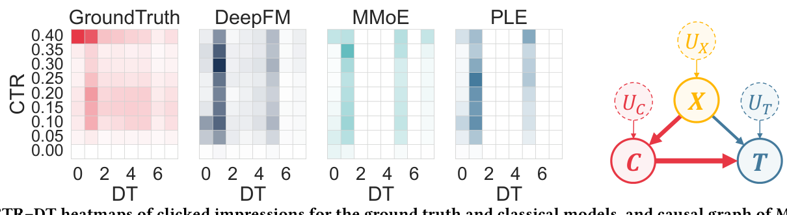
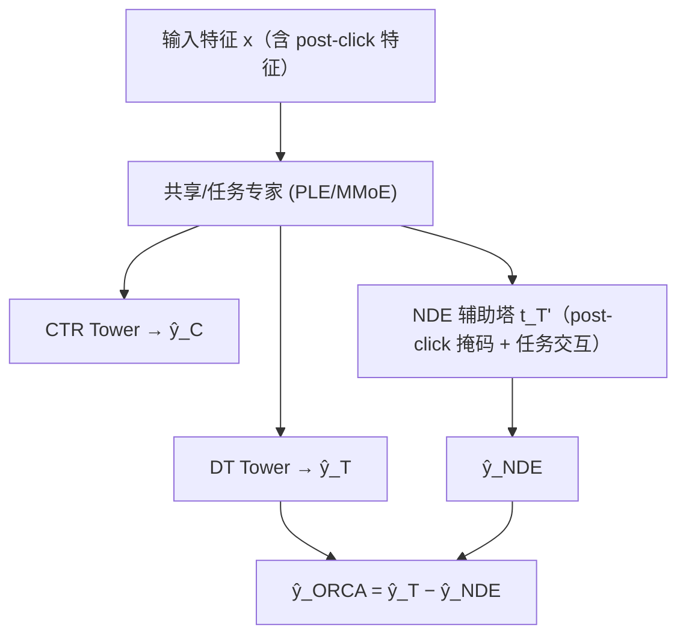

# ORCA: Mitigating Over-Reliance for Multi-Task Dwell Time Prediction with Causal Decoupling (基于因果解耦缓解多任务停留时间预测的过度依赖)

- **会议/期刊**: CIKM 2025 (Short Paper)
- **作者与机构**: Huishi Luo, Fuzhen Zhuang, Yongchun Zhu, Yiqing Wu, Bo Kang, Ruobing Xie, Feng Xia, Deqing Wang, Jin Dong（北航、中科院计算所、北航深算院等）
- **推荐链路定位**: 精排（多任务多目标预估）
- **研究方向**: 多任务学习与列表级重排 / CTR/CVR 预估与特征交叉
- **论文原文**: [https://arxiv.org/abs/2508.16573v1](https://arxiv.org/abs/2508.16573v1)
- **开源代码**: [https://github.com/Chrissie-Law/ORCA-Mitigating-Over-Reliance-for-Multi-Task-Dwell-Time-Prediction-with-Causal-Decoupling](https://github.com/Chrissie-Law/ORCA-Mitigating-Over-Reliance-for-Multi-Task-Dwell-Time-Prediction-with-Causal-Decoupling)

## TL;DR (1分钟核心速览)

多任务模型联合优化 CTR 与停留时间（DT）时，DT 预测会系统性塌缩到最短/最长分桶，中时长分桶（2–4、6）严重欠预测。作者将其归因于 CTR 监督主导（标签比 7.7:1）与 CTR–DT 虚假相关导致的过度依赖，提出 ORCA：用辅助塔显式建模并减去 CTR 介导的负迁移，配合特征级反事实掩码与任务交互+逆权重，在 2 个工业数据集与 Tenrec 上 DT 指标平均提升 10.6%，CTR AUC 不降。

## Background & Motivation (背景与核心矛盾)

- **主流范式**: 文章推荐以 CTR 为代理目标，但点击是二值粗反馈，易被标题党误导；业界普遍用 MMoE/PLE 等多任务框架联合预测 CTR 与 DT，借助 $X\to C\to T$ 路径让 CTR 监督缓解 DT 标签稀疏。
- **前人局限**: ① 任务不平衡——CTR 与 DT 标签比达 7.7:1，占 90% 以上参数的共享层被 CTR 监督主导，$X\to T$直接路径被削弱；② 因果纠缠——"曝光→点击→阅读"天然形成$C\to T$ 强相关，模型把 CTR 特征当作 DT 的预测捷径，学到"高 CTR→低 DT"的虚假关联。
- **核心洞察 (Key Insight)**: 真实标签与单任务 DeepFM 的 CTR–DT 热力图分布正常，而 MMoE/PLE 的预测几乎全部塌缩到 0–1、5、7 三个极端桶，中时长桶几乎为零——这是多任务特有的"中时长分桶欠表示"现象，而非数据本身问题。
- **本文切入点**: 不做全量因果解耦（会丢掉 CTR 的正迁移），而是只剥离 CTR 介导效应中的**负迁移分量**，保留有益知识共享。

<figure class="paper-figure" markdown="span">
  <figcaption>图1：真实标签与经典模型在点击曝光上的CTR–DT热力图，以及MTL的因果图。𝑋：输入，𝐶：点击，𝑇：停留时间，𝑈：未观测因素。</figcaption>
</figure>

## Method (核心方法设计)

### 1. 整体框架 (Overall Architecture)

以任意 MTL 骨干（PLE/MMoE/MetaBalance）为基础，输出 CTR 得分 $\hat{y}_C$与 DT 原始 logits$\hat{\boldsymbol{y}}_T$（DT 离散为$M=8$个 log 等距分桶做多分类）。在此之上挂一个辅助塔$t_{T'}$作为负依赖提取器（NDE），输入共享专家表征（可选融合 CTR/DT 任务交互表征），输出 CTR 诱导的负效应$\hat{\boldsymbol{y}}_{NDE}$，最终 DT 预测为$\hat{\boldsymbol{y}}_{ORCA}=\hat{\boldsymbol{y}}_T-\hat{\boldsymbol{y}}_{NDE}$。训练时对后点击特征做反事实掩码、对 NDE 损失做实例逆权重，并对 NDE 回传骨干的梯度做 stop-gradient，保证偏差捕获模块不污染主干。

### 2. 关键设计拆解 (Key Designs)

1. **负依赖提取器 NDE（显式量化并减去 CTR 介导负效应）**：由总效应分解 $TE=NIE+TDE$，直接取$TDE$会连正迁移一起丢掉。ORCA 令辅助塔仅以共享专家表征为输入（因 CTR 主导性主要源于共享专家），估计$\hat{\boldsymbol{y}}_{NDE}(\boldsymbol{x})=t_{T'}([e_S(\boldsymbol{x})])$，再做减法$\hat{\boldsymbol{y}}_{ORCA}=\hat{\boldsymbol{y}}_T-\hat{\boldsymbol{y}}_{NDE}$。直觉：$\hat{\boldsymbol{y}}_{NDE}$ 越大说明 CTR 诱导偏差越强，减掉它即得去偏 logits，同时保留骨干中 CTR 的正向知识。

2. **特征级反事实干预 + 任务交互逆权重（切断虚假捷径）**：MTL 中 $X\to T$与$X\to C\to T$纠缠在共享表征里，无法像性别偏差那样直接干预。作者用 leave-one-feature-out 找出几乎只影响 DT 的后点击特征$x_{post}$（发布时间、类目），以概率$p_{fea}$掩码为$\boldsymbol{x}=(x\setminus x_{post},[\text{MASK}])$，迫使 NDE 只捕获 CTR 介导线索；同时用多头自注意力构造$\text{Inter}(e_C,e_T)$显式实例化$C\to T$ 路径，并按
$$w_i=(\mathcal{L}_{C,i})^{-\alpha}\cdot\mathcal{L}_{T,i}+\gamma,\ \alpha\ge 0$$
给"CTR 准但 DT 错"的样本更高 NDE 损失权重，精准校准虚假负相关。

3. **训练目标、负采样与推理效率**：总损失 $\mathcal{L}=\mathcal{L}_C+\mathcal{L}_T+\mathcal{L}_{ORCA}$，其中 DT 相关损失仅在点击样本$\mathcal{S}^+$上计算，$\mathcal{L}_{ORCA}=\frac{1}{\sum_{i\in\mathcal{S}^+}w_i}\sum_{i\in\mathcal{S}^+}\left(-w_i\sum_{j=1}^{M}y_{T}^{i,j}\log\hat{y}_{ORCA}^{i,j}\right)$。无需负采样（多分类 softmax 全桶归一），NDE 回传梯度被截断；推理仅多一次轻量 MLP 前向，模型无关、即插即用。

## Experimental Setup & Evaluation Protocol (实验设置与评估协议)

- **数据集与预处理**: 两个真实文章推荐系统日志 + 公开 Tenrec；DT 按 $\log t$ 等距分 8 桶（对齐线上系统）。

| 数据集 | #Users | #Items | #Interactions(Clicks) | 稀疏度/密度 | 特征/场景说明 |
| :--- | :---: | :---: | :---: | :---: | :--- |
| DS183K | 13K | 77K | 183K / 25K clicks | 极稀疏 | 工业文章推荐，含后点击特征 |
| DS651K | 24K | 166K | 651K / 84K clicks | 极稀疏 | 工业文章推荐，含后点击特征 |
| Tenrec | 66K | 71K | 9.8M / 1.57M clicks | 稀疏 | 公开多行为数据集，无干预所需物品特征 |

- **数据划分与防穿越 (Splitting Strategy)**: 工业日志按线上曝光/阅读日志构建，未采用 LOO；Tenrec 沿用公开划分，未见显式时间戳切分说明（短论文披露有限）。
- **排名评测协议 (Ranking Protocol)**: 非全库排序任务，而是逐曝光样本的多分类/二分类打分评估；DT 主指标为分类口径 $\text{MAE}_{class}$、$\text{RMSE}_{class}$、Weighted F1、Macro P/R，回归 MAE/RMSE 仅作参考（分桶非均匀会有偏）；CTR 用 AUC。
- **对比基线与超参设置**: 单任务 NFM/DeepFM/AutoInt/AFN/DCN-V2，多任务 MMoE/ESMM/PLE/AITM/MetaBalance/EXUM；ORCA 分别挂载 MMoE、PLE、MetaBalance 三种骨干，网格搜索调参，显著性用配对 t 检验 $p<0.05$。

## Key Experimental Results (实验关键数据)

### 1. 主实验对比 (Main Results)

DS651K 代表性结果（↓ 越低越好，AUC ↑）：

| 方法 | MAE_class↓ | RMSE_class↓ | F1↑ | Macro-P↑ | AUC↑ |
| :--- | :---: | :---: | :---: | :---: | :---: |
| DeepFM (单任务) | 1.492 | 2.237 | 0.337 | 0.293 | 0.759 |
| DCN-V2 | 1.524 | 2.252 | 0.331 | 0.278 | 0.760 |
| ESMM | 1.503 | 2.253 | 0.322 | 0.257 | 0.727 |
| AITM | 1.520 | 2.284 | 0.316 | 0.266 | 0.739 |
| MMoE | 1.497 | 2.261 | 0.327 | 0.279 | 0.755 |
| **MMoE+ORCA** | **1.398** | **1.999** | **0.361** | **0.323** | **0.759** |
| PLE | 1.501 | 2.269 | 0.324 | 0.270 | 0.763 |
| **PLE+ORCA** | **1.414** | **2.128** | **0.356** | **0.325** | **0.764** |
| MetaBalance | 1.491 | 2.254 | 0.324 | 0.264 | 0.765 |
| **MB+ORCA** | **1.366** | **2.061** | **0.361** | **0.317** | 0.763 |

DS183K 上 MMoE+ORCA 将 MAE_class 从 1.452 降至 1.179（约 18.8%），F1 从 0.403 升至 0.448；Tenrec 上 PLE+ORCA 将 MAE_class 从 1.041 降至 0.964。三数据集 DT 指标平均提升 10.6%，CTR AUC 与最佳基线持平（如 DS651K 上 0.759 vs 0.765，差异不显著）。

### 2. 消融实验 (Ablation Study)

DS651K 上以 MMoE 为骨干（图 3 数值趋势）：

| 变体 | MAE_class↓ | F1↑ | Macro-P↑ | 说明 |
| :--- | :---: | :---: | :---: | :--- |
| base (MMoE) | ~1.497 | ~0.327 | ~0.279 | 仅骨干 |
| +FCI | 下降 | 上升 | 上升 | NDE 塔 + 特征反事实掩码 |
| +SCD | 下降 | 上升 | 上升 | 任务交互 + 实例逆权重 |
| **ORCA (全量)** | **1.398** | **0.361** | **0.323** | 两模块叠加最优 |

### 3. 关键实验发现 (Key Findings)

1. **中时长桶恢复是增益主因**：图 4(a) 显示 MMoE 在桶 2/3/4/6 几乎零预测，ORCA 在这些桶分配了可观概率质量，直接对应 MAE_class 从 1.497→1.398 的下降，说明增益来自语义恢复而非整体偏移。
2. **虚假相关被显著校正**：图 4(b)(c) 中 MMoE 对高 CTR 低 DT 文章系统性高估、对低 CTR 高 DT 文章系统性低估（误差与 CTR 正相关），ORCA 误差分布近似无偏，验证 NDE 减法确实剥离了 CTR 诱导偏差。
3. **负迁移建模不伤正迁移**：三种骨干上 CTR AUC 均与各自基线持平（DS651K：MMoE 0.755→0.759，PLE 0.763→0.764），说明只减负分量、保留正迁移的设计目标达成，且模型无关性得到跨骨干验证。

## Highlights & Limitations (亮点、对比与审稿批判)

- **与代表作对比 (vs. Prior Work)**: 相比 MMoE/PLE/MetaBalance 只促进正迁移、反而加剧 CTR 主导，ORCA 首次显式解耦负迁移；相比 AECM 需复杂对抗训练处理 CTR–CVR 偏差，ORCA 是轻量即插即用模块；相比视频观看时长方法依赖已知视频总时长，ORCA 面向无时长先验的文章 DT 场景。
- **可迁移亮点**: ① "辅助塔估计偏差 + 减法去偏 + stop-gradient" 的范式可直接迁移到 CTR–CVR、CTR–完播率等任意存在强耦合的 MTL 任务；② leave-one-feature-out 定位任务专属特征再做掩码，是低成本构造反事实输入的实用技巧。
- **审稿级局限批判**: ① 后点击特征需人工 leave-one-feature-out 筛选，Tenrec 因缺该特征无法完整复现干预模块，跨域自动化程度不足；② 仅 8 桶离散化 + 短论文规模实验，缺少线上 A/B 与延迟数据，NDE 塔在超大规模精排中的推理开销与 $\alpha,\gamma,p_{fea}$ 敏感度未充分讨论。

## Rating (四维评分)

- **方法创新性 (Novelty)**: ⭐⭐⭐⭐ （把"中时长塌缩"归因为 CTR 负迁移并用减法式因果解耦解决，视角新颖且有因果图支撑，但组件本身较朴素）
- **评估协议与实验扎实度 (Protocol & Experiments)**: ⭐⭐⭐⭐ （2 工业 + 1 公开数据集、3 种骨干、配对 t 检验与分布级 case study 齐全，但缺线上 A/B 与时间切分细节）
- **写作与数学规范度 (Clarity & Rigor)**: ⭐⭐⭐⭐ （因果分解 $TE=NIE+TDE$ 到 NDE 减法的推导链条清晰，公式紧凑；短论文对掩码概率与权重超参的理论分析略浅）
- **工业落地与复现价值 (Industrial & Practical Value)**: ⭐⭐⭐⭐⭐ （模型无关、仅加一个轻量辅助塔、推理开销极小，代码已开源，直接可挂载现有精排 MTL 骨干）

