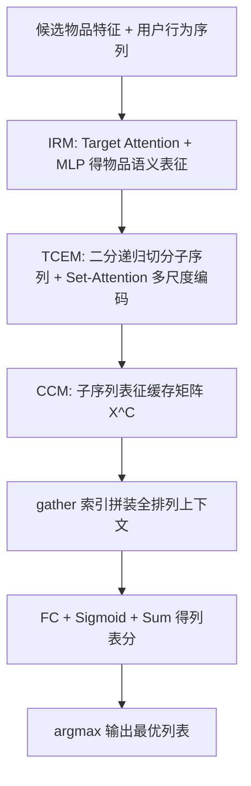
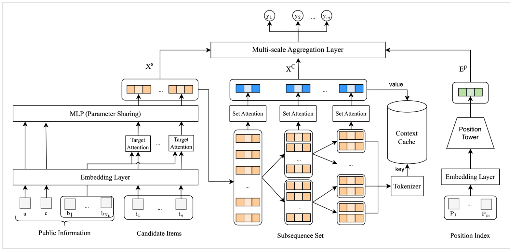

# You Only Evaluate Once: A Tree-based Rerank Method at Meituan (美团 YOLOR：一次评估即得最优列表的树状重排方法)

- **会议/期刊**: CIKM 2025
- **作者与机构**: Shuli Wang, Yinqiu Huang, Changhao Li, Yuan Zhou 等（美团）
- **推荐链路定位**: 重排
- **研究方向**: 多任务学习与列表级重排
- **论文原文**: [论文原文链接](https://arxiv.org/abs/2508.14420v1)
- **开源代码**: 暂未开源

## TL;DR (1分钟核心速览)

两阶段重排（GSU 粗筛 + ESU 精评）存在严重的**阶段不一致问题**：GSU 因时延约束设计简单，常把高价值列表漏掉，导致 HR 上限受限。本文提出单阶段 YOLOR，用**树状上下文提取模块 (TCEM)** 分层聚合多尺度上下文保证列表级效果，用**上下文缓存模块 (CCM)** 在排列间复用子序列表征保证排列级效率，从而直接遍历全排列空间。在 Taobao Ad 与美团工业数据上，GAUC 分别提升 0.0113/0.0111，线上 CTR +5.13%、GMV +7.64% 且时延不增。

## Background & Motivation (背景与核心矛盾)

- **主流范式**: 重排分两类——生成式（PRM/MIR/GRN 直接产出列表）与评估式（PRS/PIER 先粗筛候选排列再精评）。工业界主流是评估式两阶段：GSU 压缩排列空间，ESU 精确打分。
- **前人局限**: ① **不一致问题**：GSU 受时延约束只能简单设计，与 ESU 目标错位，高价值列表常被漏筛，HR 成为效果天花板；② **上下文尺度单一**：现有 ESU 多用单层全局 self-attention，而列表内物品影响窗口可能跨 2、4 乃至整条列表，缺乏多尺度建模。
- **核心洞察 (Key Insight)**: 排列空间的爆炸性来自"重复计算"而非"计算本身复杂"——同一子序列在不同排列中被反复编码，若能把子序列表征缓存复用，全排列遍历的代价可降到可接受范围。
- **本文切入点**: 砍掉 GSU，只保留 ESU，用树状分层子序列 + 缓存复用把 $O(A_m^n)$ 的编码开销摊薄为一次性子序列编码。

## Method (核心方法设计)

### 1. 整体框架 (Overall Architecture)

输入为排序阶段给出的 $n$个候选物品及其用户/上下文特征，IRM 先产出每个物品的语义表征$\mathbf{X}^s$；TCEM 对列表做二分递归切分，得到覆盖所有尺度的子序列集合，逐个子序列过无位置编码的 Set-Attention 得到多尺度上下文表征；CCM 将这些子序列表征一次性缓存为矩阵$\mathbf{X}^C$，对全排列空间$\mathcal{L}$仅用 `gather` 索引拼装 + 单层 FC + 求和即可批量打分，取$\arg\max$ 输出最优列表。训练用曝光列表日志做交叉熵 + GBPR 组内对比损失。

<figure class="paper-figure" markdown="span">
  <figcaption>图3：YOLOR 的整体架构。</figcaption>
</figure>

### 2. 关键设计拆解 (Key Designs)

1. **树状上下文提取模块 TCEM（多尺度上下文）**：针对单层注意力无法覆盖跨 2/4/整表影响窗口的问题，将列表不断二分直至子序列只剩 2 个物品，得到 $\mathcal{C}=\{L, L_{1,m/2}, L_{m/2+1,m},\dots,L_{t,t+1}\}$；对含目标物品$x_t$的所有子序列分别做**无位置编码**的 Set-Attention，拼成$\mathbf{X}^C_t\in\mathbb{R}^{D\cdot\log_2 m}$，再与绝对位置表征$\mathbf{E}^p_t$、物品表征$\mathbf{X}^s_t$拼接后过共享 FC：$\hat{y}_t=\sigma(\mathrm{FC}(\mathbf{E}^p_t\|\mathbf{X}^s_t\|\mathbf{X}^C_t))$。去掉位置编码是关键——使同一子序列在不同排列中表征完全一致，才可复用；多尺度拼接则让模型自适应选择合适的影响窗口。

2. **上下文缓存模块 CCM（排列级效率）**：针对全排列重复编码的痛点，先对全排列空间出现的**所有子序列**（规模仅 $\sum_k C_k^n$）编码一次存入$\mathbf{X}^C$，再用与请求无关的索引矩阵$M_{\text{indices}}\in\mathbb{R}^{A_m^n\times m\times\log_2 m}$通过 `tf.gather` 取出每个排列所需上下文：$\hat{\mathbf{y}}_{\mathcal{L}}=\mathrm{reduce\_sum}\big(\sigma(\mathrm{FC}(\mathrm{tile}(\mathbf{E}^p)\|\mathbf{X}^C_{\mathcal{L}}))\big)$。以$n=m=8$为例，40320 个排列只需缓存 107 条子序列表征，剩余唯一$O(A_m^n)$ 开销仅是单层 FC，故可在线全遍历。

3. **训练目标、负采样与推理效率**：总损失 $\mathcal{L}=\frac{1}{|\mathcal{B}|}\sum_{\mathcal{B}}(\mathcal{L}_{ce}+\alpha\cdot\mathcal{L}_{gbpr})$，其中$\mathcal{L}_{gbpr}=-\frac{1}{m}\sum_t\log\big(\mathrm{sgn}(y_i-y_j)(\hat{y}_i-\hat{y}_j)\big)$ 为组内 BPR，强化同一曝光列表内正负样本的对比；另设 dropout 随机遮蔽上下文增强鲁棒性。**免负采样**（直接用曝光日志的 listwise 标签），推理时全排列一次前向 + gather，无需 beam search 或哈希粗筛。

## Experimental Setup & Evaluation Protocol (实验设置与评估协议)

- **数据集与预处理**: 样本均为 list-level（一条记录含一次曝光列表全部物品），过滤掉标签全 0 或全 1 的样本。

| 数据集 | #Users | #Items | #Interactions | 稀疏度/密度 | 特征/场景说明 |
| :--- | :---: | :---: | :---: | :---: | :--- |
| Taobao Ad | 1,141,729 | 99,815 | 26,557,961 | 极稀疏 | 展示广告，5 特征 4 类行为，列表长 5（全排列 120） |
| Meituan | 5,648,310 | 14,054,691 | 161,247,488 | 极稀疏 | 外卖工业数据，239 特征，click/conversion 双标签，列表长 8（全排列 40320） |

- **数据划分与防穿越 (Splitting Strategy)**: **全局时间戳切分**——Taobao 前 7 天训练、第 8 天测试；美团前 14 天训练、最后 1 天测试。
- **排名评测协议 (Ranking Protocol)**: 离线用 AUC 与 **GAUC（列表内平均 AUC）** 衡量列表打分精度，用 **HR（Hit Ratio）** 衡量两阶段一致性（仅评估式方法有意义）；线上用 CTR 与 GMV。未采用采样排序，属列表级全排列评估。
- **对比基线与超参设置**: 三组基线——point-wise（DNN、DeepFM）、单阶段生成式（PRM、MIR）、两阶段评估式（Edge-Rerank、PIER）；Embedding 维 $d=8$，MLP 隐层 (1024,256,128)，Adam lr=0.001，batch=1024，基线候选列表数 100、beam size=3，实验重复 5 次取均值。

## Key Experimental Results (实验关键数据)

### 1. 主实验对比 (Main Results)

| 模型 | Taobao AUC | Taobao GAUC | Meituan AUC | Meituan GAUC |
| :--- | :---: | :---: | :---: | :---: |
| DNN | 0.5869 | 0.8130 | 0.7347 | 0.7418 |
| DeepFM | 0.5891 | 0.8132 | 0.7392 | 0.7442 |
| PRM | 0.6152 | 0.8163 | 0.7573 | 0.7595 |
| MIR | 0.6147 | 0.8169 | 0.7598 | 0.7603 |
| Edge-Rerank | 0.6286 | 0.8201 | 0.7586 | 0.7605 |
| PIER | 0.6316 | 0.8210 | 0.7622 | 0.7638 |
| **YOLOR** | **0.6351** | **0.8323** | **0.7669** | **0.7749** |
| Improv. (vs PIER) | +0.0035 | +0.0113 | +0.0047 | +0.0111 |

线上 A/B（3 周，30% 流量 vs PIER 70%）：**CTR +5.13%，GMV +7.64%，时延 -0.003ms，超时率 -0.001%**。

### 2. 消融实验 (Ablation Study)

| 变体 | Taobao AUC | Taobao GAUC | Meituan AUC | Meituan GAUC |
| :--- | :---: | :---: | :---: | :---: |
| w/o IRM | 0.5712 | 0.7940 | 0.7332 | 0.7454 |
| w/o TCEM | 0.6236 | 0.8225 | 0.7574 | 0.7621 |
| w/o GBPR | 0.6305 | 0.8207 | 0.7629 | 0.7632 |
| **YOLOR** | **0.6351** | **0.8323** | **0.7669** | **0.7749** |

CCM 效率消融（去掉 CCM 后随机采样 K 个列表）：Taobao K=50 时 HR 仅 0.4167、耗时 28.6ms；Meituan K=400 时 HR 仅 0.0099、耗时 217.7ms——而 YOLOR 在 50ms 内遍历全部 40320 个排列，HR 达 1。

### 3. 关键实验发现 (Key Findings)

1. **IRM 是效果地基**：去掉 IRM 后 Taobao AUC 从 0.6351 暴跌至 0.5712（-0.0639），远超其他消融项，说明列表级打分必须建立在准确的 point-wise 表征之上，重排不能脱离排序阶段的语义质量。
2. **多尺度上下文优于单层注意力**：w/o TCEM（退化为单层全局 self-attention）在 Meituan 上 GAUC 掉 0.0128，验证了跨 2/4/整表的影响窗口确实存在，分层聚合是必要而非冗余。
3. **一致性是两阶段方法的真实瓶颈**：HR 曲线显示 YOLOR 在 50ms 内 HR=1，而 PIER/Edge-Rerank 在同等时延下 HR 远低于 1；结合线上"时延不增而 CTR +5.13%"，说明收益主要来自消除 GSU 漏筛而非模型容量提升。

## Highlights & Limitations (亮点、对比与审稿批判)

- **与代表作对比 (vs. Prior Work)**: 与 PIER 的本质区别在于 PIER 用 SimHash 从全排列中选 top-K，K 之外的列表永久丢失；与 PRM/MIR 的区别在于后者是单阶段生成式、受 evaluation-before-reranking 问题困扰且无法保证最优；与 GRN/DCDR 的区别在于本文不依赖 evaluator 精度去指导 generator，而是直接让 evaluator 可负担地全遍历。
- **可迁移亮点**: ① "无位置编码子序列 + 索引 gather"的缓存范式可迁移到任何需要在组合空间上重复打分的任务（如捆绑推荐、多物品打包定价）；② 把排序模型直接复用为 IRM，天然保证链路一致性，是低成本高回报的工程技巧。
- **审稿级局限批判**: ① 全排列遍历的前提是列表长度小（$m\le 8$），$m$增大时$A_m^n$与索引矩阵$M_{\text{indices}}$的存储/访存开销会迅速失控，论文未讨论$m>10$ 的退化策略；② 仅用 AUC/GAUC/HR 评估，缺少 NDCG 等位置敏感指标，且线上 A/B 只报告相对提升、未给出置信区间与流量分配细节。

## Rating (四维评分)

- **方法创新性 (Novelty)**: ⭐⭐⭐⭐ （"排列级效率 + 列表级效果"的解耦视角新颖，树状子序列缓存是简洁有效的工程化创新，但理论深度有限）
- **评估协议与实验扎实度 (Protocol & Experiments)**: ⭐⭐⭐⭐ （公开+工业双数据集、离线+线上 A/B、HR 一致性分析与 CCM 效率消融完整，略欠 NDCG 与显著性检验）
- **写作与数学规范度 (Clarity & Rigor)**: ⭐⭐⭐⭐ （模块划分清晰、复杂度分析到位，但 GBPR 的 sgn 形式与 $\alpha$ 敏感性讨论偏简）
- **工业落地与复现价值 (Industrial & Practical Value)**: ⭐⭐⭐⭐⭐ （已在美团外卖全量部署，时延零增长、GMV +7.64%，落地说服力极强；可惜未开源）

