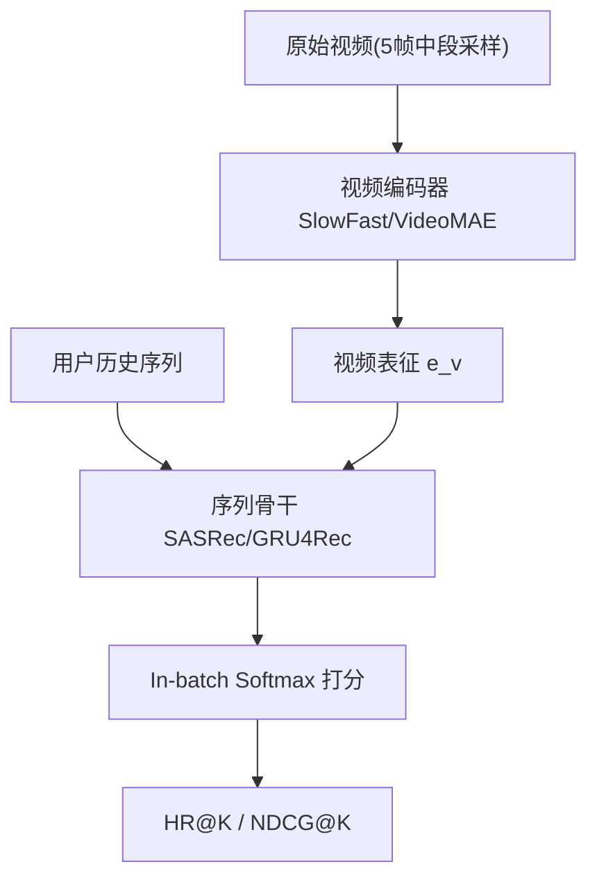

# A Content-Driven Micro-Video Recommendation Dataset at Scale (大规模内容驱动微视频推荐数据集)

- **会议/期刊**: CIKM 2025
- **作者与机构**: Yongxin Ni, Yu Cheng, Xiangyan Liu, Junchen Fu, Youhua Li, Fajie Yuan (西湖大学)；Xiangnan He (中国科学技术大学)；Yongfeng Zhang (Rutgers University)
- **推荐链路定位**: 召回（序列化 Next-Item 检索）
- **研究方向**: 多模态推荐 / 冷启动与长尾推荐
- **论文原文**: [论文原文链接](https://arxiv.org/abs/2309.15379v1)
- **开源代码**: [开源代码仓库链接](https://github.com/westlake-repl/MicroLens)

## TL;DR (1分钟核心速览)

微视频推荐长期缺乏含**原始视频内容**的大规模公开数据集，现有 KuaiRec/Tenrec 仅提供 ID 或预抽取视觉特征，无法训练内容驱动模型。本文构建 MicroLens（10 亿交互、3449 万用户、114 万视频，含标题/封面/音频/全长视频四模态），并在 MicroLens-100K 上以 Leave-One-Out + Full-Ranking 协议基准 10+ 推荐模型与 15 个视频编码器。核心发现：端到端训练的 VideoRec（SASRec$^V$ HR@10=0.0948）显著超越纯 ID 的 SASRec（0.0909）与冻结特征 VIDRec（0.0799），且视频分类精度与推荐精度**不单调相关**。

## Background & Motivation (背景与核心矛盾)

- **主流范式**: 微视频推荐分两支——纯 ID 的 IDRec（DSSM/LightGCN/SASRec）与拼接冻结视频特征的 VIDRec（MMGCN/GRCN），后者多用于冷启动辅助。
- **前人局限**: ① 公开数据集（MovieLens 仅电影长视频、KuaiRec/Tenrec 仅 ID 或 ResNet 预抽取特征）缺失原始像素，无法端到端学习视频表征；② 冻结编码器的语义空间面向**视频分类**任务，与推荐目标存在语义鸿沟。
- **核心洞察 (Key Insight)**: 视频分类 SOTA 编码器（VideoMAE）在推荐上并非最优，而 R3D-r18 分类最差却推荐表现不俗——说明"理解能力"不等于"推荐能力"。
- **本文切入点**: 以原始视频为物品表征源，用 E2E 训练让视频编码器直接吸收协同信号，并系统量化三类范式的性能边界。

## Method (核心方法设计)

### 1. 整体框架 (Overall Architecture)

数据侧：种子视频采集（>1 万赞）→ 关联页扩展（每页随机 10 条）→ 多模态过滤（标题≥3 字符、封面单色区<75%、视频>100KB）→ 评论交互采集（每视频≤5000 条、去重同用户）→ 分布式整合。模型侧：将 IDRec 的物品 ID 嵌入替换为可学习视频编码器，与序列推荐骨干（SASRec/GRU4Rec/NextItNet）联合优化，形成 VideoRec 范式。

### 2. 关键设计拆解 (Key Designs)

1. **VideoRec 端到端范式（核心增量）**：痛点在于 VIDRec 的冻结特征与协同信号割裂。做法是将物品表征完全由视频编码器输出 $\boldsymbol{e}_v=f_\theta(\mathbf{V}_i)$替代 ID 嵌入，与推荐损失联合反传：$\mathcal{L}=-\sum_{u}\log\frac{\exp(\boldsymbol{h}_u^\top\boldsymbol{e}_{v^+}/\tau)}{\sum_{j\in\mathcal{B}}\exp(\boldsymbol{h}_u^\top\boldsymbol{e}_{v_j}/\tau)}$。直觉：编码器在推荐梯度下重塑语义空间，使视觉表征对齐用户偏好而非动作类别。
2. **TopT 部分微调策略**：全参微调（FT）会灾难性遗忘预训练知识，仅微调编码器顶部少数层（TopT）反而更优，兼顾预训练迁移与任务适配，同时将训练开销从 IDRec 的 10–50 倍压缩。
3. **训练目标与推理效率**：统一采用 in-batch softmax 负采样（batch 内其他物品作负例，免显式负采样）；序列长度截断至最近 13 条（覆盖 95% 用户行为）；推理时对全库物品做内积检索，VideoRec 因需前向编码器，在线开销显著高于 IDRec。

## Experimental Setup & Evaluation Protocol (实验设置与评估协议)

- **数据集与预处理**: 三档规模，默认 MicroLens-100K：

| 数据集 | #Users | #Items | #Interactions | 稀疏度 | 特征/场景说明 |
| :--- | :---: | :---: | :---: | :---: | :--- |
| MicroLens-100K | 100,000 | 19,738 | 719,405 | 99.96% | 15,580 tags，均长 161s，含 V/A/I/T |
| MicroLens-1M | 1,000,000 | 91,402 | 9,095,620 | 99.99% | 28,383 tags，均长 162s |
| MicroLens | 34,492,051 | 1,142,528 | 1,006,528,709 | 99.997% | 258,367 tags，均长 138s |

- **数据划分与防穿越**: `Leave-One-Out`——最后一条测试、倒数第二条验证、其余训练。
- **排名评测协议**: `Full-Ranking`（全库未交互物品排序），指标 HR@{10,20}、NDCG@{10,20}。
- **对比基线与超参**: IDRec（DSSM/LightGCN/NFM/DeepFM/YouTubeID + NextItNet/GRU4Rec/SASRec）、VIDRec（MMGCN/GRCN/DSSM/SASRec + VideoMAE 冻结特征）、VideoRec（SlowFast E2E）；学习率 $\eta\in\{1e{-5},\dots,1e{-3}\}$，嵌入维度$\{64,\dots,4096\}$，batch$\{64,\dots,2048\}$。

## Key Experimental Results (实验关键数据)

### 1. 主实验对比 (Main Results)

MicroLens-100K 基准（VIDRec/VideoRec 分别用 VideoMAE/SlowFast 编码器）：

| Class | Model | HR@10 | NDCG@10 | HR@20 | NDCG@20 |
| :--- | :--- | :---: | :---: | :---: | :---: |
| IDRec-CF | LightGCN | 0.0372 | 0.0177 | 0.0618 | 0.0239 |
| IDRec-CF | DeepFM | 0.0350 | 0.0170 | 0.0571 | 0.0225 |
| IDRec-SR | GRU4Rec | 0.0782 | 0.0423 | 0.1147 | 0.0515 |
| IDRec-SR | NextItNet | 0.0805 | 0.0442 | 0.1175 | 0.0535 |
| IDRec-SR | SASRec | 0.0909 | 0.0517 | 0.1278 | 0.0610 |
| VIDRec | SASRec$^{ID+V}$ | 0.0799 | 0.0415 | 0.1217 | 0.0520 |
| VIDRec | MMGCN$^{ID+V}$ | 0.0214 | 0.0103 | 0.0374 | 0.0143 |
| VideoRec | GRU4Rec$^V$ | **0.0954** | **0.0517** | **0.1377** | **0.0623** |
| VideoRec | SASRec$^V$ | 0.0948 | 0.0515 | 0.1364 | 0.0619 |

SASRec$^V$相对 SASRec 的 HR@10 提升约 **+4.3%**，相对 SASRec$^{ID+V}$ 提升约 **+18.6%**。

### 2. 消融实验 (Ablation Study)

| 变体 | 关键设置 | HR@10 | NDCG@10 | 说明 |
| :--- | :--- | :---: | :---: | :--- |
| SASRec$^V$-WT | 预训练权重 | 显著↑ | — | 优于随机初始化 OT |
| SASRec$^V$-OT | 随机初始化 | 基线 | — | 无迁移知识 |
| SASRec$^V$-Frozen | 冻结编码器 | ~0.048 | — | 约为微调版一半 |
| SASRec$^V$-TopT | 顶部微调 | 最优 | — | 优于 FT |
| SASRec$^{ResNet}$ | 仅封面图 | 0.0858 | 0.0462 | 弱于视频 |
| SASRec$^{Swin}$| 仅封面图 | 0.0892 | 0.0479 | 仍弱于 SASRec$^V$ |

### 3. 关键实验发现 (Key Findings)

1. **端到端 > 冻结特征 > 纯 ID 的层级关系成立**：SASRec$^V$（0.0948）> SASRec（0.0909）> SASRec$^{ID+V}$（0.0799），说明冻结视频特征在暖物品场景下甚至**损害**性能，ID 嵌入已隐式吸收视觉信息。
2. **视频分类精度与推荐精度解耦**：VideoMAE 分类最优但推荐非最优，R3D-r18 分类最差却推荐尚可；且冻结编码器加 DNN 层（图 5b–d）仍远不及微调版，证明语义表征**非通用**。
3. **TopT 优于 FT**：全参微调引发灾难性遗忘，仅微调顶部层在保留预训练知识的同时适配推荐任务，是精度与算力的帕累托点。

## Highlights & Limitations (亮点、对比与审稿批判)

- **与代表作对比 (vs. Prior Work)**: 相比 KuaiRec/Tenrec 仅提供 ID 或预抽取特征，MicroLens 首次提供原始视频四模态；相比 Reasoner（仅 5 帧、规模小万倍），规模与模态完整性碾压；相比文献 [64] 在图文场景"强编码器即强推荐"的结论，本文在视频场景给出**反例**。
- **可迁移亮点**: ① TopT 部分微调策略可迁移至任意"预训练大编码器 + 推荐"的多模态场景；② 以分类精度筛选编码器的做法在推荐任务中应被质疑，需以推荐指标直接选型。
- **审稿级局限批判**: ① VideoRec 训练开销为 IDRec 的 10–50 倍，在线需实时编码器前向，工业部署成本高；② 交互以**评论**为隐式正反馈，存在严重选择偏差（评论者仅为极少数活跃用户），且未做时间戳全局切分，Leave-One-Out 可能高估序列模型性能。

## Rating (四维评分)

- **方法创新性 (Novelty)**: ⭐⭐⭐⭐ （数据集贡献为主，VideoRec 范式与"分类≠推荐"的反直觉发现具启发性，但模型层面创新有限）
- **评估协议与实验扎实度 (Protocol & Experiments)**: ⭐⭐⭐⭐ （10+ 推荐模型 × 15 视频编码器基准全面，Full-Ranking 无偏；扣分在评论交互偏差与 LOO 划分）
- **写作与数学规范度 (Clarity & Rigor)**: ⭐⭐⭐⭐ （三类范式分类清晰、Q1–Q3 递进式论证严谨，公式较简）
- **工业落地与复现价值 (Industrial & Practical Value)**: ⭐⭐⭐⭐⭐ （十亿级真实数据 + 完整开源代码与下载工具，对内容驱动推荐与视频理解社区价值极高）

