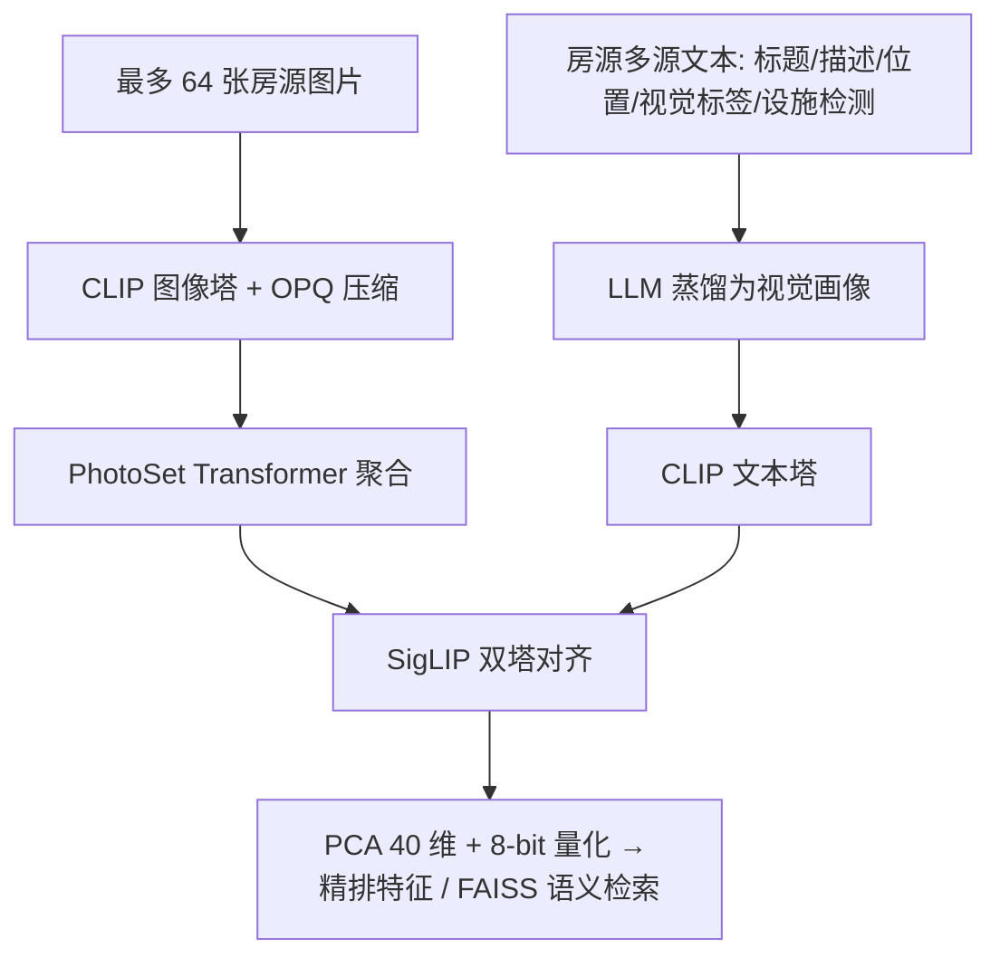
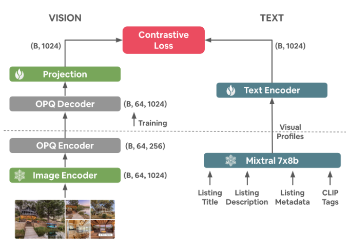

# BiListing: Modality Alignment for Listings (房源双模态对齐)

- **会议/期刊**: CIKM 2025 (Applied Research Track)
- **作者与机构**: Guillaume Guy, Mihajlo Grbovic, Chun How Tan, Han Zhao (Airbnb)
- **推荐链路定位**: 召回（房源表征与语义检索）+ 精排特征
- **研究方向**: 多模态推荐 / 冷启动推荐
- **论文原文**: [https://arxiv.org/abs/2508.20396v2](https://arxiv.org/abs/2508.20396v2)
- **开源代码**: 暂未开源

## TL;DR (1分钟核心速览)

Airbnb 房源天然是"多图 + 多段非结构化文本"的复杂实体，而 CLIP 只处理 1:1 图文对、文本上下文仅 77 token，直接套用会导致多图多文本无法收敛为单一表征，业界常用的 embedding 平均池化又会丢失主导性信息。本文提出 BiListing：用 LLM 将标题/描述/位置/视觉检测标签等异构信号蒸馏为"视觉画像"文本，再用 PhotoSet Transformer 把最多 64 张图聚合成单一视觉向量，以 SigLIP 损失做双塔对齐。离线 10k 留出集上 Text→Image Recall@1 达 58%、Mean Rank 6.2；线上 A/B 中 NDCG +0.425%、Uncancelled Bookers 显著提升（$p=0.025$），年增收数千万美元。

## Background & Motivation (背景与核心矛盾)

- **主流范式**: Airbnb 历史上依赖用户行为序列（点击/收藏/预订）训练房源 embedding（Grbovic et al.），文本与图片仅作辅助特征；表征学习兴起后，业界转向对每张图、每段文本单独编码再拼接或平均。
- **前人局限**: 其一，CLIP 的图文对是 1:1 假设，而房源有 60+ 张图与标题/描述/评论等多段文本，自由文本查询（如"带热水浴缸和桑拿的林中木屋"）涉及多个分散在不同图片中的属性，单图匹配必然失效；其二，CLIP 文本塔上下文仅 77 token 且面向"a photo of {}"式短 caption 预训练，与房源长描述、非前置信息的分布严重错配。
- **核心洞察 (Key Insight)**: 房东上传的文本与照片并非随机关联——房东会刻意用文字强调照片中的材质、景观、氛围等视觉显著点。因此无需额外标注，可直接把"文本描述"当作"多图集合"的弱监督配对信号，把房源理解重构为**集合级模态对齐**问题。
- **本文切入点**: 用 LLM 把异构文本蒸馏成"只含视觉要素"的视觉画像，再用 Transformer 把图片集合编码为一个 token 序列，从而把 CLIP 的 1:1 对齐范式推广到 N:M 实体级对齐。

## Method (核心方法设计)

### 1. 整体框架 (Overall Architecture)

离线侧，房源的结构化字段、标题描述、位置、CLIP 隐式视觉标签、目标检测/分类得到的视觉设施标签与视觉评分被送入 Mixtral 8x7b（zero-shot、step-by-step prompt、预填 "A N bedroom, M bathroom"），生成一段稠密"视觉画像"文本；图片侧先用冻结的 CLIP 图像塔逐图编码，经 OPQ 压缩后送入 4 层 4 头的 PhotoSet Transformer 聚合为单一视觉向量。两塔在共享隐空间内以 SigLIP 损失对齐，训练分"粗对齐（冻结文本塔）+ 精对齐（解冻文本塔末 5 层）"两阶段。线上仅用视觉塔向量，经 PCA 降至 40 维并做 8-bit 标量量化，作为精排模型特征。

<figure class="paper-figure" markdown="span">
  <figcaption>图4：BiListing架构，采用CLIP风格的双塔架构，左侧为视觉塔，右侧为文本塔</figcaption>
</figure>

### 2. 关键设计拆解 (Key Designs)

1. **视觉画像 (Visual Profiles)：把异构文本压成"可被照片看见"的句子**：痛点是房源文本含空调、周边 POI 等不可见属性，会污染图文对齐；且原始描述过长、非前置。做法是用 LLM 将标题、描述、位置、CLIP 隐式标签、100+ 视觉检测设施、视觉评分与房源类别融合重写为一段只保留视觉显著点的短文本，并用正则后处理（如 "0 bedroom" → "studio"）。直觉上，这让文本塔的输入分布贴近 CLIP 预训练的 caption 形态，同时天然过滤掉与图像无关的噪声监督。

2. **PhotoSet Transformer：把图片集合当"句子"、把图向量当"token"**：痛点是平均池化会让 60 张图中占多数的后院照淹没客厅照，主导性信息丢失。做法是把 $P$张图的 CLIP 向量$\{\boldsymbol{v}_1,\dots,\boldsymbol{v}_P\}$ 加位置编码后送入 Transformer 编码器，取末位 token 的输出作为房源视觉表征：

$$\boldsymbol{z}^{v}=\mathrm{PSEnc}\big(\boldsymbol{v}_1+e_1,\dots,\boldsymbol{v}_P+e_P\big)_{P},\qquad \mathcal{L}_{\text{SigLIP}}=-\frac{1}{B}\sum_{i=1}^{B}\log\frac{\exp(\tau\,\boldsymbol{z}^{v}_i\cdot\boldsymbol{z}^{t}_i)}{\sum_{j}\exp(\tau\,\boldsymbol{z}^{v}_i\cdot\boldsymbol{z}^{t}_j)}$$

位置编码并非装饰：房东习惯把最重要的照片放前面、周边环境放最后，位置信息本身携带显著性先验。损失从 InfoNCE 换成 SigLIP（sigmoid 配对损失，无需全局 softmax 归一化），在大 batch（32k）下梯度更稳定，是消融中收益最大的单项改动。

3. **训练目标、负采样与推理效率**：总损失即对称的 SigLIP 图文配对损失，负样本全部来自 in-batch（global batch 32k），无需显式难负采样。工程侧的关键是带宽：OPQ（256 中心、1280 维旋转矩阵）把每张图向量压到 256 uint8，体积缩减 97%、L2 误差仅 9.9%；线上再对房源向量做 PCA 至 40 维 + 8-bit 标量量化，最终**每房源仅 40 字节**，可支撑实时打分与 FAISS 近邻检索。

## Experimental Setup & Evaluation Protocol (实验设置与评估协议)

- **数据集与预处理**: 训练/评测集来自 Airbnb 全量房源（千万量级），经三重过滤后规模缩减 35%：

| 数据集 | #Users | #Items | #Interactions | 稀疏度/密度 | 特征/场景说明 |
| :--- | :---: | :---: | :---: | :---: | :--- |
| Airbnb Listings (train) | — | 千万级 | 图文对（无人工标签） | — | 过滤：<5 张图、视觉画像 <50 字符、预训练模型对齐分 <0.3 |
| Holdout (eval) | — | 1% 随机留出 | — | — | 检索评测取其中 10k 房源采样 |
| 下游 kNN 探针 | — | 同上 | — | — | 结构化字段/房源类别分类准确率 |

- **数据划分与防穿越 (Splitting Strategy)**: 随机 1% 房源作 holdout，与训练集房源级隔离；下游探针在训练集上拟合、holdout 上评测。
- **排名评测协议 (Ranking Protocol)**: 检索侧为 **Full-Ranking**（在留出集全库内对正确配对排序），报告 Mean Rank 与 Recall@{1,5,10}；排序侧离线用二值相关性（是否预订）的 NDCB，线上用 A/B 的 Uncanceled Bookers。
- **对比基线与超参设置**: 基线含 MLP 聚合 + InfoNCE、不同层数/头数的 PhotoSet Transformer、InfoNCE vs. SigLIP、有无粗对齐；下游对比产线 Legacy 行为序列 embedding。Embedding 维度 $d=1024$，PhotoSet 最优配置 4 层 4 头，粗对齐 140 epoch（lr$1e^{-4}$）、精对齐 80 epoch（lr$2e^{-5}$），8×A100 训练 15 小时。

## Key Experimental Results (实验关键数据)

### 1. 主实验对比 (Main Results)

检索对齐（留出集，Mean Rank 越低越好）：

| 模型配置 | 损失 | MR (T→I) | 相对最优 |
| :--- | :---: | :---: | :---: |
| MLP 聚合 (baseline) | InfoNCE | 26.5 | +329% |
| PS Trans (4L, 8H)，无粗对齐 | InfoNCE | 20.2 | +227% |
| PS Trans (8L, 8H)，无粗对齐 | InfoNCE | 20.5 | +232% |
| PS Trans (4L, 8H)，无粗对齐 | SigLIP | 8.43 | +36.6% |
| **PS Trans (4L, 4H) + 粗对齐** | **SigLIP** | **6.17** | — |

最优模型完整指标：Recall@1/5/10 (T→I) = **58% / 85% / 91%**，MR (I→T) = 6.0。

下游 kNN 探针（准确率，节选）：

| 属性 | BiListing (vision) | Legacy | 说明 |
| :--- | :---: | :---: | :--- |
| Urban/Rural Density | **0.64** | 0.41 | 视觉强相关，+56% |
| Space Type | **0.62** | 0.46 | +35% |
| Bathroom count | **0.75** | 0.72 | 小幅领先 |
| A-Frame 类别 | **0.87** | 0.80 | 类别识别全面领先 |
| Pool 类别 | **0.88** | 0.81 | — |
| Pro Host (Y/N) | 0.655 | **0.74** | 行为信号占优 |
| Bookings count | 0.26 | **0.56** | 行为信号占优 |

### 2. 消融实验 (Ablation Study)

| 消融项 | 设置 | 结果 | 结论 |
| :--- | :--- | :---: | :--- |
| 图向量量化 | PQ vs. OPQ (P50 L2 误差) | 20.93 vs. **9.49** | OPQ 随机旋转降误差 54.7% |
| 对齐损失 | InfoNCE vs. SigLIP | 20.2 vs. **8.43** | 单项最大收益 |
| 训练策略 | 无粗对齐 vs. 有粗对齐 | 8.43 vs. **6.17** | 两阶段训练再降 27% |
| 聚合器 | MLP vs. PhotoSet Trans | 26.5 vs. **20.2** | 集合建模优于池化 |
| 线上维度 | PCA 前 $n$ 维 | 40 维后收益饱和 | 最终 40 维 + 8-bit |

### 3. 关键实验发现 (Key Findings)

1. **损失函数是最大杠杆**：从 InfoNCE 换到 SigLIP 使 MR 从 20.2 骤降至 8.43（降幅 58%），远超换聚合器（26.5→20.2）的收益，说明大 batch 下 sigmoid 配对损失避免了 softmax 在 32k 候选上的梯度稀释。
2. **视觉与行为信号呈清晰互补而非替代**：BiListing 在 Urban/Rural（0.64 vs. 0.41）、Space Type（0.62 vs. 0.46）等视觉属性上大幅领先，但在 Bookings count（0.26 vs. 0.56）、Review count（0.37 vs. 0.64）等行为属性上明显落后——这恰好解释了为何线上是把视觉向量作为**精排附加特征**而非替换行为 embedding。
3. **压缩几乎无损**：OPQ 在体积缩减 97% 的同时仅损失 9.9% L2 误差，PCA 40 维 + 8-bit 量化后线上 NDCG 无统计显著下降，最终 40 字节/房源的表征仍带来 +0.425% NDCG（超过 +0.3% 的显著性门槛），证明工业部署的瓶颈在带宽而非精度。

## Highlights & Limitations (亮点、对比与审稿批判)

- **与代表作对比 (vs. Prior Work)**: 相比 CLIP/BLIP 的 1:1 图文对假设，本文首次把对齐范式推广到 N:M 实体；相比 Flamingo 类交错多模态大模型（仅支持约 5 张图、解码器架构重），PhotoSet Transformer 支持 64 图且保持 BERT 级编码器延迟；相比 Grbovic et al. 的行为序列 embedding，本文彻底摆脱对曝光日志的依赖，天然缓解冷启动且支持自然语言检索。
- **可迁移亮点**: ①"用 LLM 把异构元数据蒸馏为与目标模态同构的文本"这一招可直接迁移到电商商品、短视频等多源属性场景；②"粗对齐冻结文本塔 + 精对齐解冻末几层"的两阶段策略，是低资源下稳定微调 CLIP 双塔的通用配方。
- **审稿级局限批判**: 其一，视觉画像由 LLM 生成，其幻觉与风格偏差会作为监督信号被固化进 embedding，论文未做 LLM 选型消融（作者亦在 Future Work 中承认）；其二，检索评测仅在自建留出集上做 Full-Ranking，缺少与公开多模态检索基准的横向对比，且下游 kNN 探针的绝对准确率普遍偏低（如 ADR percentile 仅 0.29），外部可复现性受限。

## Rating (四维评分)

- **方法创新性 (Novelty)**: ⭐⭐⭐⭐ （把 CLIP 1:1 对齐推广到多图多文本实体，PhotoSet Transformer + 视觉画像的组合在工业场景中确属首创，但单点技术均为已有模块的巧妙拼装）
- **评估协议与实验扎实度 (Protocol & Experiments)**: ⭐⭐⭐⭐ （离线 Full-Ranking + 下游探针 + 线上 A/B 三层验证完整，且有显著性检验；扣分在于无公开基准对比、无 LLM 选型消融）
- **写作与数学规范度 (Clarity & Rigor)**: ⭐⭐⭐⭐ （伪代码与训练超参披露详尽、可复现性强，但公式化程度偏弱，多数设计以文字描述而非数学形式给出）
- **工业落地与复现价值 (Industrial & Practical Value)**: ⭐⭐⭐⭐⭐ （已全量上线、40 字节/房源、年增收数千万美元，且论文以"易复现"为明确写作目标，工程参考价值极高）

