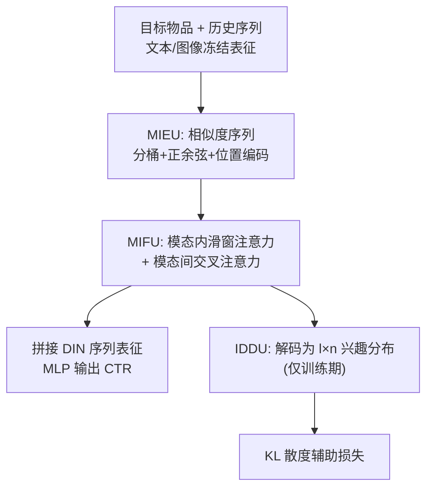
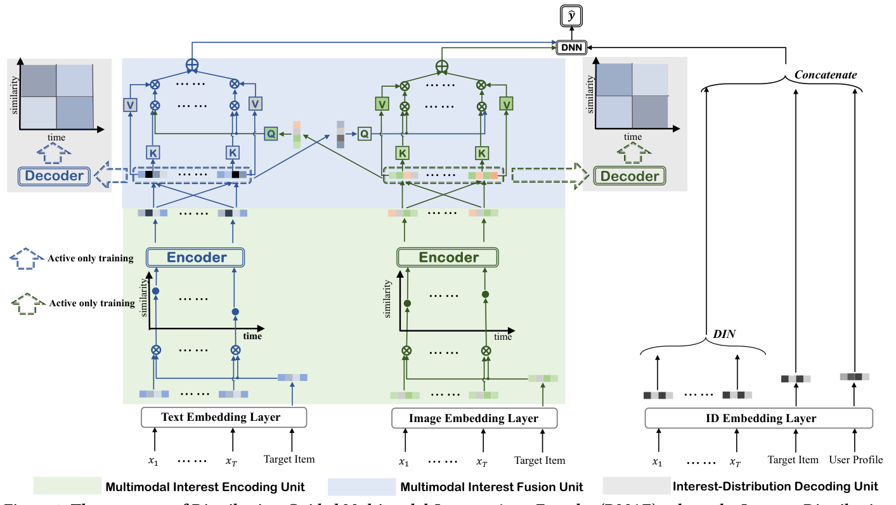

# Distribution-Guided Auto-Encoder for User Multimodal Interest Cross Fusion (分布引导的用户多模态兴趣交叉融合自编码器)

- **会议/期刊**: CIKM 2025
- **作者与机构**: Moyu Zhang, Yongxiang Tang, Yujun Jin, Jinxin Hu, Yu Zhang（阿里巴巴集团）
- **推荐链路定位**: 精排（CTR 预估）
- **研究方向**: 多模态推荐 / CTR 预估与特征交叉
- **论文原文**: [https://arxiv.org/abs/2508.14485v1](https://arxiv.org/abs/2508.14485v1)
- **开源代码**: 暂未开源

## TL;DR (1分钟核心速览)

现有工业多模态推荐要么把多模态相似度蒸馏进 ID 向量（信息有损），要么用早融合的单一多模态表征算相似度（无法按行为序列动态调整各模态兴趣）。本文提出 DMAE：在**行为粒度**上，把目标物品与历史点击物品在各模态下的相似度序列编码为兴趣向量，经模态内滑窗注意力 + 模态间交叉注意力做交叉融合，再用一个**仅在训练期生效**的解码器把兴趣向量还原为「时间×相似度」二维兴趣分布，以 KL 散度作自监督约束。四个数据集 AUC 平均相对 DIN 提升 3.23%，工业线上 CTR +12.9%、新物品曝光 +9.25%。

## Background & Motivation (背景与核心矛盾)

- **主流范式**: 工业界仍以 ID 序列建模（DIN/DIEN/BST）为主；引入多模态时主流是「关系引导的 ID 表征学习」（如 LRD，把多模态相似度当 pair-wise 标签蒸馏进 ID）与「多模态相似度建模」（如 SimTier，把目标-历史物品的多模态相似度序列作为额外特征）。
- **前人局限**: 前者在蒸馏过程中丢失多模态信息，且扰动 ID 向量原有的共现语义；后者虽保留多模态信息，但用的是**早融合**的单一表征，无法依据用户行为序列自适应地调整「文本兴趣」与「图像兴趣」的相对权重，模态内与模态间的交互均未实现。
- **核心洞察 (Key Insight)**: 用户兴趣本质是「在相似度-时间二维平面上点击行为的分布」——近期且高相似度的点击密集（图 3 右上红区）代表强兴趣，远期低相似度密集则代表弱兴趣。该分布可作为天然的监督信号。
- **本文切入点**: 把多模态融合下沉到**行为粒度**，并用兴趣分布重建作为辅助自编码任务，逼迫编码器不丢失模态信息。

## Method (核心方法设计)

### 1. 整体框架 (Overall Architecture)

输入为用户画像、历史点击序列 $\mathcal{S}=\{x_1,\dots,x_T\}$与目标物品$x_i$；物品的文本/图像表征由 GPT-3 与 EVA-02 离线抽取并**冻结**。MIEU 先计算目标物品与每个历史物品在两个模态下的余弦相似度序列，经分桶+正余弦编码+位置编码映射为逐行为的兴趣向量；MIFU 先做模态内滑窗自注意力，再以另一模态的池化向量作 Query 做交叉注意力，得到两个融合兴趣向量；IDDU 仅在训练期把兴趣序列解码回$l\times n$ 的兴趣分布并与真实分布算 KL。最终融合向量与 DIN 序列表征、用户/物品 ID 向量拼接进 MLP 输出点击概率。

<figure class="paper-figure" markdown="span">
  <figcaption>图2：分布引导的多模态兴趣自编码器（DMAE）结构，其中兴趣分布解码单元仅参与模型训练，在测试或在线推理过程中不需要</figcaption>
</figure>

### 2. 关键设计拆解 (Key Designs)

1. **MIEU：相似度数值的软编码**：相似度是连续数值，直接分桶会抹平同桶内差异与桶边界差异。本文先做可学习的线性缩放 $\hat{r}=wr+b$，再分桶取嵌入并按$\hat{r}$缩放，同时并联正余弦编码保留元素级差异，最后与位置嵌入$PE_{T-j}$拼接过两层 ReLU 映射：$\boldsymbol{r}=\mathrm{ReLU}(\boldsymbol{W}_2(\mathrm{ReLU}(\boldsymbol{W}_1(\boldsymbol{r}^d_j\oplus\boldsymbol{r}^{sc}_j)+\boldsymbol{b}_1)\oplus PE_{T-j})+\boldsymbol{b}_2)$。物理直觉：桶嵌入给粗粒度语义，缩放因子与正余弦给细粒度序关系，位置嵌入刻画兴趣漂移。

2. **MIFU：行为级模态内+模态间交叉**：早融合的症结在于「一个物品只有一个多模态向量」。这里先对每个模态的兴趣序列做滑窗自注意力（复杂度 $O(L)$而非$O(L^2)$）得到$\hat{\boldsymbol{r}}^{m_1},\hat{\boldsymbol{r}}^{m_2}$，再以另一模态的均值池化向量作 Query、本模态序列作 Key/Value 做交叉注意力：$\boldsymbol{r}^{m_1*}=\mathrm{softmax}\!\left(\frac{(\bar{\boldsymbol{r}}^{m_2}\boldsymbol{W}^{m_1}_Q)(\hat{\boldsymbol{r}}^{m_1}\boldsymbol{W}^{m_1}_K)^\top}{\sqrt{d}}\right)\hat{\boldsymbol{r}}^{m_1}\boldsymbol{W}^{m_1}_V$。池化向量浓缩了整条序列的模态上下文，因此一次交叉即同时完成模态内聚合与模态间迁移。

3. **IDDU 与训练目标**：把序列按时间等分为 $l$段、相似度等分为$n$区间，统计各格点击占比$p_{ij}=\#\{s_k\mid s_k\in c_j,\,s_k\in \boldsymbol{s}_i\}/T$作为真实分布$\boldsymbol{P}^{m_1},\boldsymbol{P}^{m_2}$；解码器对兴趣序列加随机 mask 后均值池化，经 MLP+sigmoid 输出$\boldsymbol{Q}$，用 KL 约束$\mathcal{L}_{dec}=D_{KL}(\boldsymbol{P}^{m_1}\|\boldsymbol{Q}^{m_1})+D_{KL}(\boldsymbol{P}^{m_2}\|\boldsymbol{Q}^{m_2})$。总损失$\mathcal{L}_{DMAE}=\mathcal{L}_{CE}+\lambda_{dec}\mathcal{L}_{dec}$。**负采样**：CTR 二分类任务，曝光即负样本，无需额外负采样；**推理开销**：解码器下线，滑窗注意力保持$O(L)$，与 DIN 同量级，仅多出多模态向量的存储（线上量化压缩 40%）。

## Experimental Setup & Evaluation Protocol (实验设置与评估协议)

- **数据集与预处理**:

| 数据集 | #Users | #Items | #Interactions | 特征/场景说明 |
| :--- | :---: | :---: | :---: | :--- |
| Amazon-Books | 75,053 | 358,367 | 150,016 | 评论文本+图像，1,583 类 |
| Amazon-Electro | 192,403 | 63,001 | 1,689,188 | 文本+图像，每用户/物品 ≥5 条评论 |
| MovieLens | 138,493 | 27,278 | 20,000,263 | 评分>3 为正样本，多模态从 IMDB 爬取 |
| Industrial | 10,125,327 | 1,652,178 | 873,945,605 | 国际电商展示广告系统 |

- **数据划分与防穿越**: 公开数据集沿用 DIN 的二分类构造方式；工业数据集用**全局时间戳切分**——训练集取最近 20 天，测试集取其后 1 天曝光样本，严格防穿越。
- **排名评测协议**: 采用 CTR 预估标准的 `AUC` 与 `Logloss`；工业集额外报告请求级 `GAUC_pv`（单次 pv 内分组 AUC），贴近线上排序真实场景。
- **对比基线与超参设置**: ID 类基线 Wide&Deep、FRNet、Average Pooling、GRU4Rec、DIN、BST；多模态类基线 UniSRec、LRD、DIMO、SimTier。公开集 MLP 结构 200×80×1，Embedding 维度网格搜索 $\{4,8,16,32\}$；工业集 512×256×64×1，ID 维度 8；Adam，初始学习率 0.001、衰减 0.9；显著性检验$p<0.05$。

## Key Experimental Results (实验关键数据)

### 1. 主实验对比 (Main Results)

| Method | Books AUC | Electro AUC | MovieLens AUC | Industrial AUC | GAUC_pv | ΔAUC |
| :--- | :---: | :---: | :---: | :---: | :---: | :---: |
| Wide&Deep | 0.6630 | 0.8637 | 0.7212 | 0.6990 | 0.6070 | -3.95% |
| DIN | 0.7281 | 0.8857 | 0.7366 | 0.7152 | 0.6097 | - |
| BST | 0.7264 | 0.8824 | 0.7343 | 0.7155 | 0.6105 | -0.22% |
| UniSRec | 0.7390 | 0.8946 | 0.7409 | 0.7188 | 0.6121 | +0.89% |
| LRD | 0.7371 | 0.8928 | 0.7395 | 0.7204 | 0.6136 | +0.79% |
| DIMO | 0.7501 | 0.8972 | 0.7431 | 0.7233 | 0.6143 | +1.58% |
| SimTier | 0.7526 | 0.9034 | 0.7482 | 0.7252 | 0.6181 | +2.08% |
| **DMAE** | **0.7645\*** | **0.9105\*** | **0.7570\*** | **0.7319\*** | **0.6249\*** | **+3.23%** |

### 2. 消融实验 (Ablation Study)

| 变体 | Books AUC | Electro AUC | MovieLens AUC | Industrial AUC | ΔAUC |
| :--- | :---: | :---: | :---: | :---: | :---: |
| w/o MIEU-se（退回纯分桶） | 0.7582 | 0.9069 | 0.7541 | 0.7287 | -0.51% |
| w/o MIEU-t（去时间维度） | 0.7580 | 0.9072 | 0.7555 | 0.7279 | -0.48% |
| w/o MIFU（直接池化） | 0.7539 | 0.9042 | 0.7501 | 0.7261 | -0.94% |
| w/o IDDU（去解码器） | 0.7561 | 0.9051 | 0.7527 | 0.7273 | -0.72% |
| **DMAE** | **0.7645** | **0.9105** | **0.7570** | **0.7319** | - |

### 3. 关键实验发现 (Key Findings)

1. **MIFU 是最大贡献源**：移除后平均 AUC 掉 0.94%，是四个变体中降幅最大的，说明「行为粒度交叉融合」而非「多模态信息本身」才是增益主因；这也解释了为何早融合的 SimTier 虽优于 ID 类基线，仍落后 DMAE 约 1.1 个点。
2. **IDDU 的解码约束不可替代**：去掉后掉 0.72%，且 $\lambda_{dec}$在 0.5–1.0 区间取最优（Books 为 1.0、Electro 为 0.7），过小约束不足、过大则偏离主任务；$l=n=10$时 GAUC 达 0.7645，$l=1$（忽略时间）或$l=64$（过细）均显著退化。
3. **多模态增益依赖融合方式而非模态数量**：LRD/UniSRec 把多模态压进 ID 向量，仅比 DIN 高 0.79–0.89%，甚至不如解耦式的 DIMO（+1.58%）；而 DMAE 保留独立模态通道后达 +3.23%，印证「蒸馏进 ID 会破坏共现语义」的判断。线上 7 天 A/B 中，新物品曝光占比 $IMP_{new}$ +9.25%、新物品 CTR +14.83%、整体 CTR +12.9%、收入 +11.63%。

## Highlights & Limitations (亮点、对比与审稿批判)

- **与代表作对比 (vs. Prior Work)**: 相比 LRD 把多模态相似度当 pair-wise 标签蒸馏进 ID，DMAE 保留独立模态通道、避免共现语义被扰动；相比 SimTier 用早融合表征构造兴趣，DMAE 在行为粒度上做模态内+模态间双向交叉；相比 DIMO 的解耦自监督，DMAE 的监督信号是显式的「时间×相似度」二维分布，可解释性更强。
- **可迁移亮点**: (1) 连续数值特征「分桶嵌入 × 可学习缩放 + 正余弦编码」的并联方案，可直接替换 CTR 模型中对年龄、价格、相似度等数值特征的硬分桶；(2) 「训练期加解码器重建辅助分布、推理期下线」的自编码范式，零在线开销即可正则化表征，适合任何序列兴趣建模模块。
- **审稿级局限批判**: (1) 兴趣分布的 $l\times n$ 网格与滑窗大小需按数据集调参（工业集最优为 10×10），且分布构造依赖序列截断长度 64，长序列场景下的网格设计缺乏原则性指导；(2) 多模态表征冻结自 GPT-3/EVA-02，未与推荐目标联合微调，且线上需额外存储并量化压缩 40%，对存储敏感场景仍有成本；离线仅报告 AUC/Logloss，缺少 NDCG 等排序指标与冷启动分桶的离线量化分析。

## Rating (四维评分)

- **方法创新性 (Novelty)**: ⭐⭐⭐⭐ （首次将多模态兴趣融合下沉到行为粒度，并以兴趣分布重建作自监督，思路清晰但组件均为成熟算子的巧妙重组）
- **评估协议与实验扎实度 (Protocol & Experiments)**: ⭐⭐⭐⭐ （四数据集含亿级工业集、时间切分防穿越、GAUC_pv 贴近线上，消融与超参分析完整，但缺排序指标与冷启动离线分桶）
- **写作与数学规范度 (Clarity & Rigor)**: ⭐⭐⭐ （三模块划分清楚、公式完整，但 Eq.13 中 KL 展开式第二项误写为 $q^{m_1}_{ij}$，且模板残留 Woodstock 占位信息，细节校对不足）
- **工业落地与复现价值 (Industrial & Practical Value)**: ⭐⭐⭐⭐ （解码器下线、$O(L)$ 复杂度与 DIN 持平，7 天 A/B 全指标正向，落地价值明确；可惜未开源）

