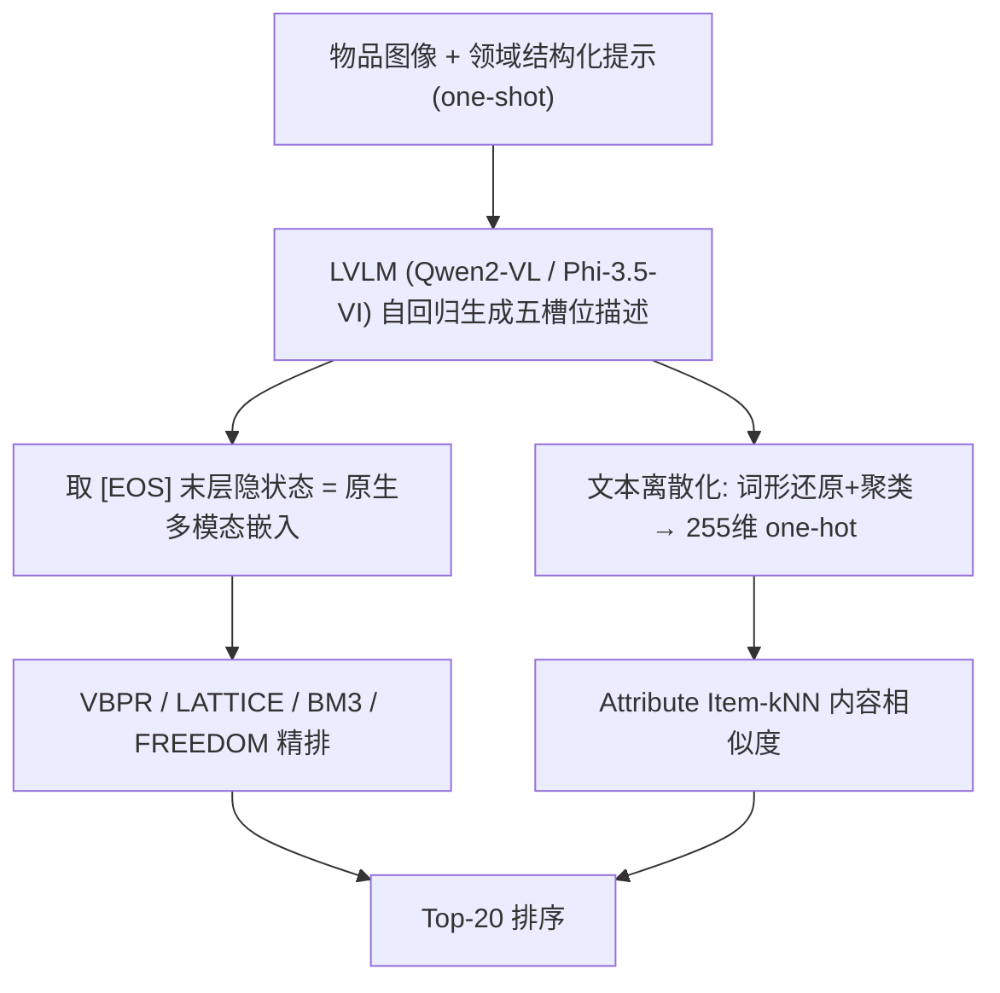

# Do Recommender Systems Really Leverage Multimodal Content? A Comprehensive Analysis on Multimodal Representations for Recommendation (推荐系统真的用上了多模态内容吗？——面向推荐的多模态表征系统性分析)

- **会议/期刊**: CIKM 2025 (Full Research Paper)
- **作者与机构**: Claudio Pomo, Matteo Attimonelli, Danilo Danese, Fedelucio Narducci, Tommaso Di Noia（Politecnico di Bari；Sapienza University of Rome）
- **推荐链路定位**: 精排（物品表征层，可上溯至召回特征供给）
- **研究方向**: 多模态推荐 / 大语言模型推荐
- **论文原文**: [https://arxiv.org/abs/2508.04571v1](https://arxiv.org/abs/2508.04571v1)
- **开源代码**: [http://split.to/mmrs](http://split.to/mmrs)

## TL;DR (1分钟核心速览)

本文追问一个被长期默认的前提：多模态推荐（MMRS）的收益究竟来自真实的跨模态语义理解，还是仅仅来自更大的模型容量？作者用高斯噪声 / 多元结构噪声 / ResNet50 三组受控输入证明语义特征确有贡献（VBPR 在 Baby 上 6.83→9.07 Recall@20），但 BM3 对噪声几乎不敏感，暴露"容量假象"。随后提出用 LVLM（Qwen2-VL、Phi-3.5-VI）经 one-shot 结构化提示生成"原生多模态"的 [EOS] 嵌入，免去晚期融合；在 Amazon 三域 80/10/10 划分、Top-20 全库排序下，LVLM 嵌入在 Borda 聚合排名中包揽前二（50.0 / 46.0 vs. RNet50–Sbert 38.0），且其可解码的文本描述回灌 Attribute Item-kNN 后即可追平甚至超越 LATTICE、VBPR 等复杂 MMRS。

## Background & Motivation (背景与核心矛盾)

- **主流范式**: MMRS 普遍采用 ResNet50 抽视觉、Sentence-BERT 抽文本，再以拼接 / 求和 / 逐元素乘做晚期融合（LATTICE、BM3、FREEDOM 均如此），把融合后的向量喂给图卷积或对比学习主干。
- **前人局限一（归因不清）**: 现有工作报告的提升从未与"参数量增加"解耦，无法判断模型是在读语义还是在拟合噪声。
- **前人局限二（融合失控）**: 晚期融合缺乏对模态间信息权重与分布的显式控制，跨模态对齐只能靠下游任务"碰运气"学出来，语义错位难以诊断。
- **核心洞察 (Key Insight)**: 若把多模态输入替换为同维噪声，性能若显著下降，则说明语义确实被使用；若几乎不变，则增益来自架构容量。作者进一步发现 LVLM 的自回归 [EOS] 隐状态天然落在统一语义空间，且可反解码为人类可读文本——这为"表征是否真有语义"提供了可验证的探针。
- **本文切入点**: 把嵌入抽取重构为 VQA 任务，用领域定制提示让 LVLM 先"说出"物品属性，再取其 [EOS] 隐状态作为物品表征，从源头消除融合环节。

## Method (核心方法设计)

### 1. 整体框架 (Overall Architecture)

对每个物品图像，构造含一个 in-context 样例的领域提示（Baby 用 [Category]/[Age Group]/[Purpose]/[Material]/[Usage Context]，Clothing 换成 [Type]/[Color]/[Wear Location]/[Material]/[Style]），LVLM 自回归生成五槽位结构化描述；取最后一个输出 token（[EOS]）在末层的隐状态作为物品嵌入 $\mathbf{z}_i^{\text{LVLM}}$，直接替代 RNet50/SBERT/CLIP 的融合向量输入 VBPR、LATTICE、BM3、FREEDOM 四个主干。同时把生成文本经词形还原 + 凝聚聚类离散化为 255 维 one-hot，作为边信息注入 Attribute Item-kNN，构成"隐向量 + 可读文本"的双路验证。

### 2. 关键设计拆解 (Key Designs)

1. **受控噪声探针（Capacity vs. Semantics 解耦）**：痛点是 MMRS 增益归因不明。做法是保持输入维度不变，仅替换语义内容为 (i) 纯高斯噪声、(ii) 匹配真实嵌入均值方差的多变量结构噪声、(iii) ResNet50 真实视觉特征，比较同一模型的 Recall@20。若 (iii) 显著优于 (i)(ii)，则语义被真实利用；若三者接近，则增益来自容量。该设计把"多模态是否有效"从相关性观察升级为干预式因果检验，是本工作方法论上最可迁移的一步。

2. **原生多模态嵌入（Multimodal-by-Design Embedding）**：痛点是晚期融合的语义错位与不可控。做法是把嵌入抽取改写为 VQA，取 [EOS] 隐状态而非均值池化：

$$\mathbf{z}_i = \mathbf{h}^{\text{last}}_{\text{[EOS]}}\big(\text{LVLM}(\mathbf{x}_i^{\text{img}}, \mathbf{p}^{\text{domain}})\big)$$

直觉上，[EOS] 位于因果注意力的末端，其隐状态已聚合"图像内容 + 提示意图 + 已生成描述"三者，等价于对整段多模态上下文做了一次有方向的摘要；而均值池化会打散 token 顺序与角色，丢失这种因果结构。由于视觉与语言在 LVLM 内部已被联合训练对齐，下游无需任何融合算子。

3. **训练目标、负采样与推理效率**：本文不提出新损失，沿用各主干的原生目标（VBPR/BPR-MF 用 BPR 成对损失，LATTICE/FREEDOM 用 BPR + 图正则，BM3 用 BPR + 自监督对比项），负采样为均匀采样。真正的开销前移到离线特征生产：每物品一次 LVLM 前向（7B 级模型），属一次性成本；在线服务阶段与普通 ID 嵌入查表无异，无额外延迟。Attribute Item-kNN 侧对相似度函数（cosine/jaccard/dot/asym/tversky）、邻居数 $\{5,\dots,100\}$ 与 TF-IDF/BM25 加权做了网格搜索。

## Experimental Setup & Evaluation Protocol (实验设置与评估协议)

- **数据集与预处理**: Amazon Reviews 2023 三个品类，仅保留同时具备文本描述与至少一张图的物品（多图取 metadata 中 large 键的首图）。

| 数据集 | #Users | #Items | #Interactions | 稀疏度 | 过滤/场景说明 |
| :--- | :---: | :---: | :---: | :---: | :--- |
| Baby | 108,897 | 17,836 | 330,771 | 99.983% | 5-core，母婴 |
| Pets | 461,828 | 61,060 | 1,772,584 | 99.993% | 5-core，宠物 |
| Clothing | 398,796 | 75,616 | 2,109,975 | 99.993% | 10-core，服饰 |

- **数据划分与防穿越**: 随机 `80%/10%/10%` 比例划分（训练/验证/测试），非全局时间戳切分，存在轻度未来信息泄漏风险，属该文评估协议的可议之处。
- **排名评测协议**: Top-20 排序，指标为 Recall@20、nDCG@20、HR@20；论文未声明是否采用全库 Full-Ranking 或采样排序（Elliot 默认配置），负样本比例未报告，跨论文比较时需谨慎。
- **对比基线与超参设置**: 协同过滤侧 Random、MostPop、Item-kNN、BPR-MF、LightGCN、Attribute Item-kNN；多模态侧 VBPR、LATTICE、BM3、FREEDOM。特征抽取器含 RNet50、ViT、SBERT、CLIP、RNet50–SBERT 拼接、Qwen2-VL-7B、Phi-3.5-VI。学习率 $\{10^{-4},\dots,10^{-2}\}$、正则$\{10^{-2},10^{-1}\}$、维度$\{64,128,256\}$，每配置 30 组搜索，按验证集 Recall@20 选优；显著性用$p<0.05$（表中 ★），总计 7,000+ 次训练。

## Key Experimental Results (实验关键数据)

### 1. 主实验对比 (Main Results)

下表摘取各主干下最优抽取器的 Recall@20（完整三指标见原文表 2/表 4）：

| 模型 | 抽取器 | Baby | Pets | Clothing |
| :--- | :--- | :---: | :---: | :---: |
| BPR-MF | — | 7.031 | 8.787 | 3.572 |
| LightGCN | — | 7.468 | 9.156 | 3.801 |
| VBPR | Qwen2-VL | **7.690★** | **9.340★** | **4.060★** |
| VBPR | RNet50 | 7.400 | 9.070 | 3.910 |
| LATTICE | Qwen2-VL / Phi-3.5-VI | 7.410 | **9.070★** | **4.050★** |
| LATTICE | RNet50–SBERT | 7.450 | 9.020 | 3.910 |
| BM3 | Phi-3.5-VI / Qwen2-VL | **7.680★** | **10.360** | **4.700★** |
| FREEDOM | RNet50–SBERT | **7.810** | **9.470★** | **4.220★** |
| Attribute Item-kNN | Phi-3.5-VI | 6.980 | 9.370 | 4.070 |

Borda 聚合排名（跨全部模型×数据集×指标）：Qwen2-VL 50.0 > Phi-3.5-VI 46.0 > RNet50–SBERT 38.0 > RNet50 16.5 > ViT 16.0 > CLIP 13.5。

### 2. 消融实验 (Ablation Study)

以"输入语义内容"为消融变量（图 3，Recall@20 %）：

| 主干 | 输入 | Baby | Pets | Clothing |
| :--- | :--- | :---: | :---: | :---: |
| VBPR | 高斯噪声 / 结构噪声 / RNet50 | 6.83 / 6.73 / **9.07** | 8.58 / 8.43 / **9.07** | 3.58 / 3.55 / **3.91** |
| LATTICE | 同上 | 6.60 / 6.70 / **8.82** | 8.27 / 8.57 / **8.82** | 3.21 / 3.40 / **3.75** |
| BM3 | 同上 | 7.55 / 6.52 / **7.79** | 10.37 / 8.20 / 9.93 | 4.68 / 2.99 / 4.09 |
| FREEDOM | 同上 | 8.73 / 8.82 / **9.93** | 8.30 / 8.20 / **8.73** | 3.77 / 3.63 / **4.09** |

### 3. 关键实验发现 (Key Findings)

1. **语义确有贡献，但并非普遍成立**：VBPR 在 Baby 上从噪声的 6.83 提升到 RNet50 的 9.07（+32.8%），LATTICE 与 FREEDOM 同样呈单调上升，说明这些架构确实在读内容；但 BM3 在 Pets 上用噪声反而拿到 10.37，高于 RNet50 的 9.93，直接证伪了"所有 MMRS 都在利用多模态语义"的默认假设——BM3 的增益主要来自对比学习架构本身。
2. **LVLM 嵌入的领先是聚合性的、而非处处最优**：Borda 总分 Qwen2-VL 50.0 领先 RNet50–SBERT 的 38.0 达 31.6%，但在 FREEDOM 主干上 RNet50–SBERT 反而全数据集最优（Baby 7.810 vs. Qwen2-VL 7.780），说明"原生多模态"与"图结构去噪主干"之间存在适配性差异，抽取器选择必须与主干联合调优。
3. **可解码文本本身就是强信号**：仅把 LVLM 生成的关键词离散化为 255 维 one-hot 喂给最简单的 Attribute Item-kNN，在 Clothing 上即达 Recall 4.073 / nDCG 2.012，超过 VBPR（4.060 / 1.820）与 LATTICE（4.050 / 1.800）；Pets 上 9.357 亦高于 LightGCN 的 9.156。这说明 LVLM 嵌入的语义深度可被独立验证，而非黑箱收益。

## Highlights & Limitations (亮点、对比与审稿批判)

- **与代表作对比 (vs. Prior Work)**: 相较 LATTICE / FREEDOM 这类"先抽单模态再构图融合"的路线，本文彻底取消了融合算子，把对齐责任交还给预训练的跨模态空间；相较 CLIP 这类对比学习对齐模型，LVLM 经生成式 VQA 得到的 [EOS] 表征携带任务指令信息，Borda 13.5 vs. 50.0 的差距说明"对齐"与"任务化对齐"不是一回事；相较既有 LVLM4Rec 工作多把 LVLM 当文本增强器，本文首次系统性地把其隐状态直接当作推荐物品嵌入。
- **可迁移亮点**: (1) 噪声替换探针可直接用于任何"多模态/边信息是否真被使用"的归因审计；(2) [EOS] 隐状态取表征 + 领域槽位提示的范式，可平移到短视频封面、POI 图片等场景的冷启动物品表征构建。
- **审稿级局限批判**: (1) 评估协议薄弱——80/10/10 随机划分未做时间切分，且未声明 Full-Ranking 与负样本比例，Top-20 指标绝对值偏低（Baby 仅 7 左右），跨论文可比性存疑；(2) 成本与泛化性未量化——7B 级 LVLM 对每物品做一次前向的离线开销、以及换到长尾/低质图像时的鲁棒性均未报告，且仅在三个 Amazon 品类上验证，缺少工业级规模与线上 A/B 证据。

## Rating (四维评分)

- **方法创新性 (Novelty)**: ⭐⭐⭐⭐ （不以新模型取胜，而以受控噪声探针 + [EOS] 原生多模态表征的方法论重构取胜，问题提法比解法更锋利）
- **评估协议与实验扎实度 (Protocol & Experiments)**: ⭐⭐⭐ （7,000+ 次训练与 Borda 聚合相当扎实，但随机划分、未声明全库排序与负样本比例削弱了结论强度）
- **写作与数学规范度 (Clarity & Rigor)**: ⭐⭐⭐⭐ （RQ 驱动结构清晰、公式克制，但核心 [EOS] 表征缺少与均值池化的定量对照实验）
- **工业落地与复现价值 (Industrial & Practical Value)**: ⭐⭐⭐⭐ （代码与 Ducho/Elliot 框架开源、在线零额外延迟，但离线 LVLM 特征生产成本与长尾图像鲁棒性待补）

