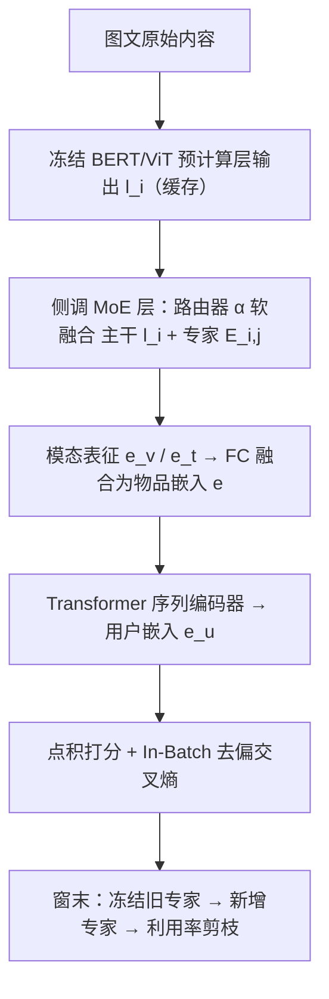
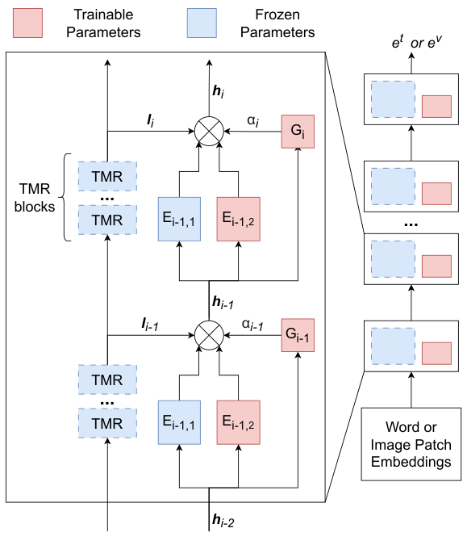
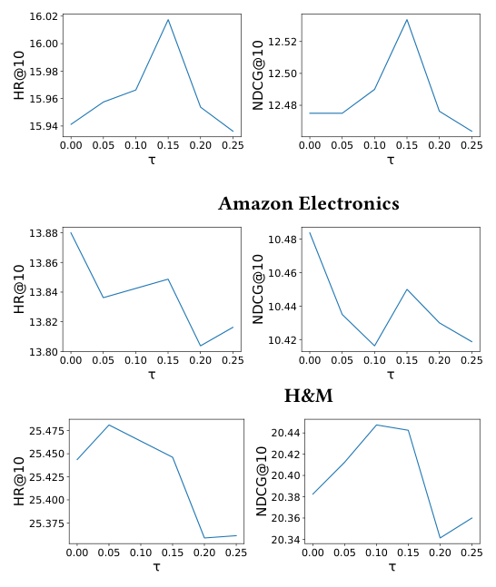

# Efficient Multimodal Streaming Recommendation via Expandable Side Mixture-of-Experts (基于可扩展侧调混合专家的高效多模态流式推荐)

- **会议/期刊**: CIKM 2025
- **作者与机构**: Yunke Qu, Liang Qu, Tong Chen, Quoc Viet Hung Nguyen, Hongzhi Yin（昆士兰大学、埃迪斯科文大学、格里菲斯大学）
- **推荐链路定位**: 召回（序列下一物品预测）
- **研究方向**: 多模态推荐 / 流式持续学习
- **论文原文**: [https://arxiv.org/abs/2508.05993v3](https://arxiv.org/abs/2508.05993v3)
- **开源代码**: [https://github.com/qykcq/Efficient-Multimodal-Streaming-Recommendation-via-Expandable-Side-Mixture-of-Experts](https://github.com/qykcq/Efficient-Multimodal-Streaming-Recommendation-via-Expandable-Side-Mixture-of-Experts)

## TL;DR (1分钟核心速览)

流式推荐中用户对**模态级特征**（视觉风格、文本语气）的偏好也会漂移，而微调 BERT/ViT 代价高、持续更新又易遗忘长期偏好。本文提出 XSMoE：在**冻结**的多模态主干旁挂轻量侧调网络，每个时间窗**新增一个 FFN 专家**并冻结旧专家，由路由器软加权融合主干与各专家输出，再用基于范数的利用率剪枝控制模型膨胀。在 Amazon Home/Electronics、H&M 三个流式数据集上，平均 HR@10 达 16.01/13.88/25.44，较最强基线 IISAN_RH 提升约 3.3%/1.6%/2.0%，同时总参数与显存显著下降。

## Background & Motivation (背景与核心矛盾)

- **主流范式**: 流式推荐（SRS）按时间窗增量更新模型；为缓解 ID 交互稀疏与新物品冷启动，主流做法引入 ViT/BERT 预计算的多模态特征，并用 rehearsal（回放缓冲）或 knowledge-transfer（KD/超网络）对抗灾难性遗忘。
- **前人局限**: ① 预训练编码器面向通用任务，未针对用户偏好建模，且忽略了**模态级偏好漂移**（用户从繁复视觉设计转向极简、从事实描述转向情绪化文案）；② 回放类方法需存储/重放高维图文内容，代价高昂；KD 与超网络（如 SML）虽免回放，但仍需更新全部参数，在多模态主干上时间与显存不可承受。
- **核心洞察 (Key Insight)**: 侧调（side-tuning）天然与主干解耦、无需反传主干，是流式场景下最省显存/时间的适配方式；而单专家侧调本质就是一个"单专家 MoE"，将其推广为**按时间窗扩展的多专家结构**，即可在不覆盖旧参数的前提下吸收新知识。
- **本文切入点**: 冻结主干 + 可扩展侧调 MoE + 利用率剪枝，三位一体同时解决"高效适配"与"知识保留"。

## Method (核心方法设计)

### 1. 整体框架 (Overall Architecture)

图文主干（BERT/ViT）的输出 $[l_0,l_1,\dots,l_M]$**预计算并缓存**，实际训练时主干不载入显存；每个模态各挂一个$M$ 层侧调网络，每层含若干 FFN 专家与一个路由器。预热阶段每层仅 1 个专家；每个新时间窗开始时，每层追加一个新专家、路由器追加一列，旧专家全部冻结。路由器以 Softmax 权重软融合"冻结主干输出 + 各专家输出"，逐层前向得到模态表征，拼接后经 FC 融合为物品嵌入，送入 Transformer 序列编码器，与物品嵌入点积打分。每个时间窗末按利用率剪除低贡献专家。

<figure class="paper-figure" markdown="span">
  <figcaption>图1：一次扩展后的模型结构。视觉编码器ViT和文本编码器BERT用虚线表示，因为我们使用其预计算输出，之后实际模型不再加载到内存中。TMR表示Transformer层。G表示路由器。在此示例中，每两个Transformer层被分为一组，因此侧调网络中的层数减半。</figcaption>
</figure>

### 2. 关键设计拆解 (Key Designs)

1. **可扩展侧调 MoE（Expandable Side MoE）**：痛点是单专家持续微调会覆盖旧知识。每层专家为带残差的瓶颈 FFN，$E_{i,j}(h_{i-1})=\mathbf{W}_{up}\,\mathrm{GELU}(\mathbf{W}_{down}h_{i-1})+h_{i-1}$；路由器输出$N_i+1$维权重（1 给主干、$N_i$ 给专家），
$\alpha_i=\mathrm{Softmax}(\mathbf{W}_i h_{i-1}),\quad h_i=\alpha_{i,0}\cdot l_i+\sum_{j=1}^{N_i}\alpha_{i,j}\cdot E_{i,j}(h_{i-1}).$
新专家权重初始化为该层历史专家权重的**均值**，既加速收敛又避免"新专家被分配零权重"的专家坍缩。直觉：新知识写入新参数子空间，旧专家冻结即天然抗遗忘，路由器负责按输入动态调配新旧知识比例。

2. **利用率感知剪枝（Utilization-based Pruning）**：痛点是专家数随时间无界增长。以加权输出范数定义相对贡献
$r_j=\frac{\lVert\alpha_j z_j\rVert_2}{\sum_{i=1}^{N}\lVert\alpha_i z_i\rVert_2}\in[0,1],$窗末将$r_j<\tau$ 的专家连同其路由列剪除；同层多个不达标时只剪最小者，保证每层每次至多删一个。直觉：加权输出幅值可忽略的专家对决策几乎无影响，剪除近乎无损，却能把总参数从 15.88MB 压到 6–8MB。

3. **训练目标、负采样与推理效率**：采用 In-Batch 去偏交叉熵（以物品流行度 $p_i$ 校正采样偏差），
$\mathcal{L}_{CE}=-\sum_{u\in\mathcal{U}}\sum_{i\in\mathcal{I}}\log\frac{\exp(y_{ui}-\log p_i)}{\exp(y_{ui}-\log p_i)+\sum_{j\in[B],j\notin\mathcal{I}_u}\exp(y_{uj}-\log p_j)},$即 in-batch 负采样 + 流行度去偏，无需显式难负样本挖掘。复杂度上，总参数$\mathcal{O}(MNDd')$，但任一时刻仅一个新专家+路由器可训练，可训练参数$\mathcal{O}(Mdd')$；主干输出预计算后不占显存，且可将 12 层 Transformer 两两分组使侧调网络仅 2 层。

## Experimental Setup & Evaluation Protocol (实验设置与评估协议)

- **数据集与预处理**: 全部按时间排序后等量切为 10 块，**每块内部**再做 $k$-core 过滤（Amazon 两集$k=5$，H&M$k=10$）；Amazon 文本为标题+描述拼接。

| 数据集 | #Users | #Items | #Interactions | 特征/场景说明 |
| :--- | :---: | :---: | :---: | :--- |
| Amazon Home | 257,475 | 126,312 | 2,220,678 | 家居，1996–2018，图文 |
| Amazon Electronics | 266,457 | 121,186 | 2,464,044 | 电子产品，1996–2018，图文 |
| H&M | 170,071 | 53,310 | 4,152,911 | 时尚服饰，仅 2022，图文 |

- **数据划分与防穿越 (Splitting Strategy)**: 全局时间戳切分为 $[D_0,\dots,D_9]$；$D_0$预热，$s\in[1,8]$时在$D_s$训练、在**下一块**$D_{s+1}$ 测试（严格前向，无穿越）；块内前 85% 训练、后 15% 测试。
- **排名评测协议 (Ranking Protocol)**: 对 $[D_0,\dots,D_s]$ 累积出现的**全部历史物品**做 Full-Ranking 全库排序，指标 HR@10 / NDCG@10；未交互视为负样本。
- **对比基线与超参设置**: ID 类流式基线 SSRM、GAG、GIUA-GNN；静态多模态基线 MMMLP、LGMRec、IISAN，并各自加回放（_RH）或 KD（_KD）以适配流式。主干 bert-base-uncased / vit-base-patch16-224，专家隐层 $d'=64$，序列长 10，batch 256，Adam 初始 lr 1e-3 每 epoch 衰减 0.95，半精度训练；与 IISAN 做 5 次重复的 t 检验，$p<0.01$。

## Key Experimental Results (实验关键数据)

### 1. 主实验对比 (Main Results)

下表为 $D_2$–$D_9$ 八个时间窗的平均值（%），完整逐窗结果见原文表 1：

| 方法 | Home HR | Home NDCG | Elec. HR | Elec. NDCG | H&M HR | H&M NDCG |
| :--- | :---: | :---: | :---: | :---: | :---: | :---: |
| SSRM | 8.17 | 6.15 | 7.08 | 5.12 | 2.10 | 1.11 |
| GAG | 9.68 | 7.79 | 8.28 | 6.29 | 3.33 | 1.95 |
| GIUA-GNN | 11.36 | 9.64 | 9.63 | 7.84 | 5.85 | 3.80 |
| MMMLP_RH | 10.09 | 8.37 | 8.42 | 6.65 | 12.37 | 9.92 |
| LGMRec_RH | 8.69 | 7.07 | 7.80 | 6.11 | 11.30 | 8.84 |
| IISAN_RH | 15.50 | 12.38 | 13.66 | 10.39 | 24.94 | 20.21 |
| IISAN_KD | 14.38 | 11.64 | 12.19 | 9.29 | 24.08 | 19.22 |
| **XSMoE** | **16.01** | **12.53** | **13.88** | **10.48** | **25.44** | **20.38** |
| Improv.% (vs 最强基线) | +3.3% | +1.2% | +1.6% | +0.9% | +2.0% | +0.8% |

### 2. 消融实验 (Ablation Study)

平均 HR@10 / NDCG@10（%）：

| 变体 | Home | Elec. | H&M | 说明 |
| :--- | :---: | :---: | :---: | :--- |
| Visual only | 15.13 / 12.42 | 12.43 / 10.00 | 21.32 / 18.76 | 仅视觉模态 |
| Textual only | 15.26 / 12.31 | 12.46 / 9.91 | 23.17 / 15.65 | 仅文本模态 |
| Static（单专家不扩展） | 15.63 / 12.29 | 13.63 / 10.32 | 24.43 / 19.74 | 去掉可扩展 MoE |
| NoFT（完全微调） | 14.84 / 11.90 | 12.82 / 9.95 | 23.44 / 19.64 | 去掉整个侧调网络 |
| **XSMoE** | **16.01 / 12.53** | **13.88 / 10.48** | **25.44 / 20.38** | 完整模型 |

效率对比（Amazon Home）：NoFT 总参数 2.27MB、显存 600.96MB、总训练 5694s；XSMoE 在 $\tau=0.15$时总参数 7.95MB、可训练 3.82MB、显存 615.44MB、总训练 3292s（$\tau=0.10$ 时 3246s 最优）。

### 3. 关键实验发现 (Key Findings)

1. **"多模态≠更强"被实证**：不微调编码器的 MMMLP/LGMRec 在 Amazon 两集上甚至不如纯 ID 的 GIUA-GNN（Home 10.09 vs 11.36），而侧调类 IISAN/XSMoE 大幅领先，说明**适配主干比引入模态本身更关键**；NoFT 相对 XSMoE 在 Home 掉 1.17 HR，直接回答 RQ2。
2. **可扩展 MoE 是抗遗忘主力**：Static 变体（单专家持续训练）在 Home/Elec./H&M 分别掉 0.38/0.25/1.01 HR，且随窗口推移差距扩大，印证"新专家写新知识、旧专家冻结"确实缓解了长期偏好遗忘。
3. **适度剪枝近乎无损甚至微涨**：$\tau\in[0.05,0.15]$时 Home 与 H&M 的 HR@10 不降反略升，总参数从 15.88MB 降至 6–8MB；但$\tau>0.10$后总训练时间回升（Home 从 3246s 增至 3820s），说明过度剪枝削弱表达力、拖慢收敛，$\tau$ 需按数据集调（Home 取 0.15，另两集取 0）。

<figure class="paper-figure" markdown="span">
  <figcaption>图2：超参数𝜏在Amazon Home、Amazon Electronics和H&amp;M数据集上对HR@10和NDCG@10的敏感性分析。</figcaption>
</figure>

## Highlights & Limitations (亮点、对比与审稿批判)

- **与代表作对比 (vs. Prior Work)**: 相比 SML 用 CNN 混合新旧权重（仍需全参数更新、多模态下代价爆炸），XSMoE 只训练新专家；相比 IISAN 的静态单专家侧调，本文把侧调推广为按窗扩展的 MoE，多出"抗遗忘"能力；相比回放类 SSRM/GAG，完全不需要存储高维图文回放缓冲。
- **可迁移亮点**: ① "预计算主干中间层输出 + 侧调网络只吃缓存"的范式可迁移到任何大模型特征冻结的推荐场景，显存收益直接；② 新专家用历史专家权重均值初始化以规避专家坍缩，是 MoE 增量扩展的通用小技巧。
- **审稿级局限批判**: ① 评测对累积历史物品做全库排序却未建模物品下架/过时，Amazon 长跨度数据上性能随时间单调下滑（$D_9$明显低于$D_2$），指标绝对值被系统性压低，跨数据集可比性存疑；② 剪枝阈值$\tau$需逐数据集手调且对训练总时长非单调，缺少自适应确定$\tau$ 的机制；③ 全文未引入 ID 嵌入（作者自述为未来工作），在图文信息弱的类目上可能受限。

## Rating (四维评分)

- **方法创新性 (Novelty)**: ⭐⭐⭐⭐ （把侧调视为单专家 MoE 并做时间窗扩展+利用率剪枝，组合新颖、动机链条清晰，但单点技术均为已有组件的巧妙拼装）
- **评估协议与实验扎实度 (Protocol & Experiments)**: ⭐⭐⭐⭐ （三数据集、8 个时间窗逐窗报告、t 检验 $p<0.01$、消融覆盖模态/扩展/微调/剪枝四维，唯缺物品过时建模与线上验证）
- **写作与数学规范度 (Clarity & Rigor)**: ⭐⭐⭐⭐ （路由与剪枝公式简洁、复杂度按参数/时间/显存三线拆解严谨，符号统一；剪枝与扩展的伪代码完整）
- **工业落地与复现价值 (Industrial & Practical Value)**: ⭐⭐⭐⭐⭐ （代码开源，主干不载入显存、单窗仅训一个专家，显存与总训练时间双降，天然契合流式上线节奏）

