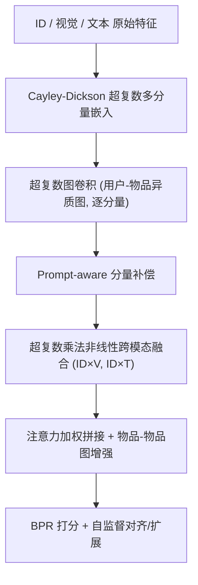
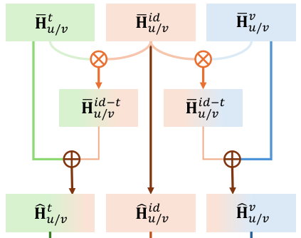

# Hypercomplex Prompt-aware Multimodal Recommendation (超复数提示感知多模态推荐)

- **会议/期刊**: CIKM 2025
- **作者与机构**: Zheyu Chen, Jinfeng Xu, Hewei Wang, Shuo Yang, Zitong Wan, Haibo Hu (香港理工大学 / 香港大学 / CMU / UCD)
- **推荐链路定位**: 召回 (Top-K 排序)
- **研究方向**: 多模态推荐 / 图神经网络推荐
- **论文原文**: [https://arxiv.org/abs/2508.10753v1](https://arxiv.org/abs/2508.10753v1)
- **开源代码**: [https://github.com/Zheyu-Chen/HPMRec](https://github.com/Zheyu-Chen/HPMRec)

## TL;DR (1分钟核心速览)

现有多模态推荐存在三重瓶颈：单向量嵌入无法承载丰富模态语义、线性融合（加权和/拼接）忽略模态间非线性关联、GCN 过平滑仅靠静态策略缓解。HPMRec 将每个模态的用户/物品表示编码为 Cayley-Dickson 超复数多分量嵌入，用超复数乘法实现天然非线性跨模态融合，并以可学习 Prompt 动态补偿分量错位与核心模态特征损失，同时设计分量差异扩展与跨模态对齐两个自监督任务。在 Office/Baby/Sports/Clothing 四个 Amazon 数据集、8:1:1 随机划分、Full-Ranking 协议下，Recall@20 相对最强基线 FREEDOM/LGMRec 提升 3.5%–13.0%。

## Background & Motivation (背景与核心矛盾)

- **主流范式**: 多模态推荐以 LightGCN 为骨干，构建用户-物品异质图与物品-物品同质图（LATTICE/FREEDOM），将视觉、文本特征作为物品侧信息注入图卷积。
- **前人局限一**: 传统嵌入把丰富模态语义压进单一定长向量，表示多样性受限；超复数推荐（如基于四元数的工作）虽引入多分量，但仅用于纯协同过滤或简单侧信息，未针对多模态特征设计。
- **前人局限二**: 模态融合普遍采用加权和、拼接或注意力（MMGCN/DualGNN/LGMRec），本质仍是线性算子，无法刻画模态分量间的高阶非线性依赖。
- **前人局限三**: 过平滑的缓解依赖手工静态策略（LayerGCN 残差、FREEDOM 图去噪），缺乏随训练动态调整的机制。
- **核心洞察 (Key Insight)**: 超复数代数的多分量结构与"并行多头"动机同构，天然适配多模态的多面性；而超复数乘法在分量层面产生交叉项，等价于一种免参数的二阶非线性交互。
- **本文切入点**: 用 Cayley-Dickson 代数统一"表示多样性 + 非线性融合 + 动态抗过平滑"三件事，并以 Prompt 作为分量语义的隐式锚点。

## Method (核心方法设计)

### 1. 整体框架 (Overall Architecture)

HPMRec 首先将 ID、视觉（4096 维）、文本（384 维）三路特征分别映射为 $2^{n+1}$个分量的超复数嵌入$\mathbf{h}^m_{u/v}$；随后在用户-物品异质图上做超复数图卷积（逐分量独立传播），并在按模态构建的$k$-NN 物品-物品同质图上做语义增强；每层聚合结果叠加可学习 Prompt 完成分量补偿；接着用超复数乘法在 ID-视觉、ID-文本之间构造非线性交叉表示并回注原模态，经注意力加权拼接后与物品同质图融合得到最终表示；训练时联合 BPR 主任务与两个自监督任务。

<figure class="paper-figure" markdown="span">
  <figcaption>图1：HPMRec的整体框架。</figcaption>
</figure>
图 1：HPMRec 整体框架，含超复数编码器、Prompt 补偿、MI 增强融合与自监督任务四大模块。

### 2. 关键设计拆解 (Key Designs)

1. **超复数多分量嵌入与图卷积（表示多样性）**：单向量嵌入无法区分同一物品的视觉风格与文本主题。本文将表示写成 $\mathbf{h}^m_v=\sum_{k=1}^{2^{n+1}}\mathbf{v}^m_k \mathbf{i}_k$，其中实部与各虚部分量各自承载独立子空间；图卷积按分量独立执行标准对称归一化传播。直觉上，分量数$2^{n+1}$相当于把嵌入维度扩为$d\cdot 2^{n+1}$，为每个模态提供多个"并行通道"，从结构上保证邻居聚合后仍保留可分性。

2. **Prompt-aware 补偿与超复数乘法融合（抗过平滑 + 非线性交互）**：多分量各自漂移会导致语义错位，直接拼接会丢失核心模态特征。本文对每层聚合结果叠加可学习 Prompt：$\bar{\mathbf{h}}^m_{u/v}=\sum_{l=0}^{L}\mathbf{h}^m_{u/v}(l)+\mathbf{p}^m_{u/v}$，Prompt 不设显式监督目标，仅由主任务与自监督损失隐式优化（消融显示显式对齐反而掉点）。融合阶段用 Cayley-Dickson 乘法$\bar{\mathbf{H}}^{id\text{-}v}=\bar{\mathbf{H}}^{id}\otimes_{n+1}\bar{\mathbf{H}}^{v}$，其展开式含$\bar{h}_a\otimes\bar{h}_c\ominus\bar{h}_d\otimes\bar{h}_b$等交叉项，天然产生分量间二阶交互，再以可训练强度$\epsilon$回注：$\hat{\mathbf{H}}^v=\bar{\mathbf{H}}^v+\epsilon_1\bar{\mathbf{H}}^{id\text{-}v}$。由于 Prompt 锚定了核心语义、分量差异被保留，表示不会塌缩到邻居均值，从机制上而非事后正则上缓解过平滑。

3. **自监督任务与训练目标**：跨模态对齐用曼哈顿距离拉近 ID-视觉、ID-文本、视觉-文本三对表示：$\mathcal{L}_{align}=-\frac{1}{|\mathcal{N}|}\sum_{n}\sum_{(a,b)\in\mathcal{C}}|\hat{\mathbf{h}}^a_n-\hat{\mathbf{h}}^b_n|$；分量差异扩展则拉大实部与虚部均值之距：$\mathcal{L}_{expand}=-\frac{1}{|\mathcal{N}|}\sum_{n}\sum_{m}|\hat{\mathbf{c}}^m_n-\mathbb{E}[\hat{\mathbf{d}}^m_n]|$。总损失$\mathcal{L}=\mathcal{L}_{rec}+\lambda_s(\mathcal{L}_{align}+\mathcal{L}_{expand})$，其中$\mathcal{L}_{rec}$ 为标准 BPR，负样本为均匀随机采样（每正样本 1 负），无难负采样设计。推理为内积打分，物品-物品图初始化后冻结，无额外在线开销。

## Experimental Setup & Evaluation Protocol (实验设置与评估协议)

- **数据集与预处理**: 四个 Amazon 子集，用户与物品均做 `5-core` 过滤；视觉特征 4096 维（预提取 CNN），文本特征 384 维（预训练 sentence transformer）。

| 数据集 | #Users | #Items | #Interactions | 稀疏度 | 场景说明 |
| :--- | :---: | :---: | :---: | :---: | :--- |
| Office | 4,905 | 2,420 | 53,258 | 99.55% | 办公用品，最稠密 |
| Baby | 19,445 | 7,050 | 160,792 | 99.88% | 母婴 |
| Sports | 35,598 | 18,357 | 296,337 | 99.95% | 运动户外 |
| Clothing | 39,387 | 23,033 | 278,677 | 99.97% | 服饰，最稀疏 |

- **数据划分与防穿越**: 随机 `8:1:1` 比例划分训练/验证/测试，以验证集 Recall@20 做早停（patience=20），非时间戳切分，存在轻度未来信息泄漏风险。
- **排名评测协议**: 采用 `Full-Ranking`（全库未交互物品排序），指标为 Recall@{10,20} 与 NDCG@{10,20}，对测试集全体用户取平均。
- **对比基线与超参设置**: 基线含 4 个通用模型（MF-BPR、LightGCN、SimGCL、LayerGCN）与 11 个多模态模型（VBPR、MMGCN、DualGNN、LATTICE、FREEDOM、SLMRec、BM3、MMSSL、LGMRec、DiffMM）。分量数 $2^{n+1}\in\{2,4,8,16\}$，GCN 层数$L\in\{1,2,3\}$，$\lambda,\lambda_s\in\{10^{-2},10^{-3},10^{-4}\}$，学习率$10^{-4}$，物品图$k=10$，单层物品图卷积。

## Key Experimental Results (实验关键数据)

### 1. 主实验对比 (Main Results)

| Model | Office R@20 | Office N@20 | Baby R@20 | Baby N@20 | Sports R@20 | Sports N@20 | Clothing R@20 | Clothing N@20 |
| :--- | :---: | :---: | :---: | :---: | :---: | :---: | :---: | :---: |
| LightGCN | 0.1189 | 0.0583 | 0.0754 | 0.0328 | 0.0864 | 0.0387 | 0.0526 | 0.0236 |
| SimGCL | 0.1239 | 0.0595 | 0.0804 | 0.0350 | 0.0919 | 0.0414 | 0.0549 | 0.0244 |
| LayerGCN | 0.1213 | 0.0593 | 0.0820 | 0.0355 | 0.0916 | 0.0406 | 0.0566 | 0.0247 |
| LATTICE | 0.1421 | 0.0686 | 0.0850 | 0.0370 | 0.0953 | 0.0421 | 0.0733 | 0.0330 |
| FREEDOM | 0.1445 | 0.0669 | 0.0992 | 0.0424 | 0.1089 | 0.0481 | 0.0941 | 0.0420 |
| MMSSL | 0.1273 | 0.0610 | 0.0971 | 0.0420 | 0.1013 | 0.0474 | 0.0797 | 0.0359 |
| LGMRec | 0.1402 | 0.0663 | 0.0989 | 0.0430 | 0.1068 | 0.0477 | 0.0828 | 0.0371 |
| DiffMM | 0.1183 | 0.0560 | 0.0975 | 0.0411 | 0.1017 | 0.0458 | 0.0791 | 0.0354 |
| **HPMRec** | **0.1632** | **0.0778** | **0.1033** | **0.0451** | **0.1129** | **0.0507** | **0.0963** | **0.0429** |
| Improv.% (vs 最强基线) | +12.9% | +13.4% | +4.1% | +4.9% | +3.7% | +5.4% | +2.3% | +2.1% |

### 2. 消融实验 (Ablation Study)

| 变体 | Baby R@10 | Baby N@10 | Sports R@10 | Sports N@10 |
| :--- | :---: | :---: | :---: | :---: |
| w/o Prompt | 0.0592 | 0.0312 | 0.0541 | 0.0297 |
| w/o MI (超复数乘法融合) | 0.0657 | 0.0351 | 0.0739 | 0.0403 |
| w/o SSL | 0.0651 | 0.0343 | 0.0742 | 0.0401 |
| w/o Enhance (MI+SSL 全去) | 0.0640 | 0.0346 | 0.0733 | 0.0398 |
| w Explicit (Prompt 显式对齐) | 0.0654 | 0.0348 | 0.0736 | 0.0403 |
| HPMRec-Split (分量切分降维) | 0.0654 | 0.0354 | 0.0708 | 0.0381 |
| HPMRec-MLP (MLP 压缩分量) | 0.0582 | 0.0319 | 0.0682 | 0.0369 |
| **HPMRec** | **0.0667** | **0.0357** | **0.0751** | **0.0410** |

### 3. 关键实验发现 (Key Findings)

1. **Prompt 补偿是绝对命门，而非锦上添花**：去掉 Prompt 后 Baby R@10 从 0.0667 跌至 0.0592（-11.2%），Sports 从 0.0751 跌至 0.0541（-28.0%），跌幅远超其他单模块消融，说明多分量结构若不做语义锚定，分量漂移的负作用会吞掉多样性收益；而仅保留"超复数嵌入 + Prompt"（w/o Enhance）仍全面超越所有基线，证明这两者构成性能主干。
2. **显式监督 Prompt 反而有害**：`w Explicit` 将 Prompt 与首层表示显式对齐，Baby/Sports 均低于隐式优化版本，作者归因为显式任务压缩了解的可行空间；这提示 Prompt 类模块在推荐中更适合"只给梯度、不给标签"。
3. **分量数存在明显甜点且与数据规模相关**：Office/Baby 在 $2^{n+1}=4$时最优，Sports/Clothing 在$2^{n+1}=2$ 时最优，继续增大到 8/16 反而掉点（噪声引入）；同时 HPMRec 在 Clothing 上单 epoch 训练 13.06s、显存 4.51GB，优于 LATTICE（16.53s/28.22GB）与 DiffMM（23.85s/6.54GB），效率具备竞争力。

## Highlights & Limitations (亮点、对比与审稿批判)

- **与代表作对比 (vs. Prior Work)**: 相比 LATTICE/FREEDOM 的"物品图 + 线性模态融合"，本文把融合算子从加权和换成超复数乘法，交互阶数从一阶升到分量级二阶；相比 LGMRec 的超图全局建模，本文不引入额外图结构，而以嵌入代数结构换取表达力；相比 LayerGCN 的静态残差抗过平滑，本文的 Prompt 补偿是训练中动态演化的。
- **可迁移亮点**: (1) 超复数乘法可作为即插即用的"免参数非线性融合层"，替换任意多模态模型中的 concat/加权和；(2) "多分量 + 隐式 Prompt 锚定"的组合思路可迁移到多行为、多场景嵌入，用 Prompt 抑制分量语义漂移。
- **审稿级局限批判**: (1) 表示维度实际膨胀为 $d\cdot 2^{n+1}$，与同维度基线的对比公平性未做严格控制，HPMRec-MLP 的崩塌也侧面说明收益部分来自容量而非结构；(2) 采用随机 8:1:1 划分而非全局时间戳切分，Full-Ranking 下存在未来交互泄漏，且未报告方差与显著性检验，$2^{n+1}$与$L$ 的最优值随数据集漂移，超参敏感度偏高。

## Rating (四维评分)

- **方法创新性 (Novelty)**: ⭐⭐⭐⭐ （首次将 Cayley-Dickson 超复数代数系统性地用于多模态推荐，乘法融合与 Prompt 补偿的组合有代数层面的自洽动机，但"多分量≈多头"的类比并非全新思想）
- **评估协议与实验扎实度 (Protocol & Experiments)**: ⭐⭐⭐ （四数据集 + 15 个基线 + Full-Ranking 较扎实，但随机划分有泄漏隐患、缺显著性检验与方差报告，效率对比未控制参数量）
- **写作与数学规范度 (Clarity & Rigor)**: ⭐⭐⭐⭐ （Cayley-Dickson 递归构造与运算定义完整，算法伪代码清晰；但部分符号（如 $\bar{\mathbf{H}}$与$\hat{\mathbf{H}}$ 的层级）在正文中略跳跃，过平滑的理论论证停留在直觉层面）
- **工业落地与复现价值 (Industrial & Practical Value)**: ⭐⭐⭐⭐ （代码已开源，物品图冻结使训练开销可控，显存优于 LATTICE/DiffMM；但嵌入维度膨胀带来的存储成本与超参逐数据集调优是上线前需解决的问题）

