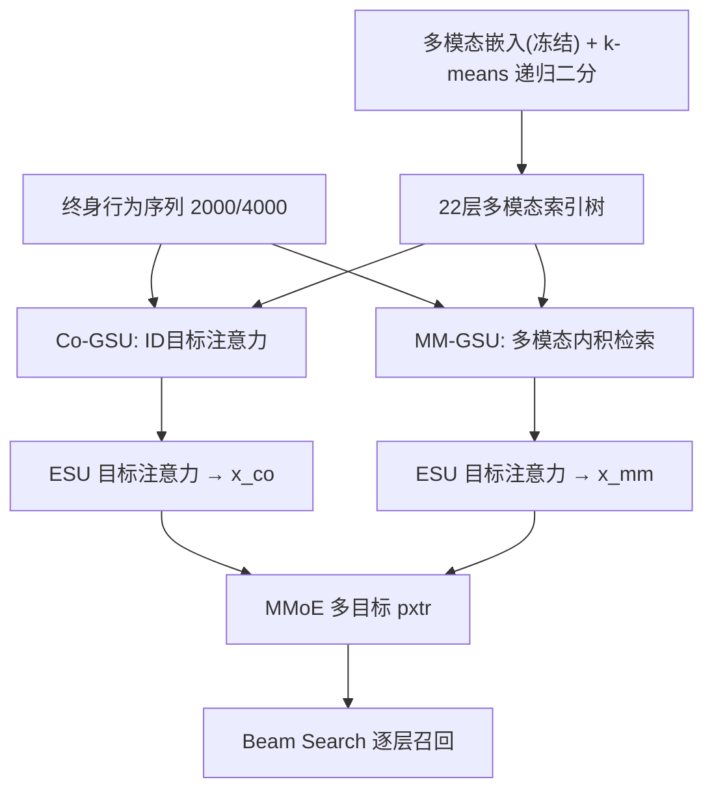
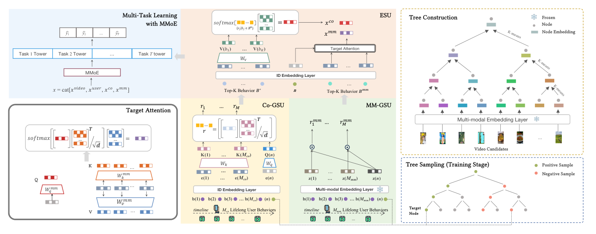

# MISS: Multi-Modal Tree Indexing and Searching with Lifelong Sequential Behavior for Retrieval Recommendation (多模态树索引与终身序列检索推荐)

- **会议/期刊**: CIKM 2025
- **作者与机构**: Chengcheng Guo, Junda She, Kuo Cai, Shiyao Wang, Qigen Hu, Qiang Luo, Kun Gai, Guorui Zhou（快手）
- **推荐链路定位**: 召回
- **研究方向**: 多模态推荐 / 序列与会话推荐
- **论文原文**: [https://arxiv.org/abs/2508.14515v1](https://arxiv.org/abs/2508.14515v1)
- **开源代码**: 暂未开源

## TL;DR (1分钟核心速览)

召回阶段长期受困于双塔晚期交互与海量候选无法使用终身行为，且多模态信息仅停留在嵌入预训练层面。MISS 首次把多模态嵌入注入树索引构建（k-means 递归二分），并在树节点打分器中并行部署协同 GSU（Co-GSU）与多模态 GSU（MM-GSU）双视角检索终身序列，再经共享参数的 ESU 与 MMoE 多目标输出。在快手 400M DAU 真实工业数据上，Recall@800 相对次优 TDM+MMoE 提升 37.93%，线上总使用时长 +0.248%。

## Background & Motivation (背景与核心矛盾)

- **主流范式**: 工业召回以 DSSM 双塔 + ANN 为主，进阶方案用树索引（TDM/JDM/BSAT）或向量量化（Streaming VQ）实现用户-候选项的早期交互；终身序列建模（SIM/TWIN）则在精排阶段成熟应用。
- **前人局限**: 其一，召回候选库达亿级，SIM 式 GSU 无法对全库候选逐一做目标注意力检索，终身行为在召回阶段几乎不可用；其二，多模态工作（AlignRec、QARM）几乎全部聚焦于"如何学好多模态嵌入"，而"如何在检索结构中用好多模态"仍是空白。
- **核心洞察 (Key Insight)**: 多模态嵌入经 item2item 对齐训练后天然具备内容+协同双重相似性，恰好满足 TDM 对"相似物品聚于同一子树"的索引要求；同时多模态空间是欧氏空间，可直接用内积做免参数的相关性检索，为 GSU 提供与 ID 协同信号互补的第二视角。
- **本文切入点**: 用多模态嵌入建树 + 用多模态/协同双通道检索终身行为，把"索引结构"与"序列建模"两个原本割裂的召回增强路线合并。

## Method (核心方法设计)

### 1. 整体框架 (Overall Architecture)

MISS 由三部分闭环构成：离线阶段用 item alignment（InfoNCE 对齐 item2item 相似对）预训练多模态嵌入，冻结后以 k-means 自顶向下递归二分构建 22 层二叉多模态索引树，非叶节点嵌入为其子树叶节点多模态嵌入的均值池化；训练阶段对每个正/负样本节点，Co-GSU 用 ID 嵌入的目标注意力从 2000 长序列中筛出 Top-K 协同子序列，MM-GSU 用多模态内积从 4000 长序列中筛出 Top-K 多模态子序列，两路经 ESU 目标注意力得到 $x_{co}$与$x_{mm}$，拼接用户/视频特征后送入 MMoE 多目标塔输出 pxtr；在线阶段以 beam search 逐层下钻，取叶层 Top-m 作为召回结果。

<figure class="paper-figure" markdown="span">
  <figcaption>图1：MISS的整体框架。a）树构建：首先基于多模态嵌入使用k-means构建多模态索引树。b）树学习：给定正样本或负样本以及终身用户行为，Co-GSU和MM-GSU会计算相关分数𝑟𝑖和𝑟𝑚𝑚</figcaption>
</figure>

### 2. 关键设计拆解 (Key Designs)

1. **多模态索引树（Multi-modal Index Tree）**：TDM 用训练后的 ID 嵌入重建树，但 ID 嵌入只含交互信号、缺失内容信息，导致相似性刻画次优。MISS 改为直接用多模态嵌入做 k-means 二分，节点嵌入取子树叶节点均值：$z_i = \text{MeanPooling}(\{c_{\pi(j)} \mid j \in \text{Leaf}(i)\})$。直觉在于多模态嵌入已被 InfoNCE 拉近"内容+协同"双重相似物品，聚类边界更贴合真实兴趣簇，且树一旦建好即冻结，避免 ID 嵌入漂移引发的索引失配。

2. **Co-GSU 与 MM-GSU 双视角检索**：单一协同信号在长序列上注意力极度稀疏（图 6 显示仅极少数 token 得高分），且易被共现偏置带偏（案例中"手机"检索出泛电子产品）。Co-GSU 沿用目标注意力 $r_i = (W_q e_n)^\top (W_k e_i)/\sqrt{d}$；MM-GSU 则直接以多模态嵌入做免参数内积$r_i^{mm} = z_n^\top z_i$，因多模态空间已是对齐的欧氏空间，无需再学投影。两路检索结果重叠率仅 13%，形成强互补：协同通道抓行为共现，多模态通道抓语义细粒度匹配。

3. **ESU 参数共享与训练目标**：ESU 对两路子序列分别做目标注意力，其中 Co-SBS 的注意力直接复用 Co-GSU 已算出的分数做 softmax，省去一次前向；MM-SBS 则用独立投影 $W_q^{mm}, W_k^{mm}, W_v^{mm}$。总损失为逐层 BCE 多目标求和：$\mathcal{L} = \sum_{t=1}^{T}\sum_{(u,y)}\sum_{h=1}^{H}\sum_{n \in S_h(y)} \text{BCE}(\tilde{y}_n, \hat{y}_n^t)$，其中伪标签$\tilde{y}_n = \mathbb{I}(\sum_{i \in \text{Leaf}(n)} y_{\pi(i)} \geq 1)$，每层正样本取全部相关节点、负样本按层采样。推理用 beam search 逐层 argTopK，无额外负采样开销。

## Experimental Setup & Evaluation Protocol (实验设置与评估协议)

- **数据集与预处理**: 快手真实工业日志，日增 500 亿条用户日志，400M DAU；全模型（含基线）均采用 streaming 在线学习范式训练，无静态 5-core 过滤。

| 数据集 | #Users | #Items | #Interactions | 稀疏度/密度 | 特征/场景说明 |
| :--- | :---: | :---: | :---: | :---: | :--- |
| Kuaishou 工业数据 | 4亿 DAU | 亿级短视频 | 500亿/天 | 极高稀疏 | 短视频推荐，含图像+文本多模态 |

- **数据划分与防穿越 (Splitting Strategy)**: 随机采样多份测试集并报告均值与方差，配合 streaming 训练天然按时间流式消费，避免未来信息泄漏。
- **排名评测协议 (Ranking Protocol)**: 采用 `Full-Ranking` 语义的 Recall@K（K=400/600/800），对全库树搜索召回结果与用户真实交互集求交；另提出分层召回 H@hRecall@K 评估 beam search 中间层（h=13/16/19）的检索质量。
- **对比基线与超参设置**: 基线含 SASRec（双塔化）、NANN（HNSW 图索引）、Kuaiformer（快手线上强基线双塔）、TDM（深度模型为 SIM）、TDM+MMoE。树高 22 层，Co-GSU 序列长 2000、MM-GSU 4000、ESU 长 50，beam size 固定。

## Key Experimental Results (实验关键数据)

### 1. 主实验对比 (Main Results)

| Method | R@800 | R@600 | R@400 |
| :--- | :---: | :---: | :---: |
| SASRec | 0.20 | 0.18 | 0.15 |
| NANN | 0.23 | 0.20 | 0.15 |
| Kuaiformer | 0.26 | 0.23 | 0.19 |
| TDM | 0.22 | 0.19 | 0.14 |
| TDM+MMoE | 0.29 | 0.26 | 0.18 |
| MISS (2k seq) | 0.38 | 0.33 | 0.26 |
| **MISS (4k seq)** | **0.40** | **0.34** | **0.28** |
| **Improv.%** | **+37.93%** | **+30.77%** | **+47.37%** |

分层召回上，MISS(4k) 在 H@13/H@16/H@19 的 R@800 分别达 0.85/0.64/0.51，相对 TDM+MMoE 提升 11.84%/52.38%/59.38%，越靠近叶层增益越大，说明多模态树把相关物品更早收敛到同一子树。

### 2. 消融实验 (Ablation Study)

| 变体 | H@13 R@800 | H@16 R@800 | H@19 R@800 | Leaf R@800 |
| :--- | :---: | :---: | :---: | :---: |
| Full MISS | 0.85 | 0.64 | 0.51 | 0.40 |
| w/o MM-GSU | 0.80 | 0.55 | 0.42 | 0.35 |
| w/o MM-GSU & Co-GSU | 0.77 | 0.48 | 0.35 | 0.30 |
| w/o 全部（ID 树替代） | 0.76 | 0.42 | 0.32 | 0.29 |

### 3. 关键实验发现 (Key Findings)

1. **多模态树是增益底座**：仅把 ID 树换成多模态树（末行 vs 倒数第二行），叶层 R@800 从 0.29 升至 0.30、H@16 从 0.42 升至 0.48，说明索引层的相似性质量对中间层检索影响远大于对叶层的影响，越粗粒度收益越显著。
2. **双 GSU 互补而非冗余**：Co-GSU 与 MM-GSU 检索结果重叠率仅 13%，移除 MM-GSU 使叶层 R@800 掉 0.05，移除 Co-GSU 再掉 0.05，两路贡献近似可加，验证了协同共现与语义匹配捕捉的是不同兴趣维度。
3. **序列长度存在明显边际递减**：MM-GSU 从 4k 扩到 8k，R@800 仅从 0.40 升至 0.41，但 GPU 数从 10 翻倍到 20、单卡 QPS 从 100 腰斩至 50，故最终取 4k 作为效率-效果平衡点；线上 A/B 中完整 MISS 带来总使用时长 +0.248%（CI [0.16%, 0.34%]）、人均时长 +0.212%，显著优于仅加多模态树的 +0.121% 与仅加多模态检索的 +0.166%。

## Highlights & Limitations (亮点、对比与审稿批判)

- **与代表作对比 (vs. Prior Work)**: 相比 TDM 仅用 ID 嵌入建树、SIM 仅在精排做 GSU，MISS 把多模态嵌入同时用于"建树"与"检索"两个环节；相比 QARM 等把多模态停留在嵌入预训练，MISS 首次让多模态参与召回索引结构本身，形成端到端的检索增强。
- **可迁移亮点**: ① 用"已对齐的冻结嵌入 + 免参数内积"做 GSU，可零成本替换任意双塔召回的第二路检索通道；② 分层召回 H@hRecall 指标能定位树模型在哪一层开始失配，是树索引调优的实用诊断工具。
- **审稿级局限批判**: ① 实验完全基于快手私有工业数据，无公开数据集复现，且基线均为内部改造版本（如 SASRec 双塔化），可比性存疑；② 多模态嵌入冻结虽省算力，但无法随业务兴趣漂移在线更新，长期可能退化；③ 22 层树 + 双 GSU 的在线开销（4k 序列、10 卡）对中小平台门槛偏高，论文未给出延迟绝对值。

## Rating (四维评分)

- **方法创新性 (Novelty)**: ⭐⭐⭐⭐ （首次将多模态嵌入同时注入树索引构建与 GSU 检索，双视角互补机制有清晰实证支撑，但各组件本身多为已有模块的组合）
- **评估协议与实验扎实度 (Protocol & Experiments)**: ⭐⭐⭐⭐ （400M DAU 工业级数据 + 7 天线上 A/B + 置信区间 + 分层召回，扎实度高，但缺公开数据集与开源复现）
- **写作与数学规范度 (Clarity & Rigor)**: ⭐⭐⭐⭐ （公式简洁、伪标签与 beam search 定义清晰，但部分符号如 $S_h(y)$ 的负采样规模未明确交代）
- **工业落地与复现价值 (Industrial & Practical Value)**: ⭐⭐⭐⭐ （已在快手全量上线并带来显著时长增益，工程价值极高，但未开源且依赖内部多模态嵌入与训练系统）

