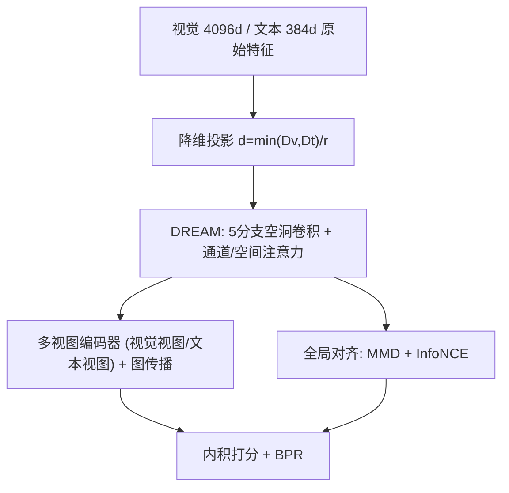
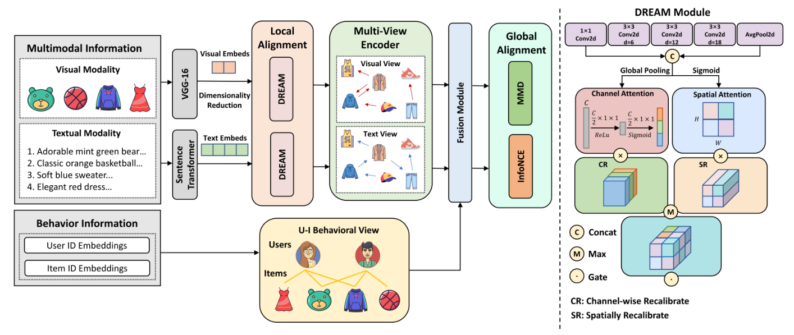

# Modality Alignment with Multi-scale Bilateral Attention for Multimodal Recommendation (多尺度双边注意力驱动的模态对齐多模态推荐)

- **会议/期刊**: CIKM 2025
- **作者与机构**: Kelin Ren, Chan-Yang Ju, Dong-Ho Lee（韩国汉阳大学 ERICA 计算机工程系 / 应用人工智能系）
- **推荐链路定位**: 召回（多模态特征融合 + 图协同过滤表征）
- **研究方向**: 多模态推荐 / 自监督与表征对齐
- **论文原文**: [https://arxiv.org/abs/2509.09114v1](https://arxiv.org/abs/2509.09114v1)
- **开源代码**: [https://github.com/rkl71/MambaRec](https://github.com/rkl71/MambaRec)

## TL;DR (1分钟核心速览)

现有多模态推荐要么用静态线性投影融合图文，要么只在图结构上做局部交互建模，导致**细粒度跨模态语义对不齐**且**模态分布存在系统性偏移**。MambaRec 从"局部+全局"双侧下手：局部用 DREAM（1×1 + 空洞率 6/12/18 的 3×3 空洞卷积 + 全局池化五分支，再叠加通道/空间双注意力）做细粒度图文匹配；全局用 MMD（高斯核 RKHS 均值嵌入距离）+ InfoNCE 约束两个模态的分布一致性；并加可配置降维因子压缩 4096 维视觉特征。在 Amazon Baby/Sports/Clothing 三数据集、8:1:1 随机划分、全库排序协议下，Recall@20 相对最强基线 LGMRec 分别提升 1.1%/7.4%/18.0%，Recall@10 最高提升 21.3%（Clothing）。

## Background & Motivation (背景与核心矛盾)

- **主流范式**: 以 MMGCN/MGCN/LGMRec 为代表的 GCN 类方法为每个模态单独构图再融合图嵌入；以 SLMRec/BM3 为代表的自监督方法用对比学习增强模态表征鲁棒性。
- **前人局限**: ① 特征提取阶段普遍依赖静态线性投影或简单拼接，无法刻画图文之间**细粒度、一对一的语义对应**（图 1(a) 中蓝/绿特征块明显错位）；② 对比类方法只约束样本级正负对，**缺乏对模态整体分布的一致性约束**，跨模态分布偏移（distribution shift）与高维特征噪声持续存在。
- **核心洞察 (Key Insight)**: 图文错配不只是"配对样本不够近"，而是**局部语义粒度不匹配 + 全局分布形状不一致**两个层面同时出问题；单靠对比损失只能治标。
- **本文切入点**: 把"对齐"拆成局部（DREAM 多尺度感受野匹配）与全局（MMD 分布匹配）两级，用同一套表征同时受两级正则约束。

## Method (核心方法设计)

### 1. 整体框架 (Overall Architecture)

物品的 4096 维 VGG16 视觉特征与 384 维 sentence-transformers 文本特征先经降维矩阵投影到统一 $d$维空间（降维因子$r$ 控制），随后送入 DREAM 做多尺度空洞卷积 + 通道/空间双注意力的局部对齐，输出增强后的图文特征；再经 MGCN 式多视图编码器分别生成视觉视图与文本视图，在用户-物品交互图上做 LightGCN 式传播得到协同表征；全局侧对两模态特征施加 MMD 与 InfoNCE 联合正则；最终用户/物品融合表征内积打分，BPR + 辅助损失联合优化。

<figure class="paper-figure" markdown="span">
  <figcaption>图 2：所提出的 MambaRec 的整体架构，包含三个关键组件。(i) 局部对齐在图像和文本的局部特征之间进行细粒度匹配。(ii) 全局对齐在全局分布层面确保不同模态之间的一致性。(iii) 在对齐之前引入降维机制，以压缩高维视觉特征并降低内存开销。</figcaption>
</figure>

### 2. 关键设计拆解 (Key Designs)

1. **DREAM 空洞精炼注意力（局部对齐）**：痛点是用单一 3×3 卷积的感受野无法同时覆盖"局部纹理"与"长程语义块"。DREAM 并行五分支——$1\times1$卷积、空洞率$\{6,12,18\}$的$3\times3$空洞卷积、全局平均池化后上采样——沿通道拼接得$F=\mathrm{Concat}_c(F_1,\dots,F_5)$，再分别算通道注意力$M_c=\sigma(W_2\delta(W_1(z)))$与空间注意力$M_s=\sigma(f^{1\times1}(P))$，最后用**逐元素取最大**而非相加融合：$Y=\mathcal{M}(F\otimes M_c,\;F\otimes M_s)$。取 max 的直觉是让每个位置自适应选择"通道显著"还是"空间显著"的那一路响应，避免两路注意力互相稀释；空洞卷积在不增加参数的前提下把感受野扩到覆盖整幅特征图，从而在局部算子内同时拿到多粒度上下文。

2. **MMD + InfoNCE 全局分布对齐**：对比损失只拉近配对样本、管不住分布形状。本文引入 MMD 在 RKHS 中比较两模态的均值嵌入：$\mathrm{MMD}^2(V,T)=\big\|\tfrac{1}{N}\sum_i\phi(v_i)-\tfrac{1}{N}\sum_j\phi(t_j)\big\|^2_{\mathcal{H}}$，用高斯核$k(v,t)=\exp(-\|v-t\|^2/2\sigma^2)$展开为核矩阵形式，直接最小化两个模态特征云的"整体形状差"；InfoNCE 作为样本级补充。总对齐损失$\mathcal{L}_{align}=\lambda_{mmd}\mathcal{L}_{MMD}+\lambda_{cl}\mathcal{L}_{InfoNCE}$。物理直觉：MMD 是分布层面的"重心+高阶矩"匹配，能压掉模态特有的系统性偏移（mode-specific deviation），而 InfoNCE 保证判别性不被抹平。

3. **降维优化与训练目标**：高维视觉特征是显存杀手。用 $V'=VW_V,\;T'=TW_T$投影，目标维度$d=\lfloor \min(D_V,D_T)/r\rfloor$，$r=8$时参数降 30% 以上而 Recall@20 反升（压缩同时起到去噪正则作用）。总损失$\mathcal{L}=\mathcal{L}_{BPR}+\lambda_{cl}\mathcal{L}_{cl}+\lambda_{mmd}\mathcal{L}_{mmd}+\lambda_{reg}\|\Theta\|_2^2$，其中$\mathcal{L}_{BPR}=\sum_{(u,i,j)\in O}-\log\sigma(\hat{y}_{ui}-\hat{y}_{uj})$。负采样为标准 BPR 均匀采样，无额外难负样本挖掘；推理为内积全库排序，无额外在线开销。

## Experimental Setup & Evaluation Protocol (实验设置与评估协议)

- **数据集与预处理**: Amazon 三个类目，均按 **5-core** 过滤用户与物品；视觉用预训练 VGG16 提 4096 维，文本用 sentence-transformers 对 title+description+category+brand 拼接提 384 维。

| 数据集 | #Users | #Items | #Interactions | 密度 | 场景说明 |
| :--- | :---: | :---: | :---: | :---: | :--- |
| Baby | 19,445 | 7,050 | 160,792 | 0.117% | 母婴，图文信息丰富 |
| Sports | 35,598 | 18,357 | 296,337 | 0.045% | 运动户外，类目跨度大 |
| Clothing | 39,387 | 23,033 | 278,677 | 0.031% | 服饰鞋饰，视觉主导、最稀疏 |

- **数据划分与防穿越 (Splitting Strategy)**: 沿用 LGMRec/MGCN/FREEDOM 的设定，对每个用户交互历史按 **8:1:1 随机划分**训练/验证/测试，非全局时间戳切分。
- **排名评测协议 (Ranking Protocol)**: 采用 **Full-Ranking（全库未交互物品排序）**，报告 Recall@{10,20} 与 NDCG@{10,20}，对测试集全体用户取平均。
- **对比基线与超参设置**: 基线含通用模型 BPR、LightGCN 与多模态模型 VBPR、MMGCN、GRCN、SLMRec、FREEDOM、MGCN、LGMRec；统一基于 MMRec 框架、RTX4090 复现，嵌入维度 $d=64$，Xavier 初始化，batch=2048，lr=0.001（每 50 epoch 衰减 0.96），验证集 Recall@20 连续 20 轮不升即早停；$\lambda_{cl}=0.01$，$\lambda_{mmd}\in[0.1,0.2]$，高斯核带宽$\sigma\in[1.0,2.0]$，降维因子$r=8$；显著性用$t$-test，$p<0.01$。

## Key Experimental Results (实验关键数据)

### 1. 主实验对比 (Main Results)

| 数据集 | 指标 | BPR | LightGCN | VBPR | SLMRec | FREEDOM | MGCN | LGMRec | **MambaRec** | Improv.% vs 最优基线 |
| :--- | :--- | :---: | :---: | :---: | :---: | :---: | :---: | :---: | :---: | :---: |
| Baby | R@10 | 0.0382 | 0.0453 | 0.0425 | 0.0545 | 0.0627 | 0.0620 | 0.0644 | **0.0660** | +2.5% |
| Baby | R@20 | 0.0595 | 0.0728 | 0.0663 | 0.0837 | 0.0992 | 0.0964 | 0.1002 | **0.1013** | +1.1% |
| Baby | N@20 | 0.0263 | 0.0317 | 0.0284 | 0.0371 | 0.0424 | 0.0427 | 0.0440 | **0.0454** | +3.2% |
| Sports | R@10 | 0.0417 | 0.0542 | 0.0561 | 0.0676 | 0.0717 | 0.0729 | 0.0720 | **0.0763** | +4.7% |
| Sports | R@20 | 0.0633 | 0.0837 | 0.0857 | 0.1017 | 0.1089 | 0.1106 | 0.1068 | **0.1147** | +3.7% |
| Sports | N@20 | 0.0288 | 0.0376 | 0.0384 | 0.0462 | 0.0481 | 0.0496 | 0.0480 | **0.0514** | +3.6% |
| Clothing | R@10 | 0.0200 | 0.0338 | 0.0281 | 0.0461 | 0.0629 | 0.0641 | 0.0555 | **0.0673** | +5.0% |
| Clothing | R@20 | 0.0295 | 0.0517 | 0.0410 | 0.0696 | 0.0941 | 0.0945 | 0.0828 | **0.0996** | +5.4% |
| Clothing | N@20 | 0.0135 | 0.0230 | 0.0190 | 0.0308 | 0.0420 | 0.0428 | 0.0371 | **0.0449** | +4.9% |

### 2. 消融实验 (Ablation Study)

| 变体 | Baby R@20 | Sports R@20 | Clothing R@20 | 说明 |
| :--- | :---: | :---: | :---: | :--- |
| MambaRec (Full) | **0.1013** | **0.1147** | **0.0996** | 完整模型 |
| w/o LA（去局部对齐/DREAM） | 显著下降（图 3） | 显著下降 | 显著下降 | 降幅最大，局部对齐最关键 |
| w/o GA（去全局对齐） | 下降（图 3） | 下降 | 下降 | 降幅次之，分布正则仍有贡献 |
| 仅文本模态 | 0.0863 | 0.1024 | 0.0900 | 文本语义属性更强 |
| 仅视觉模态 | 0.0761 | 0.0852 | 0.0627 | 视觉单独最弱，Clothing 尤甚 |
| 图文全模态 | **0.1013** | **0.1147** | **0.0996** | 双模态互补最优 |

### 3. 关键实验发现 (Key Findings)

1. **局部对齐是主引擎，全局对齐是增益器**：去掉 DREAM 的性能跌幅明显大于去掉 MMD+InfoNCE，说明细粒度语义匹配是融合质量的第一瓶颈；但两者叠加才使 Clothing 的 R@20 从 LGMRec 的 0.0828 跃至 0.0996（+20.3%），证明"局部对齐 + 全局分布约束"存在互补而非冗余。
2. **越稀疏、越视觉主导的数据集收益越大**：Clothing 密度仅 0.031%，MambaRec 相对最优基线的 R@20 提升 5.4%，而 Baby（密度 0.117%）仅 1.1%；同时 Clothing 上"仅视觉"模态 R@20 只有 0.0627，说明高维视觉噪声在该场景最严重，降维 + 对齐的去噪价值被放大。
3. **降维因子 $r=8$是性能与开销的甜点**：$r=8$时 Recall@20 达到峰值，同时参数量下降 30% 以上、计算时间显著缩短；过度压缩（更大$r$）表征能力不足导致性能下滑，不压缩则显存与过拟合双重承压——压缩本身起到了抑制噪声的正则作用。超参上$\lambda_{cl}=0.01$、$\lambda_{mmd}=0.15$ 为稳定最优区间，过大则辅助任务主导训练、削弱 BPR 主目标。

## Highlights & Limitations (亮点、对比与审稿批判)

- **与代表作对比 (vs. Prior Work)**: 相比 MGCN/LGMRec 这类"构图 + 线性投影融合"路线，本文把对齐做进了特征提取算子内部（DREAM），而非事后在图嵌入上补救；相比 SLMRec/BM3 只做样本级对比，本文额外引入 MMD 约束**分布形状**，直接针对跨模态 distribution shift；相比 FREEDOM 靠冻结图省显存，本文用可配置降维因子在特征侧压缩，思路更轻量。
- **可迁移亮点**: ① "逐元素取 max 融合通道/空间双注意力"是一个廉价且即插即用的注意力融合技巧，可移植到任何双路注意力模块；② 把 MMD 作为分布级正则引入多模态融合，可低成本迁移到跨域推荐、多行为建模等存在分布偏移的场景。
- **审稿级局限批判**: ① 全局对齐需在每 batch 内计算 $N\times N$高斯核矩阵，$O(N^2)$ 复杂度在万级 batch 下显存与时间开销未做量化分析，论文只给了降维带来的节省，未给端到端训练时长对比；② 评估仅限 Amazon 三个 5-core 子集与随机 8:1:1 划分，缺少时间切分与冷启动分桶实验，"缓解冷启动"的主张缺乏直接证据；③ 方法名 MambaRec 与 Mamba(SSM) 无任何技术关联，命名易误导；DREAM 的超参（空洞率 6/12/18、五分支结构）直接沿用 DeepLabV3 ASPP 设定，未做分支数/空洞率的消融。

## Rating (四维评分)

- **方法创新性 (Novelty)**: ⭐⭐⭐ （局部多尺度空洞注意力 + 全局 MMD 分布对齐的组合有新意，但各组件均为成熟模块的跨领域移植，缺少理论层面的对齐保证）
- **评估协议与实验扎实度 (Protocol & Experiments)**: ⭐⭐⭐ （三数据集 + 9 个基线 + Full-Ranking + $t$ 检验较规范，但划分单一、缺冷启动与效率的端到端量化）
- **写作与数学规范度 (Clarity & Rigor)**: ⭐⭐⭐ （公式与符号基本清晰，但 Lyapunov 式排版错误较多、MMD 核带宽选择未给依据、部分符号前后不一致）
- **工业落地与复现价值 (Industrial & Practical Value)**: ⭐⭐⭐⭐ （代码已开源、基于 MMRec 框架易复现，降维因子提供了明确的显存-性能调节旋钮，工程可部署性强）

